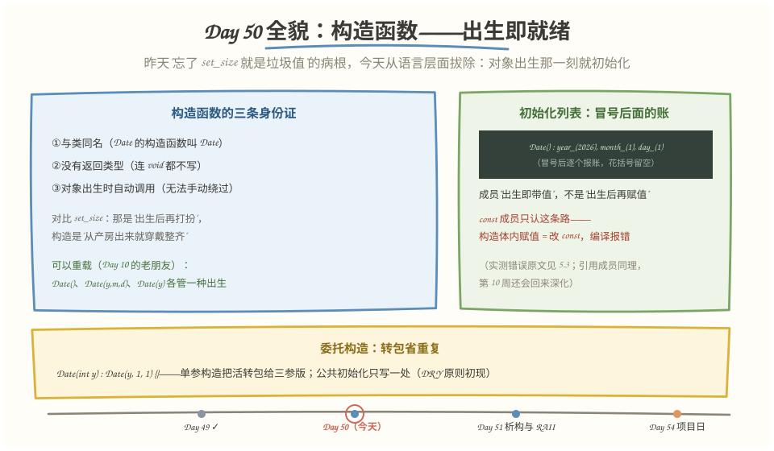
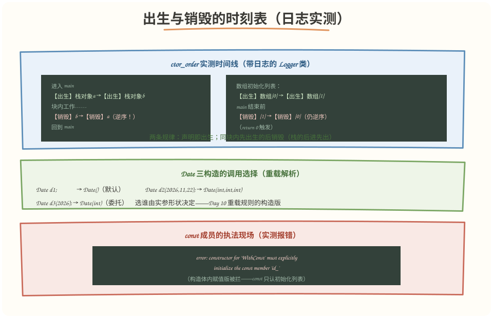
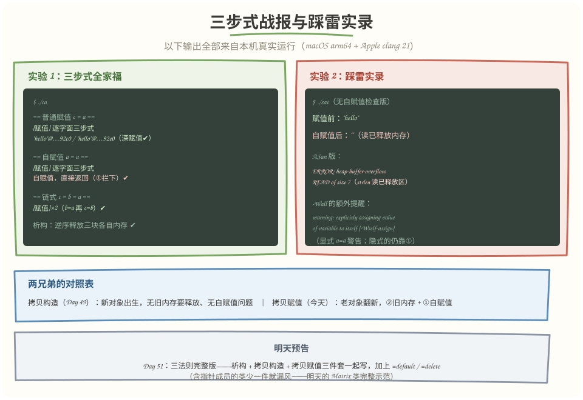

# 第 50 天：构造函数——出生即就绪

> **今日目标**：完成本教程后，你能做到：写出与类同名、无返回类型的构造函数并用初始化列表初始化成员；用重载提供多种构造方式（默认/三参/委托）；解释初始化列表与构造体内赋值的差别（const 成员只认前者，实测报错）；用日志类观察对象出生与销毁的时刻表（逆序销毁）。
> **预计时间**：学习 25 分钟＋实践 45 分钟
> **前置准备**：完成 Day 49（类的基本结构；昨天"忘了 set_size"的隐患是今天的病灶）。
> **今日产出**：Date 类四种构造实测、Logger 出生销毁时刻表、一次 const 成员的编译错误执法记录。

## 1. 今天解决什么问题？

昨天的 Rectangle 有个隐患：`Rectangle r;` 之后忘了 `set_size` 就调 `area()`——输出垃圾值。根源是"对象出生时数据没着落"。今天的问题：**能不能让对象一出生就初始化好**？构造函数（constructor）就是答案：与类同名、无返回类型、对象创建时**自动**调用——想忘都忘不了。

三个进阶配套：**初始化列表**（冒号后报账，成员出生即带值——const 成员只认这条路）；**构造函数重载**（多种出生方式）；**委托构造**（一个构造把活转包给另一个，公共逻辑只写一处）。计划指定的练习 Date 类的多种构造方式正好全覆盖。

## 2. 先看全貌：今天的内容位于哪里？



**图 1**：左卡是构造函数的三条身份证（同名/无返回/自动调用）；右卡是初始化列表的语法和 const 红线（实测报错预告）；下方黄卡是委托构造（`Date(int y) : Date(y, 1, 1) {}`——转包省重复，DRY 原则初现）。

三步概括今天：

1. 构造函数：同名、无返回、出生自动调用，可重载出多种；
2. 初始化列表：`: 成员(值), 成员(值) {}`——const/引用成员唯一合法的初始化方式；
3. 委托构造：冒号后调另一个构造，公共初始化只写一处。

## 3. 核心概念：先用直觉，再给准确定义

### 3.1 构造函数：产房里的第一套动作

- **一句通俗解释**：构造函数是对象出生时自动执行的一段代码——负责让对象"从产房出来就穿戴整齐"。
- **一个类比**：新生儿出生登记——姓名、脚印、疫苗第一针在产房一次完成，不存在"先出生、手续回头补"。
- **对应到技术上是**：`Date d2(2026, 11, 22);` 声明的瞬间 `Date(int,int,int)` 被调用，三个成员即时就位。本机实测四种出生各得其所（默认/三参/委托/非法退回默认）。类比的边界：构造函数里也能放校验（今天 Date 的非法日期退回默认）——**不变量从出生就开始保护**，比 Day 49 的 set_size 校验更早一步。
- **与 Day 10 的连接**：构造函数重载的解析规则就是函数重载——实参形状决定选谁（`Date d3(2026)` 匹配单参版）。
- **常见误解**："构造函数可以手动调用"——不行；它只在对象创建时自动触发（这也是它可靠的原因：绕不过去）。

### 3.2 初始化列表：出生即带值 vs 出生后再赋值

- **一句通俗解释**：初始化列表让成员**在出生的那一刻**带上初值；构造体内赋值是"先默认出生、再改值"——两步。
- **一个类比**：出生证直接写好名字（列表）vs 先发空白证再涂改（赋值）——涂改 const 证？不行。
- **对应到技术上是**：`Date() : year_(2026), month_(1), day_(1) {}`——冒号后逐个报账。**红线实测**：把 const 成员的初始化写成构造体内赋值，编译器直接拦下：`error: constructor for 'WithConst' must explicitly initialize the const member 'id_'`——const 成员出生后不许改，赋值版等于让它"先随机出生再改"，语言不允许。类比的边界：对 int 这类普通成员两种写法结果一样（今天可随意）；差别在 const/引用成员（只有列表合法）和性能（类成员少一次默认构造）——**习惯上统一用列表**，一劳永逸。
- **常见误解**："列表里的顺序决定初始化顺序"——不是；初始化顺序永远按**成员声明顺序**（列表只是报账单，顺序坑在进阶时再深挖）。

### 3.3 委托构造：转包省重复

- **一句通俗解释**：一个构造函数把初始化的活转包给另一个构造函数，自己只补充差异。
- **一个类比**：分店开业——总部流程（三参构造）全盘照做，分店只挂自己的招牌（年份）。
- **对应到技术上是**：`Date(int y) : Date(y, 1, 1) {}`——单参版转包给三参版；公共初始化逻辑只存在于三参版一处（DRY：Don't Repeat Yourself 的第一次正式亮相）。类比的边界：委托要放在初始化列表的位置（冒号后调构造），且**不能同时又自己初始化成员**（要么全转包要么自己干）。
- **常见误解**："委托就是调用"——位置和语义都特殊：它是"我出生前先按别人的方式出生一遍"，不是普通函数调用。

## 4. 图解核心机制



**图 2**：上半部分是 Logger 类的时刻表实测——进 main 后 a、b 顺序出生；**出块时逆序销毁**（栈的后进先出）；数组元素同样"初始化列表顺序出生、逆序销毁"。中间绿卡是三构造的重载选择表（实参形状定去向——Day 10 规则的构造版）；下方红卡是 const 成员的执法现场（初始化列表是唯一合法通道）。

按图逐步讲：

1. **看时刻表记两条规律**：声明即出生（不是用到才出生）；同块内先出生的后销毁——第 10 周析构函数的主角戏码今天先看预告片；
2. **三构造看实参**：无参→默认、三参→完整版、单参→委托版；测试非法输入（13 月 99 日）验证了构造期校验；
3. **红线只在列表**：const 成员的执法错误原文值得抄录——它把"两种初始化的差别"从风格问题升级成了合法性问题；
4. **出生即就绪的意义**：昨天的隐患（忘 set_size）今天从语言层面不存在——"忘"这个动作没有发生的机会。

## 5. 动手实践：完成一个最小可运行例子

### 5.1 准备文件

```bash
cd ai-compiler-roadmap/tutorials/day-038/examples
```

三个程序：`date_class.cpp`、`ctor_order.cpp`、`init_list_vs_assign.cpp`。

### 5.2 编写代码

主角 `date_class.cpp` 的三种构造（完整代码见本目录）：

```cpp
class Date {
private:
    int year_;
    int month_;
    int day_;

    bool is_valid(int y, int m, int d) const {     // 私有工具：校验日期
        if (y < 1 || m < 1 || m > 12 || d < 1 || d > 31) {
            return false;
        }
        return true;
    }

public:
    Date() : year_(2026), month_(1), day_(1) {}    // 默认构造（初始化列表）

    Date(int y, int m, int d) : year_(y), month_(m), day_(d) {
        if (!is_valid(y, m, d)) {                  // 非法日期退回默认
            year_ = 2026; month_ = 1; day_ = 1;
        }
    }

    Date(int y) : Date(y, 1, 1) {}                 // 委托构造：转包给三参版
    …
};
```

注意校验工具 `is_valid` 放在 private 区——外界不需要知道校验的存在，只需要知道"非法日期进不来"（Day 49 的藏法）。

### 5.3 运行与观察

```bash
g++ -Wall date_class.cpp -o dc && ./dc
```

实际执行结果（本机）：

```text
d1（默认）　：2026-1-1
d2（三参）　：2026-11-22
d3（委托）　：2026-1-1
d4（非法）　：2026-1-1
```

```bash
g++ -Wall ctor_order.cpp -o co && ./co
```

```text
进入 main
  【出生】栈对象a
  【出生】栈对象b
  块内工作……
  【销毁】栈对象b
  【销毁】栈对象a
回到 main
  【出生】数组[0]
  【出生】数组[1]
main 结束前
  【销毁】数组[1]
  【销毁】数组[0]
```



**图 3**：左上 Date 四种出生（非法日期被拦）；右上 Logger 时刻表（逆序销毁规律）；下半红卡是初始化列表红线（正确版输出 `id=7`，赋值版被编译器拦截）。

### 5.4 修改一行再观察：红线的亲测

把 `init_list_vs_assign.cpp` 里注释的赋值版构造放开（预期编译失败，本机实测）：

```text
error: constructor cannot be redeclared
error: constructor for 'WithConst' must explicitly initialize the const member 'id_'
```

两条错误读出两层意思：同签名构造只能有一个（先把正确版注释掉才能试错版）；**const 成员必须在初始化列表里初始化**——赋值版等于"先让它随便出生再改"，语言直接禁止。把正确版恢复，编译通过输出 `id = 7`——一错一对，红线落地。

## 6. 常见错误与排查

**错误 1：`error: constructor cannot be redeclared`**

- 现象：写了两个签名相同的构造函数；
- 原因：重载要求参数不同——两个 `WithConst(int, int)` 撞车；
- 定位：报错指向第二个构造；
- 修复：改参数个数/类型，或删一个。

**错误 2：`must explicitly initialize the const member`**

- 现象：const 成员想用构造体内赋值；
- 原因：const 出生后不许改——赋值是改；
- 定位：报错点名成员名；
- 修复：挪进初始化列表（`: id_(i)`）。

**错误 3：对象数组只初始化了一部分**

- 现象：`Date arr[2] = {Date(2026,1,1)};` 第二个元素是垃圾？
- 原因：其实不会——数组剩余元素会**调用默认构造**补齐（前提：默认构造存在）；
- 定位：删掉默认构造再试，编译器会要求完整初始化；
- 修复：类有数组使用场景时保留默认构造（或用今天 Logger 数组的完整列表写法）。

## 7. 今日练习

### 必做练习（计划指定：Date 类多种构造）

给 Date 再加两个构造：`Date(int y, int m)`（委托给三参，日默认 1）和拷贝式构造 `Date(const Date& other)`（照抄另一个 Date——拷贝构造的正式登场在第 11 周，今天先混脸熟）。预期产出：五种出生各打印一行，非法输入仍被拦。

### 选做挑战

给昨天的 Rectangle 补上构造函数族：`Rectangle()`（默认 1×1）、`Rectangle(double w, double h)`（校验非负）、`Rectangle(double side)`（正方形，委托给双参版）。然后用一行 `Rectangle pool(25, 10);` 验证"声明即就绪"——不再需要 set_size。

## 8. 今日验收

- [ ] 我能默写构造函数的三条身份证（同名/无返回/自动调用）
- [ ] 我的 Date 有默认/三参/委托三种构造，非法日期被拦（实测）
- [ ] 我实测了 const 成员的红线：赋值版编译失败、列表版通过
- [ ] 我用日志类观察了出生与逆序销毁的时刻表
- [ ] 我能给昨天的 Rectangle 补上"声明即就绪"的构造函数

## 9. 一句话总结与明天预告

今天的问题是"对象出生时的垃圾值怎么根除"；机制上，构造函数同名无返回自动调用，初始化列表让成员出生即带值（const 只认此路），委托构造转包省重复；实践上，Date 四种出生、Logger 时刻表、红线执法全部实测；验证标准是任何对象声明语句都能说出"哪个构造被调了、成员初值是什么"。明天 **Day 51：析构函数与 RAII 思想**——出生的另一半故事：对象销毁时自动收摊；FileGuard 自动关文件，"忘了 cleanup"和"忘了 set_size"一样绝迹。
