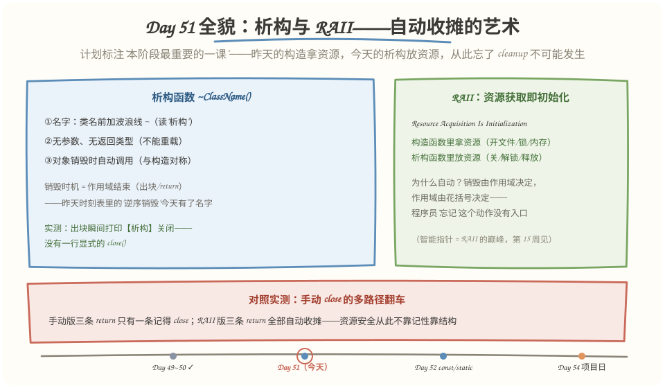
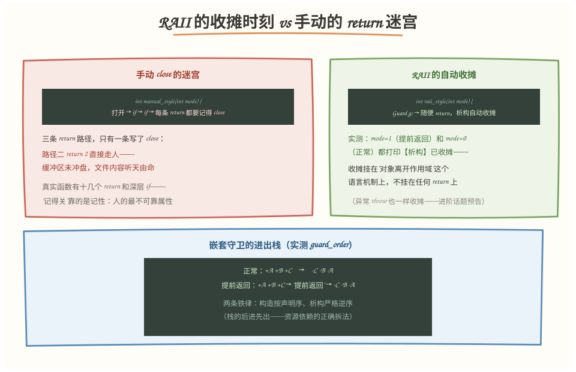
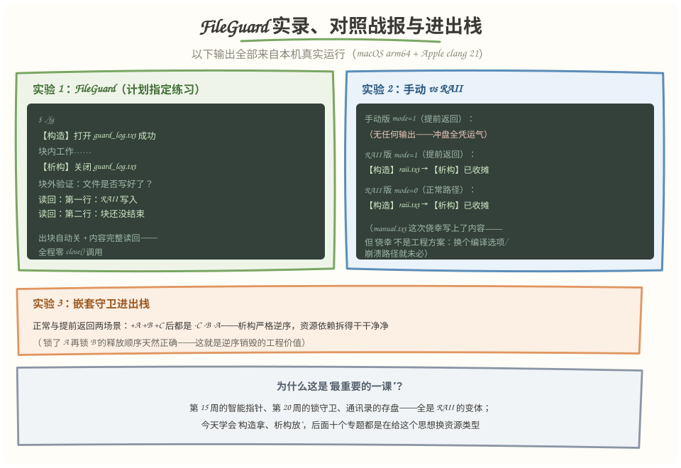

# 第 51 天：三法则——含指针成员的类的三件套

> **今日目标**：完成本教程后，你能做到：说出三法则（析构 + 拷贝构造 + 拷贝赋值）和"缺哪件漏什么"；判断一个类需不需要三件套（有裸指针 → 要；纯值成员 → 零法则）；用 `=default` 显式要默认版、用 `=delete` 禁止拷贝（实测编译拦截）；把 Day 39~50 的拷贝控制知识串成完整地图。
> **预计时间**：学习 20 分钟＋实践 40 分钟
> **前置准备**：完成 Day 49~50（昨天两兄弟今天打包）。
> **今日产出**：三件套联动的 Buffer 类（全场景日志）、`=default`/`=delete` 两种控制的实测记录。

## 1. 今天解决什么问题？

Day 49（拷贝构造）、Day 50（拷贝赋值）各讲了一件；今天把它们和析构（Day 39/46）打包成**三法则**（Rule of Three）：**类自己管理资源（裸指针成员）时，三件套必须一起写**——缺①double free、缺②踩自雷、缺③泄漏。这三天的坑今天在"漏风模型"里各归各位。

配套两个精确控制工具：`T(…) = default`（显式要编译器的默认版——意图清晰）和 `T(…) = delete`（禁止某操作——NoCopy 类实测编译拦截）。Day 39 FileGuard 的"想禁拷贝"思想今天正式武器化。

## 2. 先看全貌：今天的内容位于哪里？



**图 1**：左卡是三件套清单（①②③各标注出处和"不写会漏什么"）；右卡绿是判断法（有裸指针 → 三件套；纯值成员 → 零法则）；下方黄卡是 `=default`/`=delete` 的精确控制。

三步概括今天：

1. 三法则：析构 + 拷贝构造 + 拷贝赋值一起写——含裸指针的类缺一漏风；
2. 零法则优先：能 string/vector 就不用裸指针（默认版就够）；
3. `=default` 要默认、`=delete` 禁操作——意图写进类型。

## 3. 核心概念：先用直觉，再给准确定义

### 3.1 三法则：资源管理的三件套

- **一句通俗解释**：类自己 new 的内存要自己负责到底——怎么造（构造）、怎么复印（拷贝构造）、怎么翻新（拷贝赋值）、怎么还（析构），复印和翻新和还要**一起**管。
- **一个类比**：租房合同三条款——退房时恢复原状（析构）、转租要重签新约而非复制钥匙（拷贝构造）、换租客要清旧物再搬新（拷贝赋值）——少一条房东和租客必有一方吃亏。
- **对应到技术上是**：实测 Buffer 类三件全写——`b = a` 打拷贝构造日志、`c = a` 打拷贝赋值日志、退出时三次析构逆序释放三个**不同**地址（深拷贝 ✔ 无泄漏 ✔）。漏风模型：缺①→Day 49 的 ShallowString（double free）、缺②→Day 50 的 NoCheck（自赋值踩雷）、缺③→Day 46 的静默泄漏。类比的边界：三法则管的是**拷贝语义**；Day 111 的五法则加上移动（move）——"偷资源"比"抄资源"更快的场景。
- **常见误解**："三个都要手写"——先问能不能零法则（换 string/vector）；必须裸指针才手写三件套。
- **与零法则的分工**：Day 49 选做已实证（ShallowString 换 std::string 后默认版全安全）——**第一防线永远是"不用裸指针"**。

### 3.2 =default：显式要默认

- **一句通俗解释**：`= default` 告诉编译器"这个特殊函数我确认要自动版"——比不写更清晰地表达意图。
- **一个类比**：表格上的"同上"——不是不填，是明确表示"和默认一致"。
- **对应到技术上是**：Widget 类四个特殊函数全 `= default`——成员只有 string 和 int（值语义），默认版逐成员处理已安全；显式写出来读代码的人一眼知道"作者想过这件事"。类比的边界：`= default` 的函数体由编译器生成——你写不了自定义逻辑；要自定义就正常写函数体（Day 49~50 的手写版）。
- **常见误解**："`= default` 和不写一样"——行为一样，**意图表达**不一样；团队协作时显式声明避免"作者忘了还是想清楚了"的猜疑。

### 3.3 =delete：类型级禁止

- **一句通俗解释**：`= delete` 把某操作**从类型系统里删掉**——任何调用直接编译错误，不是运行时警告。
- **一个类比**：门上焊死钢板（=delete）vs 挂"请勿入内"牌子（文档约定）——前者物理上进不来。
- **对应到技术上是**：实测 NoCopy 类——`NoCopy n2 = n1;` 编译报 `error: call to deleted constructor of 'NoCopy'`；`n3 = n1` 报 `no matching constructor`。两条执法线都在编译期——调用方写代码时就被拦住。类比的边界：`= delete` 不只用于拷贝——任何成员函数都能删（比如禁止 `new` 的类 `static void* operator new(std::size_t) = delete;`——进阶）；今天先掌握最常见的禁拷贝。
- **什么时候禁拷贝**：资源唯一性的类——文件守卫（FileGuard，Day 39 练习已遇）、锁、单例（明天主角）。拷贝它们语义上就不对：两个守卫关同一文件 = double close。
- **常见误解**："禁了拷贝就没法用"——能构造、能调成员函数、能传**引用/指针**；只是不能复制值。

## 4. 图解核心机制



**图 2**：上半部分蓝卡是 Buffer 的完整生命周期——一次 main 里 ①②③ 全部登场（构造→拷贝构造→拷贝赋值→析构×3 逆序）；左下红卡是漏风模型（缺①②③各漏什么，对应三天的实测案例）；右下绿卡是 `=delete` 的执法记录（两条编译错误原文）。

按图逐步讲：

1. **看生命周期数三件**：拷贝构造在 `b = a` 处、拷贝赋值在 `c = a` 处、析构在退出处——**一次 main 全触发**，这解释了为什么三件必须配套；
2. **看漏风模型对照**：三天的坑各对应一件缺失——今天的图就是第 9 周前三天的总复习表；
3. **`=delete` 的价值在编译期**：错误在调用方写代码时就报出来（IDE 红线）——比运行时崩溃提前了整整一个阶段；
4. **判断顺序**：先问能否零法则 → 必须裸指针再三件套 → 不许拷贝用 `=delete`——三步决策树背下来。

## 5. 动手实践：完成一个最小可运行例子

### 5.1 准备文件

```bash
cd ai-compiler-roadmap/tutorials/day-051/examples
```

两个程序：`rule_of_three.cpp`（三件套联动）、`default_delete.cpp`（两种控制）。

### 5.2 编写代码

`rule_of_three.cpp` 的三件套骨架（完整代码见本目录）：

```cpp
class Buffer {
private:
    char* data_;
    std::size_t len_;

public:
    Buffer(const char* s) : len_(strlen(s)) {         // 出生
        data_ = new char[len_ + 1];
        memcpy(data_, s, len_ + 1);
    }

    Buffer(const Buffer& other) : len_(other.len_) {  // ①拷贝构造（Day 49）
        data_ = new char[len_ + 1];
        memcpy(data_, other.data_, len_ + 1);
    }

    Buffer& operator=(const Buffer& other) {          // ②拷贝赋值（Day 50）
        if (this == &other) { return *this; }         //   自赋值检查
        delete[] data_;                               //   释放旧
        len_ = other.len_;
        data_ = new char[len_ + 1];
        memcpy(data_, other.data_, len_ + 1);
        return *this;
    }

    ~Buffer() { delete[] data_; }                     // ③析构
};
```

### 5.3 运行与观察

```bash
g++ -Wall rule_of_three.cpp -o rot && ./rot
```

实际执行结果（本机）：

```text
== 三件套全上场 ==
  [构造] hello
  [拷贝构造] hello
  [构造] world
  [拷贝赋值] hello

== 出块统一析构 ==
  [析构] 释放 0x1030312e0
  [析构] 释放 0x1030312d0
  [析构] 释放 0x1030312c0
```

```bash
g++ -Wall default_delete.cpp -o dd && ./dd
```

```text
== Widget（=default 全家桶） ==
  普通 #1

== NoCopy（=delete 禁拷贝） ==
  secret!
  （两行注释的取消注释版会编译失败——见 5.4 实测）
```



**图 3**：左上三件套联动（三个不同地址 + 逆序析构 = 深拷贝无泄漏双证）；右上是两种控制的战报；下方橙卡是本周战役图、灰卡预告明天。

### 5.4 修改一行再观察：=delete 的执法亲测

**执法一（禁拷贝构造）**：把 `default_delete.cpp` 里 `NoCopy n2 = n1;` 的注释放开（预期编译失败，本机实测）：

```text
error: call to deleted constructor of 'NoCopy'
```

**执法二（禁拷贝赋值）**：把 `NoCopy n3; n3 = n1;` 的注释放开（预期编译失败，本机实测）：

```text
error: no matching constructor for initialization of 'NoCopy'
```

**对照实验**：把 NoCopy 的两行 `= delete` 改成 `= default`——两条都编译通过。**一改一对，`=delete` 的拦截力实测**。注意第二条错误的措辞：赋值被删后连"构造 n3 的默认构造"都找不到了（`= delete` 拷贝构造时默认构造也被抑制——编译器不再生成；修法是补 `NoCopy() = default;` 或用带参构造）。

## 6. 常见错误与排查

**错误 1：`error: call to deleted constructor / no matching constructor`**

- 现象：复制被 `=delete` 的类对象；
- 原因：拷贝构造/赋值被删——类型设计如此；
- 定位：看类声明里的 `= delete` 行；
- 修复：不复制——传引用/指针；确要复制找类作者（或自己）改设计。

**错误 2：写了 `= delete` 拷贝构造后连默认构造都报错**

- 现象：`NoCopy n3;` 也编译失败；
- 原因：声明了拷贝构造（哪怕是 =delete）会抑制默认构造的自动生成；
- 定位：错误提到 no matching constructor；
- 修复：补 `NoCopy() = default;`（今天 NoCopy 有带参构造所以本来就没默认构造——这是"声明任何构造函数都抑制默认构造"的老规则）。

**错误 3：手写三件套后发现某个场景多了次拷贝**

- 现象：拷贝构造日志出现次数比预期多；
- 原因排查：值传参每次都拷贝（Day 49 场景②）；RVO 被关或跨编译器；
- 定位：逐场景打日志（今天的方法）；
- 修复：传 `const T&`（省拷贝）；或接受拷贝（语义正确即可）。

## 7. 今日练习

### 必做练习

把 Day 49 的 DeepString 和 Day 50 的 MyString 合并成完整版：三件套全手写 + 每件打日志，跑今天 5.3 的全场景。预期产出：三场景日志（构造/拷贝构造/拷贝赋值/析构）+ 三个不同地址 + 逆序释放——一张"三件套体检报告"。

### 选做挑战

给 Buffer 加 `void swap(Buffer& other) noexcept` 成员（交换 data_ 和 len_），然后把拷贝赋值改成 copy-and-swap 版：`Buffer& operator=(Buffer other) { swap(other); return *this; }`。跑三场景验证全过——自赋值天然安全（拷贝出来的临时对象和自己交换后析构带走旧的）。对比三步式与 copy-and-swap 的行数和安全性——为 Day 54 项目日选定你的写法。

## 8. 今日验收

- [ ] 我能背出三法则和"缺哪件漏什么"（对照三天的实测案例）
- [ ] 我能判断类需不需要三件套（裸指针→要；值成员→零法则）
- [ ] 我实测了 =delete 的两条执法线（拷贝构造和赋值各被拦一次）
- [ ] 我知道 =default 的价值是"显式表达意图"而非行为差异
- [ ] 我理解 =delete 后默认构造被抑制的原因和修法

## 9. 一句话总结与明天预告

今天的问题是"拷贝控制的知识怎么打包"；机制上，三法则（析构+拷贝构造+拷贝赋值）配套缺一漏风、零法则是第一防线、=default/=delete 把意图写进类型；实践上，三件套联动日志、两种控制的执法实测落地；验证标准是看到任何含裸指针的类能说出三件套要不要写、哪件在哪个场景登场。明天 **Day 52：=delete 的设计应用**——不可拷贝的单例雏形（计划指定练习）：全局唯一实例怎么造、为什么禁止拷贝是它的命根子，FileGuard 的思想武器化。
