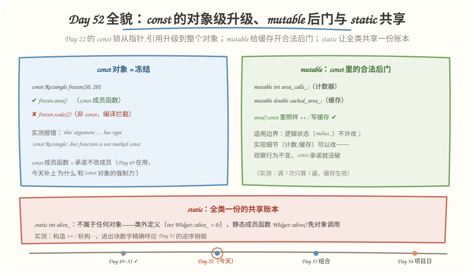
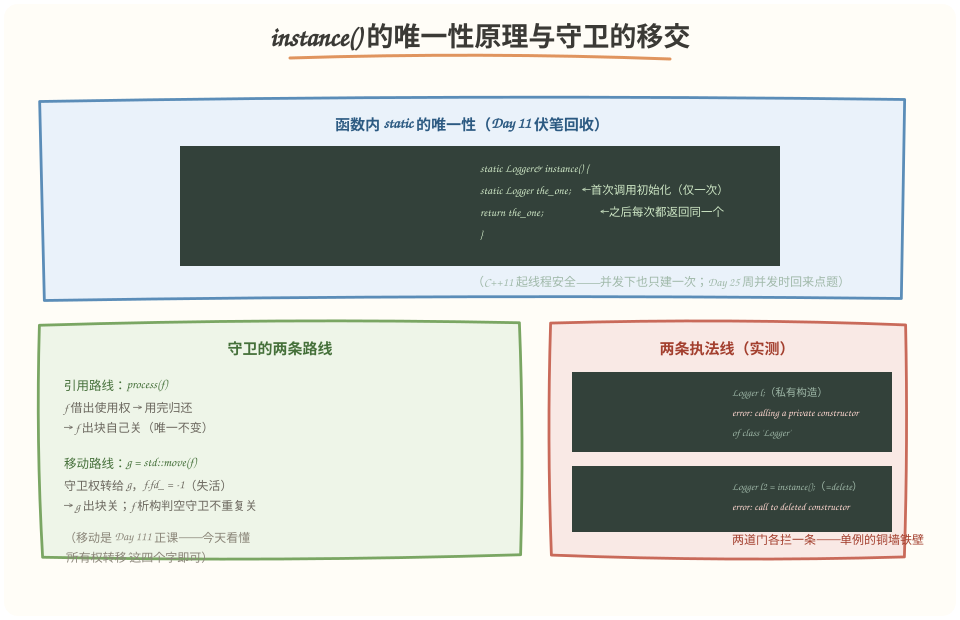
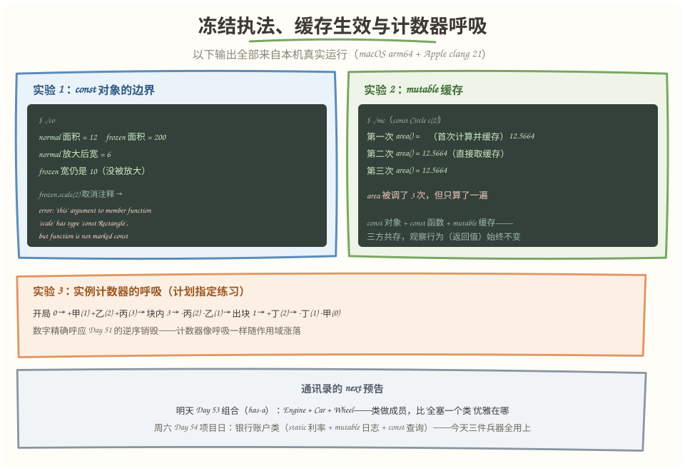

# 第 52 天：=delete 的设计应用——不可拷贝的单例雏形

> **今日目标**：完成本教程后，你能做到：实现三道门的单例（私有构造 + `=delete` 拷贝 + 静态访问点）并实测唯一性；说出"函数内 static"保证唯一性的原理；用引用和移动两种方式正确使用禁拷贝的守卫；解释"唯一性交给类型系统"为什么比文档约定可靠。
> **预计时间**：学习 20 分钟＋实践 45 分钟
> **前置准备**：完成 Day 51（`=delete` 语法昨天学、今天用）。
> **今日产出**：单例 Logger（唯一性实测——一次出生/计数连续/进程结束销毁）、FileGuard 武器化版（引用与移动两路线）、两条执法线实测。

## 1. 今天解决什么问题？

昨天学了 `=delete` 的语法；今天把它变成**设计工具**。计划指定的练习是"不可拷贝的单例雏形"——全局唯一的 Logger：模块 A、B、main 各自拿到的必须是**同一个**实例（计数连续证明）。配套把 Day 39 的 FileGuard 正式武器化：当时的"禁拷贝"是编译器因 fstream 成员自动删的（巧合），今天 `=delete` 显式声明（设计）。

两者的共同点是一个设计原则：**唯一性用类型表达**——注释说"请勿拷贝"可被违反，`=delete` 是物理禁止。

## 2. 先看全貌：今天的内容位于哪里？



**图 1**：左卡是单例 Logger 的三道门（①私有构造 ②`=delete` 拷贝 ③静态访问点——Day 11 函数内 static 的伏笔回收）；右卡绿是守卫的两种用法（引用借出 / 移动移交——Day 111 预告）；下方红卡是"唯一性交给类型系统"的设计原则。

三步概括今天：

1. 单例三道门：私有构造（不能自己造）+ 禁拷贝（不能复制）+ 静态点（只能经此取）；
2. `=delete` 是资源唯一性类的标配（单例/守卫/锁）；
3. 持有方式：引用（借出）或移动（移交），就是不拷贝。

## 3. 核心概念：先用直觉，再给准确定义

### 3.1 单例：三道门的保险箱

- **一句通俗解释**：单例（singleton）是全程序只有一个实例的类——三道门锁死"只能有一个"：不能自己造（私有构造）、不能复制（`=delete`）、只能经固定入口取（静态访问点）。
- **一个类比**：公司公章——不能自己刻（私有构造）、不能复印（禁拷贝）、要用只能去行政部登记领取（`instance()`）——全公司盖出来的都是同一颗章。
- **对应到技术上是**：实测——模块 A/B/main 各调 `Logger::instance()`：`[Logger 出生]` 只打**一次**、计数 `#1~#4` 连续（四个调用方共享同一实例）、进程结束才销毁。函数内 `static Logger the_one;` 是唯一性的核心（Day 11 埋的伏笔：static 局部变量只在首次调用时初始化一次）。类比的边界：公章闲置时也在保险柜（实例进程期间一直活着）； Meyers 单例是今天的雏形——线程安全版（C++11 起自动）到 Day 25 周并发时正式点题。
- **常见误解**："static 变量每个调用者一份"——恰恰相反；函数内 static 全程一份，这正是选它当单例载体的原因。

### 3.2 =delete 是资源唯一性的命根子

- **一句通俗解释**：拷贝一个"唯一性资源"（日志器/文件守卫/锁）在语义上就错了——`=delete` 把这个错误堵在编译期。
- **一个类比**：克隆一把已激活的门禁卡——两张卡刷同一扇门，系统不知道该信谁（双关 = double close/double free）。
- **对应到技术上是**：两条执法实测——`Logger l;` 报 `calling a private constructor`（门①拦）；`Logger l2 = Logger::instance();` 报 `call to deleted constructor`（门②拦）。守卫版的道理：两个 FileGuard 持同一 fd，析构时 double close（和 Day 49 的 double free 同构）。类比的边界：`=delete` 不等于"没这函数"——它明确存在但被禁；错误信息也因此更友好（"被删除"而非"不存在"）。
- **Day 39 的对照**：当时 FileGuard 的拷贝被编译器**自动**删（fstream 成员不可拷贝的连带）——巧合的保护；今天显式 `=delete`——**设计**的保护。前者换了成员可能悄悄失守，后者永远锁死。

### 3.3 引用与移动：禁拷贝类的两种用法

- **一句通俗解释**：不能复制的东西怎么用？**借**（引用）或**移交**（移动）——就是不抄。
- **一个类比**：原件合同——借阅（引用：用完还）或过户（移动：所有权转手，原持有人失去权利）。
- **对应到技术上是**：实测两条路线——`process(f)` 引用传递（f 借出守卫权、出块自己关，唯一性不变 ✔）；`FileGuard g = std::move(f)` 移动移交（f 的 fd 置 -1 变空守卫、g 接管；f 析构时判空不重复关 ✔）。类比的边界：移动是 Day 111 的正课——今天的 FileGuard 移动构造是预告版，看懂"所有权转移"四个字即可。
- **常见误解**："禁了拷贝这类就没法传了"——引用和指针畅通无阻；禁的只是**值语义**（复制）。

## 4. 图解核心机制



**图 2**：上半部分蓝卡是 `instance()` 的解剖——函数内 static 首次调用初始化（仅一次）、之后每次返回同一个（C++11 起线程安全）；左下绿卡是守卫的两条路线（引用借出 vs 移动移交——后者 f.fd_ = -1 失活、析构判空）；右下红卡是两条执法线（private constructor / deleted constructor）。

按图逐步讲：

1. **看 static 的"仅一次"**：初始化发生在第一次调用时——实测 `[Logger 出生]` 在模块 A 首调时打出、B 和 main 复调时**不再打**；
2. **看计数的连续性**：#1~#4 无跳号——四个调用方写的是同一个 log_count_（唯一性的行为证据）；
3. **看移动的失活**：f 移交后 fd_ = -1（空守卫）——析构的 `if (fd_ >= 0)` 判空防重复关（和三步式的自赋值检查同是"先验后动"）；
4. **销毁时机**：`[Logger 销毁]` 在**进程结束时**打（main 的 return 之后）——static 局部的生命期是全程，不是出块。

## 5. 动手实践：完成一个最小可运行例子

### 5.1 准备文件

```bash
cd ai-compiler-roadmap/tutorials/day-052/examples
```

两个程序：`singleton_logger.cpp`（主角）、`guard_delete.cpp`（守卫武器化）。

### 5.2 编写代码

主角 `singleton_logger.cpp` 的三道门（完整代码见本目录）：

```cpp
class Logger {
private:
    std::string name_;
    int log_count_;

    Logger() : name_("全局日志"), log_count_(0) {       // ①构造私有
        std::cout << "  [Logger 出生] 全局唯一实例创建" << std::endl;
    }

public:
    Logger(const Logger&) = delete;                     // ②禁拷贝
    Logger& operator=(const Logger&) = delete;

    static Logger& instance() {                         // ③静态访问点
        static Logger the_one;                          //   首次调用创建，进程结束才销毁
        return the_one;
    }

    void log(const std::string& msg) { … }
};
```

### 5.3 运行与观察

```bash
g++ -Wall singleton_logger.cpp -o sl && ./sl
```

实际执行结果（本机）：

```text
== 通过静态点获取（两次都是同一个） ==
  [Logger 出生] 全局唯一实例创建
  [#1] 模块 A 启动
  [#2] 模块 B 干活
  [#3] main 结束前

== 引用别名（仍然唯一） ==
  [#4] 经引用调用
总条数 = 4
  [Logger 销毁] 共记录 4 条
```

```bash
g++ -Wall guard_delete.cpp -o gd && ./gd
```

```text
== 引用传递（守卫唯一） ==
  [打开] data.txt（fd=3）
  [使用] data.txt
  [关闭] data.txt（fd=3）

== 移动移交（Day 111 预告） ==
  [打开] b.txt（fd=5）
  [移交] 守卫权转移
  [使用] b.txt
  [关闭] b.txt（fd=5）
  [析构] 已移交的空守卫（不重复关）
```



**图 3**：左上单例战报（一次出生/计数连续/进程结束销毁三证）；右上守卫两条路线（含空守卫判空）；下方橙卡是 Day 39 巧合 vs 今天设计的对照。

### 5.4 修改一行再观察：两条执法线

**执法一（私有构造）**：把 `Logger l;` 的注释放开（预期编译失败，本机实测）：

```text
error: calling a private constructor of class 'Logger'
```

**执法二（禁拷贝）**：把 `Logger l2 = Logger::instance();` 的注释放开（预期编译失败，本机实测）：

```text
error: call to deleted constructor of 'Logger'
```

两条错误守住单例的两道门（第三道——静态访问点——是入口不是限制）。**对照实验**：把构造改 public、拷贝的 `=delete` 删掉——两条都编译过但单例破了（`[Logger 出生]` 会打两次、计数分裂）——一改一对，三道门各司其职的实证。

## 6. 常见错误与排查

**错误 1：`error: calling a private constructor of class 'Logger'`**

- 现象：直接 `Logger l;`；
- 原因：门①——单例不许外界自己造；
- 定位：看构造函数在 private 区；
- 修复：走 `Logger::instance()`。

**错误 2：`error: call to deleted constructor of 'Logger'`**

- 现象：`Logger l2 = Logger::instance();`；
- 原因：门②——拷贝被 `=delete`；
- 定位：看类声明里的 delete 行；
- 修复：用引用——`Logger& ref = Logger::instance();`（借出不复制）。

**错误 3：单例计数"分裂"（各模块从 1 开始数）**

- 现象：`[#1]` 出现多次；
- 原因：实例被复制了（构造没私有或拷贝没删）——每个副本有自己的 log_count_；
- 定位：`[Logger 出生]` 打了几次——多于一次就是破了；
- 修复：三道门逐一检查补齐。

## 7. 今日练习

### 必做练习

给单例加"按等级过滤"：`enum class Level { Debug, Info, Error };` 加 `set_level(Level)` 和 `log(Level, msg)`（低于设定等级的不打印）。预期产出：设 Error 后 Debug/Info 被滤、Error 通过——过滤状态全局生效（又是唯一性的证明）。

### 选做挑战

把 Day 42 的 BankAccount 利率改成"单例 Config"：`Config::instance().interest_rate()` 提供全行利率（替代 static 成员）。对比两种做法：static 成员 vs 单例——什么时候后者更好（提示：需要初始化逻辑/多字段/懒加载时单例更顺手）。

## 8. 今日验收

- [ ] 我能实现三道门的单例并实测唯一性（一次出生/计数连续/进程结束销毁）
- [ ] 我能说出函数内 static 保证唯一性的原理
- [ ] 我能用引用和移动两种方式正确使用禁拷贝的守卫
- [ ] 我实测了两条执法线（private constructor / deleted constructor）
- [ ] 我理解"唯一性交给类型系统"比文档约定可靠

## 9. 一句话总结与明天预告

今天的问题是"唯一性怎么用代码锁死"；机制上，单例三道门（私有构造 + 禁拷贝 + 静态点）配合函数内 static 的一次初始化，守卫用引用借出或移动移交；实践上，唯一性三证、两路线、执法线全部实测；验证标准是看到任何"全局唯一"的需求能画出三道门的草图。明天 **Day 53：组合 vs 继承的坏例重构**——"为复用而继承"的经典反模式怎么改造成组合（计划指定的重构练习）：第 9 周倒数第二课。
