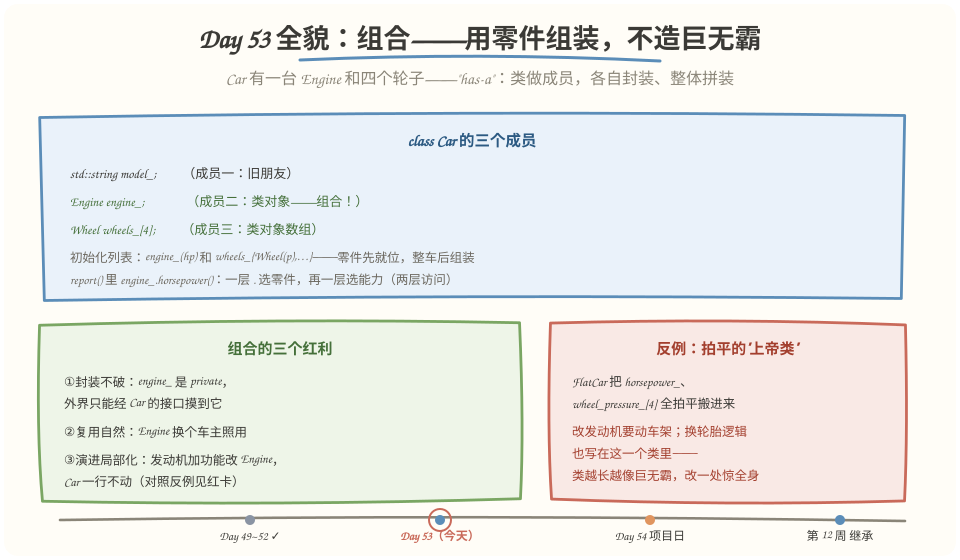
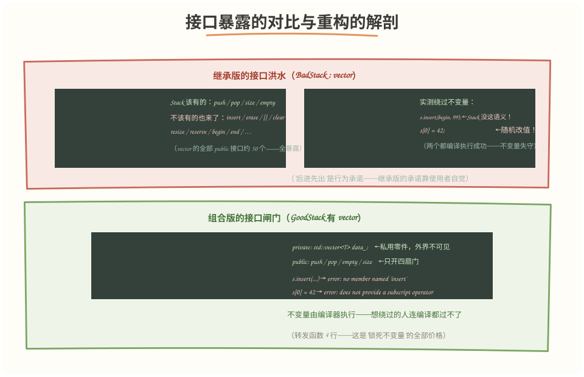
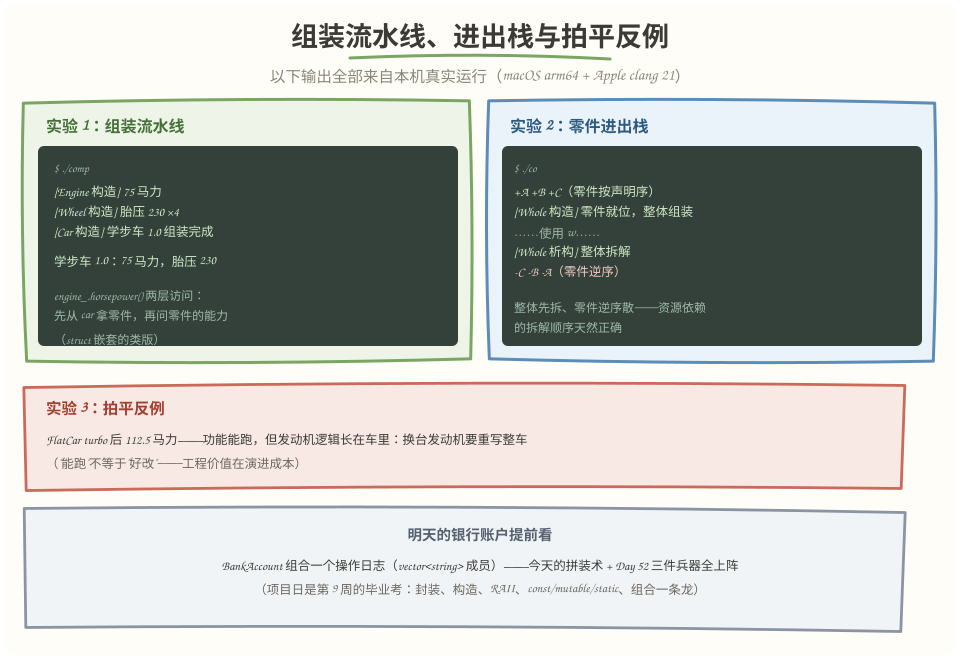

# 第 53 天：组合（has-a）——用零件组装，不造巨无霸

> **今日目标**：完成本教程后，你能做到：把类对象作为成员组装新类（Engine + Wheel → Car）；用初始化列表给组合成员传参（零件先就位、整车后组装）；解释组合的三个红利（封装不破、复用自然、演进局部化）；说出组合与继承的分界（has-a vs is-a）。
> **预计时间**：学习 25 分钟＋实践 45 分钟
> **前置准备**：完成 Day 49~52（构造顺序、const、static 都是今天的零件；Day 51 的逆序销毁在组合里再现）。
> **今日产出**：Car 组装程序（发动机 + 四轮）、零件进出栈实录、拍平反例对照。

## 1. 今天解决什么问题？

类学到第五天，一个自然的诱惑出现：把所有相关的数据和行为**塞进一个类**——发动机参数、轮胎数据、车型名全做成一个类的成员。今天用计划指定的 Engine + Car + Wheel 例子回答：**为什么不塞，而要组装**？

组合（composition，has-a 关系）让 Car **拥有**一个 Engine 成员和四个 Wheel 成员：零件各自封装、整车负责拼装。对照实验（拍平版 FlatCar）会展示塞成一团的代价：改发动机要动车架。明天的银行账户项目日直接用今天的拼装术（账户组合一个操作日志）。

## 2. 先看全貌：今天的内容位于哪里？



**图 1**：上方蓝卡是 `class Car` 的三个成员——string（旧朋友）、`Engine engine_`（组合！）、`Wheel wheels_[4]`（组合数组）；左下绿卡是组合的三个红利（封装不破、复用自然、演进局部化）；右下红卡是拍平反例（FlatCar——改发动机要动车架的巨无霸雏形）。

三步概括今天：

1. 组合 = 类对象做成员；初始化列表传零件参数；
2. 构造按声明序（零件先就位），析构逆序（先拆整车再拆零件）；
3. 选型口诀：能用组合就先用组合，继承留给真正的 is-a。

## 3. 核心概念：先用直觉，再给准确定义

### 3.1 has-a：拥有，而非拍平

- **一句通俗解释**：组合是"整体-零件"关系——Car **拥有** Engine，而不是把发动机的零件拆散焊死在车架上。
- **一个类比**：乐团——钢琴手、小提琴手各自是完整的音乐家（独立类），乐团把他们组合起来演出；不是把所有人的手指移植到一个人身上。
- **对应到技术上是**：`Car` 的成员 `engine_` 是一个完整的 `Engine` 对象——它自己的 private、构造、成员函数原样生效；Car 通过 `engine_.horsepower()` 使用它（两层访问：先拿零件、再问能力）。类比的边界：乐团的成员可以离团再入别的团（对象可复制传递）；Car 的 engine_ 生死与 Car 同步——组合是**值语义**的拥有（引用/指针的灵活组装是进阶玩法）。
- **与 struct 嵌套的关系**：Day 14 的二维数组已经是"数组的数组"——组合是同一思想在类上的应用，加上封装。
- **常见误解**："组合就是嵌套定义类"——不是；Engine 在 Car **外面**独立定义，Car 只声明一个 Engine 类型的成员。类中定义类（嵌套类）是另一回事（进阶）。

### 3.2 构造顺序：零件先就位，整车后组装

- **一句通俗解释**：组合对象的构造顺序固定——先按成员声明顺序构造各零件，最后执行整体的构造函数体；析构严格反过来。
- **一个类比**：先到货零件再装配（构造）；拆解时先拆整车再散零件（析构）——不能拆不存在的整车。
- **对应到技术上是**：本机实测——`Car car(…)` 触发 `[Engine 构造]` → `[Wheel 构造] ×4` → `[Car 构造]`；析构时先 `[Car 析构]` 再逆序拆零件。这就是为什么**初始化列表是必须的**：零件在整车构造函数体执行前就要出生，参数只能从列表给（Day 50 红线的组合版——Engine 没有默认构造时尤其如此）。类比的边界：声明顺序才是构造顺序——列表里写颠倒也按声明序构造（Day 50 埋过的伏笔，组合场景更要牢记）。
- **常见误解**："构造函数体里给 engine_ 赋值也行"——Engine 已在列表阶段出生（用了默认构造）；没有默认构造就直接编译错。

### 3.3 组合 vs 继承：分界线预埋

- **一句通俗解释**：has-a 用组合（Car 有 Engine），is-a 用继承（跑车是 Car）——下周的主角今天先立分界牌。
- **一个类比**：房子有门（组合——门可以换）；木门是门（继承——共享门的血脉）。
- **对应到技术上是**：今天的 Car 组合 Engine：Engine 可以原样搬进船、发电机（复用）；下周的继承让共享行为自动传播。**工程口诀：能用组合就先用组合**——继承耦合更深（第 12 周展开）。类比的边界：两者可混用（Car 组合 Wheel，SportsCar 继承 Car 再组合尾翼）——先各练各的，混搭在项目里自然出现。
- **常见误解**："继承更高级，组合是初学者的凑合"——恰恰相反；现代设计原则（组合复用原则）把组合排在首选。

## 4. 图解核心机制



**图 2**：上半部分是组装流水线实测——成员按声明序构造（Engine → Wheel×4 → Car），析构严格反向；中间绿卡是初始化列表的零件清单语法；下方灰卡预埋组合与继承的分界线。

按图逐步讲：

1. **看流水线记顺序**：零件先就位、整车后组装——所以 Car 的构造函数体里可以放心用 `engine_`（它已经出生了）；
2. **看列表语法**：`wheels_{Wheel(p), Wheel(p), Wheel(p), Wheel(p)}`——数组四个元素逐个在列表里构造；
3. **两层访问练熟**：`car.report()` 里 `engine_.horsepower()`——Day 14 二维数组 `m[r][c]` 的类版（一层选零件、一层选能力）；
4. **分界牌立好**：has-a 今天练到肌肉记忆，is-a 下周正式开课——两者不是竞争而是分工。

## 5. 动手实践：完成一个最小可运行例子

### 5.1 准备文件

```bash
cd ai-compiler-roadmap/tutorials/day-041/examples
```

三个程序：`composition.cpp`（主角）、`ctor_order.cpp`（进出栈）、`flat_vs_composed.cpp`（反例）。

### 5.2 编写代码

主角 `composition.cpp` 的类骨架（完整代码见本目录）：

```cpp
class Car {
private:
    std::string model_;      // 成员一：字符串
    Engine engine_;          // 成员二：类对象（组合！）
    Wheel wheels_[4];        // 成员三：类对象数组

public:
    Car(const std::string& model, double hp, int pressure)
        : model_(model), engine_(hp), wheels_{Wheel(pressure), Wheel(pressure),
                                              Wheel(pressure), Wheel(pressure)} {
        std::cout << "  [Car 构造] " << model_ << " 组装完成" << std::endl;
    }

    void report() const {
        std::cout << model_ << "：" << engine_.horsepower() << " 马力，"
                  << "胎压 " << wheels_[0].pressure() << std::endl;
    }
};
```

### 5.3 运行与观察

```bash
g++ -Wall composition.cpp -o comp && ./comp
```

实际执行结果（本机）：

```text
创建 car：
  [Engine 构造] 75 马力
  [Wheel 构造] 胎压 230
  [Wheel 构造] 胎压 230
  [Wheel 构造] 胎压 230
  [Wheel 构造] 胎压 230
  [Car 构造] 学步车 1.0 组装完成
学步车 1.0：75 马力，胎压 230
```

```bash
g++ -Wall ctor_order.cpp -o co && ./co
```

```text
声明 Whole w;（进入作用域）
  +A 构造
  +B 构造
  +C 构造
  [Whole 构造] 零件就位，整体组装
  ……使用 w……
  [Whole 析构] 整体拆解
  -C 析构
  -B 析构
  -A 析构
w 已销毁（离开作用域）
```



**图 3**：左上组装流水线（两层访问注解）；右上零件进出栈（整体先拆、零件逆序散）；下方红卡是拍平反例的对照结论。

### 5.4 修改一个输入再观察：给发动机加功能

给 `composition.cpp` 的 Engine 加一个 `void turbo(double factor)`（马力 ×factor），Car 加 `void upgrade(double f) { engine_.turbo(f); }`——**只改了两个类，FlatCar 对照版要动它自己**。重跑：75 马力 turbo 1.5 后 report 显示 112.5（与拍平版同样的功能）。差别在演进：再要造一艘船（也组合 Engine），组合版零改动复用，拍平版要把发动机逻辑再抄一遍——**复用红利的实测**。

## 6. 常见错误与排查

**错误 1：`error: constructor for 'Car' must explicitly initialize member 'engine_'`**

- 现象：Engine 没有默认构造，Car 的构造函数没用初始化列表给 engine_ 传参；
- 原因：零件在列表阶段就要出生——没有默认构造就没法"先默认出生再赋值"；
- 定位：报错点名成员名；
- 修复：列表加 `engine_(hp)`（Day 50 红线的组合版）。

**错误 2：组合成员的构造顺序按列表书写顺序**

- 现象：以为列表里把 c_ 写在 a_ 前面 c_ 就先构造；
- 原因：构造顺序永远按**声明顺序**，列表只是报账单；
- 定位：给每个零件打日志（今天的 ctor_order 就是这个实验）；
- 修复：按希望的构造顺序安排成员声明（依赖别人的排后面）。

**错误 3：想从外界直接摸零件 `car.engine_.horsepower()`**

- 现象：编译错误——engine_ 是 Car 的 private；
- 原因：组合不破封装——外界经 Car 的接口（report/upgrade）使用零件；
- 定位：报错 `'engine_' is a private member`；
- 修复：Car 转发（upgrade 的做法）或提供只读访问器。

## 7. 今日练习

### 必做练习（计划指定：Engine + Car + Wheel）

给 Wheel 加"磨损"模型：`int wear_`（0~100）、`void drive(int km)`（磨损 += km/1000，上限 100）、`bool needs_change() const`。Car 加 `void drive(int km)`（四个轮子都磨）和 `void show_wheels() const`。预期产出：drive(3000) 后某轮磨损 3、无需更换；drive(98000) 后磨损逼近 100、`needs_change()` 报真。

### 选做挑战

组装一个三层组合：`class Garage { Car cars_[2]; … }`（车库有两辆车）——构造顺序三层嵌套（每辆车的零件 → 车 → 车库），打印日志数一数总共多少次构造（应为 2×(1 发动机+4 轮+1 车)+1 车库 = 13 次）。这是明天银行账户"账户组合日志"的预演。

## 8. 今日验收

- [ ] 我能写出组合类（类对象成员 + 数组）并用初始化列表传零件参数
- [ ] 我实测了组装流水线：零件按声明序先就位、整车后组装、析构逆序
- [ ] 我能说出组合的三个红利，并用"加 turbo 只改两处"实测了演进局部化
- [ ] 我能背出分界口诀：has-a 组合（首选）、is-a 继承（第 12 周）
- [ ] 我理解 engine_ 是 private——组合不破封装

## 9. 一句话总结与明天预告

今天的问题是"相关联的类怎么拼成系统"；机制上，组合让类对象做成员——零件先就位整车后组装、析构逆序拆解、封装层层不破；实践上，组装流水线、进出栈、拍平对照三组实验落地；验证标准是看到任何系统草图能拆出零件类和整体类。明天 **Day 54（项目日）：银行账户类**——存取款、查询、static 利率、vector 操作日志：第 9 周五天所学（封装、构造、RAII、const/mutable/static、组合）的毕业大考。
