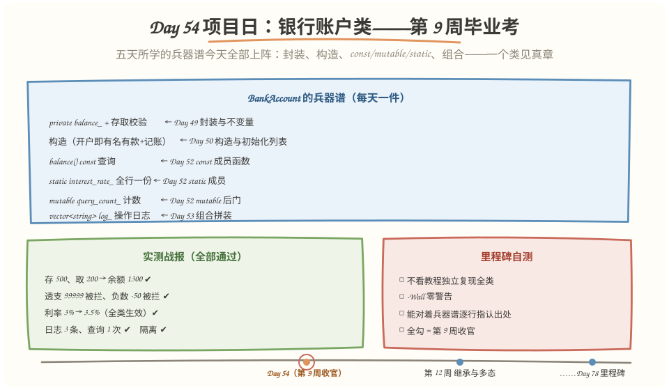
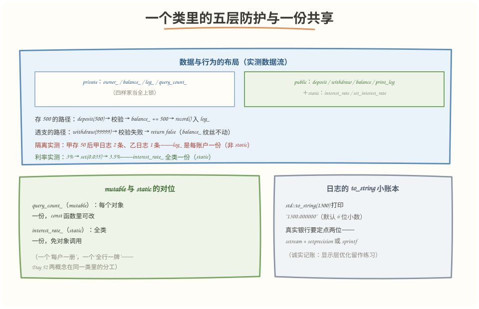
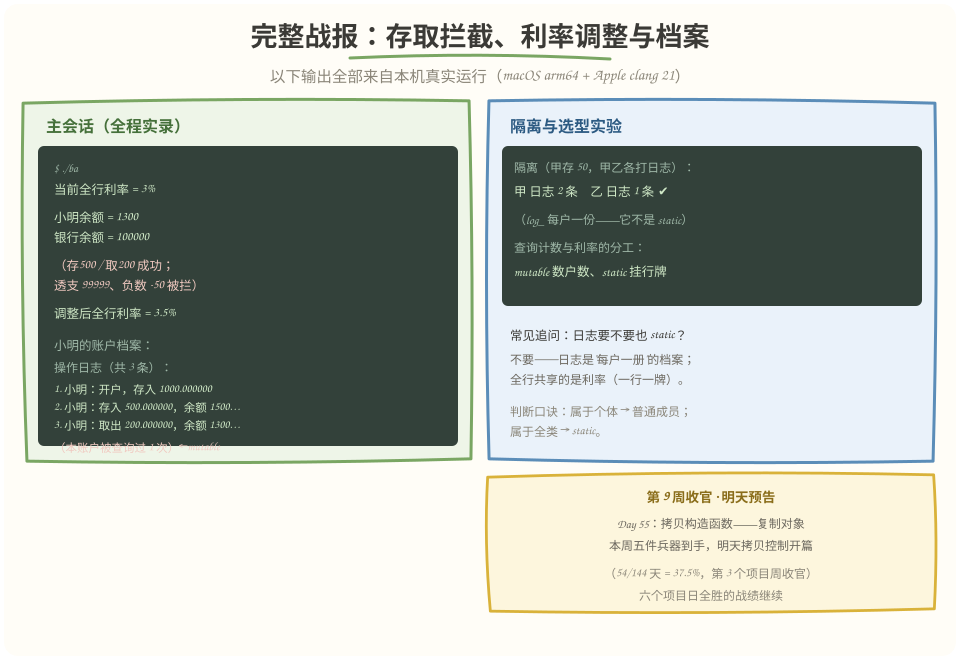

# 第 54 天（项目日）：银行账户类——第 9 周毕业考

> **今日目标**：完成本教程后，你能做到：独立实现 BankAccount（private 余额 + 存取校验 + vector 日志 + static 利率 + mutable 查询计数）；对透支/负数/隔离三类场景给出正确预测；对着兵器谱逐行指认每个特性出自本周哪一天。
> **预计时间**：闭卷实现 50 分钟＋对照复盘 30 分钟
> **前置准备**：完成 Day 49~53；合上教程，只留空编辑器——今天的类就是五天所学的答卷。
> **今日产出**：一个约 80 行、`-Wall` 零警告的 BankAccount，完整会话与隔离实验的实测记录。

## 1. 今天解决什么问题？

第 9 周的五天各教一件兵器：封装（49）、构造（50）、RAII（51）、const/mutable/static（52）、组合（53）。今天的问题是计划指定的项目日考题：**银行账户类**——存取款、查询、利率用 static、操作日志用 vector。一件兵器都不多余，一个特性都不缺席：这是面向对象第一周的毕业考。

先闭卷自己写，写完跑 5.3 的验收会话——你的输出和参考实现对得上，兵器谱就算真正到手了。

## 2. 先看全貌：今天的内容位于哪里？



**图 1**：上方蓝卡是 BankAccount 的兵器谱——六行代码逐行标注出处（每天一件）；左下绿卡是实测战报（存取/拦截/利率/日志/隔离全过）；右下红卡是里程碑自测清单。路线图：**第 9 周今天收官（54/144 = 37.5%）**。

三步概括今天：

1. 数据全上锁（private）＋接口做校验（不变量：余额永不为负）；
2. 每户一册（log_ 普通成员）＋全行一牌（interest_rate_ static）；
3. const 查询里 mutable 计数——观察行为不变。

## 3. 核心概念：先用直觉，再给准确定义

### 3.1 兵器谱：一个类集成五件兵器

- **一句通俗解释**：银行账户把本周五件兵器组装进同一个类——像检验一支特种小队的合成演习。
- **一个类比**：银行金库——余额锁在库内（private）、柜台校验每笔交易（校验）、每户一册流水（log_）、全行一块利率牌（static）、柜员台的查询计数器（mutable）。
- **对应到技术上是**：本机实测全过——存 500 取 200 得 1300；透支 99999 和负数 -50 被拦；利率 3%→3.5% 全类生效；日志 3 条含开户；查询计数 1。类比的边界：**真实银行**的利息计算、并发扣款、持久化都比今天复杂——本项目练的是类设计的骨架，不是银行业务。
- **常见误解**："项目日就是把语法拼在一起"——拼的同时要**选型正确**：日志为什么不是 static？利率为什么不是 mutable？（见 3.2）

### 3.2 每户一册 vs 全行一牌：成员的归属判断

- **一句通俗解释**：属于个体的数据做普通成员（每户一本流水），属于全类的数据做 static（全行一块利率牌）。
- **一个类比**：病历（每病人一份）vs 药品价目表（全院一块）——挂错位置要么浪费要么出错。
- **对应到技术上是**：隔离实测——甲存 50 后**甲日志 2 条、乙日志 1 条**（log_ 每对象一份）；`set_interest_rate(0.035)` 后**两个账户的利率同时变**（static 全类一份）。判断口诀：**属于个体 → 普通成员；属于全类 → static**。类比的边界：mutable 的判断是另一维度——不是"归谁"而是"const 里能不能改"（query_count_ 是每户的，但查询不改账户逻辑状态）。
- **常见误解**："日志也设成 static 好共享"——所有客户的操作混进一本账，隐私和正确性双输。

### 3.3 校验与不变量：银行级的三道闸

- **一句通俗解释**：存取款各有一道校验闸——非法金额（≤0）和透支在门口就被拦，余额的不变量（≥0）永不被破坏。
- **一个类比**：机场安检——身份（金额合法）和行李（不超支）都过了才放行登机。
- **对应到技术上是**：实测 `withdraw(99999)` 返回 false、余额纹丝不动（1300 不变）；`deposit(-50)` 同拦。对比 Day 49 的 SafeRect（set_size 校验）——不变量保护从"设置时"前移到了"每笔交易时"。类比的边界：今天的返回 bool 是最朴素的报错方式——异常（throw）是进阶选项（第 12 周后接触）。
- **常见误解**："校验写在使用处"——账户类把校验焊在接口里，**任何使用者都绕不过**（这就是封装的价值）。

## 4. 图解核心机制



**图 2**：上半部分是数据与行为的布局——private 四样家当（owner_/balance_/log_/query_count_）全上锁，public 四个接口 + static 两个利率函数；数据流注释了存 500 和透支两条路径的走向；红字标注隔离实测（甲乙日志独立）和利率实测（全类生效）。左下绿卡是 mutable 与 static 的对位（每户一册 vs 全行一牌）；右下灰卡是 `to_string` 显示 6 位小数的诚实小账本。

按图逐步讲：

1. **看布局识兵器**：private 区四样家当对应 Day 49 封装；public 区的 const 标注对应 Day 52；static 函数免对象对应 Day 52；log_ 的 vector 类型对应 Day 53 组合；
2. **看数据流理解校验**：两条路径一成一败——分岔点都在校验闸（不变量的守门员）；
3. **对位记选型**：query_count_（mutable，每户）与 interest_rate_（static，全类）在同一类里各就各位——Day 52 两概念的最生动对照；
4. **诚实账本**：日志里 `1300.000000` 是 to_string 的默认 6 位小数——显示层优化（定点两位）留作练习，不假装它已经做了。

## 5. 动手实践：完成一个最小可运行例子

### 5.1 准备文件

```bash
cd ai-compiler-roadmap/tutorials/day-054/examples
```

### 5.2 编写代码

参考实现 `bank_account.cpp` 约 80 行（完整代码见本目录）。核心骨架：

```cpp
class BankAccount {
private:
    std::string owner_;
    double balance_;
    std::vector<std::string> log_;        // 组合：操作日志（Day 53）
    static double interest_rate_;         // static：利率全类共享（Day 52）
    mutable int query_count_;             // mutable：查询计数（Day 52）

    void record(const std::string& entry) {   // 私有工具：记账
        log_.push_back(owner_ + "：" + entry);
    }

public:
    BankAccount(const std::string& owner, double opening)          // Day 50
        : owner_(owner), balance_(opening >= 0 ? opening : 0), query_count_(0) {
        record("开户，存入 " + std::to_string(opening));
    }

    bool deposit(double amount) {
        if (amount <= 0) { return false; }                        // Day 49 不变量
        balance_ += amount;
        record("存入 " + std::to_string(amount) + "，余额 " + std::to_string(balance_));
        return true;
    }
    // …… withdraw（含透支拦截）、balance() const（含 mutable 计数）、
    //　　 print_log() const、static interest_rate/set_interest_rate ……
};

double BankAccount::interest_rate_ = 0.03;  // 类外定义（Day 52）
```

### 5.3 运行与观察

```bash
g++ -Wall bank_account.cpp -o ba && ./ba
```

实际执行结果（本机）：

```text
当前全行利率 = 3%

小明余额 = 1300
银行余额 = 100000

调整后全行利率 = 3.5%

小明的账户档案：
  操作日志（共 3 条）：
    1. 小明：开户，存入 1000.000000
    2. 小明：存入 500.000000，余额 1500.000000
    3. 小明：取出 200.000000，余额 1300.000000
  （本账户被查询过 1 次）
```



**图 3**：左上主会话全程实录（拦截、利率、档案、mutable 计数四处标注）；右上隔离实验（甲日志 2 条乙 1 条）与选型追问；右下黄卡是第 9 周收官与明天预告。

### 5.4 修改一个输入再观察：三组边界

**透支边界**：`withdraw(bal + 0.01)` 被拦（刚好超一分也不行）。**负数边界**：`deposit(0)` 也被拦（零元存款无意义）。**多查询**：连续调 `a.balance()` 三次后 `print_log()` 显示"被查询过 3 次"——mutable 计数与 const 承诺共存。三组边界各跑一遍，预测先于实测——今天的验收标准不只是"功能对"，还有"每条边界的行为说得清"。

## 6. 常见错误与排查

**错误 1：static 成员忘了类外定义**

- 现象：链接报 `undefined reference to 'BankAccount::interest_rate_'`；
- 原因：类内只是声明（Day 52 的坑）；
- 定位：Day 27 三步套路——符号名带类名前缀即知；
- 修复：源文件加 `double BankAccount::interest_rate_ = 0.03;`。

**错误 2：const 函数里改 balance_ 想标 mutable 糊弄**

- 现象：编译过了但设计事故——查询改余额；
- 原因：mutable 用在逻辑状态上（Day 52 红线）；
- 定位：改的是"观察行为会变的数据"吗？
- 修复：撤 mutable；要改状态的函数别标 const。

**错误 3：日志混进了别的账户的操作**

- 现象：甲的 print_log 里出现乙的名字；
- 原因：log_ 被误设成 static（全类一本账）；
- 定位：隔离实验一测便知（今天的 5.4）；
- 修复：log_ 改回普通成员。

## 7. 今日练习

### 必做练习

给账户加"转账"：`bool transfer(BankAccount& to, double amount)`——从本账户取、往对方存（复用 withdraw/deposit，两步都成功才算成）。预期产出：小明转 300 给银行后，小明 1000、银行 100300，双方日志各多一条；余额不足时双方都不动。

### 选做挑战

日志的"定点两位"改造：写 `std::string money(double v)`（用 `<sstream>` + `std::fixed` + `setprecision(2)` 把 1300 变 "1300.00"），record 里全部改用它。预期产出：日志里 `1300.00` 替代 `1300.000000`——诚实账本里挂的账今天销掉。

## 8. 今日验收

- [ ] 我闭卷实现了 BankAccount（约 80 行，-Wall 零警告）
- [ ] 我的输出与 5.3 的参考会话逐行一致（含拦截和日志）
- [ ] 我实测了隔离（甲乙日志独立）并能解释 log_ 为什么不是 static
- [ ] 我能对着兵器谱逐行说出每个特性的出处（Day 49~53）
- [ ] 三组边界（透支/零元/多查询）行为全部预测正确

## 9. 一句话总结与明天预告

今天的问题是"五件兵器能不能在同一个类里各就各位"；机制上，private 保不变量、构造记账、static 挂行牌、mutable 数户数、vector 组合流水——每个特性都有明确的归属判断；实践上，完整会话、隔离实验、三组边界全部实测；验证标准是闭卷写出且逐行指认出处。**第 9 周收官——54/144 天（37.5%），面向对象的地基（类五件套）全部到手。** 明天进入 **第 10 周 · Day 55：拷贝构造函数——复制对象的正确姿势**——`T b = a` 的出生方式、浅拷贝的事故现场、深拷贝的正确答案——拷贝控制周开篇。
