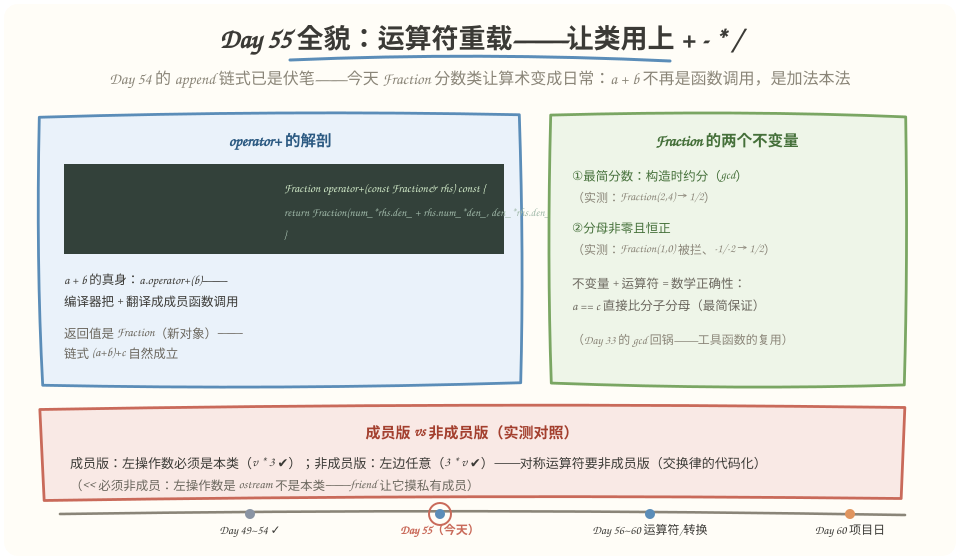
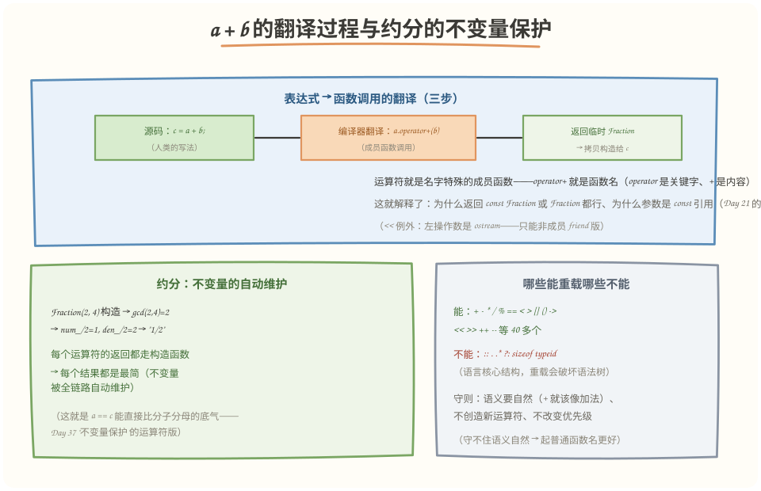
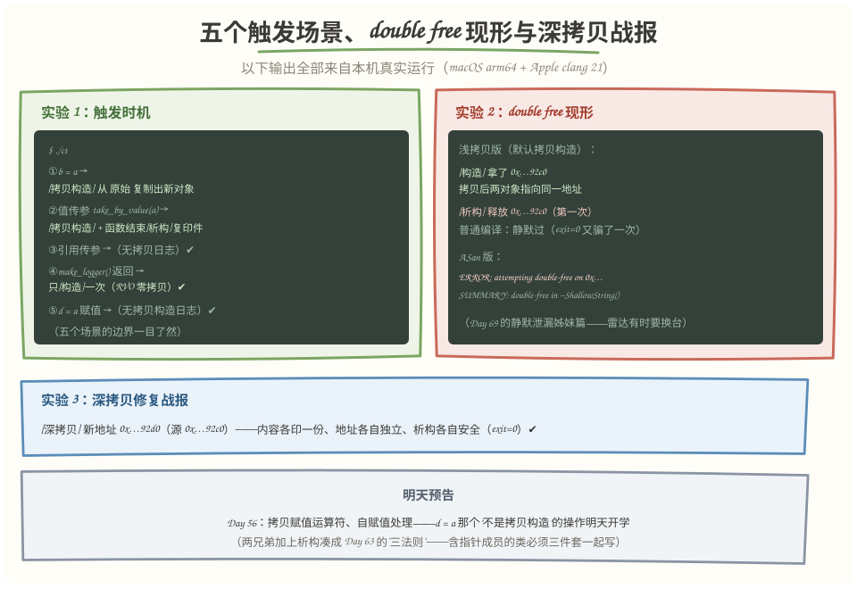

# 第 55 天：拷贝构造函数——复制对象的正确姿势

> **今日目标**：完成本教程后，你能做到：列出拷贝构造的触发场景和"不触发"的场景（各实测）；解释浅拷贝为什么导致 double free（ASan 实测现形）；手写深拷贝的拷贝构造（new + memcpy 两步）并验证地址分离；说出拷贝构造的参数为什么必须是引用。
> **预计时间**：学习 25 分钟＋实践 45 分钟
> **前置准备**：完成 Day 1~54（Day 9 的"复印件"是今天的伏笔回收；第 10 周拷贝控制三部曲开篇）。
> **今日产出**：五场景触发日志、浅拷贝 double free 的 ASan 报告、深拷贝修复战报（地址分离实测）。

## 1. 今天解决什么问题？

Day 9 的值传递实验里我们说过"函数拿到的是复印件"——今天给复印件正式命名：**拷贝构造函数**（copy constructor）。它决定了 `Logger b = a;`、`take_by_value(a)` 这些复制操作**怎么复制**。

问题的严重性在于：编译器默认生成的拷贝构造是**浅拷贝**（只抄指针值、不抄指向的内容）——对象含指针成员时，两个对象共用一块堆内存，析构时 double free。今天用真实实验看事故、用两行代码修复，并预告 Day 57 的"三法则"。

## 2. 先看全貌：今天的内容位于哪里？



**图 1**：左卡是拷贝构造的五个场景（三触发、两不触发——RVO 和赋值各归各的）；右卡红是浅拷贝的事故链（两指针一内存 → double free）；下方绿卡是深拷贝的两步修复（new + memcpy）。

三步概括今天：

1. 触发：初始化（`b = a`）和值传参触发；引用传参、RVO 返回、赋值不触发；
2. 事故：默认浅拷贝 → 两对象共一块内存 → double free；
3. 修复：拷贝构造里 new 新内存 + memcpy 抄内容。

## 3. 核心概念：先用直觉，再给准确定义

### 3.1 拷贝构造：复印机的电路图

- **一句通俗解释**：拷贝构造函数定义了"用一个已有对象造一个新对象"时**怎么造**——它是复制操作的电路图。
- **一个类比**：复印机的扫描逻辑——默认模式（浅拷贝）只记下"文件在第几个柜子"；深拷贝模式把文件内容重新印一份放进新柜子。
- **对应到技术上是**：签名 `T(const T& other)`；本机实测五个场景——①`Logger b = a;` 触发（打印拷贝构造日志）、②`take_by_value(a)` 触发（参数复印）、③`take_by_ref(a)` 不触发（引用无拷贝）、④`make_logger()` 返回**不触发**（RVO 返回值优化——编译器直接在目标位置构造）、⑤`d = a` 不触发（这是**拷贝赋值**，Day 56 的主角）。类比的边界：RVO 是编译器优化不是语言保证——`Logger c = make_logger();` 本机零拷贝，别的编译器或加 `-fno-elide-constructors` 可能打日志。
- **参数为什么必须引用**：`T(T other)` 传值就要先复制 other——复制又调拷贝构造——无限递归；所以标准规定必须 `const T&`（const 还能接临时对象）。
- **常见误解**："`b = a` 和 `T b(a)` 是两回事"——都是拷贝构造（初始化的两种写法）；**赋值**（`d = a`，d 已存在）才是另一个操作。

### 3.2 浅拷贝：一根线上的蚂蚱

- **一句通俗解释**：默认拷贝构造做**逐成员复制**——指针成员抄的是地址值，两个对象从此共用同一块堆内存。
- **一个类比**：合租房只有一把钥匙——房东（原对象）把**钥匙复制了地址标签**（浅拷贝后两人都以为有自己的房）退租时都想退同一间 → 物业炸了（double free）。
- **对应到技术上是**：实测——`ShallowString a("hello")` 拿到 `0x…92c0`；`b = a` 后 b.data_ **也是** `0x…92c0`；出块析构 b（释放该地址）→ 析构 a（再释放同一地址）→ **double free**。普通编译这次本机直接 abort（libmalloc 检测到 double free——exit=133；UB 的下场看运气：崩或静默都可能）；ASan 实测报 `attempting double-free on 0x…92c0`。类比的边界：`std::string`、`std::vector` 这些标准库类型**自带深拷贝**——所以前 48 天我们没踩过这雷；自己管理裸资源（new 的内存）时雷就在脚下。
- **常见误解**："编译器默认生成的一定是对的"——对**无指针成员**的类（Day 29 的 Contact、Day 72 的 Shape）默认够了；含裸指针时默认就是雷（Day 57 三法则的判断标准）。

### 3.3 深拷贝：各印各的

- **一句通俗解释**：深拷贝在拷贝构造里**另开内存、复制内容**——两个对象各有一份独立数据。
- **一个类比**：正版复印——新纸新墨重新印一份，原件复印件互不影响；各自撕毁各自的。
- **对应到技术上是**：修复版 `DeepString` 的拷贝构造两步——①`new char[len_+1]`（同大小新内存）②`memcpy(data_, other.data_, len_+1)`（抄内容）；实测新地址 `0x…92d0` 与源 `0x…92c0` 分离、两个对象各自安全析构（exit=0）。类比的边界：深拷贝有代价（多一次分配 + 复制）——Day 111 的移动语义专治"拷贝完就扔"的浪费。
- **与 Day 9 的连接**：`double_it(int n)` 里改不动 x 是值传递的"保护"面；今天看到它的"代价"面（大对象复印很贵）——引用传参 `const T&` 两头都占（不拷贝 + 承诺不改），这就是 48 天来函数签名爱用它的完整原因。
- **常见误解**："把成员都写值类型就不需要管拷贝"——正是如此！**能不用裸指针就不用**（std::string/std::vector 自带深拷贝）是第一防线；必须用时三法则跟上。

## 4. 图解核心机制



**图 2**：上半部分红卡是浅拷贝的内存图——对象 a 和 b 的 data_ 都指向 `0x…92c0` 一块内存（两根线一根蚂蚱）；下半部分绿卡是深拷贝——a 指 `…92c0`、b 指 `…92d0`，两块内存内容相同地址独立。

按图逐步讲：

1. **先看浅版的两根线**：复制发生后没有任何代码 new 新内存——两根指针天然指向同一处；
2. **看析构的顺序**：出块时先析构 b（释放共享内存）→ 再析构 a（double free）——Day 51 逆序销毁在这里变成了引爆顺序；
3. **看深版的两步**：new（房子先建好）→ memcpy（家当搬进去）——顺序不能反（先 memcpy 会写进野指针）；
4. **本周路线**：今天拷贝构造、明天拷贝赋值（`d = a` 的那件事）、后天开始补齐——Day 57 的三法则（析构 + 拷贝构造 + 拷贝赋值）把三件套打包。

## 5. 动手实践：完成一个最小可运行例子

### 5.1 准备文件

```bash
cd ai-compiler-roadmap/tutorials/day-055/examples
```

三个程序：`copy_ctor_timing.cpp`（五场景）、`shallow_crash.cpp`（事故）、`deep_fix.cpp`（修复）。

### 5.2 编写代码

深拷贝修复版的核心（完整代码见本目录）：

```cpp
class DeepString {
private:
    char* data_;
    std::size_t len_;

public:
    DeepString(const char* s) : len_(strlen(s)) {
        data_ = new char[len_ + 1];
        memcpy(data_, s, len_ + 1);
    }

    // 深拷贝的拷贝构造：另开内存、复制内容
    DeepString(const DeepString& other) : len_(other.len_) {
        data_ = new char[len_ + 1];               // ① 另开一块同样大小的内存
        memcpy(data_, other.data_, len_ + 1);      // ② 把内容抄过来
    }

    ~DeepString() { delete[] data_; }
    …
};
```

### 5.3 运行与观察

```bash
g++ -Wall copy_ctor_timing.cpp -o ct && ./ct
```

实际执行结果（本机，节选）：

```text
== ① 用另一个对象初始化 ==
  [构造] 原始
  [拷贝构造] 从 原始 复制出新对象

== ② 值传递进函数 ==
  [拷贝构造] 从 原始 复制出新对象
  函数内使用 ……
  [析构] 原始 的拷贝

== ③ 引用传递（不拷贝） ==
  函数内使用（引用，无拷贝）

== ④ 函数返回对象 ==
  [构造] 局部对象
（RVO：没有拷贝构造日志）

== ⑤ 赋值（不是拷贝构造！） ==
  （赋值不打拷贝构造日志——两者不同）
```

```bash
g++ -Wall shallow_crash.cpp -o sc && ./sc; echo "exit=$?"
```

```text
浅拷贝实验（预期 double free 崩溃）：
  [构造] 拿了 0x1028b92c0
拷贝后两个对象指向同一地址——
  内容：hello
  内容：hello
  [析构] 释放 0x1028b92c0
  [析构] 释放 0x1028b92c0
Trace/BPT trap: 5
exit=133  ← 本机 libmalloc 检测到 double free 直接 abort（UB 下场看运气：崩或静默）
```

```bash
g++ -Wall -fsanitize=address shallow_crash.cpp -o sc_asan && ./sc_asan
```

```text
ERROR: AddressSanitizer: attempting double-free on 0x602000000950 in thread T0:
SUMMARY: AddressSanitizer: double-free (sc_asan:arm64+0x10000110c) in ShallowString::~ShallowString()
```

```bash
g++ -Wall deep_fix.cpp -o df && ./df; echo "exit=$?"
```

```text
深拷贝实验（各自独立，安全析构）：
  [构造] 0x1017192c0：hello
  [深拷贝] 新地址 0x1017192d0（源 0x1017192c0）
  内容：hello @ 0x1017192c0
  内容：hello @ 0x1017192d0
  [析构] 释放 0x1017192d0
  [析构] 释放 0x1017192c0
安全退出（exit=0 预期）
```



**图 3**：左上五场景触发日志；右上是 double free 的 ASan 现形（含普通编译本机 abort 的对照）；下方蓝卡是深拷贝战报（新地址与源分离）。

### 5.4 修改一个输入再观察：RVO 的开关

给 `copy_ctor_timing.cpp` 的编译加 `-fno-elide-constructors`（关掉拷贝省略）重跑场景④——本机实测：`make_logger()` 的返回**多出一次拷贝构造日志**（return 语句把局部对象拷入返回对象；`Logger c = make_logger()` 目标侧的拷贝是 C++17 起的语言保证省略，即使加 -fno-elide 也不会出现第二次）。这证实了 5.3 的 RVO 注释：零拷贝是优化不是保证——**依赖它要小心，理解它要清楚**（第 24 周性能专题回来细讲）。

## 6. 常见错误与排查

**错误 1：`error: candidate constructor not viable: expects an l-value for 1st argument`**

- 现象：拷贝构造参数写成了 `T&`（没 const）却用临时对象初始化；
- 原因：临时对象不能绑非 const 引用；
- 定位：看拷贝构造签名的 const；
- 修复：写成 `T(const T&)`。

**错误 2：程序退出时崩溃 / ASan 报 double-free**

- 现象：对象析构阶段炸了；
- 原因三查：类有裸指针成员？拷贝构造没写（默认浅拷贝）？两对象共内存？
- 定位：给构造/析构/拷贝构造都打地址日志（今天三程序的套路）；
- 修复：补深拷贝拷贝构造（new + memcpy）。

**错误 3：以为 `d = a` 赋值会调拷贝构造**

- 现象：给拷贝构造打了日志，`d = a` 时没打；
- 原因：赋值是**拷贝赋值运算符**（Day 56）——目标对象已存在，走的是另一条路；
- 定位：区分初始化（`T b = a;` 拷贝构造）和赋值（`b = a;` 拷贝赋值）；
- 修复：明天补齐拷贝赋值。

## 7. 今日练习

### 必做练习

给 `deep_fix.cpp` 加 `modify()` 方法（`data_[0] = 'X';`），验证深拷贝的独立性：`b.modify(); a.print();` 后 a 的内容**仍是 hello**（b 改的是自己那份）。预期产出：一前一后两次打印对照 + 一句"内容独立"的结论。

### 选做挑战

把 `ShallowString` 类的 `char*` 换成 `std::string` 成员重写——删掉手写拷贝构造和析构，用默认的。验证：拷贝、打印、析构全安全（string 自带深拷贝 + 自带析构）。这就是"第一防线"的实证：**能不用裸指针就不用**——手写三件套只在必须管裸资源时出场。

## 8. 今日验收

- [ ] 我能列出拷贝构造的触发/不触发场景，且五场景实测对上
- [ ] 我实测了浅拷贝 double free：普通编译本机 abort（exit=133）、ASan 现形
- [ ] 我手写了深拷贝两步（new + memcpy）并验证地址分离
- [ ] 我能说出参数必须是 const 引用的两个原因（防递归 + 接临时）
- [ ] 我知道 RVO 的零拷贝是优化不是保证（-fno-elide 亲测）

## 9. 一句话总结与明天预告

今天的问题是"复制对象时怎么才安全"；机制上，拷贝构造定义复制行为——默认浅拷贝在含指针成员时引发 double free（ASan 实测），深拷贝 new+memcpy 两步根治；实践上，五场景日志、事故现形、修复战报全部落地；验证标准是看到任何 `T b = a` 能说出走了哪条路、指针成员是否安全。明天 **Day 56：拷贝赋值运算符**——`d = a` 那个"不是拷贝构造"的操作：自赋值陷阱（`a = a` 会不会炸）、旧内存怎么处理——拷贝控制三部曲第二集。
