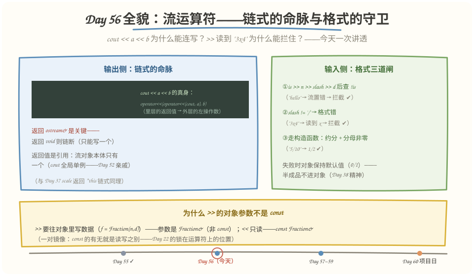
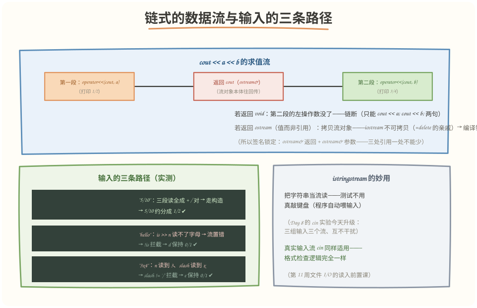
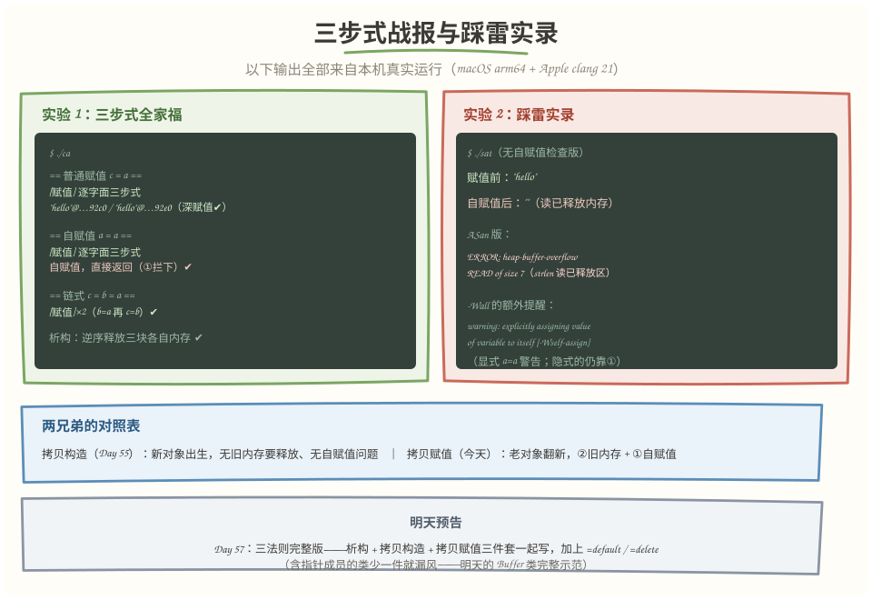

# 第 56 天：拷贝赋值运算符——d = a 的正确写法

> **今日目标**：完成本教程后，你能做到：写出三步式拷贝赋值（自赋值检查 + 释放旧内存 + 开新抄内容）并返回 `*this`；演示不写自赋值检查时 `a = a` 的踩雷（普通编译 UB / ASan 现形）；解释拷贝赋值和拷贝构造的分工（老对象翻新 vs 新对象出生）；用 `-Wself-assign-overloaded` 的警告辅助排查。
> **预计时间**：学习 25 分钟＋实践 45 分钟
> **前置准备**：完成 Day 55（拷贝构造是昨天主角——今天是它的兄弟）。
> **今日产出**：三步式 MyString（含链式赋值实测）、自赋值踩雷实录（普通 + ASan 双版本）。

## 1. 今天解决什么问题？

昨天场景⑤的伏笔今天回收：`d = a`（d 已存在）走的不是拷贝构造，而是**拷贝赋值运算符**（copy assignment operator）。两者的分工一句话：**拷贝构造管出生，拷贝赋值管翻新**——赋值多出两个专属难题：旧内存怎么处理（先释放再开新）、自赋值（`a = a`）怎么防（不防就读已释放内存）。

今天用含指针成员的 MyString 做三件事：三步式的正确写法（含链式 `c = b = a`）；**故意删掉自赋值检查**看踩雷（普通编译打出空串、ASan 报 heap-buffer-overflow）；对照昨天整理两兄弟的差异表。

## 2. 先看全貌：今天的内容位于哪里？



**图 1**：左卡是两兄弟的分工（出生 vs 翻新——赋值多两件事：旧内存 + 自赋值）；右卡绿是三步式语法（①检查 → ②释放 → ③开新抄 + 返回 `*this`）；下方红卡是自赋值陷阱的预告。

三步概括今天：

1. 签名 `T& operator=(const T& other)`，返回 `*this` 支持链式；
2. 三步式：①`if (this == &other) return *this;` → ②`delete[] 旧` → ③`new + memcpy`；
3. 自赋值不防就踩雷：先 delete 自己再从已释放内存抄（实测 UB）。

## 3. 核心概念：先用直觉，再给准确定义

### 3.1 拷贝赋值：老对象翻新

- **一句通俗解释**：拷贝赋值是"把一个已有对象的内容替换成另一个对象的"——对象还是那个对象（地址不变），内容换了。
- **一个类比**：旧房翻新——房子还是那套（对象地址不变），家具全换成新房客的（内容替换）；搬家前旧家具要先处理（释放旧内存）。
- **对应到技术上是**：实测 `c = a` 后 c 的地址仍是 `0x…92e0`（没变）但内容变成 "hello"（翻了新）——与 Day 55 拷贝构造（新地址 `0x…92d0`）形成对照。返回 `T&`（而非 void）让 `c = b = a` 链式成立（实测两连赋值日志）。类比的边界：翻新期间新旧并存有一瞬（③完成后旧的才真正消失）——这个间隙正是自赋值踩雷的窗口。
- **常见误解**："`d = a` 和 `T d(a)` 差不多"——差的正是"旧内存"和"自赋值"两件事；写拷贝赋值忘了这两样的坑昨天不存在今天必踩。

### 3.2 自赋值：自己给自己搬家

- **一句通俗解释**：`a = a`（或隐式等价形式）时，如果不检查就执行"释放自己的 → 从自己抄"——源已经被自己删了。
- **一个类比**：把信件原件碎掉、再想复印原件——纸都没了印什么？
- **对应到技术上是**：实测无检查版——`delete[] data_` 后 `memcpy(data_, other.data_, …)` 里 other 就是 *this（同一块已释放内存）——普通编译打出空串 `""`（UB 的呈现）、ASan 报 `heap-buffer-overflow READ of size 7`（strlen 读已释放区）。一行检查根治：`if (this == &other) return *this;`（实测"自赋值，直接返回"）。类比的边界：**显式写 `a = a` 很少见，但隐式等价常见**——`a[i] = a[j]` 且 i==j、`*p1 = *p2` 且 p1==p2——编译器看不见，只有①能拦。
- **-Wall 的新礼物**：本机实测 `-Wself-assign-overloaded` 会警告显式自赋值（今天两个程序都收到了）——又一个免费质检员，但只管显式的。
- **常见误解**："自赋值检查拖慢所有赋值"——一次指针比较纳秒级；事故成本是 UB。有的写法（copy-and-swap）天然免疫自赋值不需要检查（见选做）。

### 3.3 三步式与替代方案

- **一句通俗解释**：教科书三步式（检查 → 释放 → 开新抄）逻辑直白；替代方案 copy-and-swap 更巧（先做拷贝再交换——旧的自然释放）。
- **一个类比**：三步式像先退旧房再搬新家具（中间有空窗，自赋值就炸在空窗）；copy-and-swap 像先在新址布置好一模一样的房间再交换钥匙——任何时刻都有完整的家。
- **对应到技术上是**：三步式是今天的正文（实测三个场景全过）；copy-and-swap 四行——`T& operator=(T other) { swap(other); return *this; }`（参数按值传 = 编译器自动拷贝，swap 后 other 析构带走旧内存）——自赋值安全 + 异常安全一步到位。类比的边界：copy-and-swap 多一次拷贝构造的开销；三步式可先 `new` 后 `delete` 换序获得异常安全——细节 Day 57 三法则时再展开。
- **常见误解**："返回 void 也行"——编译能过，但 `c = b = a` 链断掉；惯例返回 `T&`。

## 4. 图解核心机制



**图 2**：上半部分蓝卡是 `c = a` 的正常三步——②释放旧 `0x…92e0` → ③new 碰巧复用同址 → memcpy "hello"（实测 c 内容换了地址没变）；下半部分红卡是 `a = a` 的踩雷路径——delete 自己 → memcpy 从已释放的自己读（普通编译空串 / ASan heap-buffer-overflow）。

按图逐步讲：

1. **先看正常路径的地址**：赋值后 c 地址不变——这就是"翻新"的含义（对照 Day 55 拷贝构造的新地址）；
2. **再看踩雷的时间线**：delete 在前、memcpy 在后——源已死还从它抄；①检查是唯一防线；
3. **链式的原理**：`b = a` 返回 `*this`（b 的引用）→ 它成为 `c = …` 的右操作数——Day 49 的 this 三用法今天用上第三个；
4. **两兄弟对照表**（图 3 底部）：出生（无旧内存无自赋值）vs 翻新（② + ①两件事）——明天三法则把两兄弟和析构打包。

## 5. 动手实践：完成一个最小可运行例子

### 5.1 准备文件

```bash
cd ai-compiler-roadmap/tutorials/day-056/examples
```

两个程序：`copy_assign.cpp`（三步式主角）、`self_assign_trap.cpp`（踩雷版）。

### 5.2 编写代码

主角 `copy_assign.cpp` 的核心（完整代码见本目录）：

```cpp
// 拷贝赋值：教科书三步式
MyString& operator=(const MyString& other) {
    std::cout << "  [赋值] 逐字面三步式" << std::endl;
    if (this == &other) {                      // ① 自赋值检查
        std::cout << "    自赋值，直接返回" << std::endl;
        return *this;
    }
    delete[] data_;                            // ② 释放旧内存
    len_ = other.len_;
    data_ = new char[len_ + 1];                // ③ 开新 + 抄内容
    memcpy(data_, other.data_, len_ + 1);
    return *this;                              // 返回 *this 支持链式（Day 49）
}
```

### 5.3 运行与观察

```bash
g++ -Wall copy_assign.cpp -o ca && ./ca
```

实际执行结果（本机，节选）：

```text
== 普通赋值 c = a ==
  [赋值] 逐字面三步式
  "hello" @ 0x1014f12c0
  "hello" @ 0x1014f12e0      ←c 地址没变（翻新），与 a 地址不同（深赋值）

== 自赋值 a = a ==
  [赋值] 逐字面三步式
    自赋值，直接返回          ←①拦下
  "hello" @ 0x1014f12c0

== 链式赋值 c = b = a ==
  [赋值] 逐字面三步式
  [赋值] 逐字面三步式        ←两连
```

```bash
g++ -Wall self_assign_trap.cpp -o sat && ./sat; echo "exit=$?"
```

```text
赋值前：  "hello"
自赋值后：  ""       ←读已释放内存（UB）
exit=0
```

```bash
g++ -Wall -fsanitize=address self_assign_trap.cpp -o sat_asan && ./sat_asan
```

```text
ERROR: AddressSanitizer: heap-buffer-overflow on address 0x602000000976
READ of size 7 at 0x602000000976 thread T0
SUMMARY: AddressSanitizer: heap-buffer-overflow (sat_asan:arm64+0x100002d2c) in std::__1::__constexpr_strlen
```



**图 3**：左上三步式全家福（普通/自赋值/链式三场景 + 逆序析构）；右上是踩雷实录（普通空串 + ASan 报告 + `-Wself-assign` 警告）；下方蓝卡是两兄弟对照表、灰卡预告三法则。

### 5.4 修改一行再观察：-Wall 的自赋值警告

两个程序编译时 `-Wall` 都给出了 `warning: explicitly assigning value of variable of type 'MyString' to itself [-Wself-assign-overloaded]`（本机实测）——显式的 `a = a` 被免费质检员点名。但要注意边界：**隐式自赋值**（`arr[i] = arr[j]` 且 i==j）编译器看不见——①检查仍是必需。做个小实验：把踩雷版的 `a = a` 改成经引用别名（`NoCheck& r = a; a = r;`）——警告消失、雷照样踩。**结论：警告是辅助，①是防线**。

## 6. 常见错误与排查

**错误 1：程序输出乱码或空串（赋值后）**

- 现象：`a = a` 或别名等价形式后内容变空/乱码；
- 原因：无自赋值检查——delete 后从已释放内存抄；
- 定位：ASan 跑一遍（heap-buffer-overflow / use-after-free）；检查 operator= 开头有没有 `if (this == &other)`；
- 修复：补①（一行根治）。

**错误 2：`c = b = a` 链编译失败或行为怪**

- 现象：链式赋值报错或只有最后一个生效；
- 原因：operator= 返回 void 或返回了值（非引用）；
- 定位：看签名返回类型；
- 修复：返回 `T&`，函数体最后 `return *this;`。

**错误 3：赋值后旧内存泄漏（ASan Linux / 内存涨）**

- 现象：多次赋值后内存持续增长；
- 原因：三步式漏了②——直接 new 新内存没 delete 旧的；
- 定位：对照三步式逐行检查；
- 修复：补 `delete[] data_;`（②不能省）。

## 7. 今日练习

### 必做练习（计划指定：给动态数组补全赋值）

把本周（Day 55/56）的深拷贝类改造成"赋值三场景测试"：普通赋值、自赋值、链式各跑一遍并打印地址和内容。预期产出：三场景全过的日志 + 一句"地址不变内容翻新"的观察记录。

### 选做挑战

实现 copy-and-swap 版赋值：`MyString& operator=(MyString other) { swap(other); return *this; }`（注意参数**按值**——编译器自动拷贝）。跑今天的三个场景验证全过（自赋值天然安全：拷贝出来的 other 和自己交换后带走旧内存）。对比三步式：哪个少操心、哪个少一次拷贝——把结论写进 `notes.md`（Day 57 三法则的素材）。

## 8. 今日验收

- [ ] 我能写出三步式拷贝赋值并解释每步的必要性（含 return *this）
- [ ] 我实测了自赋值踩雷：普通编译空串（UB）、ASan heap-buffer-overflow
- [ ] 我的链式赋值 `c = b = a` 通过（返回 T& 的价值）
- [ ] 我能背出两兄弟的分工（出生无旧内存/翻新多②①两件事）
- [ ] 我知道 -Wself-assign 只管显式、隐式要靠①

## 9. 一句话总结与明天预告

今天的问题是"老对象的内容替换怎么才安全"；机制上，拷贝赋值三步式（检查→释放→开新抄）对付两大专属难题——自赋值（①一行根治）和旧内存（②不能省）；实践上，三场景战报、踩雷实录（普通 + ASan 双版本）、-Wall 警告边界全部落地；验证标准是看到任何 `d = a` 能说出旧内存怎么处理、自赋值走哪条路。明天 **Day 57：三法则完整版**——析构 + 拷贝构造 + 拷贝赋值三件套一起写，加上 `=default`/`=delete`：含指针成员的类少一件就漏风，MyString 的完整形态明天收官。
