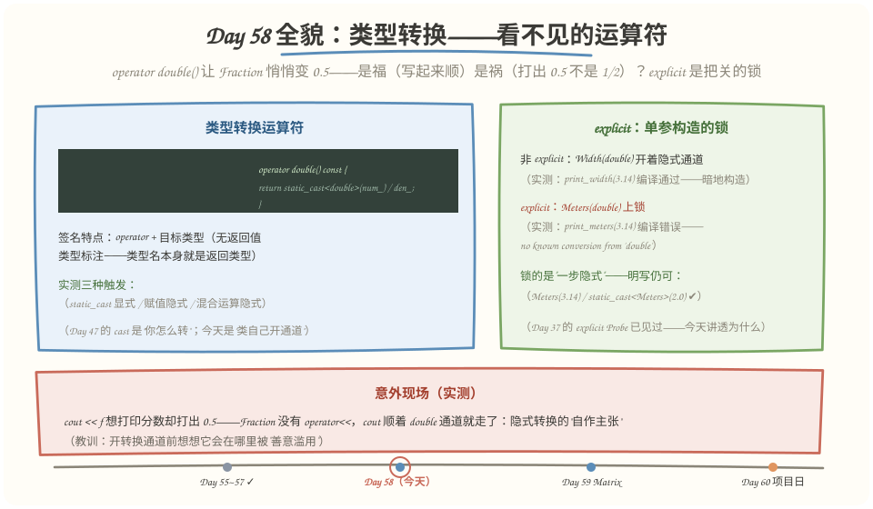
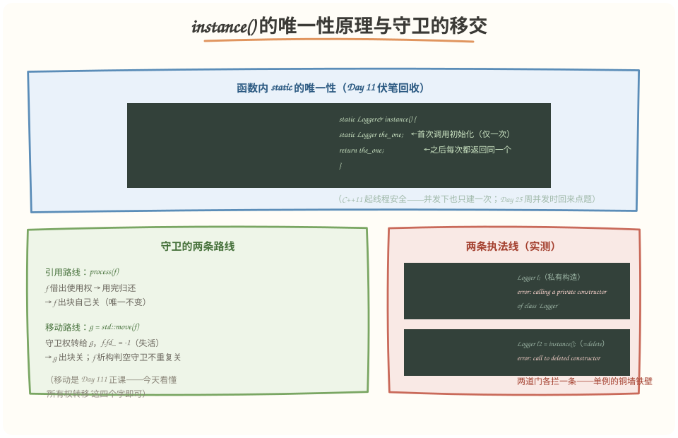
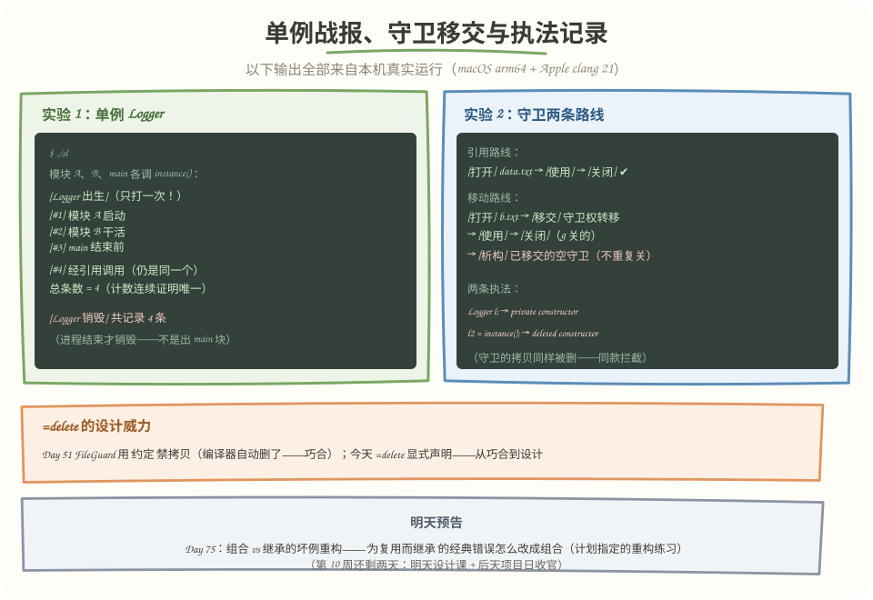

# 第 58 天：类型转换运算符与 explicit——看不见的运算符

> **今日目标**：完成本教程后，你能做到：写出类型转换运算符（`operator double()`）并说出它的三种触发场景；解释隐式转换的"意外现场"（cout << f 打出 0.5 而不是 1/2 的决策链）；用 explicit 锁住单参构造的隐式通道（实测编译拦截）；背出"单参构造默认加 explicit"的白名单思维。
> **预计时间**：学习 20 分钟＋实践 45 分钟
> **前置准备**：完成 Day 55~57（运算符三大族齐了——今天是"看不见的"第四类）。
> **今日产出**：Fraction → double 的隐式通道实测（含意外现场）、explicit 上锁/解锁对照、一条经验法则。

## 1. 今天解决什么问题？

运算符三族（算术/流/容器）之外还有一类**看不见的运算符**：类型转换。它有两个方向——**转出**（`operator double()` 让 Fraction 变 0.5）和**转入**（单参构造 `Width(double)` 让 3.14 变 Width）。两个方向都能被**隐式触发**——你没写转换，编译器自己走了：写起来顺（`f + 1.5` 直接算），但也会"自作主张"（`cout << f` 想打分数打出 0.5）。

今天的把关工具是 **explicit**：锁住隐式通道、明写才放行。一条经验法则贯穿：**单参构造默认加 explicit**——白名单思维。

## 2. 先看全貌：今天的内容位于哪里？



**图 1**：左卡是类型转换运算符（`operator 目标类型()`——无返回类型标注，类型名本身就是）；右卡绿是 explicit 的锁（锁"一步隐式"、明写仍可）；下方红卡是意外现场预告。

三步概括今天：

1. 转出靠 `operator double()`、转入靠单参构造——两端都可能隐式触发；
2. 隐式的代价：cout 决策链"退而求其次"走了 double 通道；
3. explicit 锁一步隐式；经验法则：单参构造默认加。

## 3. 核心概念：先用直觉，再给准确定义

### 3.1 类型转换运算符：类的出口

- **一句通俗解释**：`operator double()` 给类开一个"出口"——凡是需要 double 的地方，Fraction 都能悄悄挤过去。
- **一个类比**：外币兑换窗口——人民币（Fraction）在任何收美元（double）的场合自动按汇率换——方便，但你没喊"兑换"它也换了。
- **对应到技术上是**：实测三种触发——①显式 `static_cast<double>(f)` 得 0.5；②隐式赋值 `double d2 = f` 得 0.5；③混合运算 `f + 1.5` 得 2（0.5+1.5=2.0，cout 默认格式打 2——顺带见证了流格式细节）。签名特点：**没有返回类型标注**（`operator double()` 不是 `double operator double()`）——目标类型名本身就说明了返回什么。类比的边界：兑换窗口只能按你写的汇率（函数体）；不写就没有这个出口——**转换是类自己的决定**。
- **常见误解**："转出比转入安全"——都一样：`cout << f` 的意外就是转出端闯的祸。

### 3.2 意外现场：cout 的决策链

- **一句通俗解释**：`cout << f` 想 `operator<<(ostream, Fraction)`——没有；编译器不放弃，找到 double 通道就把 f 换成 0.5 塞给 `operator<<(ostream, double)`。
- **一个类比**：点菜没有——服务员看你能变身成"简餐"就自作主张上了简餐。
- **对应到技术上是**：实测 `cout << f` 打出 **0.5 不是 1/2**——三步决策链：①找精确匹配（没有）→ ②找可行的转换（double 通道开着）→ ③用转换后的版本。教训：**开转换通道前想清所有会被触发的地方**——cout 只是今天撞见的第一个。类比的边界：转换只走**一步**（Fraction→double 直接可达；Fraction→double→int 的两步链编译器不走——Day 47 也见过"一步规则"）。
- **常见误解**："没写 operator<< 就该编译错"——恰好给了编译器"退而求其次"的机会；想要编译错或正确行为，都该显式写 operator<<（昨天的技能）。

### 3.3 explicit：一步隐式的锁

- **一句通俗解释**：`explicit` 锁住"一步隐式转换"——`print_meters(3.14)` 编译不过；明写 `Meters(3.14)` 或 `static_cast<Meters>(2.0)` 照常通行。
- **一个类比**：门禁卡——explicit 的卡必须本人刷（明写）；非 explicit 的卡谁捡到都能刷（隐式）。
- **对应到技术上是**：实测对照——`print_width(3.14)` 编译过（Width 的构造没锁，double 暗地构造）；`print_meters(3.14)` 编译错（`no known conversion from 'double' to 'const Meters'`）；`Meters(3.14)` 明写编译过。C++11 起 explicit 也能加在转换运算符上（`explicit operator double()`）——同样的锁、同样的放行规则。类比的边界：**锁的只是一步隐式**——明写（直接初始化/static_cast）永远合法；Day 37 的 `explicit Probe(int)` 见过用法，今天补上了"为什么"。
- **经验法则**：单参构造**默认加 explicit**——需要隐式时再摘（白名单思维：默认关、按需开——比"默认开、出事再关"的黑名单安全得多）。

## 4. 图解核心机制



**图 2**：上半部分蓝卡是转换的两条路——转出（operator double）与转入（单参构造），两端都可能自作主张、两端都能上锁；左下红卡是 `cout << f` 的三步决策链（找精确匹配 → 走转换通道 → 打 0.5）；右下绿卡是 explicit 的三问决策（语义自然吗/会出意外吗/构造是凑巧单参吗）。

按图逐步讲：

1. **先认两端**：转出是 `operator 目标类型()`、转入是单参构造——今天两个实验各占一端；explicit 两处都能上锁；
2. **走一遍决策链**：cout 的"退而求其次"是编译器的常规操作（重载决议的一部分）——意外不是 bug 而是机制的自然结果；理解了链路才能预测意外；
3. **三问过滤一遍**：语义不自然→不写转换；会出意外→explicit；构造凑巧单参→explicit——三问覆盖今天的全部决策；
4. **白名单法则落袋**：默认 explicit、按需摘——和 Day 52"唯一性交给类型系统"同源：**默认安全，例外才开口**。

## 5. 动手实践：完成一个最小可运行例子

### 5.1 准备文件

```bash
cd ai-compiler-roadmap/tutorials/day-058/examples
```

两个程序：`implicit_convert.cpp`（转出端）、`explicit_guard.cpp`（转入端对照）。

### 5.2 编写代码

两个关键片段（完整代码见本目录）：

```cpp
class Fraction {
    …
    operator double() const {                    // 类型转换运算符（出口）
        return static_cast<double>(num_) / den_;
    }
};

class Meters {
    …
    explicit Meters(double v) : value_(v) {}     // explicit：锁住一步隐式（入口）
};
```

### 5.3 运行与观察

```bash
g++ -Wall implicit_convert.cpp -o ic && ./ic
```

实际执行结果（本机）：

```text
== 显式转换 ==
static_cast<double>(f) = 0.5

== 隐式转换（看不见但发生了） ==
double d2 = f → 0.5
f + 1.5 = 2

== 隐式转换的意外现场 ==
cout << f 打出的是：0.5
（Fraction 没有 operator<<，cout 找到 double 通道就走了）
```

```bash
g++ -Wall explicit_guard.cpp -o eg && ./eg
```

```text
== 非 explicit 版（隐式通道开着） ==
  3.14 宽
（print_width(3.14) 编译通过——double 暗地里走了 Width 构造）
Width w = 2.5 → 2.5

== explicit 版（通道上锁） ==
  3.14 m
（必须 Meters(3.14) 明写——一步都逃不掉）
static_cast<Meters>(2.0) → 2
```



**图 3**：左上三种触发 + 意外现场（含 `f+1.5=2` 的格式注解）；右上是 explicit 的锁（编译错误原文）；下方橙卡是白名单法则、灰卡预告明天。

### 5.4 修改一行再观察：锁的执法亲测

把 `explicit_guard.cpp` 里 `print_meters(3.14);` 的注释放开（预期编译失败，本机实测）：

```text
error: no matching function for call to 'print_meters'
note: candidate function not viable: no known conversion from 'double' to 'const Meters' for 1st argument
```

**对照两步**：①把 `print_meters(3.14)` 改成 `print_meters(Meters(3.14))`——编译过（明写放行）；②把 `explicit` 删掉——`print_meters(3.14)` 也编译过（锁没了）。**一锁一开一摘**三态对照，explicit 管的就是"一步隐式"实证。顺带实验：**两步隐式永远不通**——`print_width(3.14)` 能过是因为一步（double→Width）；若再有 `void f(const Meters&)` 想从 Width 走过去（Width→Meters 没有通道）——编译器不会替你串两步。

## 6. 常见错误与排查

**错误 1：`cout << myobj` 打出奇怪的数字**

- 现象：想打印自定义格式却出了 double 值；
- 原因：类开了 `operator double()`——cout 的重载决议"退而求其次"走了它；
- 定位：看类里有没有转换运算符；
- 修复：写正经的 `operator<<`（Day 56）；或转换运算符加 explicit（C++11 起支持）。

**错误 2：`error: no matching function … no known conversion from 'double'`**

- 现象：传字面量给 `const T&` 参数被拒；
- 原因：T 的单参构造是 explicit——一步隐式被锁；
- 定位：看构造函数的 explicit；
- 修复：明写 `T(value)` 或 `static_cast<T>`；确认设计意图（锁是故意的就别摘）。

**错误 3：两步转换不生效**

- 现象：A→B→C 的链编译不过；
- 原因：隐式转换最多一步（语言规则）；
- 定位：检查中间类型；
- 修复：明写一步（`B(a)` 再传）；或给 A 写直达 C 的转换（慎——多开口多意外）。

## 7. 今日练习

### 必做练习

给 Day 55 的 Fraction 补 `operator<<`（打 "1/2" 格式），验证 `cout << f` 打出 **1/2 而不是 0.5**——精确匹配优先于转换通道（决策链的第一步获胜）。预期产出：前后对照（有/无 operator<< 的两种输出）。

### 选做挑战

给 Fraction 的转换运算符加 explicit（`explicit operator double() const`）——本机实测三种语境两种被锁：`double d = f` 编译错（`explicit conversion function is not a candidate`——拷贝初始化不放行）；`f + 1.5` 编译错（`invalid operands to binary expression`——算术语境不放行）；`static_cast<double>(f)` 照常通行。**只有 static_cast 一条活路**——把三种语境的实测结果记入 notes.md（例外：`explicit operator bool` 在 if 条件里可隐式用——上下文转换，第 12 周遇异常处理时再展开）。

## 8. 今日验收

- [ ] 我的 operator double() 三种触发实测通过（显式/赋值/混合运算）
- [ ] 我能讲出 cout << f 打 0.5 的三步决策链
- [ ] 我实测了 explicit 的锁（编译错误原文）和两种放行（明写/static_cast）
- [ ] 我知道两步隐式永远不通（一步规则）
- [ ] 我能背出白名单法则：单参构造默认加 explicit

## 9. 一句话总结与明天预告

今天的问题是"类型转换的隐式通道怎么开怎么锁"；机制上，转出靠 operator 目标类型()、转入靠单参构造，两端的隐式触发由重载决议驱动（cout 意外就是它），explicit 锁一步隐式、明写放行；实践上，三种触发、意外现场、锁的三态对照全部实测；验证标准是看到任何转换能说出"隐式走得通吗、意外在哪、锁怎么上"。明天 **Day 59：Matrix 矩阵类实战**——本周运算符全家桶（`[] () 算术 ==`）的总演练场：`m[i][j]` 链式下标是 Day 57 的进阶应用。
