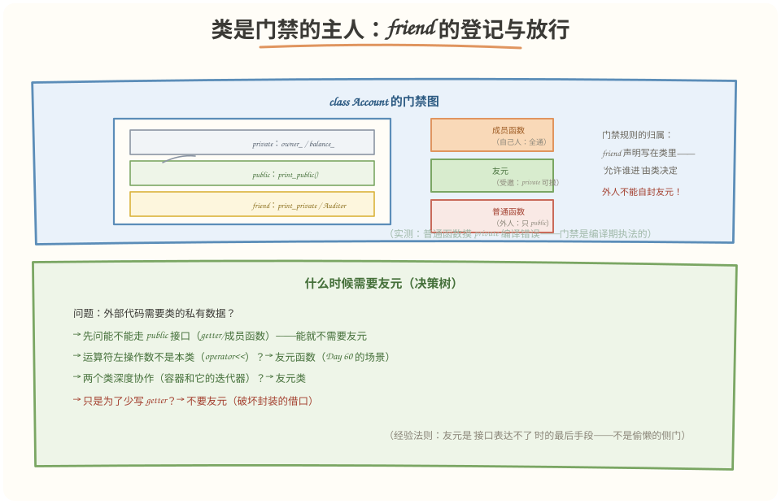
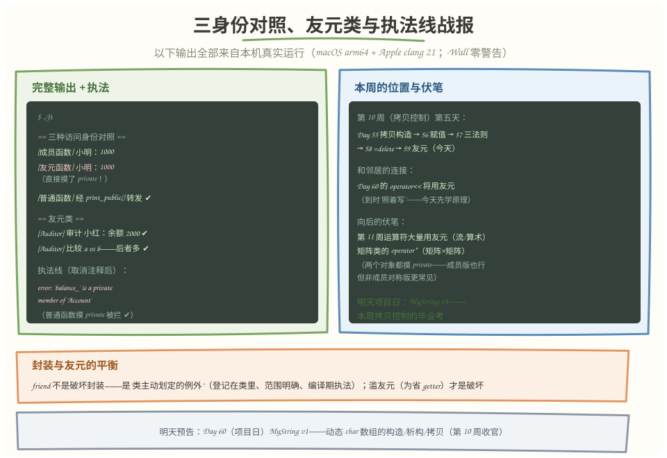

# 第 59 天：友元 friend——给外部函数开的侧门

> **今日目标**：完成本教程后，你能做到：用 friend 让外部函数/类访问私有成员（计划指定练习）；区分三种访问身份（成员/友元/普通函数——实测对照）；说出友元的三条性质（单向、不传递、不继承）；用决策树判断"要不要友元"（接口表达不了才用）。
> **预计时间**：学习 15 分钟＋实践 45 分钟
> **前置准备**：完成 Day 55~58（operator<< 需要友元——今天先学原理，明天 Day 60 项目日用上）。
> **今日产出**：三身份对照实验（含普通函数的执法线）、友元类 Auditor、决策树。

## 1. 今天解决什么问题？

private 的墙很严——但有些场景外人**确实需要**看内部：`operator<<` 要摸私有成员才能打印（明天 Day 60 的项目里就要用上）、审计类要看所有账户的余额。**友元（friend）** 就是类主动开的侧门：声明写在类里（"我允许谁进"由类决定）、范围明确（只有登记过的函数/类）、编译期执法（没登记的摸 private 直接报错）。

常见误解先行澄清：friend **不是**破坏封装——滥友元（为省 getter）才是；类主动划定的例外恰恰体现了封装的控制权（门禁的主人始终是类）。

## 2. 先看全貌：今天的内容位于哪里？


**图 1**：左卡蓝是三种访问身份（成员/友元/普通——实测对照）；右卡绿是友元的两种形态（函数/类）和最常见场景（operator<<）；下方红卡是三条性质。

三步概括今天：

1. friend 声明在类里——类决定谁进门；
2. 友元函数/友元类两种形态；三条性质（单向/不传递/不继承）；
3. 决策树：接口能表达就不友元；operator<< 是主场。

## 3. 核心概念：先用直觉，再给准确定义

### 3.1 友元：登记制的侧门

- **一句通俗解释**：friend 是 private 墙上的门——钥匙只发给**在类里登记过**的函数或类。
- **一个类比**：小区门禁——业主（成员函数）天然能进自家；登记过的访客（友元）拿临时卡能进；陌生人（普通函数）只能走正门（public）。
- **对应到技术上是**：实测——`print_private(a)` 直接打出 `owner_` 和 `balance_`（友元摸 private 成功）；普通函数同款访问**编译错误**（`'balance_' is a private member of 'Account'`——执法线实测）；声明语法：`friend void print_private(const Account&);` 写在类里（public/private 区都行——友元声明不属于访问控制）。类比的边界：登记权在**类**手里——外人不能自封友元（这是它和"全 public"的本质区别）。
- **常见误解**："friend 声明在 private 区就也是私有的"——友元声明不受访问区影响（它不是成员）；习惯放在 public 区或单独一段以示清晰。

### 3.2 友元类与三性质

- **一句通俗解释**：友元类让整个类的所有成员函数都成为友；友元关系单向、不传递、不继承。
- **一个类比**：VIP 通行证发给公司（友元类 Auditor——全员通行）；但通行证**单向**（Account 友 Auditor 不等于 Auditor 友 Account）、**不转借**（Auditor 的友元不是 Account 的友元）、**不世袭**（Auditor 的子类不自动友 Account）。
- **对应到技术上是**：实测——Auditor 的 `audit`/`compare` 都摸到了两个 Account 的私有数据；语法 `friend class Auditor;`。三性质的工程含义：友元关系**封闭可控**——不会像 public 那样扩散。类比的边界：友元类是"全员通行"的大授权——能用友元函数（精准到单个函数）就别用友元类（最小权限原则）。
- **常见误解**："友元的友元也是友"——不传递；`B` 友 `A`、`C` 友 `B` ≠ `C` 友 `A`。

### 3.3 决策树：要不要友元

- **一句通俗解释**：外部需要私有数据时按序三问——接口能表达吗？→ 运算符左操作数不是本类吗？→ 是深度协作吗？——都不是才轮到"为了少写 getter"（而这最后一条永远选"不"）。
- **一个类比**：家里需要外人进卧室（私有区）？→ 先问能不能在客厅谈（public 接口）；→ 水管工必须进（operator<< 这种结构性的"必须"）；→ 长期合作的保姆（配套类）；→ 只是想省得自己走一趟（懒）——不行。
- **对应到技术上是**：决策树（图 2）——①能走 getter/成员函数就不友元；②`operator<<` 的左操作数是 ostream（不能是本类成员）→ 友元函数（Day 60 项目日的场景、第 11 周的主场）；③容器和迭代器这类深度协作 → 友元类；④为省 getter → **永不**（那是封装的松动不是例外）。经验法则：友元是"接口表达不了"的最后手段。类比的边界：第 61 天将实证对称运算的这条经验——运算符的对称场景（`3 * v`）非成员比友元更宽（经 public 接口即可）；**需要直摸私有的才升级到友元**。
- **常见误解**："友元破坏封装所以禁用"——因噎废食；operator<< 没有友元几乎写不了——该用就用、用对地方。

## 4. 图解核心机制



**图 2**：上半部分蓝卡是 Account 的门禁图（private/public/friend 三区 + 三种身份的通行范围）；下半部分绿卡是"要不要友元"的四分支决策树。

按图逐步讲：

1. **看门禁图的三色区**：private 是卧室（成员+友元可进）、public 是客厅（谁都能进）、friend 是登记簿（写在类里的授权名单）；
2. **顺着三身份走一遍**：成员函数全通（自己人）、友元直达 private（受邀）、普通函数只能客厅（实测的执法线）；
3. **决策树过四个案例**：getter 能表达的（不需要）、operator<<（友元函数）、容器+迭代器（友元类）、省 getter（不友）；
4. **预告 Day 60**：项目日的流运算符将"照着写 friend"——今天先知道为什么（左操作数是 ostream，成员版不可能）。

## 5. 动手实践：完成一个最小可运行例子

### 5.1 准备文件

```bash
cd ai-compiler-roadmap/tutorials/day-059/examples
```

主角：`friend_tour.cpp`（三身份对照 + 友元类）。

### 5.2 编写代码

核心（完整代码见本目录）：

```cpp
class Account {
private:
    std::string owner_;
    double balance_;

public:
    Account(const std::string& owner, double balance) : owner_(owner), balance_(balance) {}

    friend void print_private(const Account& a);    // 友元函数：登记！
    friend class Auditor;                            // 友元类：全员登记
    …
};

// 友元函数的定义（在类外、无 Account:: 前缀——不是成员）
void print_private(const Account& a) {
    std::cout << "  [友元函数] " << a.owner_ << "：" << a.balance_ << std::endl;  // 直接摸 private
}
```

### 5.3 运行与观察

```bash
g++ -Wall friend_tour.cpp -o ft && ./ft
```

实际执行结果（本机）：

```text
== 三种访问身份对照 ==
  [成员函数] 小明：1000
  [友元函数] 小明：1000（直接摸了 private！）
  [普通函数] 经 print_public() 转发：
  [成员函数] 小明：1000

== 友元类 ==
  [友元类 Auditor] 审计 小红：余额 2000
  [友元类 Auditor] 小明(1000) vs 小红(2000)——后者多或相等
```

```bash
# 执法线：普通函数摸 private（取消注释后编译）
g++ -Wall （放开 a.balance_ 注释的版本）
```

```text
error: 'balance_' is a private member of 'Account'
```



**图 3**：左上完整输出（三身份 + 友元类 + 执法线原文）；右侧是本周位置和向后的伏笔；下方橙卡是封装与友元的平衡论。

### 5.4 修改一行再观察：单向性亲测

给 Auditor 加一个私有成员 `log_`，并在 Account 里写 `friend class Auditor;` 的反向——在 Auditor 里声明 `friend class Account;`，然后在 Account 的成员函数里访问 `aud.log_`（Auditor 对象的私有）——编译结果取决于**哪边登记**：只删 Account 里的 `friend class Auditor` 而保留 Auditor 里的 `friend class Account`——Auditor 仍能摸 Account（它的登记在 Account 里……不对，删了就不能）；反之 Account 摸 Auditor 的登记在 Auditor 里。**实验设计**：两个方向各删一次、各编译一次——**只有登记所在的一侧放行**。单向性的编译期实证（比背三条性质记得牢）。

## 6. 常见错误与排查

**错误 1：`error: 'xxx_' is a private member of 'ClassName'`**

- 现象：外部函数访问私有成员被拦；
- 原因：函数不是成员也不是友元；
- 定位：看该函数是否在类里有 friend 声明；
- 修复：走 public 接口（首选）；结构性必要时登记 friend。

**错误 2：友元函数写成成员（带 `ClassName::` 前缀）**

- 现象：编译报 friend 不能是成员或链接错；
- 原因：友元定义在类外、无前缀——它不是成员；
- 定位：看定义处的前缀；
- 修复：去掉 `ClassName::`（类里只是声明）。

**错误 3：以为友元声明受 public/private 区影响**

- 现象：纠结 friend 声明放哪个区；
- 原因：把友元声明当成了成员；
- 定位：友元不是成员——访问区对它无效；
- 修复：习惯放 public 区或独立段落（可读性）。

## 7. 今日练习

### 必做练习（计划指定：让外部函数访问私有成员）

给 Day 55 的 MyString 加一个友元函数 `friend int common_length(const MyString&, const MyString&);`——直接读两个对象的 `len_` 私有返回较大值。对照：用 public 的 `size()` 接口写同功能的非友元版——两版输出一致。预期产出：两版对照 + 一句"这里其实不需要友元"的判断（决策树第一分支）。

### 选做挑战

给 Account 加 `friend Account merge(const Account&, const Account&);`——友元版合并两账户（新建 owner 为"A+B"、余额相加）。再想：merge 能不能写成成员函数（`a.merge(b)`）？能——但不对称（a 主动 b 被动）；非成员友元版两参数地位平等——把"对称运算符用非成员"的经验推广到普通函数。

## 8. 今日验收

- [ ] 我的三身份对照实测通过（成员/友元/普通——含执法线编译错误）
- [ ] 我的友元类 Auditor 能摸所有 Account 私有（audit/compare 实测）
- [ ] 我能背出三条性质（单向/不传递/不继承）并实测过单向性（5.4）
- [ ] 我能用决策树判断要不要友元（接口优先、operator<< 是主场）
- [ ] 我知道 friend 声明不受访问区影响（它不是成员）

## 9. 一句话总结与明天预告

今天的问题是"外部代码怎么看私有数据"；机制上，friend 是类里登记的侧门（单向、不传递、不继承——门禁权在类），友元函数/类两种形态，operator<< 是结构性主场；实践上，三身份对照、友元类、执法线、单向性实验全部实测；验证标准是看到任何 friend 声明能说出"为什么需要它、能不能用接口替代"。明天 **Day 60（项目日）：MyString v1**——动态 char 数组的构造/析构/拷贝（第 10 周拷贝控制的毕业考收官）。
