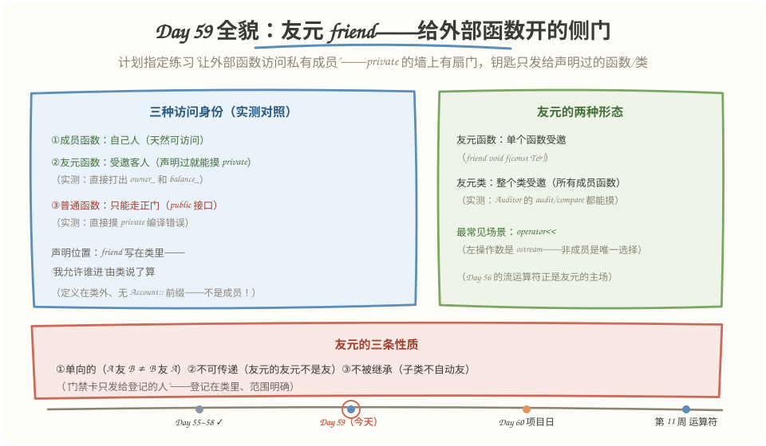

# 第 59 天：Matrix 矩阵类——运算符全家桶的总演练场

> **今日目标**：完成本教程后，你能做到：实现 `m[i][j]` 链式下标（Row 代理两步接力）并解释一维存储的折叠公式（`r*cols+c`）；实现矩阵加/乘/标量乘（同名 operator* 靠参数分派）；用断言守卫形状不变量；手算核对矩阵乘法的每个元素。
> **预计时间**：学习 25 分钟＋实践 50 分钟
> **前置准备**：完成 Day 55~58（四天运算符今天会师；Day 14 的二维数组是老朋友）。
> **今日产出**：约 130 行的 Matrix（三件套 + 链式下标 + 四则 + == + <<），全部输出手算核对。

## 1. 今天解决什么问题？

计划本周的实战日：**Matrix 矩阵类**——把 Day 55（算术）、56（流）、57（下标）、58（转换，今天恰好用不上）的运算符**放进同一个类**会师。核心新知是 `m[i][j]` 的**链式下标**：`operator[]` 只能收一个参数，两次 `[]` 要分两步走——第一步定行（返回 Row 代理）、第二步定列（Row 的 `operator[]` 返回元素引用）。

Day 14 的二维数组（`m[r][c]` 折叠进一维）今天变成自己写的类：折叠公式 `r*cols+c` 进 `at()`，三重循环的矩阵乘是老朋友的类版。

## 2. 先看全貌：今天的内容位于哪里？



**图 1**：左卡是 `m[i][j]` 的两步接力（`a.operator[](1)` 返回 Row → `Row.operator[](2)` 返回 int&）；右卡绿是三个运算符的分工（+/矩阵乘/标量乘——同名 operator* 靠参数分派）；下方黄卡提醒三件套依然是地基。

三步概括今天：

1. 链式下标 = Row 代理两步接力；一维存储靠 `r*cols+c` 折叠；
2. 同名 operator* 重载（矩阵版/标量版）靠参数类型分派；
3. 三件套是地基——运算符全家桶站在拷贝控制上。

## 3. 核心概念：先用直觉，再给准确定义

### 3.1 链式下标：两次 [] 的接力

- **一句通俗解释**：`a[1][2]` 拆成两步——第一步 `a[1]` 返回一个"第 1 行"的定位器（Row 代理），第二步 `[2]` 在这行里定列、返回元素引用。
- **一个类比**：地址定位——`a[1]` 先定位到楼（Row 带着"1 号楼"），`[2]` 再定位房间（"2 号室"）——两步各司其职。
- **对应到技术上是**：实测 `a[1][2] = 6` 读写都通——翻译 `a.operator[](1).operator[](2)`。Row 是**嵌套的轻量结构**：只存 `(矩阵指针, 行号)` 不存数据（两个成员的定位器）。为什么不能一步？`operator[]` 只收一个参数（语言规则）——二维要两个下标，只能拆两次。类比的边界：**另一条路**是 `operator()(int r, int c)`（`m(1,2)` 一步到位）——很多数学库这么干（Eigen 等）；[][] 保留"像二维数组"的手感、() 简洁直接——各有拥趸。
- **常见误解**："Row 代理会拷贝整个矩阵"——它只带指针和行号（几个字节）；真正的数据访问发生在第二步的 `at()` 里。

### 3.2 一维存储 × 二维接口

- **一句通俗解释**：内存是一维的长条——二维矩阵靠 `r*cols+c` 公式把坐标折进一维；`at(r,c)` 是公式的唯一出口。
- **一个类比**：书架编号——第 3 排第 4 本 = 前面 3 排全满 + 4 = `3*每排本数+4`。
- **对应到技术上是**：实测 `a[1][2]`（2 行 3 列）落点 `1×3+2=5` → `data_[5]`（值为 6）。Day 14 的二维数组编译器在背后做的正是这个折叠；今天公式进自己的 `at()`（私有一处、读写两个版本共用——**公式的单点维护**）。类比的边界：这种"行主序"（row-major）不是唯一摆法——列主序（`c*rows+r`）也行，图形学库常见；关键是一致。
- **常见误解**："Matrix 里存的是 int 二维数组"——存的是一维 `int*`；二维只是接口的呈现。

### 3.3 同名分派与形状守卫

- **一句通俗解释**：两个 `operator*`（矩阵版收 `const Matrix&`、标量版收 `int`）——重载决议按参数类型自动分派；形状不对（如 2×3 加 3×2）被 assert 拦下。
- **一个类比**：同姓收银员（都叫 `*`）——你递矩阵他走矩阵流程、递数字他走标量流程；发票格式不对（形状）柜台拒收。
- **对应到技术上是**：实测 `a * e`（2×3 · 3×2 → 2×2）和 `a * 10`（标量）各得其所；手算四个乘积元素全对（58/64/139/154）。assert 是**教学版**守卫（违约直接崩、信息少）；真实库抛异常带恢复信息（第 12 周方向）。类比的边界：== 先比形状再逐元素——不同形直接 false（不是崩溃）。
- **常见误解**："assert 的检查留在发布版"——NDEBUG 下 assert 被编译掉——教学可接受、产品要另设关卡（这也是它的定位）。

## 4. 图解核心机制


**图 2**：上半部分蓝卡是一维存储图——6 格的 data_ 上绿格是行 0、橙格是行 1，`a[1][2]` 落点 `data_[5]`；左下绿卡是矩阵乘的坐标图（`f[i][j] = Σ a[i][k]·e[k][j]`，手算 58 全过程）；右下灰卡是断言守卫。

按图逐步讲：

1. **对着格子走一遍折叠**：`r*cols+c` 把二维坐标映射进一维下标——Row 代理的第二步就是在调这个公式；
2. **看乘法的坐标图**：a 的行点乘 e 的列——`f[0][0] = 1·7+2·9+3·11 = 58` 手算全对；
3. **数三重循环**：i（行）× j（列）× k（点乘项）——2×2 结果各 3 项共 12 次乘加；
4. **三周技能清单核销**（图 3 右侧）：三件套（9 周）、const 双版（7 周）、四则运算符（10 周）——今天全部现役。

## 5. 动手实践：完成一个最小可运行例子

### 5.1 准备文件

```bash
cd ai-compiler-roadmap/tutorials/day-059/examples
```

主角：`matrix.cpp`（约 130 行完整版）。

### 5.2 编写代码

链式下标的骨架（完整代码见本目录）：

```cpp
// 链式下标：Row 代理类（两次 [] 分两步走）
struct Row {
    Matrix* m_;
    int r_;
    int& operator[](int c) { return m_->at(r_, c); }        // 第二步：定列
};

Row operator[](int r) { return Row{this, r}; }               // 第一步：定行
```

矩阵乘（Day 14 老朋友的类版）：

```cpp
Matrix operator*(const Matrix& rhs) const {
    assert(cols_ == rhs.rows_);
    Matrix result(rows_, rhs.cols_);
    for (int i = 0; i < rows_; ++i) {
        for (int j = 0; j < rhs.cols_; ++j) {
            int sum = 0;
            for (int k = 0; k < cols_; ++k) {
                sum += at(i, k) * rhs.at(k, j);
            }
            result.at(i, j) = sum;
        }
    }
    return result;
}
```

### 5.3 运行与观察

```bash
g++ -Wall matrix.cpp -o mx && ./mx
```

实际执行结果（本机）：

```text
== 链式下标 m[i][j] 读写 ==
a =
  [   1   2   3 ]
  [   4   5   6 ]
a[1][2] = 6

== 拷贝构造 + ==
c = a + b =
  [   2   4   6 ]
  [   8  10  12 ]

== 标量乘 ==
d = a * 10 =
  [  10  20   30 ]
  [  40   50   60 ]

== 矩阵乘法 ==
f = a * e =
  [  58   64 ]
  [ 139  154 ]

== 相等比较 ==
a == b ? 相等
a == c ? 不等
```


**图 3**：左上完整输出（手算账本逐项标注）；右侧是本周运算符清单核销 + 三周技能在一个类现役的说明。

**手算账本**（全部核对）：加法逐元素和 ✔；标量 ×10 ✔；矩阵乘四个元素 `1·7+2·9+3·11=58`、`1·8+2·10+3·12=64`、`4·7+5·9+6·11=139`、`4·8+5·10+6·12=154` ✔；`a == b`（深拷贝的副本）相等 ✔。

### 5.4 修改一个输入再观察：形状守卫亲测

把 main 里的 `Matrix c = a + b;` 改成 `Matrix c = a + e;`（e 是 3×2，与 a 的 2×3 **不同型**）——运行即崩（assert 触发，本机表现为Assertion failed 断言失败信息后 abort）。这正是守卫的拦截点。**对照**：把 assert 换成注释（去掉守卫）再跑——**静默读越界**（UB 又一次欺骗性呈现——shape 不匹配的加法逐元素乱算）。**一守一撤**：断言的价值和它的边界（NDEBUG 下被编译掉）都清楚了。

## 6. 常见错误与排查

**错误 1：`a[1][2]` 编译报 no member named 'at' 之类**

- 现象：链式下标编译失败；
- 原因：Row 里访问 `m_->at()` 但 at 是 Matrix 的 private——Row 是 Matrix 的**嵌套类**所以能访问（今天的设计）；若把 Row 拆到外面就断了权限；
- 定位：看 Row 是不是定义在 Matrix 内部；
- 修复：Row 保持嵌套（或用 friend）。

**错误 2：矩阵乘结果维度不对**

- 现象：2×3 · 3×2 得到 3×3 或别的；
- 原因：result 的构造维度写错（应为 `rows_ × rhs.cols_`）或循环边界混乱；
- 定位：手算一个元素对照（今天 5.3 的账本法）；
- 修复：result(rows_, rhs.cols_)；三重循环边界 i<rows_、j<rhs.cols_、k<cols_。

**错误 3：assert 没拦住形状错误**

- 现象：不同型相加没有立即崩；
- 原因排查：编译时定义了 NDEBUG（assert 被编译掉）；或断言条件写错；
- 定位：看编译选项和断言表达式；
- 修复：教学版去掉 NDEBUG；产品版换显式检查（抛异常/返回错误——第 12 周）。

## 7. 今日练习

### 必做练习

给 Matrix 加 `transpose()`（转置：行列互换，`result[c][r] = at(r, c)`）。验证：2×3 转置后 3×2；`a.transpose()[2][0] == a[0][2]`（=3）。再验证 `(a.transpose()).transpose() == a`（转置两次回原样）。预期产出：转置结果的打印 + 两条断言验证。

### 选做挑战

实现单位矩阵工厂：`static Matrix identity(int n)`（n×n，对角线 1 其余 0）。验证数学性质：`a * identity(3) == a`（右乘单位矩阵不变——今天的 == 立功）。这是"静态工厂函数"（Day 40 static 成员函数）在数学类的应用。

## 8. 今日验收

- [ ] 我的 m[i][j] 链式下标读写都通；能讲出 Row 代理的两步接力
- [ ] 我能默写折叠公式 r*cols+c 并定位 a[1][2] 的存储下标
- [ ] 我的四则运算实测与手算账本逐项一致（含矩阵乘四元素）
- [ ] 我实测了形状守卫（assert 拦截）和撤守卫的静默越界对照
- [ ] 我知道同名 operator* 靠参数类型分派（重载的日常形态）

## 9. 一句话总结与明天预告

今天的问题是"运算符全家桶在一个真实类里怎么协作"；机制上，链式下标靠 Row 代理两步接力、一维存储靠 r*cols+c 折叠、同名运算符靠参数分派、形状靠断言守卫——三件套是全部华丽的地基；实践上，四则战报 + 手算账本 + 守卫对照全部落地；验证标准是看到 m[i][j] 能画出两步接力、看到 a*e 能手算任一元素。明天 **Day 60（项目日）：第 10 周收官**——运算符全家桶的综合应用大考：详细需求明天揭晓，今天的 Matrix 是最好的复习材料。
