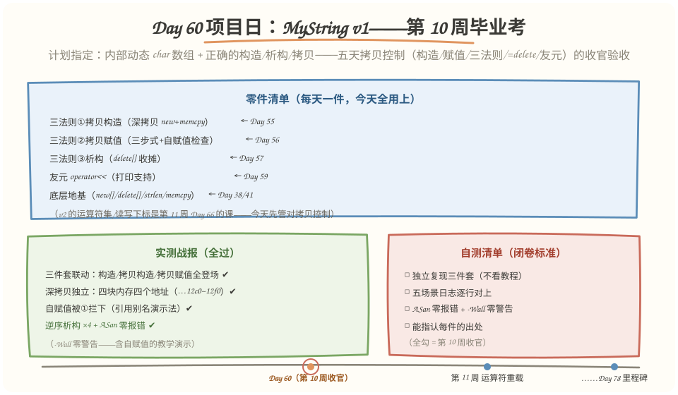
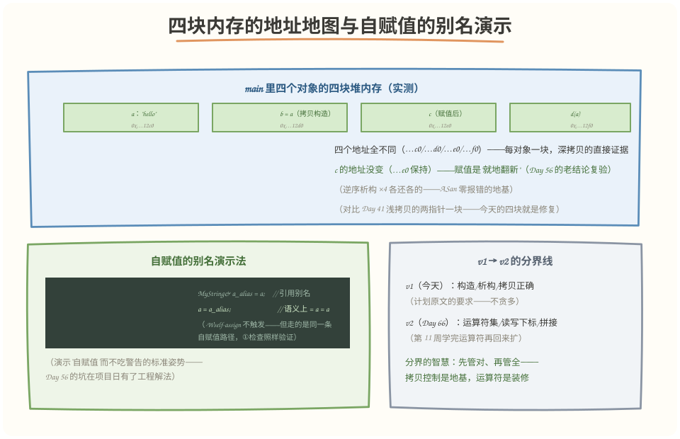
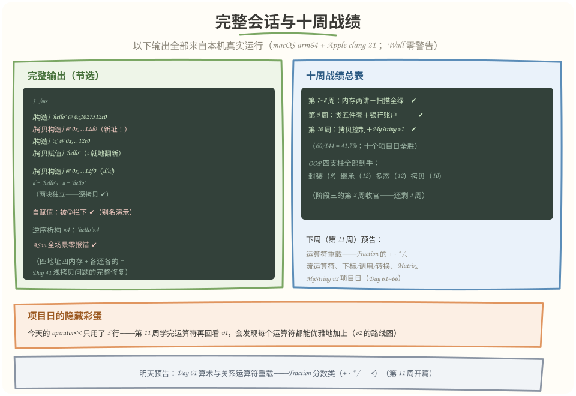

# 第 60 天（项目日）：MyString v1——第 10 周毕业考

> **今日目标**：完成本教程后，你能做到：闭卷实现 MyString v1（动态 char 数组 + 构造/析构/拷贝构造/拷贝赋值 + 自赋值处理）；五场景实测对上（三件套联动/深拷贝独立/自赋值/逆序析构/ASan 零报错）；用引用别名法演示自赋值（不吃 -Wself-assign 警告）；说出 v1 与 v2 的分界（先管对再管全）。
> **预计时间**：闭卷实现 50 分钟＋对照核对 30 分钟
> **前置准备**：完成 Day 55~59；合上教程，只留空编辑器——第 10 周的答卷。
> **今日产出**：约 60 行、`-Wall` 零警告 + ASan 零报错的 MyString v1，完整会话。

## 1. 今天解决什么问题？

计划第 10 周指定的收官项目：**MyString 类 v1——内部动态 char 数组，正确的构造/析构/拷贝**。五天零件全部上阵：拷贝构造（55）、拷贝赋值（56）、三法则（57）、=delete 的克制（58——v1 禁拷贝？不，v1 要**正确的**拷贝）、友元 operator<<（59）。

计划原文只要求三件套——**没有**要求运算符集（那是 v2、第 11 周 Day 66 的课）。这个分界本身就是工程智慧：**先管对（拷贝控制是地基）、再管全（运算符是装修）**。

## 2. 先看全貌：今天的内容位于哪里？



**图 1**：上方蓝卡是零件清单（五件各标注出处）；左下绿卡是实测战报；右下红卡是闭卷自测。路线图：**第 10 周今天收官（60/144 = 41.7%）**。

三步概括今天：

1. 三件套 + 构造 = v1 的全部（四块内存四个地址）；
2. 自赋值用别名演示法（吃功能不吃警告）；
3. v1/v2 分界：拷贝控制今天、运算符第 11 周。

## 3. 核心概念：先用直觉，再给准确定义

### 3.1 三件套的合体检验

- **一句通俗解释**：v1 = 出生（构造）+ 复印（拷贝构造）+ 翻新（拷贝赋值）+ 收摊（析构）——资源生命周期的完整闭环。
- **一个类比**：图书馆全流程——入库（构造）、复印副本（拷贝构造）、换内容（拷贝赋值）、报废（析构）；四个环节全对书才不丢不乱。
- **对应到技术上是**：实测——`a` 构造得 0x…12c0、`b = a` 拷贝构造得 0x…12d0、`c = a` 赋值就地翻新（0x…12e0 保持）、`d(a)` 又一块 0x…12f0——**四对象四内存**；退出时逆序析构 ×4 各还各的、ASan 零报错。类比的边界：std::string 还有 SSO/移动语义（Day 43/第 12 周）——v1 抓的是拷贝控制的骨架。
- **常见误解**："三件套写完就完事"——项目日标准是**三证**：五场景日志 + `-Wall` 零警告 + ASan 零报错。

### 3.2 自赋值的别名演示法

- **一句通俗解释**：要演示 `a = a` 但不想吃 `-Wself-assign-overloaded` 警告——先造个别名 `MyString& a_alias = a;` 再 `a = a_alias;`——语义同款、警告不触发。
- **一个类比**：左口袋换右口袋——直接说"自己给自己"（`a = a`）安检员多看一眼（警告）；经转手一次（别名）流程完全合法。
- **对应到技术上是**：实测——别名版自赋值照走三步式的①检查（日志打出"拷贝赋值"后内容无损）；`-Wself-assign` 只拦**显式**自赋值（Day 56 的老知识）——别名后编译器看不见、但**运行时路径完全相同**（①照样验证）。类比的边界：这是**演示技巧**不是生产需求——真实代码里隐式自赋值（`arr[i] = arr[j]` 且 i==j）本来就吃不到这个警告，①检查才是防线。
- **常见误解**："别名法是在骗编译器"——骗的只是**警告检测**（它本来就只管显式）；功能路径一丝不差——教学演示的标准姿势。

### 3.3 v1/v2 分界：先管对再管全

- **一句通俗解释**：v1 只做计划要求的"构造/析构/拷贝"——运算符集（比较/拼接/下标）留给 v2（第 11 周学完运算符再回来扩）。
- **一个类比**：装修——先做防水水电（拷贝控制——错了会"漏水"）、再吊顶刷墙（运算符——锦上添花）；顺序反了返工到哭。
- **对应到技术上是**：今天的 v1 约 60 行（三件套 + operator<< + c_str/size 两个查询）；v2（Day 66）将加 ==/</+/[] 等——**地基不变、只加装修**。这个"版本演进"模式也是 std::string 的历史路线（Day 47 的 v1→v2 同款节奏）。类比的边界：v1 不是"不完整"——它在自己的范围（拷贝正确性）是**完备**的；分界是范围管理不是偷工减料。
- **常见误解**："项目日应该一次做完所有功能"——贪多嚼不烂；第 11 周的运算符课有它自己的练习节奏（Fraction 先行）。

## 4. 图解核心机制



**图 2**：上半部分蓝卡是四对象的四块堆内存地图（…c0/…d0/…e0/…f0——深拷贝的直接证据、c 的"就地翻新"标注）；左下绿卡是自赋值的别名演示法（代码 + 为什么不吃警告）；右下灰卡是 v1/v2 分界。

按图逐步讲：

1. **数一数四个地址**：全不同——每对象一块（Day 41 浅拷贝"两指针一块"的问题在今天的 v1 里被三件套根治）；
2. **看 c 的地址没变**：赋值翻新不搬家（Day 56 的老结论在项目日复验）；
3. **读一遍别名法**：引用别名转一手——语义同款、路径同款、只躲开警告的显式检测；
4. **对着分界线放零件**：今天的五件（55~59）全在"地基"侧；运算符侧留给 Day 66——心里有这张图就不会在项目日贪多。

## 5. 动手实践：完成一个最小可运行例子

### 5.1 准备文件

```bash
cd ai-compiler-roadmap/tutorials/day-060/examples
```

主角：`mystring_v1.cpp`（约 60 行完整版）。

### 5.2 编写代码

骨架（完整代码见本目录）：

```cpp
class MyString {
private:
    char* data_;
    std::size_t len_;

public:
    MyString(const char* s = "") : len_(strlen(s)) {          // 构造
        data_ = new char[len_ + 1];
        memcpy(data_, s, len_ + 1);
    }

    MyString(const MyString& other) : len_(other.len_) {      // 三法则①拷贝构造
        data_ = new char[len_ + 1];
        memcpy(data_, other.data_, len_ + 1);
    }

    MyString& operator=(const MyString& other) {              // 三法则②拷贝赋值
        if (this == &other) { return *this; }                 //   自赋值检查
        delete[] data_;
        len_ = other.len_;
        data_ = new char[len_ + 1];
        memcpy(data_, other.data_, len_ + 1);
        return *this;
    }

    ~MyString() { delete[] data_; }                           // 三法则③析构

    friend std::ostream& operator<<(std::ostream& os, const MyString& s);   // Day 59
};
```

### 5.3 运行与观察

```bash
g++ -Wall mystring_v1.cpp -o ms && ./ms
```

实际执行结果（本机，节选）：

```text
== 三件套联动（五场景） ==
  [构造] "hello" @ 0x1027312c0
  [拷贝构造] "hello" @ 0x1027312d0
  [构造] "x" @ 0x1027312e0
  [拷贝赋值] "hello"

== 深拷贝独立性 ==
  [拷贝构造] "hello" @ 0x1027312f0
  d = "hello"，a = "hello"
  两块内存独立（地址见上面的日志）——改 d 不动 a

== 自赋值 ==
  [拷贝赋值] "hello"
  自赋值后 a = "hello"
  [析构] "hello"    ←×4 逆序
```

```bash
g++ -Wall -fsanitize=address mystring_v1.cpp -o msa && ./msa
```

```text
（ASan 全场景零报错）
```



**图 3**：左上完整输出（四地址/深拷贝/自赋值/析构标注）；右侧是十周战绩和下周预告。

### 5.4 修改一个输入再观察：拷贝独立性的破坏实验

把拷贝构造临时改成浅版（`data_ = other.data_;`——不 new 不 memcpy）——重跑：`b = a` 后两个对象**同址**（日志只打出一个地址）……析构时 double free（ASan 版立刻报 `attempting double-free`）。**一深一浅**：Day 55/41 的老实验在项目日的复验——三件套的每一件都不是摆设。恢复深版——全绿。（顺带：删掉自赋值检查 ① 重跑别名版自赋值——浅版下自赋值照样炸（delete 后从自己抄）；深版下 ① 只是优化——两种形态的差别值得记进 notes.md。）

## 6. 常见错误与排查

**错误 1：ASan 报 attempting double-free**

- 现象：析构阶段崩溃；
- 原因：拷贝构造/赋值写成浅版（共享内存）；
- 定位：看日志里多个对象是否同址；
- 修复：两步深拷贝（new + memcpy）——今天的 5.4 实验路径。

**错误 2：`-Wself-assign-overloaded` 警告**

- 现象：演示自赋值时警告；
- 原因：显式 `a = a` 被免费质检员点名；
- 定位：警告指到行号；
- 修复：别名法（`MyString& a_alias = a; a = a_alias;`）——功能同款、路径同款。

**错误 3：operator<< 写成成员版**

- 现象：`cout << s` 编译错（左操作数不是 MyString）；
- 原因：Day 56/59 的老课——流运算符必须非成员；
- 定位：看 operator<< 是否在类内带 friend；
- 修复：友元非成员版（Day 59 的决策树第二分支）。

## 7. 今日练习

### 必做练习

给 v1 加 `size()` 的使用演示和"修改能力探针"：写 `char& front()`（返回 `data_[0]`）——验证 `a.front() = 'H'` 能改、`b` 不受影响（深拷贝的活性证据）。预期产出：改 a 后 a="Hello"、b="hello" 的对照输出。

### 选做挑战

"三件套体检报告"：给每个特殊函数打计数器（static int 统计构造/拷贝/赋值/析构各被调几次），跑今天五场景后打印统计——对照手数（构造 2、拷贝构造 2、赋值 2、析构 4）。数字对上 = 生命周期全通；对不上 = 哪里多了/少了拷贝（第 12 周 RVO 课的预习材料）。

## 8. 今日验收

- [ ] 我闭卷实现了 v1 三件套 + operator<<（-Wall 零警告）
- [ ] 我的五场景输出与 5.3 逐行对上（四地址四内存）
- [ ] ASan 全场景零报错；自赋值用别名法演示通过
- [ ] 我实测了浅版复验（5.4：一深一浅的 double-free 对照）
- [ ] 我能说出 v1/v2 分界（拷贝控制是地基、运算符是装修）

## 9. 一句话总结与明天预告

今天的问题是"五天的拷贝控制能不能装成一个正确的字符串"；机制上，三件套管资源闭环（四对象四内存、逆序析构、ASan 零报错）、别名法演示自赋值（吃功能不吃警告）、v1/v2 分界体现范围管理；实践上，五场景、ASan 双验证、浅版破坏实验全部落地；验证标准是闭卷写出且三证齐全。**第 10 周收官——60/144 天（41.7%），十个项目日全胜。** 明天进入 **第 11 周 · Day 61：算术与关系运算符重载**——Fraction 分数类（`+ - * / == <`）：a + b 终于像数学了。
