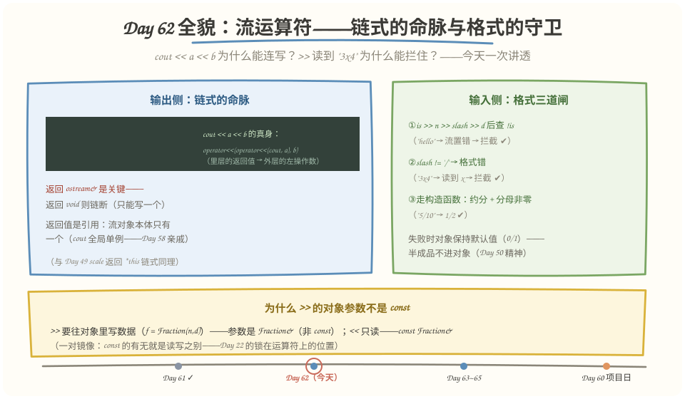
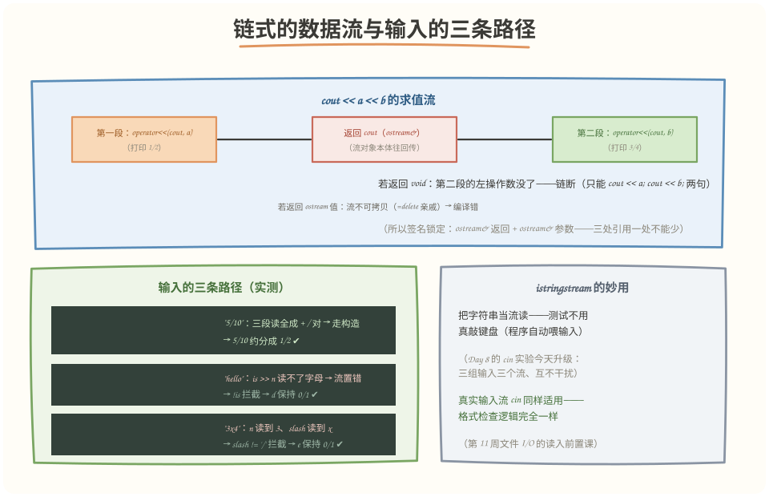
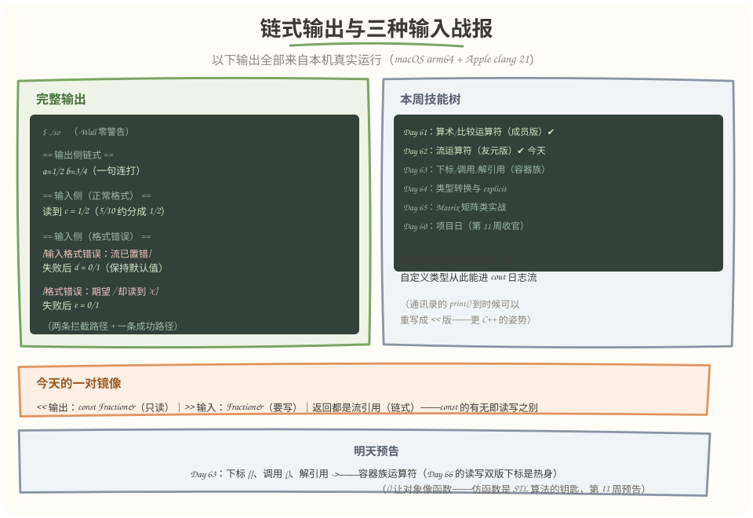

# 第 62 天：流运算符深入——链式的命脉与格式的守卫

> **今日目标**：完成本教程后，你能做到：写出 `<<` 和 `>>` 的友元版并解释链式机制（里层返回值成为外层左操作数）；解释返回 `ostream&` 而非值/void 的原因（流不可拷贝、void 断链）；给 `>>` 实现三道格式闸（流状态、分隔符、构造校验）并实测两种失败路径；说出 `<<` 和 `>>` 参数 const 之别的含义。
> **预计时间**：学习 20 分钟＋实践 45 分钟
> **前置准备**：完成 Day 61（昨天 friend 版 `<<` 是伏笔）。
> **今日产出**：Fraction 的流运算符完整版（链式输出 + 三种输入路径实测）、istringstream 测试法。

## 1. 今天解决什么问题？

昨天 Fraction 的 `cout << a` 用了友元 `operator<<` 但没展开两个疑问：**`cout << a << b` 为什么能连写**？（链式的命脉在返回值）；**`>>` 读到 "3x4" 这种坏输入怎么拦**？（格式守卫的三道闸）。

今天把流运算符一次讲透。顺带引入 istringstream——把字符串当流读，测试不用真敲键盘（Day 8 的 cin 实验升级版）。

## 2. 先看全貌：今天的内容位于哪里？



**图 1**：左卡是输出侧的链式命脉（`operator<<(operator<<(cout, a), b)`——里层返回值成为外层左操作数；返回 ostream& 是关键）；右卡绿是输入侧三道闸（流状态/分隔符/构造校验）；下方黄卡是 `<<` `>>` 的 const 镜像。

三步概括今天：

1. 链式：返回流引用——返回 void 断链、返回值编译错（流不可拷贝）；
2. 格式：`!is` 查流状态、`slash != '/'` 查分隔符、构造函数兜底（约分+分母）；
3. 镜像：`<<` 参数 const（只读）、`>>` 参数非 const（要写）。

## 3. 核心概念：先用直觉，再给准确定义

### 3.1 链式的命脉：返回流引用

- **一句通俗解释**：`cout << a << b` 从左到右求值——第一段返回 cout 本体，第二段接着用它；链式的前提是**把流往回传**。
- **一个类比**：传纸条——第一人写完把纸条传给第二人（返回流），第二人接着写再传出（又返回）；若第一人写完把纸条收起来（返回 void），第二人就没了纸条。
- **对应到技术上是**：实测 `a=1/2 b=3/4` 一句连打；翻译是 `operator<<(operator<<(cout, a), b)`——**里层的返回值成为外层的左操作数**。两种错误返回：void 断链（只能分两句）；ostream 按值返回——iostream 不可拷贝（`=delete` 的亲戚，Day 57~58 思想）直接编译错。类比的边界：从右往左结合的运算符（如 `=`）链式方向相反（Day 56 的 `c = b = a`）——<< 从左到右、= 从右到左，各有天然语义。
- **常见误解**："`<<` 是 cout 的方法所以随便链"——每一段都是一次 operator<< 调用；链得住全靠每段往回传流。

### 3.2 格式守卫：三道闸

- **一句通俗解释**：`>>` 读 Fraction 期望"数字/数字"——三道闸逐个检查：流状态（数字读进了吗）、分隔符（是 / 吗）、构造校验（分母非零+约分）。
- **一个类比**：机场三关——证件检查（流状态）、签证类型（分隔符）、海关申报（构造校验）——任何一关不过都不能登机（对象不被写入）。
- **对应到技术上是**：实测三条路径——"5/10" 三关全过 → 1/2（约分）；"hello" → `is >> n` 读不了字母 → 流置错 → `!is` 拦截（d 保持 0/1）；"3x4" → n 读到 3、slash 读到 x → `slash != '/'` 拦截（e 保持 0/1）。**失败时对象保持默认值**——半成品不进对象（Day 50"出生即就绪"精神的输入版）。类比的边界：流一旦置错**持续到显式 clear()**——后续读取全部失败（Day 8 的 cin 循环陷阱同源）；今天每格用独立的 istringstream 避免串联污染。
- **常见误解**："读失败对象会被写一半"——不会；本实现失败路径直接 return，`f = Fraction(n, d)` 只在三关全过后执行。

### 3.3 const 镜像与 istringstream

- **一句通俗解释**：`<<` 只读对象（const Fraction&）、`>>` 要写对象（Fraction&）——const 的有无就是读写之别；istringstream 把字符串变成流，测试自动喂输入。
- **一个类比**：展览（<< 隔玻璃看，const）和录入（>> 填表格，非 const）；istringstream 像自动喂卡机——把写好的卡片（字符串）依次送进读卡器。
- **对应到技术上是**：实测用三个 istringstream 分别喂 "5/10"、"hello"、"3x4"——互不干扰、无需键盘交互；同样逻辑换 cin 直接可用（第 13 周 Day 77 文件驱动、第 14 周 Day 84 读文件的前置课）。类比的边界：istringstream 是**只读流**（喂进去就不能改）；要动态拼输入用 ostringstream（先拼再转）——进阶工具箱的存货。
- **常见误解**："测试输入必须 cin 交互"——istringstream 让输入成为测试数据的一部分（可重复、可自动化）；这也是今天三个失败路径能并排实测的原因。

## 4. 图解核心机制



**图 2**：上半部分蓝卡是 `cout << a << b` 的求值流——第一段打印 1/2 返回 cout 本体 → 第二段用它打印 3/4；红字标注两种错误返回的后果（void 断链/按值返回编译错）；左下绿卡是输入三条路径的实测（成功/流置错/分隔符错各走一关）；右下灰卡是 istringstream 的妙用。

按图逐步讲：

1. **顺着箭头走数据流**：流对象从左到右被每段传递——像接力棒；签名三处引用（返回 ostream&、参数 ostream&、参数 Fraction&）一处不能少；
2. **看三条路径的分流点**：第一关在 `is >> n`（读不进字母就置错）、第二关在 slash 的值、第三关在构造函数——**每关失败都提前 return**，对象不被碰；
3. **想清楚为什么失败保持默认**：`f = Fraction(n,d)` 是唯一的写入点——它前面三关全过才执行（写入点收敛 = 失败安全）；
4. **istringstream 的工程价值**：三组测试三个流——今天能并排展示三种命运全靠它；真实项目的单元测试同款思路。

## 5. 动手实践：完成一个最小可运行例子

### 5.1 准备文件

```bash
cd ai-compiler-roadmap/tutorials/day-062/examples
```

主角：`stream_ops.cpp`（流运算符完整版）。

### 5.2 编写代码

核心两件（完整代码见本目录）：

```cpp
// 输出运算符：友元非成员版（左边是 ostream）
friend std::ostream& operator<<(std::ostream& os, const Fraction& f) {
    os << f.num_ << "/" << f.den_;
    return os;                             // 返回流引用——链式的命脉
}

// 输入运算符：istream 版（格式检查是重点）
friend std::istream& operator>>(std::istream& is, Fraction& f) {
    int n, d;
    char slash;
    is >> n >> slash >> d;                 // 期望格式："1/2"（数字/数字）
    if (!is) {                             // 闸一：流状态（非数字）
        return is;
    }
    if (slash != '/') {                    // 闸二：分隔符
        return is;
    }
    f = Fraction(n, d);                    // 闸三：构造校验（约分+分母）
    return is;
}
```

### 5.3 运行与观察

```bash
g++ -Wall stream_ops.cpp -o so && ./so
```

实际执行结果（本机）：

```text
== 输出侧链式 ==
a=1/2 b=3/4（一句连打）

== 输入侧（正常格式） ==
读到 c = 1/2（5/10 约分成 1/2）

== 输入侧（格式错误） ==
  [输入格式错误：流已置错]
失败后 d = 0/1（保持默认值 0/1）
  [格式错误：期望 / 却读到 'x']
失败后 e = 0/1
```



**图 3**：左上完整输出（成功/流置错/分隔符错三条路径标注）；右侧是本周技能树和流运算符的定位；下方橙卡是 const 镜像、灰卡预告明天。

### 5.4 修改一行再观察：链式的两种断法

**断法一（返回 void）**：把 `operator<<` 的返回类型改成 `void`（函数体去掉 `return os;`）——编译报错：`invalid operands to binary expression ('void' and 'const char[4]')`（第二段 `<< " b="` 的左操作数没了）。**断法二（按值返回）**：返回类型改成 `std::ostream`（去掉 &）——编译报错：`call to deleted constructor of 'std::ostream'`（流不可拷贝——Day 57 `=delete` 的标准库现身）。两种断法一对照，**返回 ostream& 是唯一活路**的结论自己浮出来。

## 6. 常见错误与排查

**错误 1：`invalid operands to binary expression ('void' and 'const char[4]')`**

- 现象：链式 `cout << a << b` 编译失败（第二段报错）；
- 原因：operator<< 返回了 void——第一段的结果不是流；
- 定位：看报错指向第二个 <<；
- 修复：返回 `std::ostream&` 并 `return os;`。

**错误 2：`call to deleted constructor of 'std::ostream'`**

- 现象：operator<< 按值返回 ostream；
- 原因：流对象不可拷贝（标准库 =delete 了拷贝）；
- 定位：返回类型的 & 有没有丢；
- 修复：返回引用 `std::ostream&`。

**错误 3：读坏输入后对象"变垃圾"**

- 现象：`>>` 失败后对象值诡异；
- 原因：失败路径没有提前 return——继续执行了写入（或部分写入）；
- 定位：检查三道闸的 return 路径；
- 修复：每关失败立即 return is，写入点（`f = …`）收敛在三关之后。

## 7. 今日练习

### 必做练习

给 `>>` 补"负分数"支持："-1/2"（分子带负号）——验证 `is >> n` 天然支持负号（实测 `-1/2` 读成 -1 和 2）。预期产出：负分数读入 + 输出的往返测试（`>>` 后 `<<` 回去应一致，注意 -1/-2 会被规范化成 1/2）。

### 选做挑战

给 Fraction 加 `operator>>` 的"宽容格式"：允许 "3"（无分母默认 /1）——用 `is.peek()` 预看下一字符：不是 `/` 就跳过分母读取（d = 1）。预期产出：`3` → 3/1、`3/4` → 3/4 两种输入都能读。这是后续解析格式化输入（第 22 周 JSON 解析器同款思路）的迷你预演。

## 8. 今日验收

- [ ] 我能画出 `cout << a << b` 的求值流（里层返回值 → 外层左操作数）
- [ ] 我实测了两种断链（void 断链 / 按值返回编译错）——返回 ostream& 是唯一活路
- [ ] 我的三道闸实测：成功/流置错/分隔符错三条路径，失败时对象保持默认
- [ ] 我能说出 << 和 >> 的 const 镜像（读写之别）
- [ ] 我会用 istringstream 做自动化输入测试

## 9. 一句话总结与明天预告

今天的问题是"流运算符的链式和输入安全怎么做"；机制上，链式的命脉是返回流引用（void 断链、按值编译错），输入的安全靠三道闸（流状态/分隔符/构造校验）+ 写入点收敛；实践上，链式输出、三种输入路径、两种断链全部实测；验证标准是看到任何 `cout << a << b` 能画出数据流、任何 `>>` 能指出闸在哪。明天 **Day 63：下标 []、调用 ()、解引用 ->**——容器族运算符：Day 66 的读写双版下标是热身，`()` 让对象像函数（仿函数是第 16 周 STL 算法的钥匙）。
