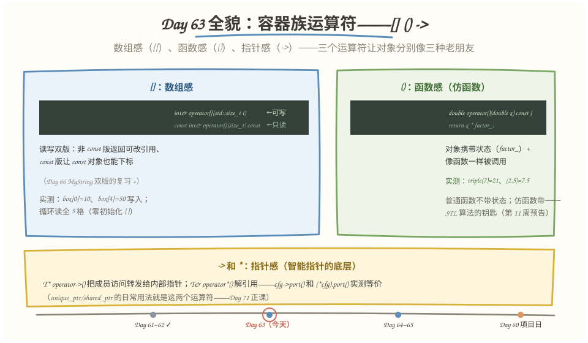
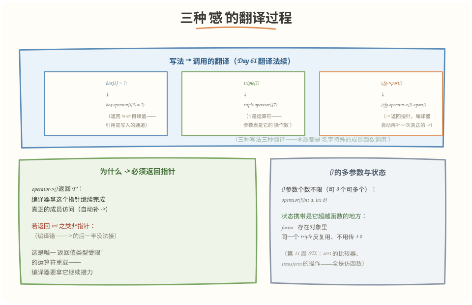
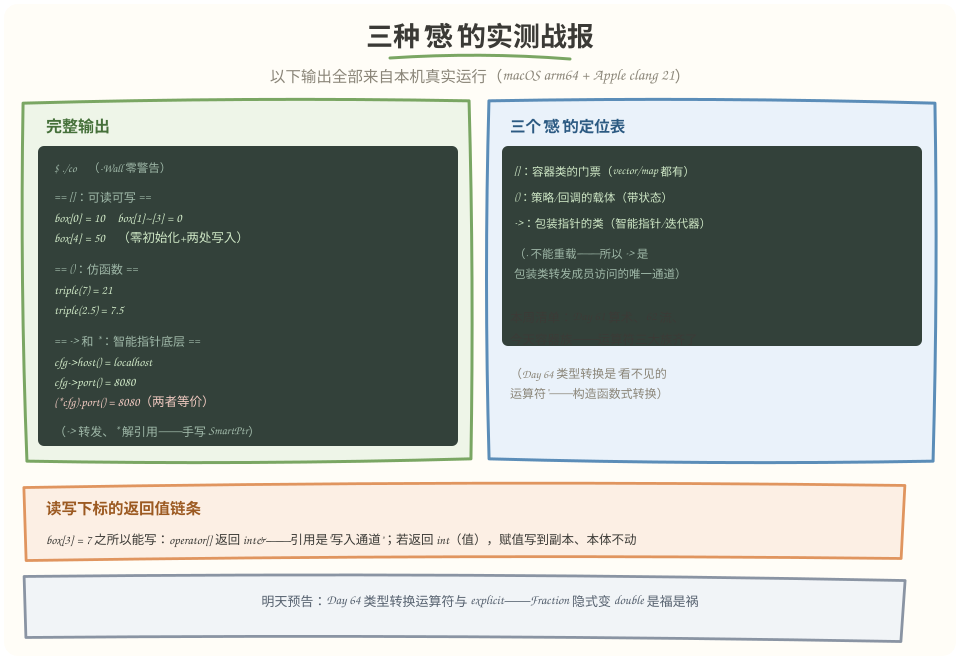

# 第 63 天：容器族运算符——下标 []、调用 ()、解引用 ->

> **今日目标**：完成本教程后，你能做到：实现读写双版 `operator[]`（引用是写入通道）并解释返回 int（值）时赋值为什么失效；实现仿函数 `operator()`（对象携带状态被"调用"）；实现 `operator->` 和 `operator*`（智能指针的底层机制）并说出 -> 必须返回指针的原因；说出 . 不能重载所以 -> 是包装类的唯一通道。
> **预计时间**：学习 20 分钟＋实践 45 分钟
> **前置准备**：完成 Day 61~62（MyString 读写双版下标是热身；翻译法是 Day 61 的工具）。
> **今日产出**：IntBox（读写下标 + 零初始化）、Multiplier（仿函数）、SmartPtr（-> 和 * 转发）三合一实测。

## 1. 今天解决什么问题？

算术（Day 61）和流（Day 62）之后，运算符三大族的最后一族：**容器族**——让对象分别像数组（`[]`）、像函数（`()`）、像指针（`->`）。计划本周的"下标、调用、解引用"今天一网打尽。

三个实用背景：`[]` 是容器类的门票（vector/map 全有——读写双版 Day 66 练过今天复习机制）；`()` 是仿函数（对象带状态被调用——STL 算法的钥匙，第 11 周正式开箱）；`->` 是智能指针的底层（手写一个 SmartPtr 看懂 unique_ptr 的日常用法——Day 71 正课的前菜）。

## 2. 先看全貌：今天的内容位于哪里？



**图 1**：左卡是 `[]`（读写双版——引用是写入通道）；右卡绿是 `()`（仿函数——带状态的调用）；下方黄卡是 `->` `*`（智能指针底层）。

三步概括今天：

1. `[]` 双版：非 const 返回可写引用、const 返回只读引用——引用是写入通道；
2. `()`：参数个数不限、对象携带状态——超越普通函数的地方；
3. `->` 必须返回指针（编译器拿它接力完成真正的成员访问）；. 不能重载。

## 3. 核心概念：先用直觉，再给准确定义

### 3.1 operator[]：数组感

- **一句通俗解释**：重载下标让对象用数组语法读写元素——`box[3]` 翻译成 `box.operator[](3)`。
- **一个类比**：储物柜——`box[3]` 是"3 号柜"；可写版给你钥匙（引用），只读版只给观察窗。
- **对应到技术上是**：实测——`box[0]=10`、`box[4]=50` 写入成功，循环读全 5 格（`new int[n]{}` 零初始化：未写的格子是 0 不是垃圾）。**关键机制**：`operator[]` 返回 `int&`（引用）——`box[3]=7` 的赋值经引用直达本体；若返回 `int`（值），赋值写到**临时副本**、本体纹丝不动（且编译器可能警告）。类比的边界：教学版 `[]` 不查边界（Day 66 的 at() 练习同款问题）；vector 的 `[]` 同样不查、`at()` 查——行业标准姿势。
- **常见误解**："`[]` 是数组的专利"——它就是个运算符；map 用它按键取值（`m["key"]`）、Day 65 的 Matrix 用它做二维访问（`m[i][j]` 的链式）。

### 3.2 operator()：函数感（仿函数）

- **一句通俗解释**：重载调用运算符让对象能像函数一样被"调用"——`triple(7)` 翻译成 `triple.operator()(7)`。
- **一个类比**：定制机床——普通函数是通用车床（每次全调参数）；仿函数是调好参数的专用机床（factor_ 存在对象里），按下按钮（()）就按设定加工。
- **对应到技术上是**：实测——`Multiplier triple(3.0)` 后 `triple(7)=21`、`triple(2.5)=7.5`：**状态（factor_）在对象里、调用时不用再传**。这是它超越普通函数的核心：函数无状态（每次调用的参数就是全部信息），仿函数有（构造时定、多次调用复用）。类比的边界：() 的参数个数不限（可 0 个可多个——和普通函数一样的签名自由度）；**lambda（Day 73 前后会遇到）本质就是仿函数的语法糖**。
- **常见误解**："() 是构造函数"——构造函数名是类名（Day 50）；`operator()` 是调用运算符——对象**已存在**时被"调用"。两者完全不同。

### 3.3 operator-> 和 operator*：指针感

- **一句通俗解释**：`->` 把成员访问转发给内部指针（智能指针的日常）；`*` 解引用拿对象本体——`cfg->port()` 和 `(*cfg).port()` 等价（实测都是 8080）。
- **一个类比**：私人助理——你跟助理说"帮我问他的端口"（cfg->port()），助理转发给本人（内部指针）；或者你直接见本人（*cfg 再 .）。
- **对应到技术上是**：实测——手写 `SmartPtr<Config>` 内部持有 `Config*`；`operator->()` 返回 `ptr_`（**必须是指针**——编译器拿它自动再补一次 `->` 完成真正的成员访问：`(cfg.operator->())->port()`）；`operator*()` 返回 `*ptr_`（对象引用）。类比的边界：**-> 是唯一"返回值类型受限"的运算符重载**——必须返回指针（或另一个重载了 -> 的类——链式转发，进阶）；返回 int 之类编译器没法接力，直接编译错。
- **为什么 . 不能重载**：`.` 是访问成员的核心语法——重载它会让所有成员访问都变得不可信（语言设计者禁止）；所以**包装指针的类（智能指针/迭代器）用 -> 转发是唯一通道**——这正是 Day 61 不能重载清单里 `.` 在列的原因。

## 4. 图解核心机制



**图 2**：上半部分蓝卡是三种写法的翻译——`box[3]=7` → `box.operator[](3)=7`（引用是写入通道）；`triple(7)` → `triple.operator()(7)`；`cfg->port()` → `(cfg.operator->())->port()`（编译器自动补第二支箭）；左下绿卡是 -> 必须返回指针的原因（编译器要接力）；右下灰卡是 () 的多参数与状态优势。

按图逐步讲：

1. **顺着翻译链看本质**：三种"感"殊途同归——都是"名字特殊的成员函数调用"（Day 61 翻译法续）；懂了翻译，签名怎么写自然清楚；
2. **看 -> 的两段接力**：operator->() 只负责前半（返回指针）；编译器自动接后半（用返回的指针做真正的成员访问）——所以返回类型必须是指针；
3. **看 () 的状态栏**：triple 构造时存了 3.0——之后每次调用都用它；普通函数做同样的事要把 3.0 传成参数（每次都要传）；
4. **回归三大族**：算术（55）、流（56）、容器（今天）——Day 64 的类型转换是"看不见的运算符"（构造函数式）——运算符重载的知识版图明天合拢。

## 5. 动手实践：完成一个最小可运行例子

### 5.1 准备文件

```bash
cd ai-compiler-roadmap/tutorials/day-057/examples
```

主角：`container_ops.cpp`（三合一：IntBox + Multiplier + SmartPtr）。

### 5.2 编写代码

三个类的核心（完整代码见本目录）：

```cpp
class IntBox {                                   // [] 的主场
    int* data_;
    std::size_t size_;
public:
    explicit IntBox(std::size_t n) : data_(new int[n]{}), size_(n) {}   // {} 零初始化

    int& operator[](std::size_t i) {             // 可写下标（引用是写入通道）
        return data_[i];
    }
    const int& operator[](std::size_t i) const { // 只读下标
        return data_[i];
    }
};

class Multiplier {                               // () 的主场
    double factor_;
public:
    explicit Multiplier(double f) : factor_(f) {}
    double operator()(double x) const {          // 对象像函数一样被"调用"
        return x * factor_;
    }
};

template <typename T>
class SmartPtr {                                 // -> 的主场
    T* ptr_;
public:
    explicit SmartPtr(T* p) : ptr_(p) {}
    T* operator->() { return ptr_; }             // 返回指针——编译器接力
    T& operator*() { return *ptr_; }             // 解引用拿本体
};
```

### 5.3 运行与观察

```bash
g++ -Wall container_ops.cpp -o co && ./co
```

实际执行结果（本机）：

```text
== []：可读可写 ==
  box[0] = 10
  box[1] = 0
  box[2] = 0
  box[3] = 0
  box[4] = 50

== ()：仿函数 ==
  triple(7) = 21
  triple(2.5) = 7.5

== -> 和 *：智能指针的底层 ==
  cfg->host() = localhost
  cfg->port() = 8080
  (*cfg).port() = 8080
```



**图 3**：左上完整输出（含 `(*cfg).port()` 与 `cfg->port()` 等价的标注）；右侧是三族的定位表和本周清单；下方橙卡是读写下标的返回值链条。

### 5.4 修改一行再观察：引用通道的失效

把 IntBox 的可写版 `operator[]` 返回类型从 `int&` 改成 `int`（去掉 &）——重编译（预期编译失败，本机实测）：

```text
error: expression is not assignable
box[0] = 10;
```

比预想**更强**的保护：值返回后 `box[0] = 10` 直接编译不通过（右值不可赋值——编译器比"静默写副本"更早拦住）。**一改一对**：引用是写入通道的实证——去掉 & 连编译都过不了。恢复 `int&`——一切正常。把这条和 Day 56 的"返回 T& 支持链式"并排放进 notes.md：**引用的两大用途（写入通道 + 链式接力）今天凑齐，而且两处失效都是编译期红牌**。

## 6. 常见错误与排查

**错误 1：`box[3] = 7` 编译报 expression is not assignable**

- 现象：下标赋值编译失败；
- 原因：operator[] 返回了 int（值）——右值不可赋值，编译器直接拦；
- 定位：看返回类型的 & 丢了没；
- 修复：返回 `int&`（引用是写入通道）。

**错误 2：`error: 'operator->()' must return a pointer`（或类似措辞）**

- 现象：-> 重载返回了非指针类型；
- 原因：编译器拿返回值接力做真正的成员访问——不是指针接不上；
- 定位：看 operator-> 的返回类型；
- 修复：返回 `T*`（内部裸指针）。

**错误 3：误把 operator() 当构造函数**

- 现象：在 operator() 里写初始化逻辑、期望对象"重生"；
- 原因：混淆了构造（Day 50，名字是类名）和调用运算符（operator()）；
- 定位：看函数名——`Multiplier(...)` 是构造、`triple(...)` 是调用；
- 修复：初始化归构造函数；operator() 只做"调用时的活"。

## 7. 今日练习

### 必做练习

给 IntBox 加 `at(std::size_t i)`：越界打印错误并 exit(1)（Day 66 的练习版搬运）；对照 `[]` 的不查边界。预期产出：`box.at(2)` 正常、`box.at(99)` 被拦的对照输出。

### 选做挑战

写一个两参数仿函数 `Clamp`：构造时存 `lo_`、`hi_`；`operator()(double x)` 把 x 夹在 [lo, hi]（小于 lo 返回 lo、大于 hi 返回 hi、否则原值）。验证：`Clamp(0, 100)` 对 -5/50/150 三输入分别得 0/50/100。这是 STL `std::clamp` 的手写版——第 11 周算法库的预演。

## 8. 今日验收

- [ ] 我的 IntBox 读写双版下标通过；能解释引用为什么是写入通道（5.4 实测：去掉 & 编译红牌）
- [ ] 我的 Multiplier 仿函数工作；能说出它超越普通函数的地方（状态）
- [ ] 我的 SmartPtr 的 -> 和 * 都转发正确；能讲出 -> 必须返回指针的原因
- [ ] 我知道 . 不能重载——-> 是包装类的唯一通道
- [ ] 我能把三种写法各翻译成成员函数调用（Day 61 翻译法续）

## 9. 一句话总结与明天预告

今天的问题是"怎么让对象像数组、像函数、像指针"；机制上，[] 的写入通道是引用、() 的优势是状态、-> 的返回必须是指针（编译器接力）——三种"感"本质都是成员函数调用；实践上，IntBox、Multiplier、SmartPtr 三合一全部实测，引用通道失效实验一改一对；验证标准是看到 box[3]、triple(7)、cfg->port() 都能写出翻译。明天 **Day 64：类型转换运算符与 explicit**——Fraction 隐式变 double 是福是祸：看不见的转换在哪里发生、explicit 怎么把关。
