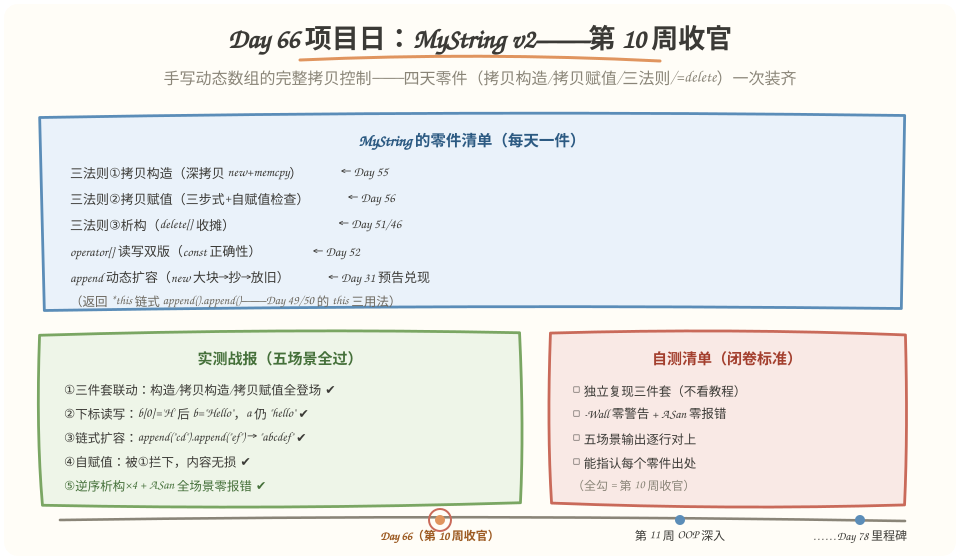
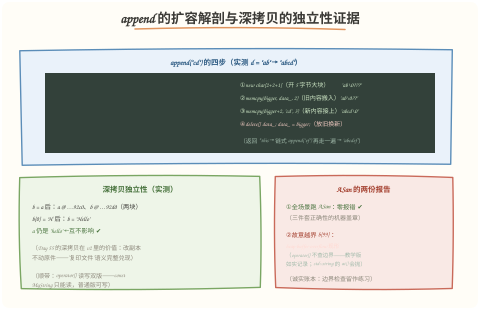
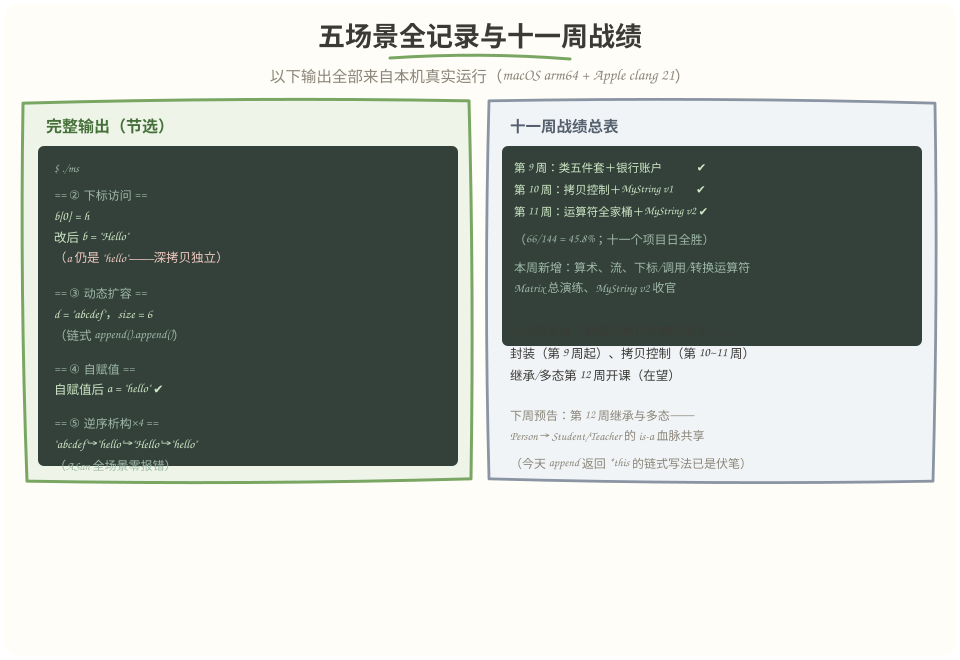

# 第 66 天（项目日）：MyString v2——完整拷贝控制（第 11 周收官）

> **今日目标**：完成本教程后，你能做到：闭卷实现手写动态字符串（三法则全手写 + 读写双版 `operator[]` + 动态扩容 append + 链式调用）；用五场景会话验证（三件套联动/下标读写/链式扩容/自赋值/逆序析构）；用 ASan 给全场景盖零报错章；说出每个零件的出处。
> **预计时间**：闭卷实现 60 分钟＋对照核对 30 分钟
> **前置准备**：完成 Day 55~65；合上教程，只留空编辑器——第 11 周的答卷。
> **今日产出**：约 90 行、`-Wall` 零警告 + ASan 零报错的 MyString v2，五场景全记录。

## 1. 今天解决什么问题？

计划第 11 周指定的收官验收：**MyString v2——手写动态数组的完整拷贝控制**。四天零件全部上阵：拷贝构造（Day 55）、拷贝赋值（Day 56）、三法则（Day 57）、设计原则（Day 58~65）。v2 比 v1（Day 60——上周的毕业考）多了三件套和读写分离的下标。

两个设计点值得先说：**append 的扩容四步**（new 大块 → 抄旧 → 接新 → 放旧——Day 47 vector 容量的预告今天兑现）；**operator[] 读写双版**（const 版只读、普通版可写——Day 52 const 正确性在运算符上的落地）。ASan 为全场景的正确性盖机器章。

## 2. 先看全貌：今天的内容位于哪里？



**图 1**：上方蓝卡是零件清单（五件各标注出处）；左下绿卡是五场景战报（全过 + ASan 零报错）；右下红卡是闭卷自测清单。路线图：**第 11 周今天收官（66/144 = 45.8%）**。

三步概括今天：

1. 三件套（拷贝构造 + 拷贝赋值 + 析构）是 v2 的骨架；
2. append 四步扩容 + 返回 `*this` 支持链式；
3. 五场景会话 + ASan 是验收双保险。

## 3. 核心概念：先用直觉，再给准确定义

### 3.1 三件套骨架：四天知识的合体

- **一句通俗解释**：MyString v2 = 构造（出生）+ 拷贝构造（复印）+ 拷贝赋值（翻新）+ 析构（收摊）——资源生命周期的四个环节全部手写。
- **一个类比**：图书馆的完整管理制度——新书入库（构造）、复印副本（拷贝构造）、替换内容（拷贝赋值）、报废销毁（析构）——四个流程齐了书才不丢不乱。
- **对应到技术上是**：实测五场景全过——①三件套日志全登场（构造/拷贝构造/拷贝赋值各就各位）；⑤退出时逆序析构×4（每个对象释放自己的内存）。类比的边界：真实的 std::string 还有 SSO（短字符串优化）、移动语义（Day 111）——今天的手写版抓的是**拷贝控制的骨架**，不是全部优化。
- **常见误解**："写完功能就算完成"——项目日的标准是**三证齐全**：五场景日志对上 + `-Wall` 零警告 + ASan 零报错——功能只是入场券。

### 3.2 append 四步：动态扩容的仪式

- **一句通俗解释**：容量不够就换更大的房子——四步：找新房（new 大块）、搬旧家具（memcpy 旧内容）、添新家具（memcpy 新内容）、退旧房（delete[]）。
- **一个类比**：换大办公室——先租新址、搬旧设备、装新设备、退租旧址——顺序不能乱（先退旧址就没地方搬了）。
- **对应到技术上是**：实测 `d.append("cd").append("ef")`——"ab" 先变 "abcd" 再变 "abcdef"（size=6）；返回 `*this` 让链式成立（Day 49 的 this 三用法第三次上岗）。类比的边界：每次 append 都扩一次是教学版；真实 vector 用**倍增策略**（容量翻倍摊薄单次成本——Day 79 vector 深入时展开）。
- **与 Day 47 的连接**：当时观察了 vector 的 capacity 增长曲线（预告了"内部搬家"）——今天的四步就是搬家的源码级呈现。

### 3.3 读写双版下标：const 正确性落地

- **一句通俗解释**：`operator[]` 写两个版本——普通版返回可写引用（`b[0] = 'H'` 能改）、const 版返回只读引用（const 对象只能看）。
- **一个类比**：展览馆的展品——本馆研究员（非 const）可以戴手套调整展品；游客（const）只能隔着玻璃看。
- **对应到技术上是**：实测 `b[0] = 'H'` 后 b 变 "Hello"、a 仍是 "hello"（深拷贝独立性 + 可写下标双证）；const 版的存在让 `const MyString&` 参数也能用 `[]`（编译不报错）。类比的边界：**两个版本都不查边界**——`b[99]` 越界是 UB（ASan 实测 heap-buffer-overflow 现形）——std::string 的 `at()` 会抛异常；边界检查留作今天的练习。
- **常见误解**："写两个 operator[] 太重复"——签名差在 const（重载的合法差异）；不写 const 版的话 const 对象完全不能下标（Day 52 执法线的运算符版）。

## 4. 图解核心机制



**图 2**：上半部分蓝卡是 append 四步解剖（new 5 字节 → 抄 "ab" → 接 "cd" → 放旧换新）；左下绿卡是深拷贝独立性（b[0]='H' 后 a 不动——两块内存互不影响）；右下红卡是 ASan 的两份报告（全场景零报错 ✔ + 故意越界的现形——operator[] 不查边界的诚实记录）。

按图逐步讲：

1. **看四步的顺序**：new 在前、delete 在后——先备好新房再退旧居（顺序反了就踩 Day 56 自赋值同款的雷）；
2. **看独立性的证据链**：两块地址 → 改 b → a 不动——Day 55 的深拷贝在 v2 里兑现了"复印文件"语义；
3. **看 ASan 的两副面孔**：正确实现零报错（机器盖章）、故意越界立刻现形（雷达灵敏度）——**同一工具既验收又探测**；
4. **阶段地图合拢**：封装与拷贝控制到手——继承/多态下周开课（图 3 右侧总表）。

## 5. 动手实践：完成一个最小可运行例子

### 5.1 准备文件

```bash
cd ai-compiler-roadmap/tutorials/day-066/examples
```

### 5.2 编写代码

参考实现 `mystring_v2.cpp` 约 90 行（完整代码见本目录）。三件套骨架（正文从 Day 55~56 的手写版复制，这里展示 append）：

```cpp
MyString& append(const char* s) {                // 动态扩容（new 大块 → 抄 → 放旧）
    std::size_t add = strlen(s);
    char* bigger = new char[len_ + add + 1];     // ①开大块
    memcpy(bigger, data_, len_);                 // ②旧内容搬入
    memcpy(bigger + len_, s, add + 1);           // ③新内容接上
    delete[] data_;                              // ④放旧
    data_ = bigger;
    len_ += add;
    return *this;                                // 支持链式
}

char& operator[](std::size_t i) { return data_[i]; }              // 可写版
const char& operator[](std::size_t i) const { return data_[i]; }  // 只读版
```

### 5.3 运行与观察

```bash
g++ -Wall mystring_v2.cpp -o ms && ./ms
```

实际执行结果（本机，节选）：

```text
== ① 三件套联动 ==
  [构造] "hello"
  [拷贝构造] "hello" @ 0x1054512d0
  [构造] "x"
  [拷贝赋值] "hello"

== ② 下标访问（读+写） ==
b[0] = h
改后 b = "Hello"（a 仍是 "hello"——深拷贝独立）

== ③ 动态扩容 append ==
  [构造] "ab"
d = "abcdef"，size = 6

== ④ 自赋值 ==
  [拷贝赋值] "hello"
自赋值后 a = "hello"

（⑤ 逆序析构×4："abcdef" → "hello" → "Hello" → "hello"）
```

```bash
g++ -Wall -fsanitize=address mystring_v2.cpp -o ms_asan && ./ms_asan
```

```text
（ASan 全场景零报错——三件套正确性的机器盖章）
```



**图 3**：左上五场景完整输出（含深拷贝独立、链式扩容、自赋值、逆序析构的标注）；右侧是十一周战绩总表和 OOP 支柱进度地图。

### 5.4 修改一行再观察：越界的现形

把 `b[0] = 'H'` 改成 `b[99] = 'H'`（故意越界），ASan 版编译运行（预期报错，本机实测）：

```text
ERROR: AddressSanitizer: heap-buffer-overflow on address 0x602000000a13
SUMMARY: AddressSanitizer: heap-buffer-overflow (oob:arm64+0x100000bc8) in main
```

**诚实账本**：教学版 operator[] 不查边界（如实记录）——真实 std::string 提供两个通道：`[]`（不查、快）和 `at()`（查、越界抛异常）。给 MyString 加一个 `at()`（带 `if (i >= len_)` 检查返回错误或抛异常）是今天的必做练习。**一正一越**：正确实现零报错、越界立刻现形——ASan 的两副面孔就是今天的验收工具。

## 6. 常见错误与排查

**错误 1：ASan 报 heap-buffer-overflow（自己实现时）**

- 现象：append 或三件套某处越界；
- 原因排查：memcpy 的长度算错（len_ + add + 1 少加 1 就是 '\0' 丢了）；new 的大小和 memcpy 长度不匹配；
- 定位：ASan 的报告直接给出地址和调用栈；
- 修复：逐字节核对四步的长度参数（画图数格子最保险）。

**错误 2：拷贝后改动互相影响（浅拷贝复发）**

- 现象：改 b 后 a 也变了；
- 原因：拷贝构造漏写（默认浅拷贝）或 new 忘了（两指针同址）；
- 定位：打印两个对象的 data_ 地址——相同即浅；
- 修复：补三件套（Day 57 的判断：有裸指针就该有）。

**错误 3：append 后旧内容丢失**

- 现象：append 完变成只有新内容；
- 原因：四步顺序错了——先 delete 了旧块再 memcpy 旧内容（读已释放内存）；
- 定位：检查 delete 的位置（必须在两次 memcpy 之后）；
- 修复：按 ①new ②抄旧 ③接新 ④放旧 的顺序重排。

## 7. 今日练习

### 必做练习

给 MyString 加 `at(std::size_t i)`：越界时打印错误并 `std::exit(1)`（教学版简化处理；真实做法是抛异常）。验证：`b.at(0)` 正常返回 'H'；`b.at(99)` 打印"下标越界"退出。预期产出：一组正常/越界对照输出。

### 选做挑战

倍增扩容策略：给 MyString 加 `capacity_` 成员——append 时容量不够就 `capacity_ = capacity_ ? capacity_ * 2 : 16`（翻倍而非精确）。对比：连续 append 100 次，两种策略各 new 多少次？（精确策略 99 次 vs 倍增约 7 次——Day 79 vector 深入的数学预告）。

## 8. 今日验收

- [ ] 我闭卷实现了 MyString v2（三件套 + 读写下标 + append，-Wall 零警告）
- [ ] 我的五场景输出与 5.3 逐行对上（含深拷贝独立、链式扩容）
- [ ] ASan 全场景零报错（机器盖章）
- [ ] 我实测了越界下标的 ASan 现形（operator[] 不查边界的边界）
- [ ] 我能对着零件清单逐行指认出处（Day 49~56 各一件）

## 9. 一句话总结与明天预告

今天的问题是"四天的拷贝控制零件能不能装成一个完整的手写字符串"；机制上，三件套管生命周期、append 四步管扩容、读写双版管 const 正确性——每个环节都是本周某天的主角；实践上，五场景会话、ASan 双面孔、越界现形全部实测；验证标准是闭卷写出且三证齐全（日志对上/零警告/零报错）。**第 11 周收官——66/144 天（45.8%），OOP 支柱：封装与拷贝控制到手，继承/多态明天开课。** 明天进入 **第 12 周 · Day 67：继承基础**——Person → Student/Teacher、`protected`、基类指针指向派生类：is-a 血脉共享开课。
