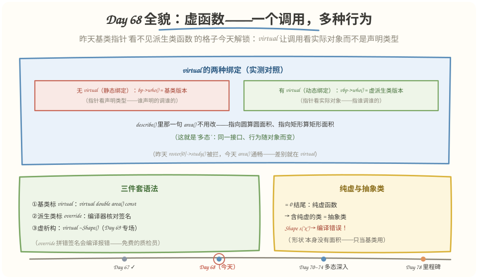
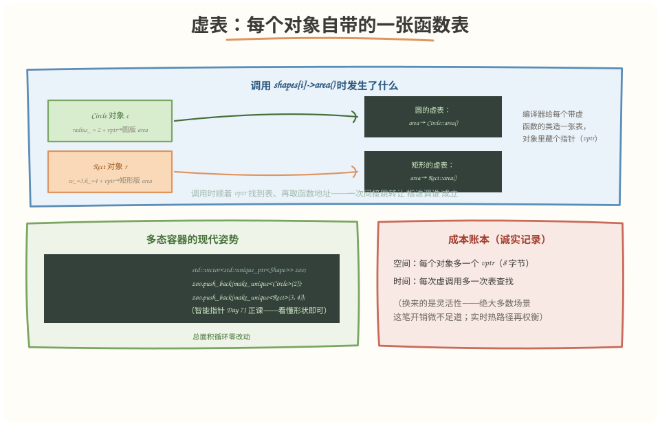
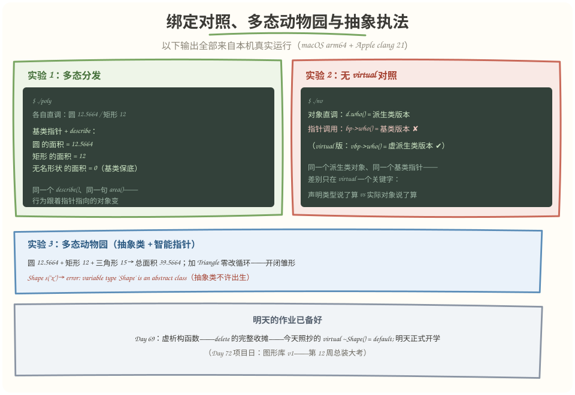

# 第 68 天：虚函数与动态多态——一个调用，多种行为

> **今日目标**：完成本教程后，你能做到：写出 virtual 基类函数 + override 派生覆盖，并解释两种绑定的差别（实测对照）；说出虚表机制的大致原理（vptr → 表 → 函数地址）；用纯虚函数（`= 0`）定义抽象类并实测其不可实例化；用多态容器统一管理不同派生类对象。
> **预计时间**：学习 30 分钟＋实践 45 分钟
> **前置准备**：完成 Day 67（基类指针的视野限制是今天的起点——今天解锁它）。
> **今日产出**：Shape 多态体系（圆/矩形/三角形）、绑定对照实验、抽象类执法记录、多态动物园（含智能指针初见）。

## 1. 今天解决什么问题？

昨天基类指针有条铁律：**只认基类接口**——`roster[0]->study()` 被编译器拦下。今天的问题：当基类和派生类**有同名函数**时，基类指针调用它会执行哪个版本？答案分两种：没有 `virtual`，看**声明类型**（谁的指针调谁的）；有了 `virtual`，看**实际对象**（指向谁调谁的）——后者就是**动态多态**（dynamic polymorphism），面向对象的高光时刻。

计划第 12 周的核心戏码（Shape 基类的 `area()` 被不同派生类覆盖）今天开演。多态的价值一句话：**一套接口管住一族类型，加新类型不改老代码**——今天加 Triangle，总面积循环一行没改。

## 2. 先看全貌：今天的内容位于哪里？



**图 1**：上半部分是两种绑定的实测对照（无 virtual 看声明类型 / 有 virtual 看实际对象）；左下绿卡是三件套语法（基类 virtual + 派生 override + 虚析构）；右下黄卡是纯虚与抽象类（`= 0` 结尾，抽象类不许出生——实测报错）。

三步概括今天：

1. 基类函数标 `virtual`，派生类同名同参标 `override`；
2. 经基类指针/引用调用时，实际对象说了算（动态绑定）；
3. `= 0` 纯虚让类变抽象——只能当基类，不能实例化。

## 3. 核心概念：先用直觉，再给准确定义

### 3.1 动态绑定：指谁调谁

- **一句通俗解释**：virtual 让函数调用在**运行期**按实际对象选择版本——而不是编译期按声明类型定死。
- **一个类比**：点外卖——非虚函数像"看收货地址的门牌号发货"（声明在哪发哪）；虚函数像"看实际下单的人吃什么"（对象是谁调谁的厨房）。
- **对应到技术上是**：实测对照——无 virtual 时 `bp->who()` 得"基类版本"（声明是 Base* 就调 Base 的）；有 virtual 时 `vbp->who()` 得"虚派生类版本"（对象是 VDerived 就调它的）。类比的边界：动态绑定**只发生在指针/引用调用**时——对象直调（`d.who()`）永远是编译期定的（今天就实测了这一点，两种写法结果相同）。
- **常见误解**："virtual 就是让派生类能改函数"——不加 virtual 派生类也能写同名函数（今天的 Derived 就写了），但那是**遮蔽**（声明类型说了算）而非覆盖；virtual 改变的是**经基类指针调用时的选择规则**。

### 3.2 虚表：一次间接跳转的原理

- **一句通俗解释**：编译器给每个带虚函数的类造一张函数表（虚表 vtable），对象里藏一个指回这张表的指针（vptr）——调用时顺着 vptr 找表、取函数地址、跳转。
- **一个类比**：酒店房间里的服务指南——每间房（对象）贴着指向本酒店服务目录（类的虚表）的二维码；扫码（vptr）看到的是**这家酒店**的餐厅电话（该类的函数版本）。
- **对应到技术上是**：Circle 对象和 Rect 对象各带 vptr，分别指向圆的虚表和矩形的虚表——`shapes[i]->area()` 的 `->` 顺 vptr 查表分发。成本账本诚实记录：每对象多 8 字节 vptr、每次调用多一次查表——绝大多数场景微不足道（Day 73 深入时回来对账）。类比的边界：虚表是**编译器和链接器的实现细节**，语言标准只规定行为（指谁调谁）不规定实现——不同编译器的虚表布局可以不同。
- **常见误解**："每个对象复制一张函数表"——表全类一张，对象里只有指过去的指针。

### 3.3 纯虚与抽象类：只当基类的类

- **一句通俗解释**：`= 0` 结尾的纯虚函数没有实现——含纯虚的类就是抽象类，**不能创建对象**，只能被继承。
- **一个类比**："形状"这个词本身没有面积——你不能画一个"形状"，只能画圆、画矩形；但"面积"这个概念对每种形状都成立（所以放在基类当接口）。
- **对应到技术上是**：实测 `Shape s("x")` 编译报 `variable type 'Shape' is an abstract class`；而 `Circle(2)`、`Rect(3,4)` 照常出生。抽象类的意义：**强制派生类实现接口**——忘了写 area() 的派生类也变抽象类，也出生不了（编译器替你把关）。类比的边界：抽象类可以有**非纯虚的成员和普通成员函数**（describe 就在 Shape 里）——"抽象"只针对那些 `= 0` 的函数。
- **常见误解**："抽象类就是没有成员的类"——不；它可以有数据、有实现好的函数，只要有一个纯虚函数就整体抽象。

## 4. 图解核心机制



**图 2**：上半部分是虚表分发图——Circle 对象和 Rect 对象各带 vptr 指向各自类的虚表（area 一栏填着不同函数地址）；调用 `shapes[i]->area()` 就是顺 vptr 查表跳转。左下绿卡是多态容器的现代姿势（`vector<unique_ptr<Shape>>`——智能指针 Day 71 正式学，今天看懂形状）；右下红卡是成本账本（8 字节 vptr + 一次查表，换来灵活性）。

按图逐步讲：

1. **顺着 vptr 走一遍**：对象 → vptr → 类的虚表 → 函数地址 → 跳转——"指谁调谁"的四步物理实现；
2. **override 是免费质检员**：派生类签名写错（参数多一个、const 漏了）时，没有 override 只是遮蔽、有 override 直接编译错——所以**每个覆盖都标 override**；
3. **多态容器的威力**：zoo 里圆、矩形、三角形混住，一个循环统一 describe——**加 Triangle 时循环零改动**（开闭原则的雏形：对扩展开放、对修改关闭）；
4. **成本与收益**：8 字节 + 一次查表换"接口统一 + 新类型零改老码"——今天的判断：值；实时热路径再单独权衡。

## 5. 动手实践：完成一个最小可运行例子

### 5.1 准备文件

```bash
cd ai-compiler-roadmap/tutorials/day-068/examples
```

三个程序：`polymorphism.cpp`（主角）、`no_virtual.cpp`（绑定对照）、`abstract_zoo.cpp`（多态动物园）。

### 5.2 编写代码

主角 `polymorphism.cpp` 的继承骨架（完整代码见本目录）：

```cpp
class Shape {
protected:
    std::string name_;

public:
    explicit Shape(const std::string& name) : name_(name) {}

    virtual double area() const {          // virtual：派生类可以覆盖
        return 0.0;                        // 基类给个保底（无面积）
    }

    void describe() const {                // 非虚：公共逻辑
        std::cout << name_ << " 的面积 = " << area() << std::endl;
    }

    virtual ~Shape() = default;            // 虚析构（Day 69 正式讲，今天先照写）
};

class Circle : public Shape {
private:
    double radius_;

public:
    explicit Circle(double r) : Shape("圆"), radius_(r) {}

    double area() const override {         // override：覆盖基类版本
        return 3.14159265 * radius_ * radius_;
    }
};
```

注意 describe() 里只写了一句 `area()`——它会被**实际对象**的版本接管（这就是多态的杠杆：公共逻辑写在基类，行为差异由派生类注入）。

### 5.3 运行与观察

```bash
g++ -Wall polymorphism.cpp -o poly && ./poly
```

实际执行结果（本机）：

```text
== 各自直调（编译期绑定） ==
圆面积 = 12.5664
矩形面积 = 12

== 基类指针 + describe（运行期分发） ==
圆 的面积 = 12.5664
矩形 的面积 = 12
无名形状 的面积 = 0
```

```bash
g++ -Wall no_virtual.cpp -o nv && ./nv
```

```text
对象直调：d.who() = 派生类版本
指针调用：bp->who() = 基类版本

对象直调：vd.who() = 虚派生类版本
指针调用：vbp->who() = 虚派生类版本

结论：没有 virtual，指针看声明类型（谁声明的调谁的）；
　　　有了 virtual，指针看实际对象（指谁调谁的）。
```

```bash
g++ -Wall abstract_zoo.cpp -o az && ./az
```

```text
圆 的面积 = 12.5664
矩形 的面积 = 12
三角形 的面积 = 15
总面积 = 39.5664
```



**图 3**：左上多态分发（同一个 describe 三种行为）；右上无 virtual 对照（一关键字两种命运）；下方蓝卡是多态动物园（加 Triangle 零改循环）和抽象类执法（`variable type 'Shape' is an abstract class`）。

### 5.4 修改一行再观察：抽象执法与漏写覆盖

**执法一（实例化抽象类）**：给 `abstract_zoo.cpp` 的 main 加 `Shape s("x");`（预期编译失败，本机实测）：

```text
error: variable type 'Shape' is an abstract class
```

**执法二（派生类漏写 area）**：给动物园加一个 `class Blob : public Shape {}`（空类，不写 area）——同样编译错误：Blob 继承了纯虚没实现，自己也成抽象类，`make_unique<Blob>()` 被拦。**抽象类把"必须实现接口"写进了类型系统**——忘了写不是运行时崩溃，是编译期红牌。

## 6. 常见错误与排查

**错误 1：派生类覆盖写错签名，被当成新函数**

- 现象：基类指针调用时执行了基类版本（多态"失灵"）；
- 原因：参数表或 const 不一致——派生类的同名函数成了新函数（遮蔽而非覆盖）；
- 定位：看派生类有没有标 override——**标了的话签名不匹配直接编译错**；
- 修复：补 override，按报错对齐签名（这就是 override 存在的意义）。

**错误 2：`error: variable type 'Shape' is an abstract class`**

- 现象：想直接创建抽象类对象；
- 原因：类里有纯虚函数（`= 0`）——它只当基类；
- 定位：看类声明里有没有 `= 0`；
- 修复：创建具体派生类的对象（Circle/Rect），抽象类只用于指针/引用。

**错误 3：基类析构没标 virtual，delete 基类指针只拆基类**

- 现象：经基类指针 delete 派生对象，派生类的析构没执行（资源可能泄漏）；
- 原因：析构函数走静态绑定——只调了基类版本；
- 定位：Day 69 的主题（虚析构为什么必须写）；今天先照抄 `virtual ~Shape() = default;`；
- 修复：基类析构一律标 virtual（明天的正式作业）。

## 7. 今日练习

### 必做练习

给动物园加第四种形状 `Square`（正方形，边长 a，继承 Rect 或独立实现均可）。预期产出：四个面积 + 新总面积；确认 describe 循环**一行没改**——把"加类型不改老码"再实操一遍。

### 选做挑战

在 Shape 加第二个纯虚 `virtual double perimeter() const = 0;`（周长），四种形状全部实现（圆 2πr、矩形 2(w+h)、三角形三边和——三角形需存三边或用勾股算）。describe 扩展成两行输出。体会：**基类加接口 = 全部派生类必须跟上**（编译器逐个点名）——这是抽象类的双刃剑。

## 8. 今日验收

- [ ] 我能写出 virtual + override 的完整继承体系并运行出多态分发
- [ ] 我能说出两种绑定的规则差别，并实测了无 virtual 的对照
- [ ] 我能大致讲出虚表机制（vptr → 表 → 函数地址）和成本账本
- [ ] 我实测了抽象类不可实例化、派生类漏实现也被拦
- [ ] 我用多态容器管理了混合对象，并体验了"加类型零改循环"

## 9. 一句话总结与明天预告

今天的问题是"同一个调用怎么按对象选行为"；机制上，virtual 让绑定从声明类型换成实际对象（虚表一次间接跳转实现），override 替编译器核对签名，纯虚把类变抽象强制接口；实践上，多态分发、绑定对照、多态动物园、抽象执法四组实验落地；验证标准是看到任何基类指针调用能说出会执行哪个版本、为什么。明天 **Day 69：虚析构函数为什么必须写**——今天两个示例照抄的 `virtual ~Shape() = default;` 正式开学：delete 基类指针时派生类析构不执行的真实泄漏实验（ASan 抓获）。
