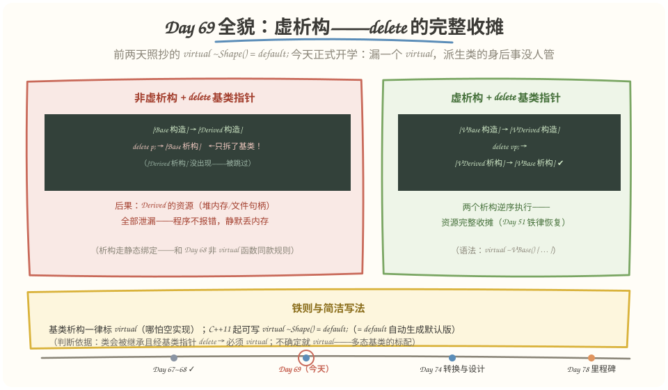
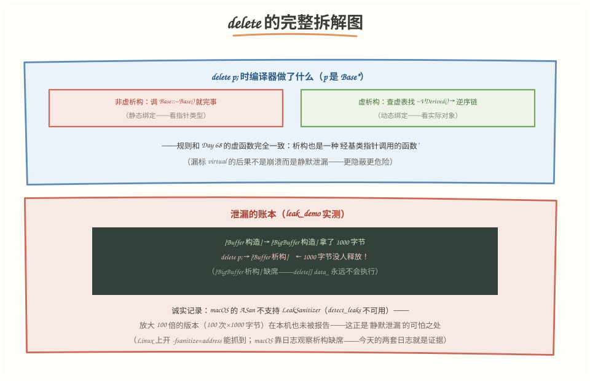
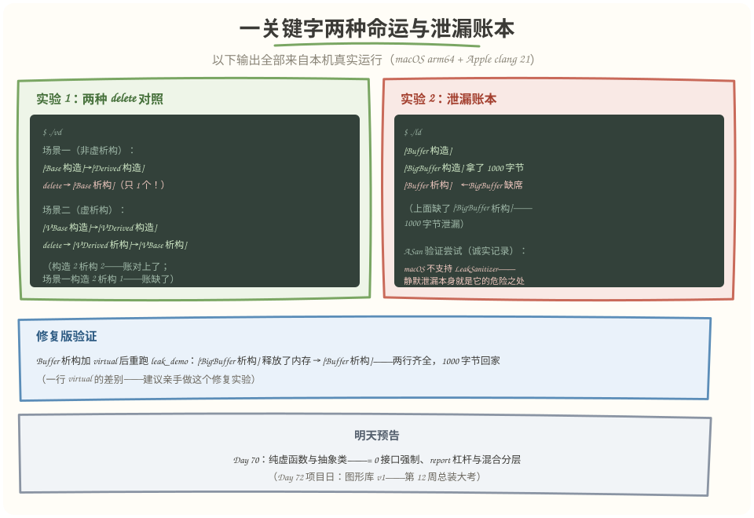

# 第 69 天：虚析构函数——delete 的完整收摊

> **今日目标**：完成本教程后，你能做到：演示非虚析构 + delete 基类指针时派生类析构被跳过（日志实证）；解释这为什么导致资源静默泄漏（1000 字节实验）；说出铁则"多态基类的析构一律 virtual"；用 `virtual ~T() = default;` 的现代写法修复并验证。
> **预计时间**：学习 20 分钟＋实践 40 分钟
> **前置准备**：完成 Day 67~68（前两天照抄的 `virtual ~Shape() = default;` 今天正式开学；Day 68 的绑定规则是原理基础）。
> **今日产出**：两种 delete 对照实验（构造 2 析构 1 vs 构造 2 析构 2）、1000 字节泄漏账本、修复版验证。

## 1. 今天解决什么问题？

Day 68 的常见错误第 3 条预告过：基类析构没标 virtual，`delete` 基类指针时**派生类的析构不执行**——如果派生类持有堆内存，就是静默泄漏。今天正面展开这个计划标注的重点：**虚析构函数为什么必须写**。

规则其实早就学过（Day 68）：析构函数也是"经基类指针调用的函数"——非虚走静态绑定（看指针类型）、虚走动态绑定（看实际对象）。差别只在后果：普通函数漏 virtual 最多调错版本，**析构漏 virtual 是派生类的身后事没人管**——资源泄漏且不报错。

## 2. 先看全貌：今天的内容位于哪里？



**图 1**：左卡红是非虚版——delete 后只打了 `[Base 析构]`（`[Derived 析构]` 被跳过）；右卡绿是虚析构版——两个析构逆序齐全。下方黄卡是铁则和 `= default` 现代写法。

三步概括今天：

1. 析构也吃 Day 68 的绑定规则：非虚看指针类型、虚看实际对象；
2. 后果是静默泄漏——不崩溃、不报错，内存悄悄丢；
3. 铁则：多态基类析构一律 virtual（`= default` 最简写法）。

## 3. 核心概念：先用直觉，再给准确定义

### 3.1 析构的绑定规则

- **一句通俗解释**：delete 基类指针时，编译器决定调哪个析构——非虚只调基类版（指针说了算），虚则从实际对象开始逆序拆（对象说了算）。
- **一个类比**：拆迁队按**房产证上的户型**拆（非虚——只拆登记的楼层）；按**实际建筑结构**拆（虚——几层拆几层，从顶往下）。
- **对应到技术上是**：实测——非虚版 `[Base 构造]→[Derived 构造]→delete→[Base 析构]`（构造 2 析构 1，账缺了）；虚版加 `[VDerived 析构]`（构造 2 析构 2，账对了）。类比的边界：拆迁漏一层是肉眼可见的废墟；内存泄漏**什么都不显示**——程序照常跑完、exit=0。
- **常见误解**："delete 会自动把整条继承链都拆了"——不会；析构就是普通成员函数，绑定规则完全同 Day 68。

### 3.2 静默泄漏：最危险的失败形态

- **一句通俗解释**：派生类析构被跳过时，它持有的资源（new 的内存、打开的文件、锁）永远不会释放——程序不崩溃不报错，像慢性失血。
- **一个类比**：退房只退了主卡没退副卡——酒店系统不报警，但副卡永久失效（资源占着）。
- **对应到技术上是**：实测 leak_demo——BigBuffer 拿了 1000 字节、delete 后 `[BigBuffer 析构]` 缺席、`delete[] data_` 永不执行。**诚实记录**：本机（macOS）的 ASan 不支持 LeakSanitizer（`detect_leaks is not supported on this platform`），放大 100 倍也未被报告——这正是静默泄漏的可怕：**没有雷达的时候连证据都没有**。Linux 上 `-fsanitize=address` 能抓到；macOS 靠日志观察析构缺席（今天两套日志就是证据）。类比的边界：少量泄漏短命程序察觉不到（进程结束 OS 回收）；长跑服务（服务器）里累积成灾。
- **常见误解**："程序退出时操作系统会清理一切"——进程地址空间会被回收没错；但文件锁、数据库连接、日志缓冲这类**进程外资源**不受此保护。

### 3.3 铁则与 = default 写法

- **一句通俗解释**：会被继承且经基类指针 delete 的类，析构**一律**标 virtual——不确定就标，代价为零。
- **一个类比**：大楼设计图——只要有加盖楼层的可能，就预留逐层拆迁的接口；预留了不用没损失，没预留后患无穷。
- **对应到技术上是**：现代写法 `virtual ~Shape() = default;`——`= default` 让编译器生成默认析构体（等价于空 `{}`），加 virtual 只在"经基类指针 delete"时有意义；不删堆对象的多态基类理论可不写，但**习惯统一写**（防将来用法变化）。类比的边界：**非多态基类**（不经基类指针用）不需要 virtual——加了也没错但多余；判断依据回到 Day 68 的"会用基类指针吗"。
- **常见误解**："virtual 析构会让所有析构变虚调用，性能差"——只有经指针/引用 delete 时才走虚表；栈对象和直调对象照常静态绑定。

## 4. 图解核心机制



**图 2**：上半部分是 delete 的两种路径——非虚调 `Base::~Base()` 就完事（静态绑定）；虚查虚表找到 `~VDerived()` 再逆序链（动态绑定）——规则与 Day 68 虚函数完全一致；下半部分红卡是泄漏账本（1000 字节 + ASan 平台限制的诚实记录）。

按图逐步讲：

1. **把析构当虚函数看**：Day 68 的绑定规则一行不差地适用——`delete p` 就是 `p->~Base()` 的语法糖（非虚）或 `vptr 查表`（虚）；
2. **看账对不对**：构造 N 次必须析构 N 次——今天的两场景日志就是最简单的审计法（比任何工具都直接）；
3. **静默的危险**：ASan 平台限制的实测告诉我们——**不能指望工具兜底**，规则要在写代码时就遵守（基类析构一律 virtual）；
4. **修复一行搞定**：`~Buffer()` 加 virtual 后重跑——`[BigBuffer 析构] 释放了内存` 出现，账平（5.4 的修复实验）。

## 5. 动手实践：完成一个最小可运行例子

### 5.1 准备文件

```bash
cd ai-compiler-roadmap/tutorials/day-069/examples
```

两个程序：`virtual_dtor.cpp`（对照主角）、`leak_demo.cpp`（泄漏账本）。

### 5.2 编写代码

主角 `virtual_dtor.cpp`（完整代码见本目录）——两组平行的类：Base/Derived（非虚析构）和 VBase/VDerived（虚析构），各自 `new` 到基类指针再 `delete`，析构日志对照。

### 5.3 运行与观察

```bash
g++ -Wall virtual_dtor.cpp -o vd && ./vd
```

实际执行结果（本机）：

```text
场景一：非虚析构 + delete 基类指针
  [Base 构造]
  [Derived 构造]
  [Base 析构]

场景二：虚析构 + delete 基类指针
  [VBase 构造]
  [VDerived 构造]
  [VDerived 析构]
  [VBase 析构]
```

```bash
g++ -Wall leak_demo.cpp -o ld && ./ld
```

```text
非虚析构版（Buffer 的析构没标 virtual）：
  [Buffer 构造]
  [BigBuffer 构造] 拿了 1000 字节
  [Buffer 析构]
（上面缺了 [BigBuffer 析构] —— 1000 字节泄漏）
```



**图 3**：左上两种 delete 对照（账对账缺一目了然）；右上是泄漏账本（含 ASan 平台限制的诚实记录）；下方蓝卡是修复版验证、灰卡预告明天。

### 5.4 修改一行再观察：修复实验

把 `leak_demo.cpp` 里 `~Buffer()` 加上 `virtual`（预期修复，本机实测）：

```text
非虚析构版（Buffer 的析构没标 virtual）：
  [Buffer 构造]
  [BigBuffer 构造] 拿了 1000 字节
  [BigBuffer 析构] 释放了内存
  [Buffer 析构]
（上面缺了 [BigBuffer 析构] —— 1000 字节泄漏）
```

末行是程序里写死的提示文本（首行"非虚析构版"同理）——修复后它已名不副实，正好当"账平"的反向对照。一行 `virtual` 的差别——`[BigBuffer 析构]` 归队、1000 字节回家、构造析构 2:2 账平。**这个亲手修复实验建议必做**——一行代码前后对照，比读十遍规则记得牢。

## 6. 常见错误与排查

**错误 1：delete 基类指针后内存占用持续增长**

- 现象：长跑程序内存一路涨；
- 原因：基类析构非虚——派生类持有的资源每 new 一次漏一份；
- 定位：给基类和派生类加析构日志，数一数 delete 后打几行；构造 N 析构 N-1 就是它；
- 修复：基类析构加 virtual（一行修复，今天实测）。

**错误 2：`error: deleting an object of polymorphic class type 'X' whose non-virtual destructor causes undefined behavior`**

- 现象：某些编译器（开启 -Wdelete-non-virtual-dtor）直接报警告/错误；
- 原因：X 有虚函数（多态类）但析构非虚——delete 基类指针是 UB；
- 定位：类有 virtual 函数却没有 virtual 析构——铁则违例；
- 修复：`virtual ~X() = default;`。

**错误 3：给非多态基类加 virtual 析构被说"多余"**

- 现象：code review 被指出多余；
- 原因：该类从不经基类指针 delete（纯组合用法）；
- 定位：问"这个类会被继承且用基类指针吗"；
- 修复：可去掉 virtual；但**团队统一写**也是合理惯例（防将来用法变化）。

## 7. 今日练习

### 必做练习

把 Day 68 的 Shape 体系（polymorphism.cpp）改成堆分配版：`Shape* s = new Circle(2); … delete s;`——验证今天加的 `virtual ~Shape() = default;` 保证了 Circle 的析构（加打印日志）被调用。再**删掉 virtual** 重跑——观察 Circle 析构消失。预期产出：一组删/留 virtual 的对照日志。

### 选做挑战

用 `std::unique_ptr<Shape>` 管理同样的对象（`auto s = std::make_unique<Circle>(2);`）——智能指针离开作用域自动 delete，**也走虚析构**。验证：unique_ptr 版无需手写 delete、析构照样齐全——这就是 Day 51 RAII 与今天虚析构的合流（第 20 周智能指针专场的前菜）。

## 8. 今日验收

- [ ] 我能演示非虚析构 + 基类指针 delete 时派生类析构被跳过（日志实证）
- [ ] 我能解释这为什么是"静默泄漏"——不崩溃不报错、macOS 上连 ASan 都不报
- [ ] 我完成了修复实验：加 virtual 后析构齐全、账平
- [ ] 我能默写铁则和现代写法：`virtual ~T() = default;`
- [ ] 我知道判断依据：会经基类指针 delete → 必须 virtual

## 9. 一句话总结与明天预告

今天的问题是"delete 基类指针为什么可能漏拆派生类"；机制上，析构的绑定规则与 Day 68 虚函数完全一致（非虚看指针类型、虚看实际对象），漏 virtual 的后果是静默泄漏（1000 字节实验 + ASan 平台限制的诚实记录）；实践上，两种 delete 对照、泄漏账本、一行修复实验全部落地；验证标准是看到任何 delete 基类指针能说出会拆几层、为什么。明天 **Day 70：纯虚函数与抽象类**——`= 0` 接口强制、漏实现的传导、report 杠杆与混合分层：为 Day 72 的图形库项目日备好零件。
