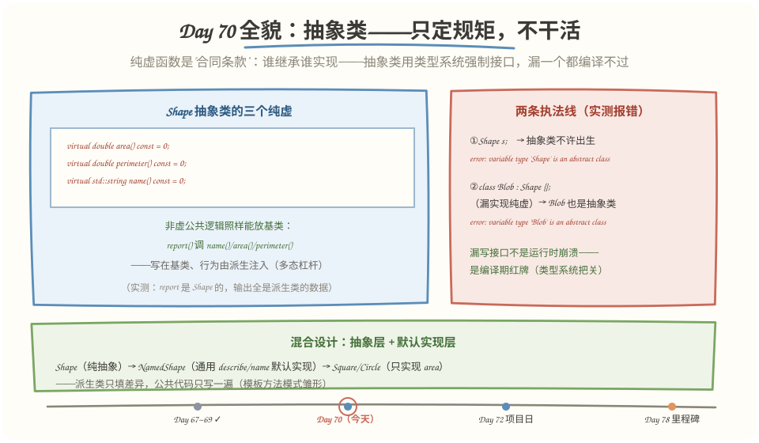
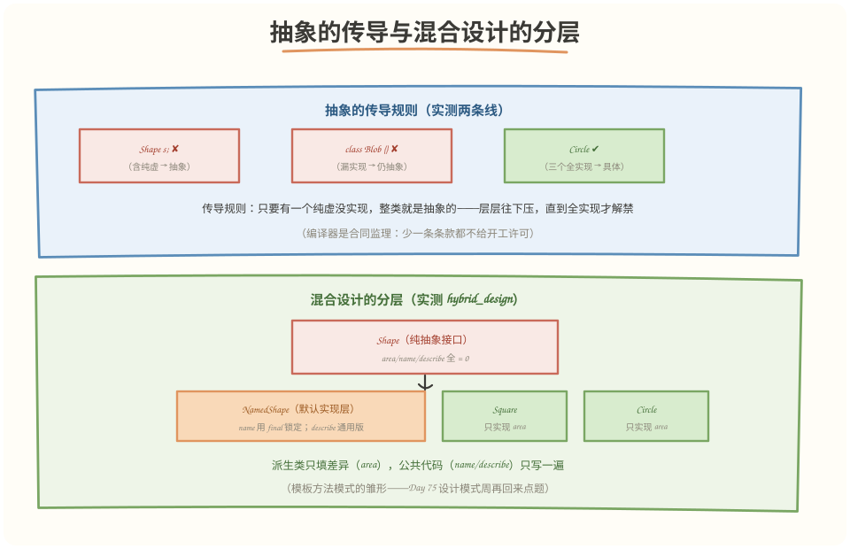
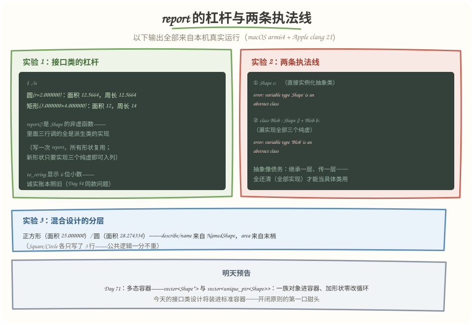

# 第 70 天：纯虚函数与抽象类——只定规矩，不干活

> **今日目标**：完成本教程后，你能做到：设计含多个纯虚函数的接口类（`= 0`）并解释"抽象的传导"（漏实现一层就仍抽象）；在基类写非虚公共逻辑复用纯虚接口（report 的杠杆）；搭建"抽象层 + 默认实现层 + 具体层"的三层混合设计；实测两条执法线（实例化抽象类 ✘、漏实现纯虚的派生类也 ✘）。
> **预计时间**：学习 25 分钟＋实践 45 分钟
> **前置准备**：完成 Day 67~69（虚析构昨天已照抄里瞥过的 `= 0` 今天正式开学）。
> **今日产出**：Shape 接口类（三纯虚 + report 杠杆）、混合设计三层体系、两条执法线的实测记录。

## 1. 今天解决什么问题？

昨天的 Shape 用了一个纯虚 `area() = 0`——今天正式回答三个问题：**为什么有的函数该纯虚**（接口强制：漏实现编译不过）；**基类还能有非虚函数吗**（能——report 的杠杆：公共逻辑写一遍，行为由派生注入）；**层次多了怎么分工**（混合设计：抽象层定规矩、默认实现层给通用版、具体层只填差异）。

今天的知识直接为 Day 72 图形库 v1 项目日备货：一个像样的类层次都长今天这个样子。

## 2. 先看全貌：今天的内容位于哪里？



**图 1**：左卡是 Shape 的三个纯虚（area/perimeter/name）+ 非虚公共函数 report（杠杆）；右卡红是两条执法线（实测报错原文）；下方绿卡是混合设计的分层（Shape → NamedShape → Square/Circle）。

三步概括今天：

1. `= 0` 纯虚：无实现、强制派生类填；含纯虚即抽象类（不能实例化）；
2. 抽象的传导：漏实现任何一个纯虚，派生类也抽象——层层下压直到全实现；
3. report 杠杆：非虚公共逻辑写在基类，里面调的虚函数由实际对象接管。

## 3. 核心概念：先用直觉，再给准确定义

### 3.1 接口类：合同条款

- **一句通俗解释**：纯虚函数是只写签名不写实现的"合同条款"——谁继承谁必须实现；接口类（全纯虚）就是一份纯合同。
- **一个类比**：入驻商场的品牌手册——"必须有消防通道、必须明码标价、必须有退换货政策"——商场方（接口类）定规矩不干活，各店铺（派生类）按合同开业。
- **对应到技术上是**：Shape 的三个 `= 0`——`area()/perimeter()/name()`；Circle 三个全实现所以能出生，`class Blob : Shape {}` 一个没实现、Blob 也抽象（实测报错）。类比的边界：合同可以**部分履约**——实现两个漏一个，还是抽象；C++17 没有显式的 `interface` 关键字，全纯虚的类就是事实接口。
- **与昨天 `= 0` 初见的差别**：昨天只当"抽象类不许 new"的标记；今天把三个纯虚组织成完整接口 + 配上 report 非虚函数——**接口和实现的分层**才是设计。
- **常见误解**："抽象类就是没有成员的空类"——不；它可以有数据、有非虚函数（report 就是），只要有一个纯虚整体就抽象。

### 3.2 report 杠杆：公共逻辑吃多态饭

- **一句通俗解释**：基类的**非虚**函数可以调用**虚**函数——公共逻辑写一遍，行为差异由派生类的实现注入。
- **一个类比**：报表模板——模板（report）写好"某物面积 XX、周长 XX"的框架，具体数字由各店铺填（派生类的 area/perimeter）。
- **对应到技术上是**：实测——report() 是 Shape 的非虚函数，输出全是派生类的数据（圆 12.5664、矩形 12/14）；新形状只要实现三个纯虚就能免费获得 report。类比的边界：report 里的调用经 `this`（Day 49）动态分发——所以**经对象或指针调 report 都行**，行为一致（report 非虚不 override，但它吃的饭是虚的）。
- **常见误解**："非虚函数不能调虚函数"——恰恰相反，这是最常见的多态用法（模板方法模式的核心）。

### 3.3 混合设计：三层分工

- **一句通俗解释**：抽象层（Shape 定接口）→ 默认实现层（NamedShape 给通用 describe/name）→ 具体层（Square/Circle 只填 area）——公共代码一份、差异代码最小。
- **一个类比**：连锁餐饮——总部（Shape）定菜单框架，区域中心（NamedShape）做统一品牌包装，门店（Square）只做本地特色菜。
- **对应到技术上是**：实测——Square/Circle 各只写约 3 行（构造 + area），describe/name 由 NamedShape 统一提供（`name` 还标了 `final` 锁死不许再覆盖——Day 74 专场）；输出"正方形（面积 25.000000）/ 圆（面积 28.274334）"。类比的边界：不是所有层次都需要三层——**简单场景两层够用**（昨天动物园）；三层在"多个派生类有可提取的公共实现"时才出手。
- **常见误解**："层次越深越专业"——层次是成本（理解/构造链）；能两层的别三层——今天的三层是为了演示"默认实现层"的价值。

## 4. 图解核心机制



**图 2**：上半部分是抽象的传导图——Shape s ✘、Blob ✘（漏实现）、Circle ✔（全实现）——"只要有一个纯虚没实现，整类就抽象"层层下压；下半部分是混合设计的分层图——Shape（全 = 0）→ NamedShape（name final + describe 通用版）→ Square/Circle（只写 area）。

按图逐步讲：

1. **传导像债务继承**：抽象的"债"从基类传给派生类——全还清（全实现）才解禁当具体类；中间层（NamedShape）替子孙还了一部分（describe/name），末梢只还剩下的（area）；
2. **report 杠杆的复利**：基类写一遍 report，N 个派生类免费拿——派生类越多杠杆越划算；
3. **final 在中间层**：NamedShape 的 name 标 final——子孙不许再改名字规则（品牌统一）；这是 Day 74 的预告，今天先看懂"不许覆盖"四个字；
4. **设计判断顺序**：先问"要不要多态"（有 is-a 且经基类指针用）→ 再问"接口强制"（纯虚）→ 最后问"公共实现能不能提层"（混合设计）。

## 5. 动手实践：完成一个最小可运行例子

### 5.1 准备文件

```bash
cd ai-compiler-roadmap/tutorials/day-070/examples
```

两个程序：`interface_shape.cpp`（主角）、`hybrid_design.cpp`（分层版）。

### 5.2 编写代码

主角 `interface_shape.cpp` 的类核心（完整代码见本目录）：

```cpp
class Shape {
public:
    virtual double area() const = 0;               // 纯虚：必须实现
    virtual double perimeter() const = 0;          // 第二个纯虚：周长
    virtual std::string name() const = 0;          // 第三个纯虚：名字

    void report() const {                           // 非虚的公共逻辑（复用纯虚接口）
        std::cout << name() << "：面积 " << area()
                  << "，周长 " << perimeter() << std::endl;
    }

    virtual ~Shape() = default;                    // 虚析构（Day 69 专场，今天照写）
};

class Circle : public Shape {
private:
    double r_;

public:
    explicit Circle(double r) : r_(r) {}
    double area() const override { return 3.14159265 * r_ * r_; }
    double perimeter() const override { return 2 * 3.14159265 * r_; }
    std::string name() const override { return "圆(r=" + std::to_string(r_) + ")"; }
};
```

### 5.3 运行与观察

```bash
g++ -Wall interface_shape.cpp -o is && ./is
```

实际执行结果（本机）：

```text
圆(r=2.000000)：面积 12.5664，周长 12.5664
矩形(3.000000×4.000000)：面积 12，周长 14
```

```bash
g++ -Wall hybrid_design.cpp -o hd && ./hd
```

```text
正方形（面积 25.000000）
圆（面积 28.274334）
```



**图 3**：左上 report 的杠杆（Shape 的函数输出派生类的数据）；右上两条执法线（实例化抽象 ✘、漏实现也 ✘——报错原文）；下方蓝卡是混合设计的三层输出；灰卡预告明天的多态容器。

### 5.4 修改一行再观察：两条执法线

**执法一（实例化抽象类）**：放开 `Shape s;` 的注释（预期编译失败，本机实测）：

```text
error: variable type 'Shape' is an abstract class
```

**执法二（漏实现的传导）**：加 `class Blob : public Shape {};` 并声明 `Blob b;`（预期编译失败，本机实测）：

```text
error: variable type 'Blob' is an abstract class
```

注意第二条的深意：Blob 一个纯虚都没实现，**它自己也成了抽象类**——报错的类型名是 Blob 不是 Shape。再进一步：实现 Blob 的 area（只还三分之一的债）——仍报错；三个全实现——解禁。抽象的传导用三步实验走完。

## 6. 常见错误与排查

**错误 1：`error: variable type 'X' is an abstract class`**

- 现象：直接创建某类对象被拦；
- 原因三查：X 自己有纯虚？X 的基类有纯虚而 X 没实现全？
- 定位：看报错类型名 + 往上翻继承链找 `= 0`；
- 修复：把没实现的纯虚补上（或该类就当抽象基类用，别实例化）。

**错误 2：纯虚函数忘了写 `= 0`，写了空实现**

- 现象：基类可以实例化了（不报错），派生类忘实现也不报错；
- 原因：`virtual double area() const { return 0; }` 是**虚函数带实现**，不是纯虚；
- 定位：看函数声明末尾有没有 `= 0`；
- 修复：接口类该纯虚的写 `= 0`；确实要给默认值的留实现（那是另一 种设计）。

**错误 3：中间层的 final 覆盖被拦**

- 现象：孙子类想覆盖 name，报 `declaration of 'name' overrides a 'final' function`；
- 原因：NamedShape 已把 name 锁死（今天 hybrid 的设计意图）；
- 定位：报错会指明 final 成员；
- 修复：要么不覆盖（遵守设计），要么去掉中间层的 final（改设计要慎重——Day 74 专题）。

## 7. 今日练习

### 必做练习

给 interface_shape.cpp 加第三种形状 `Triangle`（三边 a/b/c：area 用海伦公式 √(s(s-a)(s-b)(s-c))，s = (a+b+c)/2；perimeter = a+b+c）。预期产出：report 输出三边和面积周长；**report 一行没改**——杠杆的复利再攒一层。

### 选做挑战

把 hybrid_design 的中间层改名 `LabeledShape` 并加功能：构造时存一个编号（`int id_`），describe 输出 `#编号 名字（面积 XX）`。观察：改动只在中间层——两个末梢类零改动。这就是"分层"的维护红利：**公共变更只动一层**。

## 8. 今日验收

- [ ] 我能设计多纯虚的接口类，并解释"抽象的传导"（漏实现层层下压）
- [ ] 我实测了 report 杠杆：基类非虚函数里调虚函数，行为由派生注入
- [ ] 我搭出了三层混合设计，末梢类只写差异
- [ ] 两条执法线（实例化抽象、漏实现派生）都亲手触发并读了报错
- [ ] 我知道 `= 0` 和"带空实现的虚函数"的差别

## 9. 一句话总结与明天预告

今天的问题是"接口怎么强制、公共逻辑怎么复用"；机制上，纯虚把合同写进类型系统（漏实现编译不过），抽象的传导层层下压，非虚 report 吃虚函数的饭实现杠杆，混合设计三层分工让变更局部化；实践上，接口类、分层版、两条执法线全部实测；验证标准是看到任何类层次能拆出"接口/默认实现/差异"三层并说明理由。明天 **Day 71：多态容器**——`vector<unique_ptr<Shape>>` 管理一族对象：今天接口类的设计将装进标准容器，加形状零改循环的开闭红利再攒一层。
