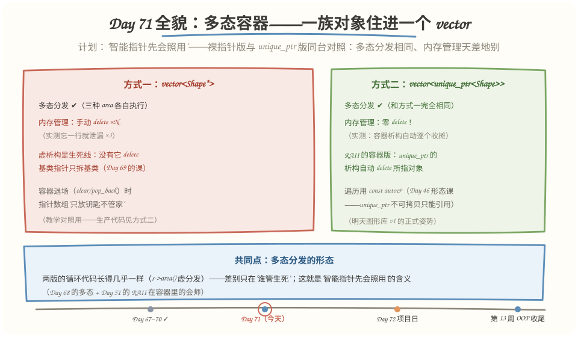
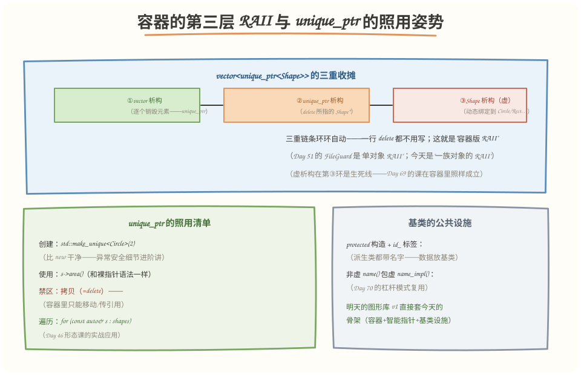
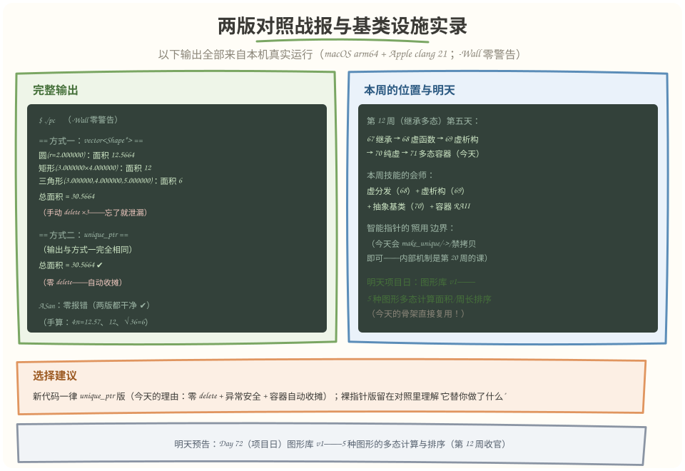

# 第 71 天：多态容器——vector\<Shape*\> 与 vector\<unique_ptr\<Shape\>\>

> **今日目标**：完成本教程后，你能做到：用两种容器管理一族多态对象（裸指针版手动 delete、unique_ptr 版零 delete——实测对照）；说出 unique_ptr 版的三重自动收摊链条（vector→unique_ptr→虚析构）；用 make_unique 创建、`const auto&` 遍历（禁拷贝的形态课应用）；复用"protected 构造 + 基类设施"的骨架。
> **预计时间**：学习 20 分钟＋实践 45 分钟
> **前置准备**：完成 Day 67~70（虚分发/虚析构/抽象类是今天的地基；Day 46 的 auto& 形态课在容器里实战）。
> **今日产出**：两版对照实验（同输出、异管理）、三重收摊链条解析、基类设施骨架（明天项目日的直接底座）。

## 1. 今天解决什么问题？

第 12 周的前四天把多态的零件备齐（继承/虚函数/虚析构/纯虚）；今天把它们**装进容器**——一族不同类型的对象住进同一个 `vector`，一个循环统一处理。计划对智能指针的要求是"**先会照用**"：make_unique 创建、`->` 使用、知道禁拷贝——内部机制是第 20 周的课。

两版对照是今天的核心教学法：裸指针版（多态分发 ✔ 但手动 delete ×3）vs unique_ptr 版（分发相同、**零 delete**）——看清智能指针替你做了什么，才知道它为什么是默认选择。

## 2. 先看全貌：今天的内容位于哪里？



**图 1**：左卡红是裸指针版（手动管理 + 虚析构生死线）；右卡绿是 unique_ptr 版（零 delete + 容器 RAII）；下方蓝卡是共同点（多态分发形态相同）。

三步概括今天：

1. 两版的多态分发完全相同——差别只在"谁管生死"；
2. unique_ptr 版三重自动收摊：vector 析构 → unique_ptr 析构 → 虚析构；
3. 基类设施骨架（protected 构造 + id_ + 杠杆包装）——明天项目日直接复用。

## 3. 核心概念：先用直觉，再给准确定义

### 3.1 多态容器：一族对象一个家

- **一句通俗解释**：不同类型的图形（圆/矩形/三角形）都住进一个 vector——一个循环对每个说"报面积"，各自报各自的。
- **一个类比**：动物园混养区——羚羊、斑马、长颈鹿共处一片；饲养员一句"开饭"（`s->area()`），各物种按各的方式进食（虚分发）。
- **对应到技术上是**：实测——两版容器都输出了三种图形各自的面积（12.5664/12/6，总和 30.5664——手算核对 ✔）；循环代码几乎一样（`for (const auto& s : shapes) s->area()`）。**为什么必须指针**：直接放 `vector<Shape>` 会切片（Shape 是抽象的装不进；即使具体类型也会被切成基类——Day 68 的知识）；指针/智能指针保存"完整对象 + 动态类型"。类比的边界：容器退场（clear/析构）时**指针版只放钥匙不管家**——这正是方式二的出场理由。
- **常见误解**："vector 能装不同类型吗"——直接装不行（同质容器）；装**基类指针**就是标准答案（多态容器的含义）。

### 3.2 三重自动收摊

- **一句通俗解释**：unique_ptr 版的清理链条——vector 析构销毁元素（unique_ptr）→ 每个 unique_ptr 析构 delete 所指对象 → 虚析构保证拆到派生类层。
- **一个类比**：物业服务链——小区物业退场（vector 析构）通知每户（unique_ptr）；每户自己退租（delete 对象）；退租流程按各户合同（虚析构到派生类）。
- **对应到技术上是**：实测——方式二**零 delete** 且 ASan 零报错（收摊完整）；三环中**第③环的虚析构是生死线**（Day 69 的课：没有它 delete 基类指针只拆基类——派生类资源泄漏）。Day 51 的 FileGuard 是"单对象 RAII"、Day 60 的 MyString 是"单类三件套"——今天是"**一族对象的 RAII**"（容器+智能指针的合体）。类比的边界：unique_ptr **禁拷贝**（=delete——Day 58 的老朋友）——所以容器里只能移动（push_back(std::move) 或 make_unique 直接返回右值）、遍历用 `const auto&`。
- **常见误解**："unique_ptr 装进 vector 会拷贝失败"——push 时是**移动**（make_unique 返回的临时对象天然可移）；遍历时用**引用**不拷贝——两个坑都有标准姿势。

### 3.3 基类设施：明天的骨架

- **一句通俗解释**：把"所有派生类都要的东西"提到基类——protected 构造（强制经派生类）、id_ 标签、非虚 name() 包虚 name_impl() 的杠杆。
- **一个类比**：小区的公共设施——门牌系统（id_）和统一的访客登记流程（name 杠杆）各家共用；物业只管框架、各家填自己的特色（name_impl）。
- **对应到技术上是**：实测——三种图形的名字都带标签（"圆(r=2)"、"矩形(3×4)"…）——id_ 在基类、格式在派生类的 name_impl；protected 构造让外界不能直接造 Shape（它本来就是抽象的——双保险）。这套骨架（抽象基类 + 设施 + unique_ptr 容器 + `const auto&` 遍历）就是**明天图形库 v1 的全部底座**——项目日只加"具体图形和排序"。类比的边界：设施不是越多越好——只有"真正公共"的才上提（Day 70 混合设计的原则）。
- **常见误解**："基类放数据会被切片"——通过指针访问没有切片；切片只在**按值**赋给基类对象时发生（Day 68）。

## 4. 图解核心机制



**图 2**：上半部分蓝卡是三重收摊链条（vector 析构 → unique_ptr 析构 → 虚析构——环环自动、零 delete）；左下绿卡是 unique_ptr 的照用清单（创建/使用/禁区/遍历）；右下灰卡是基类设施。

按图逐步讲：

1. **顺着三环走清理**：从 vector 退出 main 开始——每一环自动触发下一环；你在代码里找不到一行 delete——**这就是容器版 RAII**；
2. **标出第③环的生死线**：虚析构在第③环动态绑定——没有它整条链在最后一环断掉（Day 69 在容器语境的复验）；
3. **对照照用清单写代码**：make_unique 创建（不写 new）、`->` 使用（和裸指针一样）、禁拷贝（传引用）、`const auto&` 遍历——四条规则今天全部用上；
4. **把骨架装进明天**：今天的类图（抽象 Shape + protected 设施 + 三派生）原封不动进项目日——只扩不改。

## 5. 动手实践：完成一个最小可运行例子

### 5.1 准备文件

```bash
cd ai-compiler-roadmap/tutorials/day-071/examples
```

主角：`poly_container.cpp`（两版对照）。

### 5.2 编写代码

方式二核心（完整代码见本目录）：

```cpp
std::vector<std::unique_ptr<Shape>> shapes;
shapes.push_back(std::make_unique<Circle>(2));        // 创建（不写 new）
shapes.push_back(std::make_unique<Rect>(3, 4));
shapes.push_back(std::make_unique<Triangle>(3, 4, 5));

double total = 0;
for (const auto& s : shapes) {                        // 遍历（引用不拷贝）
    std::cout << "  " << s->name() << "：面积 " << s->area() << std::endl;
    total += s->area();
}
// 没有 delete——容器析构自动逐个收摊
```

### 5.3 运行与观察

```bash
g++ -Wall poly_container.cpp -o pc && ./pc
```

实际执行结果（本机）：

```text
== 方式一：vector<Shape*>（手动管理） ==
  圆(r=2.000000)：面积 12.5664
  矩形(3.000000×4.000000)：面积 12
  三角形(3.000000,4.000000,5.000000)：面积 6
  总面积 = 30.5664
  （手动 delete ×3——忘了就泄漏）

== 方式二：vector<unique_ptr<Shape>>（自动管理） ==
  圆(r=2.000000)：面积 12.5664
  矩形(3.000000×4.000000)：面积 12
  三角形(3.000000,4.000000,5.000000)：面积 6
  总面积 = 30.5664
  （零 delete——容器析构自动收摊）
```

```bash
g++ -Wall -fsanitize=address poly_container.cpp -o pca && ./pca
```

```text
（ASan 零报错——两版都干净；手算核对：4π=12.5664、3×4=12、海伦 √36=6）
```



**图 3**：左上完整输出（两版同输出异管理的对照）；右侧是本周位置和明天项目日的预告；下方橙卡是选择建议。

### 5.4 修改一个输入再观察：忘 delete 的泄漏亲测

把方式一末尾的清理循环注释掉——ASan 版重跑（macOS 的老边界：纯泄漏**不报**——Day 45 的档案）；但把图形数量放大到 10000 个（循环 push 一万个 new）再注释清理——程序内存占用肉眼可见地涨（活动监视器前后对比）。**对照**：方式二同样一万个——退出即全部归还。**一手动一自动**：数据规模的放大让"零 delete"的价值从"代码短"升级为"工程必需"。（另一实验：方式一里删掉基类的 `virtual ~Shape()`——ASan 版立刻在 delete 处报泄漏/UB——虚析构生死线的容器版复验。）

## 6. 常见错误与排查

**错误 1：`error: call to implicitly-deleted copy constructor of 'std::unique_ptr<Shape>'`**

- 现象：拷贝 unique_ptr（如按值传参、`auto s = shapes[0];`）；
- 原因：unique_ptr 禁拷贝（所有权唯一）；
- 定位：报错指向拷贝点；
- 修复：传引用（`const auto&`）；转移用 std::move（所有权交接）。

**错误 2：容器析构时泄漏/ASan 报错（基类没虚析构）**

- 现象：unique_ptr 版也漏了派生类部分；
- 原因：基类析构非虚——第③环断链；
- 定位：看 Shape 的析构声明；
- 修复：`virtual ~Shape() = default;`（Day 69 的铁则）。

**错误 3：`vector<Shape>` 直接装对象（切片/编译错）**

- 现象：想把图形按值放容器；
- 原因：Shape 抽象装不进；即使具体类型也会切片（丢派生部分）；
- 定位：容器元素类型是值还是指针；
- 修复：`vector<unique_ptr<Shape>>`（或 `vector<Shape*>`）——多态必须经指针/引用。

## 7. 今日练习

### 必做练习

给两版各加"第四种图形"（Ellipse：area = πab）——注意只加派生类、容器循环零改动（开闭验证的多态容器版）。预期产出：四图形输出 + 一句"加类型不改循环"的确认。

### 选做挑战

"三重收摊的目击实验"：给 Shape 加打印析构日志（`~Shape 前先打派生类名`——在派生析构里打），给 unique_ptr 版的 main 末尾加块作用域——观察退出块时的析构顺序（后进先出：Triangle→Rect→Circle——vector 元素的逆序销毁）。三环链条 + 逆序规律一次看全。

## 8. 今日验收

- [ ] 我的两版对照实测通过（同输出、异管理——多态分发完全相同）
- [ ] 我能讲出三重收摊链条（vector→unique_ptr→虚析构）并知道第③环是生死线
- [ ] 我的照用清单全过（make_unique/->/禁拷贝/const auto&）
- [ ] 我实测了忘 delete 的规模放大对照（5.4）和虚析构断链实验
- [ ] 我知道为什么多态必须经指针（切片）

## 9. 一句话总结与明天预告

今天的问题是"一族多态对象怎么管"；机制上，多态容器 = 基类指针 + 虚分发（两版相同），unique_ptr 版的三重自动收摊是容器版 RAII（零 delete）；实践上，两版对照、三环链条、规模放大、虚析构断链全部实测；验证标准是看到任何 `vector<基类指针>` 能说出"谁管生死、析构链怎么走"。明天 **Day 72（项目日）：图形库 v1**——5 种图形、多态计算面积/周长并排序输出：今天的骨架 + 具体图形 + 排序 = 第 12 周收官大考。
