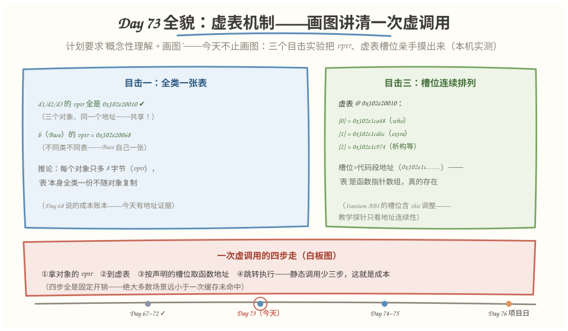
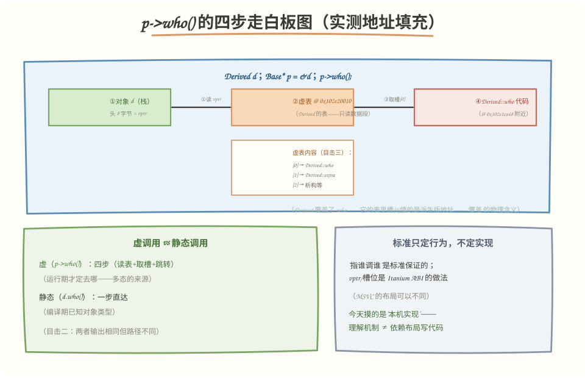
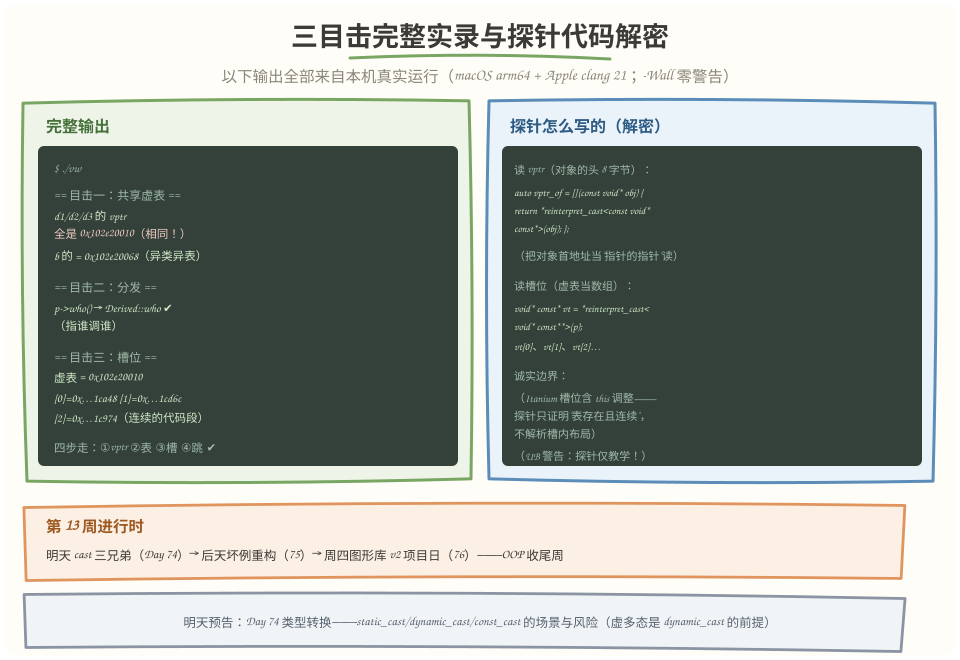

# 第 73 天：虚表机制——画图讲清一次虚调用

> **今日目标**：完成本教程后，你能做到：画出一次虚调用的四步走（vptr → 虚表 → 槽位 → 跳转）；用探针实测"全类一张表"（三个对象同 vptr）和"槽位连续"（虚表是真表）；说出虚调用与静态调用的路径差和成本；理解标准只定行为、vptr/槽位是 ABI 实现（不依赖布局写代码）。
> **预计时间**：学习 20 分钟＋实践 45 分钟
> **前置准备**：完成 Day 67~72（Day 68 说过"虚表一次间接跳转"——今天把它摸出来）。
> **今日产出**：三目击实验（共享虚表/分发对照/槽位探针——全部实测地址）、四步走白板图。

## 1. 今天解决什么问题？

Day 68 讲虚函数时说过"指谁调谁的物理实现是虚表一次间接跳转"——当时只给了概念。计划今天正式把它讲透：**画图讲清一次虚函数调用的过程**。我们不止画图——用三个目击实验把虚表**亲手摸出来**：同类对象的 vptr 相同（全类一张表）、槽位地址连续（表是真的函数指针数组）、虚/静态调用的路径对照。

诚实边界先行：**标准只保证"指谁调谁"的行为**；vptr 放对象头 8 字节、槽位怎么排是 Itanium ABI（clang/gcc）的实现——探针是理解机制的教学工具，**不是**可以依赖的编程接口。

## 2. 先看全貌：今天的内容位于哪里？



**图 1**：左卡蓝是目击一（d1/d2/d3 同 vptr 0x102e20010——全类一张表）；右卡绿是目击三（槽位连续排列）；下方红卡是四步走白板图。

三步概括今天：

1. 全类一张虚表、每对象一个 vptr（8 字节）；
2. 虚调用四步：①vptr ②表 ③槽 ④跳——覆盖=表里填派生版地址；
3. 行为是标准、布局是 ABI——理解不依赖。

## 3. 核心概念：先用直觉，再给准确定义

### 3.1 全类一张表

- **一句通俗解释**：虚表像小区的"服务指南"——全小区（类）一份贴在门口；每户（对象）只带一个指过去的小二维码（vptr）。
- **一个类比**：连锁店的分店指南——所有分店（d1/d2/d3）都指向同一份总部服务目录（Derived 虚表）；隔壁品牌（Base）有自己的目录。
- **对应到技术上是**：实测——d1、d2、d3 的 vptr **全是 0x102e20010**（同一个地址）；b（Base 对象）的是 0x102e20068（不同类不同表）。推论：虚机制的**空间成本** = 每对象 8 字节 vptr + 每类一张表（Day 68 成本账本的地址证据）。类比的边界：多继承下对象可能带多个 vptr（每个基类子对象一个）——进阶话题，今天单继承一张够用。
- **常见误解**："每个对象复制一张虚表"——表全类一份；对象里只有指针（8 字节）。

### 3.2 四步走与"覆盖"的物理含义

- **一句通俗解释**：`p->who()` 编译成四步——拿 p 所指对象的 vptr、到虚表、按 who 的**声明槽位**取地址、跳转执行。
- **一个类比**：客服热线——你拨总机（p->who）→ 系统查你所在城市（vptr）→ 城市的服务目录（虚表）→ 按业务键（who 的槽位）转接（跳转）。
- **对应到技术上是**：实测分发——`p->who()` 打出 `Derived::who`（Base* 指向 Derived 对象——槽[0]里填的是派生版地址）；**覆盖的物理含义**就是"Derived 的虚表槽[0] 填 Derived::who 而不是 Base::who"。静态对照：`d.who()` 一步直达（编译期已知类型——目击二里两者输出相同但路径不同）。类比的边界：编译器可能**去虚化**（devirtualization——编译期能确定类型时直接静态调用优化掉）——所以"虚调用四步"是最坏情况不是保证路径。
- **常见误解**："槽位按继承层次排"——槽位按**基类里的声明序**排（覆盖不改槽位、只换槽里的地址）——这是"同签名覆盖"能工作的前提。

### 3.3 行为 vs 实现：探针的边界

- **一句通俗解释**：C++ 标准只说"指谁调谁"；vptr/槽位是 clang/gcc 的 Itanium ABI 做法（MSVC 布局可以不同）。
- **一个类比**：菜单承诺"上对菜"（标准行为）；后厨怎么摆灶（ABI 实现）各店可以不同——偷看后厨能长见识，但点菜别按灶位点。
- **对应到技术上是**：探针代码（读对象头 8 字节当 vptr、虚表当数组）在本机实测成功——但它是 **UB 边缘的教学工具**（ reinterpret_cast 读对象布局不在标准保护内）；三个诚实的"不依赖"：不依赖 vptr 位置、不依赖槽位顺序、不依赖表的存在形式（标准允许其他实现）。**能依赖的**是行为：`p->who()` 指谁调谁、override 核对签名。类比的边界：理解机制的价值——性能直觉（虚调用多几步、对象胖 8 字节）和调试直觉（为什么 dynamic_cast 需要多态类——RTTI 信息常和虚表放一起）。
- **常见误解**："学了虚表就能用 vptr 编程"——生产代码永不直接碰 vptr；探针只为理解。

## 4. 图解核心机制



**图 2**：上半部分蓝卡是 `p->who()` 的四步走白板图（对象 d → vptr 0x102e20010 → 虚表槽位 → Derived::who 代码——实测地址填充）；左下绿卡是虚/静态调用的路径对照；右下灰卡是"标准 vs ABI"的边界。

按图逐步讲：

1. **对着图走四步**：①读对象头 8 字节（vptr）②跳到虚表 ③who 在基类声明序里排槽[0]——取槽[0]的地址 ④跳转执行——每一步都对应实测的地址；
2. **看"覆盖"落在哪里**：Derived 的虚表槽[0] 填的是 Derived::who 的地址——覆盖不是"改基类"而是"自己的表填自己的版本"；
3. **对照两条路径**：虚调用四步（运行期定去向）、静态一步（编译期已知）——成本差就是那三步固定开销；
4. **把边界钉牢**：图上的 vptr 位置/槽位排布是本机 ABI——换个编译器图会变、行为不会变。

## 5. 动手实践：完成一个最小可运行例子

### 5.1 准备文件

```bash
cd ai-compiler-roadmap/tutorials/day-073/examples
```

主角：`vtable_witness.cpp`（三目击实验）。

### 5.2 编写代码

探针核心（完整代码见本目录）：

```cpp
// 读对象的 vptr（头 8 字节——教学探针，生产勿用）
auto vptr_of = [](const void* obj) {
    return *reinterpret_cast<const void* const*>(obj);
};

Derived d1, d2, d3;
std::cout << vptr_of(&d1) << vptr_of(&d2) << vptr_of(&d3);   // 实测：全同！

Base* p = &d;
void* const* vt = *reinterpret_cast<void* const**>(p);       // 虚表
std::cout << vt[0] << vt[1];                                  // 槽位（who/extra 的入口）
```

### 5.3 运行与观察

```bash
g++ -Wall vtable_witness.cpp -o vw && ./vw
```

实际执行结果（本机）：

```text
== 目击一：同类对象共享虚表 ==
  d1 的 vptr = 0x102e20010
  d2 的 vptr = 0x102e20010
  d3 的 vptr = 0x102e20010
  （三个地址相同——全类一张虚表！每个对象只带一个指针）
  b  的 vptr = 0x102e20068
  （与 Derived 的不同——Base 有自己的虚表）

== 目击二：一次虚调用的分发 ==
  Derived::who（派生类覆盖版）
  Derived::extra
  Derived::who（派生类覆盖版）

== 目击三：虚表槽位探针 ==
  虚表地址 = 0x102e20010
  槽位[0] = 0x102e1ca48（who 的入口——单继承下就是函数本体；多继承可能出现 this 调整 thunk）
  槽位[1] = 0x102e1cd6c（extra 的入口）
  槽位[2] = 0x102e1c974（析构等后续槽）
  （槽位连续排列——'表'是真的表）

== 四步走总结 ==
  ①拿对象的 vptr　②到虚表　③按声明的槽位取函数地址　④跳转执行
```

（地址是本次运行的快照——ASLR 下每次运行都不同，看相对关系即可：同对象同表、槽位连续。）



**图 3**：左上完整输出（共享虚表/分发/槽位三段标注）；右侧是探针代码的解密和诚实边界；下方橙卡是本周路线。

### 5.4 修改一个输入再观察：覆盖改槽的目击

给 Derived **不覆盖** extra（注释掉它的 override 版）——重跑目击三：槽[1] 的地址**变了**（变成 Base::extra 的入口——因为 Derived 没覆盖，它的表槽[1] 直接填基类版）；槽[0]（who——仍覆盖）不变。**一覆一不覆**：覆盖决定槽里填谁的地址——"覆盖的物理含义"从推测变成目击。（预期：分发部分 `p->extra()` 打出 `Base::extra`——行为和槽位同步变。）

## 6. 常见错误与排查

**错误 1：探针代码在别的平台/编译器输出乱值**

- 现象：同样的探针换环境不对劲；
- 原因：布局是 ABI 实现不是标准——MSVC/其他 ABI 的 vptr 位置可以不同；
- 定位：这是预期行为不是 bug；
- 修复：探针只教学；跨平台代码绝不碰对象布局。

**错误 2：以为 override 会"新增"槽位**

- 现象：预期覆盖后虚表变长；
- 原因：误解覆盖机制——覆盖换槽内地址、不新增槽（槽位按基类声明序定）；
- 定位：5.4 实验（注释 override 看槽位变化）；
- 修复：概念修正——同签名覆盖=换地址、新增函数=新槽。

**错误 3：在虚函数上追求"绝对零开销"而放弃多态**

- 现象：为了省四步把虚函数全改成 if-else 分派；
- 原因：高估成本——四步固定开销远小于一次缓存未命中/一次分支预测失败；
- 定位：性能剖析（第 19 周）再优化；
- 修复：默认用虚（设计正确性优先）；热路径实测后再去虚化。

## 7. 今日练习

### 必做练习

白板复现：不看书画出"Base* p 指向 Derived 对象、p->who() 的四步走"（含对象/vptr/虚表/槽位/代码五个框和箭头）——画完对照图 2 检查。预期产出：手绘图 + 缺漏清单（漏了哪个框就是哪个概念没牢）。

### 选做挑战

"加一层继承看表"：写 `class Grand : public Derived`（覆盖 who）——探针打 Grand 对象的 vptr（第三张表！）；对比三张表（Base/Derived/Grand）的槽[0] 地址各不相同——每层覆盖都有自己的版本。三代表三地址，继承层次的虚表图完整了。

## 8. 今日验收

- [ ] 我能默画四步走白板图（vptr→表→槽→跳）并标出每步的实测地址
- [ ] 我实测了全类一张表（三对象同 vptr）和槽位连续（真表）
- [ ] 我目击了"覆盖换槽内地址"（5.4：不覆盖 extra 时槽[1] 变 Base 版）
- [ ] 我知道行为是标准、布局是 ABI——探针教学用、生产不依赖
- [ ] 我能说出虚调用的真实成本量级（几步固定开销，远小于缓存未命中）

## 9. 一句话总结与明天预告

今天的问题是"指谁调谁到底怎么做到的"；机制上，全类一张虚表、每对象一个 vptr，虚调用四步走（vptr→表→槽→跳），覆盖=自己的表填自己的版本；实践上，共享虚表、分发对照、槽位探针、覆盖换槽四个实验全部实测；验证标准是白板画出四步走并说清每步。明天 **Day 74：类型转换**——`static_cast`/`dynamic_cast`/`const_cast` 的场景与风险：dynamic_cast 的"运行期验货"靠的正是今天虚表旁边的 RTTI 信息。
