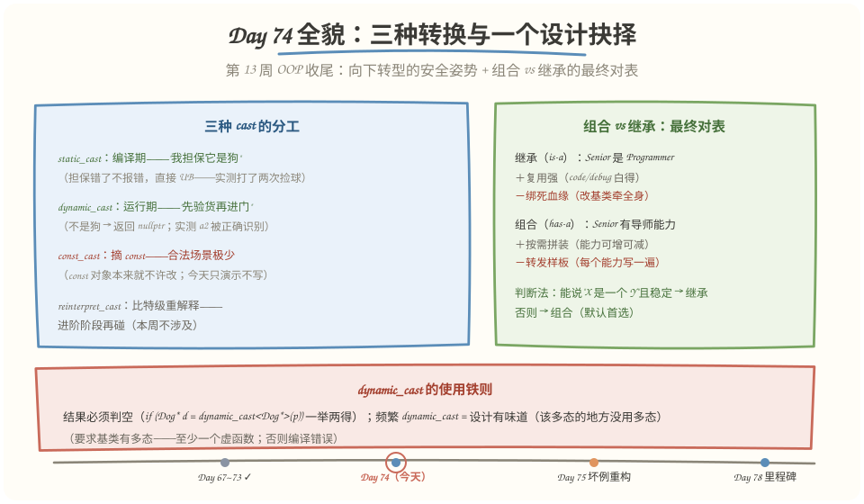
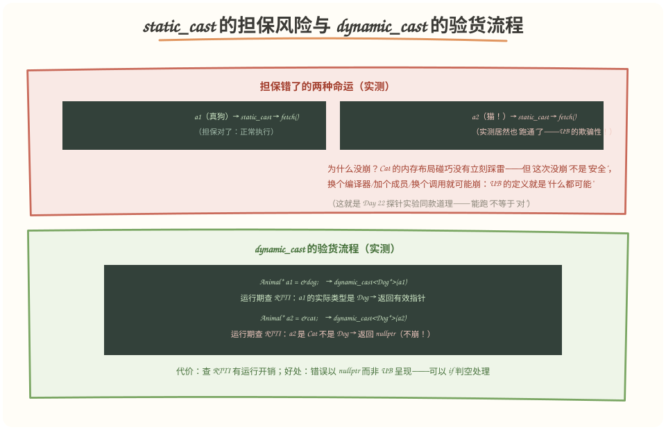
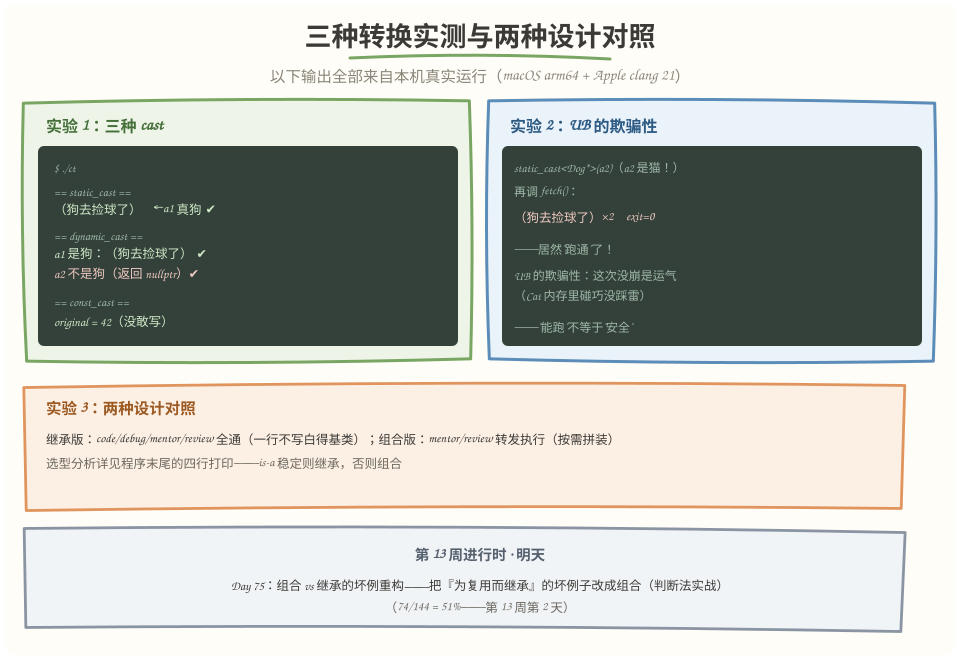

# 第 74 天：类型转换与设计抉择——cast 三兄弟和组合 vs 继承

> **今日目标**：完成本教程后，你能做到：说出 `static_cast`/`dynamic_cast`/`const_cast` 各自的语义和风险；演示 static_cast 担保错误时的 UB 欺骗性（实测跑通但危险）；用 `dynamic_cast` 安全向下转型并判空；用“X 是一个 Y 造句法”在组合与继承之间做最终选择。
> **预计时间**：学习 25 分钟＋实践 40 分钟
> **前置准备**：完成 Day 67~70（多态体系是 dynamic_cast 的前提；虚析构是今天示例的标配）。
> **今日产出**：三种 cast 巡礼（含 UB 欺骗性实测）、组合 vs 继承的同需求双实现对照。

## 1. 今天解决什么问题？

两个收尾问题。第一：基类指针指向派生类对象后（Day 67 的统一管理），**怎么调派生类的新函数**？答案是向下转型（downcast）——但 C++ 给了两种姿势：`static_cast`（担保制，错了 UB）和 `dynamic_cast`（验货制，错了 nullptr）。第二：本周既学了组合（Day 53）又学了继承（Day 67~69）——**设计时到底选哪个**？今天用同一需求的两种实现做最终对表。

这两个问题答完，第 12 周的零件就齐了——明天图形库 v3 项目日总装。

## 2. 先看全貌：今天的内容位于哪里？



**图 1**：左卡是三种 cast 的分工（static_cast 担保制 / dynamic_cast 验货制 / const_cast 摘 const——合法场景极少；reinterpret_cast 进阶再碰）；右卡绿是组合 vs 继承的最终对表（各自优劣 + 判断法）；下方红卡是 dynamic_cast 的使用铁则。

三步概括今天：

1. static_cast：编译期担保——担保错了不报错，直接 UB；
2. dynamic_cast：运行期验货——不是目标类型返回 nullptr（可判空）；
3. 设计选型：能说“X 是一个 Y”且稳定 → 继承；否则 → 组合（默认首选）。

## 3. 核心概念：先用直觉，再给准确定义

### 3.1 static_cast：担保制转换

- **一句通俗解释**：`static_cast<Dog*>(p)` 是向编译器签字担保“p 确实指向狗”——编译器不验货，直接放行。
- **一个类比**：免检通道——你声明“这是我的行李”，海关不拆箱直接过；带了违禁品（指错类型）过时不响，出事了才追责。
- **对应到技术上是**：本机实测两层——担保对了（a1 真狗）正常调到 `fetch()`；**担保错了**（a2 是猫）居然也“跑通”（打了两次捡球、exit=0）——但这正是 UB 的欺骗性：Cat 的内存布局碰巧没踩雷，换编译器/加成员就可能崩。类比的边界：免检通道偶尔混过违禁品不代表安检没用——**static_cast 在“你确定类型”时是零开销的正确工具**（如数值转换 `static_cast<double>(i)`），错的只是“不确定时用它赌”。
- **常见误解**：“static_cast 会做类型检查”——不；检查是 dynamic_cast 的工作；static_cast 只做“语法上说得通吗”的编译期审查。
- **与 Day 3 的连接**：`x * 1.0` 和 `static_cast<double>(x)` 是同一件事的两种写法——隐式转换能过的，static_cast 都能显式写出来（显式是更好的文档）。

### 3.2 dynamic_cast：验货制转换

- **一句通俗解释**：`dynamic_cast<Dog*>(p)` 先在运行期查 p 的**实际类型**——是狗给指针、不是狗给 nullptr，从不赌。
- **一个类比**：扫码验票——票面（声明类型）不作数，扫的是芯片（RTTI 实际类型信息）；假票进不去也 alarms 不响（给 nullptr 而非崩溃）。
- **对应到技术上是**：本机实测——`dynamic_cast<Dog*>(a1)` 得有效指针（“a1 是狗”分支执行）；`dynamic_cast<Dog*>(a2)` 得 nullptr（“a2 不是狗”分支执行）——**错误以可检查的形式呈现**。代价：查 RTTI 有运行开销；前提：基类至少一个虚函数（多态类才有 RTTI）。类比的边界：验票机不是万能——`dynamic_cast` 频繁出现通常是**设计味道**（该用多态分发的地方退回了类型判断）。
- **使用铁则**：结果必须判空——`if (Dog* d = dynamic_cast<Dog*>(p)) { … }`（声明在 if 里一举两得：判空 + 作用域限界）。
- **常见误解**：“dynamic_cast 比 static_cast 安全所以全用它”——安全性来自开销；确知类型时 static_cast 零成本更合适。

### 3.3 const_cast 与组合 vs 继承的抉择

- **const_cast 一句通俗解释**：摘掉 const 的唯一合法 cast——但“摘了能写”和“本来就能写”是两回事（const 对象摘了写仍是 UB）。
- **一个类比**：撕掉“请勿触摸”的牌子——牌子撕了，展品还是不能摸（保护是法律给的，不是牌子）。
- **对应到技术上是**：今天的示例只演示不写——`const_cast<int*>(cp)` 编译过了，但 `original` 是 const 对象，写它 UB。**合法场景**极少（对接老 C 接口等），初学阶段见到它先起疑心。类比的边界：非 const 对象经 const 指针被摘掉后写——这个**是**合法的（对象本来就能写）。
- **组合 vs 继承的最终对表**：同一需求（资深程序员）两种实现（实测）——继承版一行不写白得 code/debug（复用强）但绑死血缘；组合版能力按需拼装（灵活）但每个能力写转发（样板代码）。**判断法**：能说“X 是一个 Y”且关系稳定 → 继承；只是“X 有 Y 的能力”或关系可能变 → 组合。**拿不准就用组合**（Day 53 口诀的最终版）。
- **常见误解**：“组合写转发太笨，继承更优雅”——转发的几行是**灵活性的价格**；继承省的几行是**耦合性的代价**——两边的账都要看。

## 4. 图解核心机制



**图 2**：上半部分红卡是担保错误的两种命运——a1（真狗）正常、a2（猫）居然也“跑通”（UB 欺骗性的实测证据 + “能跑不等于安全”的结论）；下半部分绿卡是 dynamic_cast 的验货流程——运行期查 RTTI、是狗给指针、是猫给 nullptr（可判空处理）。

按图逐步讲：

1. **先看 UB 的欺骗性**：static_cast 担保错了**这次没崩**——但 UB 的定义就是“什么都可能”；图 2 的措辞值得抄进笔记：“这次没崩不是安全”；
2. **再看验货的价值**：错误从“不可预测的 UB”变成“可检查的 nullptr”——这是错误处理质变（Day 8 EOF 旗、Day 22 判空的同款思想：**可检查的失败优于不可控的运气**）；
3. **const_cast 的红线**：摘牌不等于获得权限——合法场景极少，初学见它先问“为什么这里有 const 又要摘”；
4. **设计对表背下来**：is-a 稳定→继承；has-a 或可能变→组合；拿不准→组合。明天的项目日会逼你做这个选择。

## 5. 动手实践：完成一个最小可运行例子

### 5.1 准备文件

```bash
cd ai-compiler-roadmap/tutorials/day-047/examples
```

两个程序：`cast_tour.cpp`（三 cast 巡礼）、`compose_vs_inherit.cpp`（设计对照）。

### 5.2 编写代码

`cast_tour.cpp` 的关键段（完整代码见本目录）：

```cpp
// ① static_cast：编译期转换——"我担保它是狗"（不检查）
Dog* d1 = static_cast<Dog*>(a1);       // a1 确实指狗 → 合法
d1->fetch();

// ② dynamic_cast：运行期检查——"先验货再进门"
if (Dog* d2 = dynamic_cast<Dog*>(a1)) {  // 验货：a1 是狗
    d2->fetch();
}
if (Dog* d3 = dynamic_cast<Dog*>(a2)) {   // a2 是猫 → nullptr
    d3->fetch();
} else {
    std::cout << "a2 不是狗" << std::endl;
}
```

### 5.3 运行与观察

```bash
g++ -Wall cast_tour.cpp -o ct && ./ct
```

实际执行结果（本机）：

```text
== static_cast ==
（狗去捡球了）
== dynamic_cast ==
a1 是狗：（狗去捡球了）
a2 不是狗（dynamic_cast 返回 nullptr）
== const_cast ==
original = 42（没敢写——const 对象本来就不许改）
```

```bash
g++ -Wall compose_vs_inherit.cpp -o cvi && ./cvi
```

```text
方案 A（继承）：
  写代码 / 调试 / 带徒弟 / 评审代码
方案 B（组合）：
  带徒弟 / 评审代码
选型分析：
  A：一行不写白得 code/debug（复用强）；但 SeniorA 永远绑死 ProgrammerA
  B：能力按需拼装（灵活）；但每个能力要写转发（样板代码）
```



**图 3**：左上三种 cast 巡礼；右上是 UB 欺骗性实测（猫“跑通”了 fetch——危险证据）；下方橙卡是两种设计的对照；灰卡预告明天项目日。

### 5.4 修改一行再观察：UB 的亲测

把 `cast_tour.cpp` 里注释的两行放开（`Dog* bad = static_cast<Dog*>(a2); bad->fetch();`）——本机实测**居然跑通**（打了两次捡球、exit=0）。这正是要记录的重点：**UB 的欺骗性**——Cat 的内存布局碰巧没让 fetch() 崩溃，但“这次没崩”不是“安全”：换编译器、给 Cat 加成员、换个虚函数调用都可能崩。把这个实验和 Day 22 的“`0 <= x <= 100` 永真式”并排放进 notes.md——同一条教训的第 N 次现身：**能跑不等于对**。

## 6. 常见错误与排查

**错误 1：`error: cannot dynamic_cast 'p' (of type 'class Base*') … source type is not polymorphic`**

- 现象：dynamic_cast 编译失败；
- 原因：基类没有虚函数——RTTI 无从谈起；
- 定位：看基类声明有没有 virtual（含虚析构）；
- 修复：给基类加虚函数（通常说明它本来就该多态）；或改用 static_cast（前提是确知类型）。

**错误 2：dynamic_cast 结果没判空，直接解引用**

- 现象：运行期崩溃（解引用 nullptr）；
- 原因：转型失败返回 nullptr，忘了检查；
- 定位：崩溃点在 `->` 处且指针来自 dynamic_cast；
- 修复：铁则写法 `if (auto* d = dynamic_cast<Dog*>(p)) { … }`。

**错误 3：const_cast 摘掉 const 后写入，程序“看起来没事”**

- 现象：写 const 对象“成功”了；
- 原因：UB 又一次欺骗性呈现（编译器可能优化掉了写入）；
- 定位：被写的对象声明处有没有 const；
- 修复：不该写的就别摘；确需修改的接口设计成收非 const 引用。

## 7. 今日练习

### 必做练习

给 cast_tour.cpp 加第三个派生类 `Puppy`（小狗，继承 Dog，加 `wag()` 摇尾巴）。用 `dynamic_cast<Dog*>(pPuppy)` 验证：**向上继承链的转型成功**（Puppy 是 Dog）——返回有效指针。再用 `dynamic_cast<Cat*>(pPuppy)` 验证跨分支转型失败（nullptr）。预期产出：一组“同链成功 / 跨链失败”的对照记录。

### 选做挑战

把 compose_vs_inherit.cpp 的 SeniorB 改造成“可配置能力”：构造时传 `bool can_mentor, bool can_review`，能力按标志启用。再想：继承版能这样按需裁剪吗？（不能——血缘在出生时焊死）——这就是“组合灵活”的具体含义。

## 8. 今日验收

- [ ] 我能说出三种 cast 的语义和风险，且实测了各自的输出
- [ ] 我亲测了 static_cast 担保错误的 UB 欺骗性（跑通但危险）
- [ ] 我能默写 dynamic_cast 的判空铁则（if 声明式写法）
- [ ] 我能背出组合 vs 继承的判断法（is-a 稳定→继承；否则→组合）
- [ ] 我知道 const_cast 的红线：摘牌不等于获得权限

## 9. 一句话总结与明天预告

今天的问题是“向下转型怎么转才安全、设计时组合继承怎么选”；机制上，static_cast 担保制（错了 UB、欺骗性强）、dynamic_cast 验货制（错了 nullptr、可判空）、const_cast 摘牌不等于授权；设计上，is-a 稳定走继承、其余默认组合；实践上，三种 cast 巡礼、UB 欺骗性实测、双设计对照全部落地；验证标准是看到任何 cast 能说出“错了会怎样、怎么检查”。明天 **Day 75：组合 vs 继承的坏例重构**——今天分界牌的判断法明天实战：把一个『为复用而继承』的坏例子改成组合（计划指定练习）。
