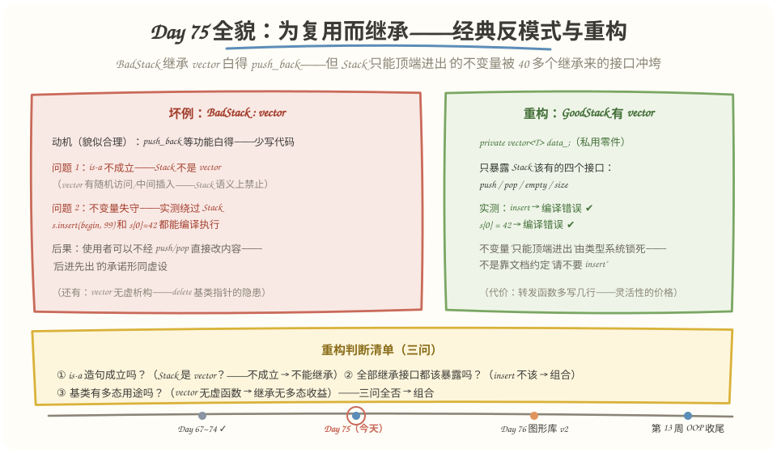
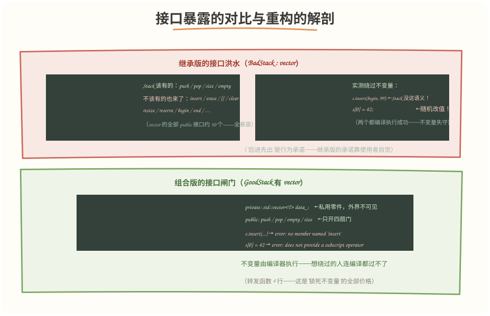
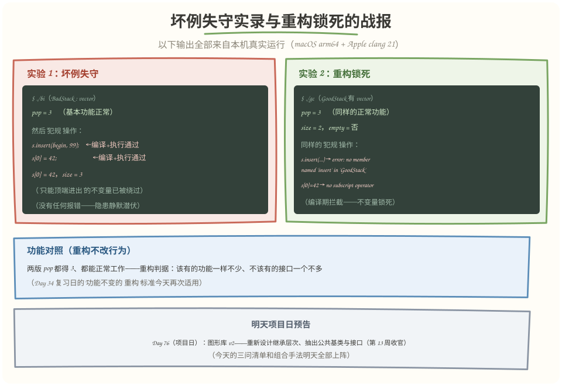

# 第 75 天：组合 vs 继承的坏例重构——"为复用而继承"的解毒剂

> **今日目标**：完成本教程后，你能做到：识别"为复用而继承"反模式（is-a 不成立 + 不该暴露的接口全暴露）；把 BadStack 重构成组合版并实测编译器锁死不变量；用三问清单（is-a 成立吗 / 全部接口该暴露吗 / 有多态收益吗）做重构决策；说出"不变量交给类型系统"和 Day 58 的设计原则一脉相承。
> **预计时间**：学习 20 分钟＋实践 45 分钟
> **前置准备**：完成 Day 53/47/58（组合、vector 基础、=delete 是今天的地基）。
> **今日产出**：BadStack 坏例（不变量失守实测）、GoodStack 重构版（编译器锁死实测）、三问决策清单。

## 1. 今天解决什么问题？

计划指定的重构练习："把一个'为复用而继承'的坏例子重构为组合"。坏例选 **BadStack : std::vector**——动机貌似合理（push_back 白得、少写代码），但它同时把 vector 约 50 个 public 接口**全部**暴露给 Stack 的使用者：`insert`（中间插入）、`operator[]`（随机改值）……而 Stack 的语义承诺是"**只能顶端进出**"。今天实测这个失守、再做重构（组合版只开四扇门）、最后总结三问决策清单。

这条原则和 Day 58 一脉相承：**不变量交给类型系统**——Day 58 用 `=delete` 锁"不能拷贝"，今天用 private 组合锁"不能从中间进出"。

## 2. 先看全貌：今天的内容位于哪里？



**图 1**：左卡红是坏例的两个问题（is-a 不成立 + 不变量失守——实测 insert 和 s[0] 绕过）；右卡绿是重构版（private vector + 只开四扇门——实测编译器拦截）；下方黄卡是三问决策清单。

三步概括今天：

1. 坏例：`BadStack : vector`——为白得 push_back 暴露了全部 50 个接口；
2. 重构：`GoodStack { private: vector<T> data_; }`——只开 push/pop/empty/size 四扇门；
3. 三问清单：is-a 成立？全部接口该暴露？有多态收益？——三问全否 → 组合。

## 3. 核心概念：先用直觉，再给准确定义

### 3.1 为复用而继承：貌似省事的陷阱

- **一句通俗解释**：为了"白得"基类的功能而继承——不问 is-a 是否成立。省的代码换来的是不该有的功能也全暴露。
- **一个类比**：为了用厨房而跟邻居合租整套房子——他的卧室、书房、保险柜你也能进——"使用权"和"产权"混为一谈。
- **对应到技术上是**：实测——`BadStack : std::vector<int>` 后 `s.insert(s.begin(), 99)` 和 `s[0] = 42` 都编译执行通过：**"只能顶端进出"的不变量被静默绕过**（无任何报错）。类比的边界：邻居好人坏人难说（使用者可能不知道自己犯规）；**设计就不该开这扇门**——错误在坏例这边。另一个隐患：vector 没有虚析构——Day 69 的 delete 基类指针问题在此潜伏（进阶场景才触发）。
- **常见误解**："能跑就没问题"——本机实测它"跑"得很正常（pop=3 正确输出）——失守是**静默**的（又见"能跑不等于对"系列）。

### 3.2 组合重构：四扇门锁死不变量

- **一句通俗解释**：把 vector 藏进 private、只转发 Stack 该有的四个操作——不该有的接口**物理上不存在**（不是"约定不用"）。
- **一个类比**：银行柜台——保险库（vector）在墙后，客户只能经四个窗口（push/pop/empty/size）办理；翻墙？墙是类型系统砌的。
- **对应到技术上是**：实测——`GoodStack` 里 `s.insert(...)` 编译报 `no member named 'insert'`；`s[0] = 42` 报 `does not provide a subscript operator`。功能对照：两版 pop 都得 3——**重构判据**（Day 34 标准）"该有的功能一样不少、不该有的接口一个不多"。类比的边界：组合的代价是转发函数几行——这是"锁死不变量"的全部价格（昨天铁则的姊妹句）。
- **与 Day 53 的连接**：当时说"能组合就组合"是经验之谈；今天用实测说明**为什么**——继承暴露全部接口（50 个），组合只暴露你选的（4 个）。

### 3.3 三问决策清单

- **一句通俗解释**：想继承先过三关——①"X 是一个 Y"造句成立吗？②Y 的全部接口都该暴露给 X 吗？③需要经 Y* 多态使用 X 吗？——三问全"是"才继承；有一问"否"就组合。
- **一个类比**：结婚三问——真是一家人吗（is-a）？愿意共享全部财产吗（接口）？需要改姓入户吗（多态）——一问犹豫就先"合租"（组合）。
- **对应到技术上是**：今天的 Stack 三问全否（Stack 不是 vector；insert 不该暴露；vector 无虚函数无多态收益）→ 组合。对照正例：Day 72 的 `Square : Rect` 三问全是（正方形是矩形；矩形的接口都适用；经 Shape* 多态使用）→ 继承正确。类比的边界：三问是**必要条件**不是充分条件——全过了还要看耦合成本（Day 74 对表）；但一问不过就必然不该继承。
- **常见误解**："私有继承 `class Stack : private vector` 能挡接口"——能（接口变 private），但那是"继承实现"的罕见用法，组合表达更直白；初学阶段统一用组合。

## 4. 图解核心机制



**图 2**：上半部分红卡是继承版的接口洪水——vector 约 50 个 public 接口全部暴露（实测 insert / s[0] 绕过不变量）；下半部分绿卡是组合版的接口闸门——private 藏起零件、public 只开四扇门（实测两条编译错误原文）。

按图逐步讲：

1. **数暴露的接口**：坏例暴露约 50 个（数不过来的就是问题）；重构版 4 个——**接口面就是风险面**；
2. **看失守的方式**：静默通过、无报错——"使用者自觉"是最不可靠的防线（Day 22"能跑不等于对"的类设计版）；
3. **看锁死的机制**：private 成员外界不可见（Day 49）——想调 insert 连编译都过不了；**错误暴露得越早越安全**（编译期 > 运行期 > 静默）；
4. **三问清单套一遍**：今天的 Stack 和 Day 72 的 Square 各走一遍——一反一正，清单的判别力实测。

## 5. 动手实践：完成一个最小可运行例子

### 5.1 准备文件

```bash
cd ai-compiler-roadmap/tutorials/day-075/examples
```

两个程序：`bad_inherit.cpp`（坏例）、`good_compose.cpp`（重构版）。

### 5.2 编写代码

重构版核心（完整代码见本目录）：

```cpp
template <typename T>
class GoodStack {
private:
    std::vector<T> data_;                       // 组合：私用零件，外界看不见

public:
    void push(const T& v) { data_.push_back(v); }

    T pop() {
        T v = data_.back();
        data_.pop_back();
        return v;
    }

    bool empty() const { return data_.empty(); }
    std::size_t size() const { return data_.size(); }
    // 没有 insert / operator[] / clear——Stack 不该有的操作，物理上不存在
};
```

### 5.3 运行与观察

```bash
g++ -Wall bad_inherit.cpp -o bi && ./bi
```

实际执行结果（本机）：

```text
pop = 3
s[0] = 42，size = 3
（Stack 的不变量'只能顶端进出'已被绕过）
```

```bash
g++ -Wall good_compose.cpp -o gc && ./gc
```

```text
pop = 3
size = 2，empty = 否
（insert / s[0] 被编译器拦下——不变量锁死）
```



**图 3**：左上坏例失守（两个犯规操作静默通过）；右上是重构锁死（两条编译错误原文）；下方蓝卡是功能对照（重构判据）。

### 5.4 修改一行再观察：两条执法线

**执法一（insert 被拦）**：把 `good_compose.cpp` 里 `s.insert(s.begin(), 99);` 的注释放开（预期编译失败，本机实测）：

```text
error: no member named 'insert' in 'GoodStack<int>'
```

**执法二（下标被拦）**：把 `s[0] = 42;` 的注释放开（预期编译失败，本机实测）：

```text
error: type 'GoodStack<int>' does not provide a subscript operator
```

**对照实验**：同样的两行在坏例版编译执行全过（5.3 第一段输出）。**一坏一好，同样代码两种命运**——这就是"不变量交给类型系统"的实测含义。把两条错误信息和 Day 58 的两条（private/deleted constructor）并排放进 notes.md——四种编译期拦截，同一个设计哲学。

## 6. 常见错误与排查

**错误 1：Stack 的使用者直接调了 insert（坏例版遗留代码）**

- 现象：Stack 行为怪异（中间多了元素、pop 拿到意料外的值）；
- 原因：继承版暴露了全部接口——某处代码"合法地"绕过了不变量；
- 定位：搜业务代码里的 `insert` / `[` / `erase` 调用；
- 修复：换成组合版——编译器把犯规点全部点亮，逐个改为 push/pop。

**错误 2：重构后编译器报"no member named 'xxx'"**

- 现象：迁移到 GoodStack 后旧代码编译不过；
- 原因：旧代码用了 Stack 不该有的接口——**这正是重构的收益**（暴露所有历史犯规）；
- 定位：逐个报错点检查——是真需求（给 GoodStack 加对应方法）还是犯规（改成 push/pop）；
- 修复：按语义逐个决策——重构是一次不变量的全面审计。

**错误 3：不确定该继承还是组合**

- 现象：设计时反复纠结；
- 原因：没有决策流程；
- 定位：跑三问清单（is-a / 接口全暴露 / 多态收益）；
- 修复：三问全"是"继承；一问"否"组合；仍犹豫 → 组合（默认首选）。

## 7. 今日练习

### 必做练习（计划指定：坏例重构）

自己从坏例开始重做一遍：先写 `BadQueue : std::vector`（同样是坏例——`pop_front` 语义被绕过），实测失守（insert / s[0] 都通过）；再重构 `GoodQueue`（组合 + 只开 push/pop/size/empty 四扇门），实测编译器锁死。预期产出：一坏一好的对照输出。

### 选做挑战

三问清单套三个案例并记结论：①`class ElectricCar : Car`（电动车是汽车——is-a ✔，继承）；②`class Car { Engine engine_; }`（Day 53——组合）；③`class String : std::vector<char>`（又一个坏例——string 有自己的不变量如'\0' 语义——组合）。把判断过程写进 `notes.md`——明天项目日前的设计热身。

## 8. 今日验收

- [ ] 我能说出"为复用而继承"的两个问题（is-a 不成立 + 不变量失守）
- [ ] 我实测了坏例失守：insert / s[0] 静默通过、无任何报错
- [ ] 我完成了组合重构并实测编译器锁死（两条错误原文）
- [ ] 我能背出三问清单并各套一个正反案例
- [ ] 我理解"不变量交给类型系统"是 Day 58~75 一贯的设计原则

## 9. 一句话总结与明天预告

今天的问题是"为复用而继承坏在哪、怎么改"；机制上，继承暴露基类全部接口（约 50 个）冲垮派生类不变量，组合用 private 藏零件 + 选择性转发把不变量锁进编译期；实践上，坏例失守、重构锁死、三问清单全部实测；验证标准是看到任何继承关系能过三问并说出"全过"或"哪问卡住"。明天 **Day 76（项目日）：图形库 v2**——重新设计继承层次、抽出公共基类与接口：本周设计原则的总装收官。
