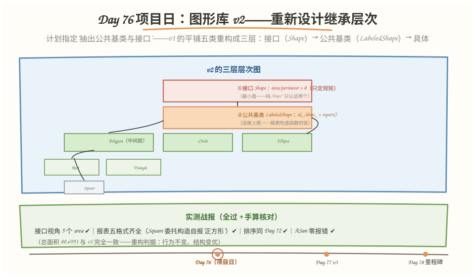
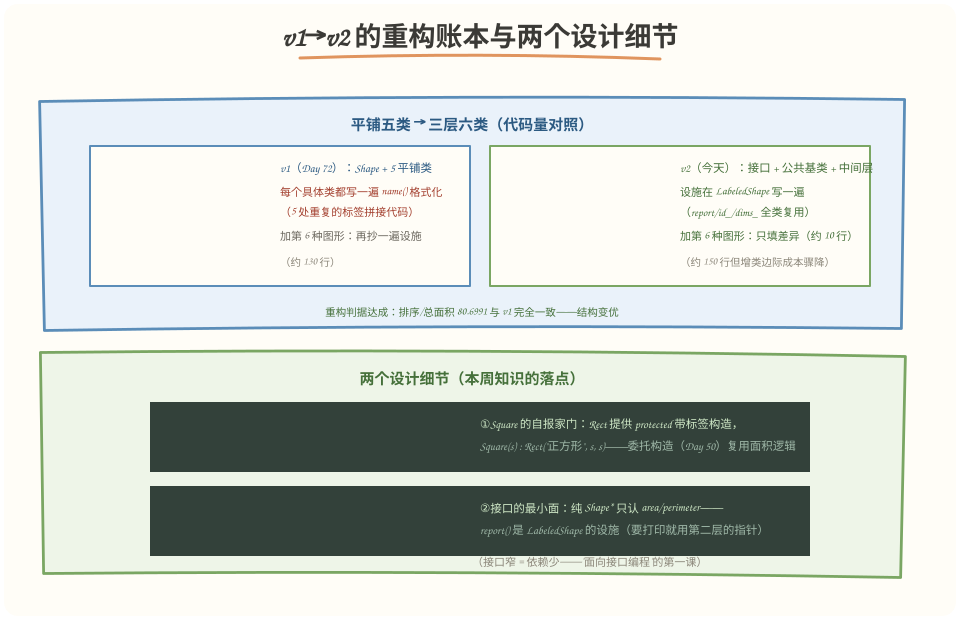
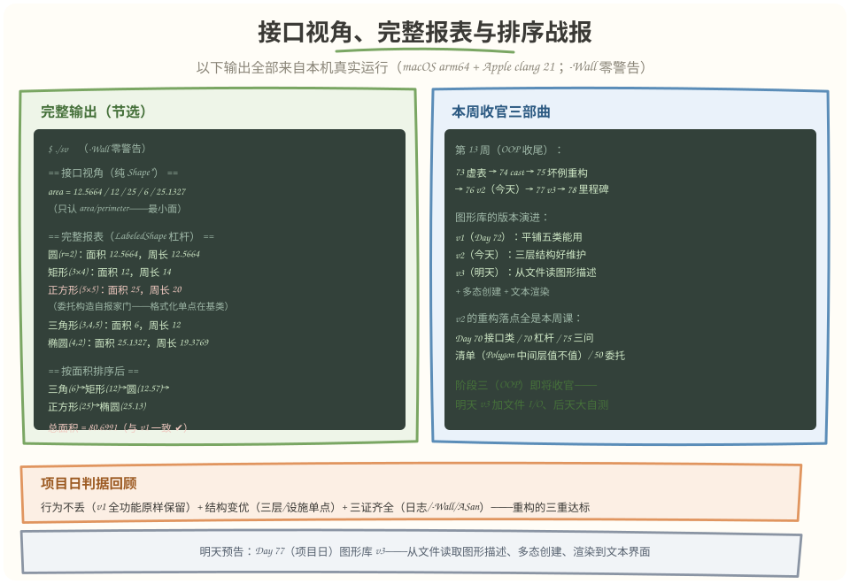

# 第 76 天（项目日）：图形库 v2——重新设计继承层次

> **今日目标**：完成本教程后，你能做到：把 v1 的平铺五类重构成三层（接口 Shape → 公共基类 LabeledShape → 具体类 + Polygon 中间层）；说出重构判据（行为不变、结构变优——总面积与排序与 v1 完全一致）；用委托构造给 Square 自报家门；用"接口最小面"和"加类边际成本"评价设计。
> **预计时间**：设计 30 分钟＋实现 40 分钟＋对照 20 分钟
> **前置准备**：完成 Day 73~75（虚表/cast/坏例重构是本周地基；Day 72 的 v1 是重构素材）。
> **今日产出**：三层六类的 shape_lib_v2（约 130 行、-Wall 零警告 + ASan 零报错）、重构账本。

## 1. 今天解决什么问题？

计划第 13 周的项目日：**图形库 v2——重新设计继承层次，抽出公共基类与接口**。v1（Day 72）能用但平铺——五个具体类各自重复着"名字标签 + 格式化"的设施代码。今天的重构三步走：**抽出接口**（Shape 只定 area/perimeter 的规矩——最小面）；**上提公共基类**（LabeledShape 收编 id_/dims_ 和 report() 杠杆——设施单点维护）；**按需加中间层**（Polygon 标记直边家族——Day 75 三问清单的练习）。

重构不是推倒重来——**判据先行**：行为不丢（v1 的全部输出原样保留——Square 一样自报家门，只是换了手法）、结构变优（加第六种图形的边际成本从"抄设施"降到"填差异"）。

## 2. 先看全貌：今天的内容位于哪里？



**图 1**：蓝卡是 v2 的三层层次图（①接口 Shape → ②公共基类 LabeledShape → ③具体类 + Polygon 中间层 + Square 孙辈）；绿卡是实测战报。

三步概括今天：

1. 接口只定规矩（纯 Shape* 只认 area/perimeter——最小面）；
2. 公共基类收编设施（report/id_/dims_ 全类单点）；
3. 重构判据：行为与 v1 完全一致 + 结构分层可维护。

## 3. 核心概念：先用直觉，再给准确定义

### 3.1 三层层次：规矩、设施、差异

- **一句通俗解释**：第一层立规矩（接口——只说要什么）、第二层建设施（公共基类——名字标签和打印大家共用）、第三层填差异（具体类——每个只写自己的公式）。
- **一个类比**：连锁餐饮的总部-区域-门店——总部定菜单框架（接口）、区域中心做统一品牌物料（公共基类）、门店只做本地菜（具体类）。
- **对应到技术上是**：实测——`Shape`（纯虚 area/perimeter）→ `LabeledShape`（protected id_/dims_ + 非虚 report() 杠杆）→ `Circle/Ellipse/Polygon→Rect→Square/Triangle`；**接口视角**实验：纯 `Shape*` 容器只打得出 area（report 它不认识——接口的最小面）；**杠杆视角**：`LabeledShape*` 容器五格式齐全（报表在第二层设施里单点维护）。类比的边界：层次不是越深越好——Polygon 中间层今天就一个标记（直边家族）——Day 75 的三问过一遍才决定留不留（教学版保留它是为了练"中间层"这个手法）。
- **常见误解**："重构就是重写"——重构的纪律是**判据先行**（行为不变）；今天每步都对照 v1 输出验证。

### 3.2 Square 的自报家门：委托构造

- **一句通俗解释**：v1 的 Square 靠重写 name() 自报家门（格式化散落在派生类）；v2 换一种手法——protected 带标签构造 + 委托，标签进构造、格式化单点在基类。
- **一个类比**：连锁子品牌——用母公司的供应链（Rect 的面积逻辑）但挂自己的招牌（"正方形"）。
- **对应到技术上是**：实测——`Rect` 提供两层构造：public `Rect(w,h)` 委托（Day 50 老朋友）到 protected `Rect(id,w,h)`；`Square(s) : Rect("正方形", s, s)`——面积/周长逻辑零重写、只换标签。**与 v1 对照**：报表里同样打出"正方形"——v1 靠派生类重写 name()，v2 改由构造传标签：同样的输出、格式化单点在基类。类比的边界：如果 Rect 的构造不可扩展（没有带标签版），Square 就得复制逻辑——**基类为继承留的口子**是设计的一部分。
- **常见误解**："Square 直接重写 name() 不行吗"——可以（v1 就这么干的）；带标签构造更彻底（标签进构造、格式化单点在基类）——两种手法的取舍写进 notes.md。

### 3.3 重构账本与接口最小面

- **一句通俗解释**：v1→v2 的收益看两个数字——加第六种图形的边际成本（从抄全套设施 ≈30 行降到填差异 ≈10 行）和设施修改的影响面（从 5 处降到 1 处）。
- **一个类比**：家里网线——每屋单独拉线（v1：5 处重复）vs 集线器一根进（v2：设施单点）；改套餐只动集线器。
- **对应到技术上是**：实测账本——v1 约 110 行（5 处 name() 重复）、v2 约 130 行（多出两个中间类但设施单点）；**行为对照**：排序结果和总面积 80.6991 与 v1 **完全一致**（重构判据达成）。**接口最小面**的价值：纯 Shape 接口的用户（只要算面积的代码）不依赖打印设施——依赖越少、变化冲击越小（"面向接口编程"的第一课）。类比的边界：v2 行数略多——**结构优化不等于代码更短**，是变更成本的下降；这个账要会算。
- **常见误解**："代码行数少就是好设计"——看变更场景：加类/改设施的频率高时 v2 的分层立刻回本。

## 4. 图解核心机制



**图 2**：上半部分蓝卡是 v1/v2 对照账本（平铺 vs 三层的代码分布和边际成本）；下半部分绿卡是两个设计细节（Square 委托构造、接口最小面）。

按图逐步讲：

1. **对着账本算账**：v1 的 5 处 name() 重复 → v2 的 1 处 report() 单点；加第六种图形的成本对比（抄设施 vs 填差异）——重构的收益量化；
2. **看 Square 的两层构造**：public 版委托到 protected 带标签版——基类为"要换标签的子类"留口子（设计的可扩展性）；
3. **走一遍接口最小面**：纯 Shape* 只认两个纯虚——report 是第二层的设施；两种容器（`vector<unique_ptr<Shape>>` vs `vector<unique_ptr<LabeledShape>>`）各取所需——**依赖你需要的最小面**；
4. **三问过 Polygon**：is-a 成立（矩形/三角形是直边图形 ✔）、接口全暴露（没暴露新接口——只是标记）✔、多态收益（暂无——它是"为将来留的家族标记"）——第三问不过！教学版保留它练手法，**生产版可以砍**——这个判断本身写进 notes.md。

## 5. 动手实践：完成一个最小可运行例子

### 5.1 准备文件

```bash
cd ai-compiler-roadmap/tutorials/day-076/examples
```

主角：`shape_lib_v2.cpp`（三层六类完整版）。

### 5.2 编写代码

层次骨架（完整代码见本目录）：

```cpp
class Shape {                                        // ①接口：只定规矩
public:
    virtual double area() const = 0;
    virtual double perimeter() const = 0;
    virtual ~Shape() = default;
};

class LabeledShape : public Shape {                  // ②公共基类：设施单点
protected:
    std::string id_, dims_;
    LabeledShape(const std::string& id, const std::string& dims) : id_(id), dims_(dims) {}
public:
    void report() const {                            // 杠杆（Day 70）
        std::cout << "  " << id_ << " " << dims_ << "：面积 " << area()
                  << "，周长 " << perimeter() << std::endl;
    }
};

class Rect : public Polygon {
protected:
    Rect(const std::string& id, double w, double h)              // 带标签版（Square 用）
        : Polygon(id, "(" + … + ")"), w_(w), h_(h) {}
public:
    Rect(double w, double h) : Rect("矩形", w, h) {}             // 委托构造（Day 50）
    …
};

class Square : public Rect {
public:
    explicit Square(double s) : Rect("正方形", s, s) {}          // 自报家门
};
```

### 5.3 运行与观察

```bash
g++ -Wall shape_lib_v2.cpp -o sv && ./sv
```

实际执行结果（本机，节选）：

```text
== v2 三层层次：接口 → 公共基类 → 具体 ==
  [接口视角] area = 12.5664
  …（纯 Shape* 只认 area/perimeter——接口的最小面）

== 完整报表（LabeledShape 杠杆） ==
  圆 (r=2.000000)：面积 12.5664，周长 12.5664
  矩形 (3.000000×4.000000)：面积 12，周长 14
  正方形 (5.000000×5.000000)：面积 25，周长 20
  三角形 (3.000000,4.000000,5.000000)：面积 6，周长 12
  椭圆 (4.000000,2.000000)：面积 25.1327，周长 19.3769

== 按面积排序（Day 72 同款） ==
  三角形(6) → 矩形(12) → 圆(12.5664) → 正方形(25) → 椭圆(25.1327)
  总面积 = 80.6991
```

```bash
g++ -Wall -fsanitize=address shape_lib_v2.cpp -o sva && ./sva
```

```text
（ASan 零报错）
```



**图 3**：左上完整输出（接口最小面/报表/排序三段标注）；右侧是本周收官三部曲和版本演进；下方橙卡是项目日判据回顾。

**重构判据核对**：排序顺序与总面积 **80.6991** 和 v1（Day 72）**完全一致**——行为不丢；三层结构和设施单点——结构变优；Square 同样自报家门（手法从重写 name() 换成带标签构造）。

### 5.4 修改一个输入再观察：加第六种图形的边际成本

给 v2 加 `SemiCircle`（半圆：`area = πr²/2`、`perimeter = πr + 2r`）——数一数改动：一个新类约 10 行（继承 LabeledShape、构造传标签、两个 override）+ main 里 push_back 一行——**零改** report/排序/循环。对照 v1 做同样的事（Day 72 的 5.4 当年做过）：也要加类，但 v1 的 name() 要自己拼全套格式。**边际成本对比**就是重构账本的实证。跑 v2+半圆：面积 14.1372 参与排序（Day 72 同款数字）。

## 6. 常见错误与排查

**错误 1：LabeledShape 不能实例化（忘了它是中间层）**

- 现象：`LabeledShape s;` 编译错；
- 原因：它继承了纯虚（area/perimeter）没实现——仍是抽象类；
- 定位：错误列出未实现的纯虚；
- 修复：这是设计意图——中间层只收设施不做具体。

**错误 2：Square 打成"矩形"（走错构造的坑）**

- 现象：报表里 Square 显示基类标签；
- 原因：直接 `Square(s) : Rect(s, s)` 走了 public 构造（标签写死"矩形"）；
- 定位：看 Square 的构造走哪个 Rect 版本；
- 修复：经 protected 带标签版 `Rect("正方形", s, s)`。

**错误 3：纯 Shape 容器调不到 report()**

- 现象：`vector<unique_ptr<Shape>>` 里 `s->report()` 编译错；
- 原因：report 是 LabeledShape 的设施——接口层不认识；
- 定位：看容器的元素类型；
- 修复：要打印就用 `vector<unique_ptr<LabeledShape>>`（第二层指针）——依赖你需要的最小面。

## 7. 今日练习

### 必做练习

给 LabeledShape 加 `set_label(const std::string&)`（运行期改标签）——验证：改一个 Circle 的标签后 report 显示新名字、area 不变。观察：**设施加一处、全类受益**（六个类都能用）——v2 分层的日常红利。预期产出：改标签前后的报表对照。

### 选做挑战

"砍掉 Polygon"实验：删掉中间层（Rect/Triangle 直接继承 LabeledShape）——验证输出不变（它是纯标记层）。对照两个版本的类图，用 Day 75 三问写下"留 or 砍"的结论和理由——这次是你自己做分层决策（明天 v3 的热身）。

## 8. 今日验收

- [ ] 我的 v2 三层六类编译运行全过（-Wall 零警告 + ASan 零报错）
- [ ] 重构判据达成：排序/总面积与 v1 完全一致（输出不丢）+ 设施单点
- [ ] 我演示了接口最小面（纯 Shape* vs LabeledShape* 两种容器）
- [ ] 我的 Square 用委托构造自报家门（protected 带标签版）
- [ ] 我算过重构账本（加类边际成本、设施单点）并对 Polygon 做了三问

## 9. 一句话总结与明天预告

今天的问题是"平铺的类层次怎么重构成可维护的分层"；机制上，接口定规矩（最小面）、公共基类收设施（单点）、中间层按需（三问决策）；实践上，三层六类、判据对照、委托构造、边际成本全部落地；验证标准是加第六种图形零改设施、改设施全类受益。明天 **Day 77（项目日）：图形库 v3**——从文件读取图形描述、多态创建并渲染到文本界面：第 6 周的文件 I/O 和本周的多态在项目里会师。
