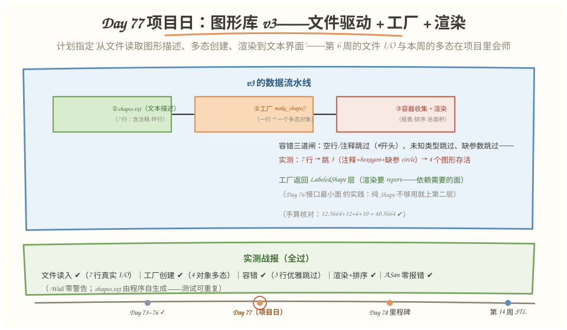
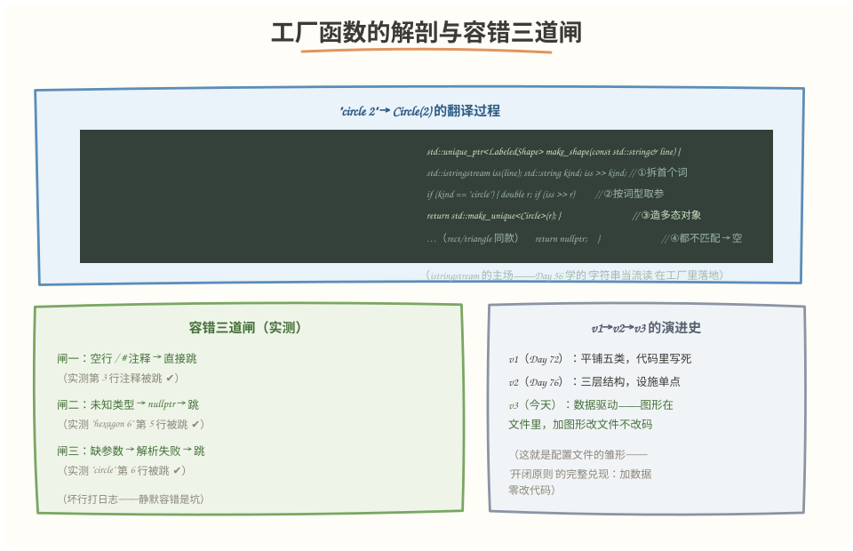
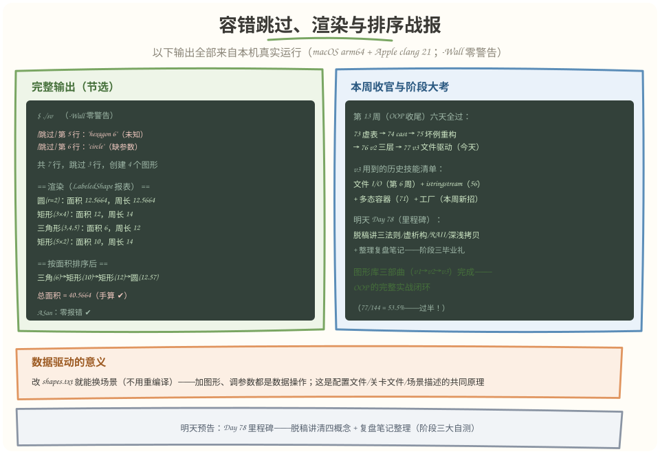

# 第 77 天（项目日）：图形库 v3——文件驱动 + 工厂 + 文本渲染

> **今日目标**：完成本教程后，你能做到：实现"一行描述 → 多态对象"的工厂函数（istringstream 拆词 + 类型分派）；从文件读图形描述并容错（空行/注释/未知类型/缺参数四类跳过都打日志）；说出数据驱动的意义（改文件不改码）；完成渲染（报表 + 排序 + 总面积）并 ASan 验证。
> **预计时间**：实现 50 分钟＋对照 30 分钟
> **前置准备**：完成 Day 73~76（v2 的三层骨架直接复用；Day 56 的 istringstream 是工厂的拆词工具）。
> **今日产出**：文件驱动的 shape_lib_v3（读 7 行、容错跳 3、多态创建 4、渲染排序 + ASan 零报错）。

## 1. 今天解决什么问题？

计划第 13 周的第二个项目日：**图形库 v3——从文件读取图形描述、多态创建并渲染到文本界面**。v1 代码写死图形、v2 分层好维护——v3 把图形搬进**数据**：`shapes.txt` 里一行行描述（"circle 2"），程序读文件、工厂逐行造对象、统一渲染。改文件就换场景——**加图形零改代码**（开闭原则的完整兑现，也是配置文件/关卡文件的原理雏形）。

今天的核心新招是**工厂函数**：`make_shape(line)` 用 istringstream 拆词、按词型分派、造出多态对象（或 nullptr 表示不认识）——配三道容错闸（注释/未知/缺参），实测 7 行跳 3 存 4。

## 2. 先看全貌：今天的内容位于哪里？



**图 1**：蓝卡是三段流水线（①shapes.txt → ②工厂 → ③容器+渲染）+ 容错三道闸的实测；绿卡是战报。路线图：**77/144 = 53.5%——过半！**

三步概括今天：

1. 工厂：istringstream 拆词 → 类型分派 → make_unique 造多态对象；
2. 容错三道闸：注释跳、未知跳、缺参跳——跳过都打日志（静默容错是坑）；
3. 数据驱动：图形在文件里——改数据不改码。

## 3. 核心概念：先用直觉，再给准确定义

### 3.1 工厂函数：一行文本的魔法

- **一句通俗解释**：工厂把"一行描述"变成"一个对象"——拆词、认类型、造对应的类。
- **一个类比**：点单台——你说"一杯大美式"（一行文本），店员拆解（大杯型+美式类型）交给对应咖啡机（类）；说不认识的（"hexagon"）店员礼貌拒绝（nullptr）。
- **对应到技术上是**：实测——`make_shape("circle 2")`：①`iss >> kind` 拆出 "circle" ②`iss >> r` 取参 2 ③`make_unique<Circle>(2)` 造对象；`"hexagon 6"` 走到 `return nullptr`（不认识）。**istringstream 的主场**——Day 56 学的"字符串当流读"在工厂里落地（`iss >> w >> h` 连取两参比手动 split 干净）。类比的边界：工厂是**形状各异**的 if-else 分派（每类型一段）——更高级的注册表工厂（map 存构造函数）是第 14 周后的进阶；今天的手写版已够用且好读。
- **常见误解**："工厂是设计模式书里的大词"——今天 20 行的 make_shape 就是工厂模式的最简形态；模式是套路不是玄学。

### 3.2 容错三道闸

- **一句通俗解释**：读文件四类行——合法行造对象，空行/注释/未知类型/缺参数各走各的跳过通道，**每次跳过都打日志**。
- **一个类比**：机场安检——合法旅客登机（造对象）；VIP 通道（注释）、不明身份者（未知类型）、证件不全者（缺参数）分别拦下并**登记在案**（日志）。
- **对应到技术上是**：实测——第 3 行注释（`#` 开头）、第 5 行 `"hexagon 6"`（未知）、第 6 行 `"circle"`（缺参数）**各打一行跳过日志**后跳过；7 行最终创建 4 个图形。**为什么打日志**：静默容错是坑（用户改错了文件程序装没事——排查地狱）；"跳过+说明"让数据问题一眼可见。类比的边界：容错的粒度看场景——今天的渲染器跳过坏行继续画（宽松）；财务系统可能一行错全停（严格）——**策略选择**不是对错。
- **常见误解**："解析失败要崩才严谨"——看需求；文本场景的惯例是跳过+日志（今天的做法）。

### 3.3 数据驱动：改文件不改码

- **一句通俗解释**：图形的定义从代码搬进数据文件——换场景（加图形、调参数）是编辑文本，不是改代码重编译。
- **一个类比**：餐厅换菜单——菜的做法（类）不变，菜单（数据文件）随时换；不用重新装修厨房（重编译）。
- **对应到技术上是**：实测——7 行文件里 4 个合法图形全被正确创建渲染；想加个圆？文件里加一行 `circle 5` 就行（**零改代码**）。这是配置文件、游戏关卡、场景描述的共同原理——**代码管逻辑、数据管内容**。类比的边界：新**类型**（如 ellipse）仍要加类+工厂分支（代码）——数据驱动的是"同类型的实例"；类型级扩展是 v2 讲的开闭（加类零改循环）。
- **常见误解**："数据驱动万能"——它管实例不管类型；类型系统的事（新算法/新行为）还是代码的领地。

## 4. 图解核心机制



**图 2**：上半部分蓝卡是 make_shape 的解剖（①拆词 ②按词型取参 ③make_unique 造对象 ④不匹配返回空）；左下绿卡是容错三道闸的实测（三行跳过日志）；右下灰卡是 v1→v2→v3 的演进史。

按图逐步讲：

1. **对着代码走一遍翻译**："circle 2" → kind="circle"、r=2 → Circle(2)——istringstream 的 `>>` 连续取参是工厂的得力工具（Day 56 回锅）；
2. **数一数三道闸的日志**：注释、hexagon、缺参 circle——**每个跳过都有名有姓有行号**；这就是"容错不静默"的样子；
3. **看演进史的落点**：v1 写死（改图形要编译）→ v2 分层（改设施单点）→ v3 数据驱动（改图形零编译）——三步各解决一层"变更成本"；
4. **工厂返回层的决策**：`unique_ptr<LabeledShape>` 而非纯 Shape——渲染要用 report（**依赖你需要的面**——Day 76 最小面原则的实践）。

## 5. 动手实践：完成一个最小可运行例子

### 5.1 准备文件

```bash
cd ai-compiler-roadmap/tutorials/day-077/examples
```

主角：`shape_lib_v3.cpp`（三层骨架 + 工厂 + 文件驱动）。

### 5.2 编写代码

工厂核心（完整代码见本目录）：

```cpp
// 格式约定："circle 2"、"rect 3 4"、"triangle 3 4 5"
// 返回 LabeledShape 层（渲染要用 report——依赖需要的面）
std::unique_ptr<LabeledShape> make_shape(const std::string& line) {
    std::istringstream iss(line);
    std::string kind;
    iss >> kind;                                          // ①拆第一个词

    if (kind == "circle") {
        double r;
        if (iss >> r) { return std::make_unique<Circle>(r); }   // ②③取参造对象
    } else if (kind == "rect") {
        double w, h;
        if (iss >> w >> h) { return std::make_unique<Rect>(w, h); }
    } else if (kind == "triangle") {
        double a, b, c;
        if (iss >> a >> b >> c) { return std::make_unique<Triangle>(a, b, c); }
    }
    return nullptr;                                       // ④不认识 → 调用方跳过
}

// main 里的读取循环：
while (std::getline(in, line)) {
    if (line.empty() || line[0] == '#') { ++skipped; continue; }   // 闸一：空/注释
    auto s = make_shape(line);
    if (s) { shapes.push_back(std::move(s)); }                     // 存活
    else   { ++skipped; /* 打跳过日志 */ }                          // 闸二/三
}
```

### 5.3 运行与观察

```bash
g++ -Wall shape_lib_v3.cpp -o sv && ./sv
```

实际执行结果（本机）：

```text
  [跳过] 第 5 行："hexagon 6"（未知类型或缺参数）
  [跳过] 第 6 行："circle"（未知类型或缺参数）
== 文件读取结果 ==
  共 7 行，跳过 3 行，创建 4 个图形

== 渲染（LabeledShape 报表） ==
  圆(r=2.000000)：面积 12.5664，周长 12.5664
  矩形(3.000000×4.000000)：面积 12，周长 14
  三角形(3.000000,4.000000,5.000000)：面积 6，周长 12
  矩形(5.000000×2.000000)：面积 10，周长 14

== 按面积排序后 ==
  三角形(3.000000,4.000000,5.000000)：面积 6，周长 12
  矩形(5.000000×2.000000)：面积 10，周长 14
  矩形(3.000000×4.000000)：面积 12，周长 14
  圆(r=2.000000)：面积 12.5664，周长 12.5664
  总面积 = 40.5664
```

```bash
g++ -Wall -fsanitize=address shape_lib_v3.cpp -o sva && ./sva
```

```text
（ASan 零报错）
```

**手算核对**：12.5664 + 12 + 6 + 10 = **40.5664** ✔；排序 6 < 10 < 12 < 12.5664 ✔。



**图 3**：左上完整输出（跳过日志/渲染/排序标注）；右侧是本周收官和过半宣言；下方橙卡是数据驱动的意义。

### 5.4 修改一个输入再观察：数据驱动的亲测

编辑 `shapes.txt`：加一行 `circle 10`（面积 314.159）、把 `rect 5 2` 改成 `rect 50 2`（面积 100）——重跑（**不重新编译**，同一二进制）：实测新图形自动参战、排序自动更新——总面积从 40.5664 变 **444.726**（40.5664 − 10 + 100 + 314.159）。**零改代码**——改数据就换场景，这是 v3 的核心红利。（程序只在文件不存在时生成样例——存在则尊重用户数据，这是数据驱动的配套设计。）再试一个坑：把某行写成 `CIRCLE 2`（大写）——被跳过（工厂的匹配是大小写敏感的——要不要宽容是设计决策，练习里你来实现宽容版）。

## 6. 常见错误与排查

**错误 1：`error: no member named 'report' in 'Shape'`**

- 现象：`vector<unique_ptr<Shape>>` 里调 report；
- 原因：report 在 LabeledShape 层——接口不认识；
- 定位：看容器/工厂的返回类型；
- 修复：工厂返回 `unique_ptr<LabeledShape>`（渲染场景需要的面）——今天的解法。

**错误 2：坏行让程序崩或死循环**

- 现象：文件里有乱行程序异常；
- 原因：没有容错闸（或闸不完整——只查了类型没查参数个数）；
- 定位：崩溃/卡住的输入行；
- 修复：三道闸齐全（注释/未知/缺参），跳过打日志——今天的模板。

**错误 3：文件读了一行就停**

- 现象：只处理了第一个图形；
- 原因：ifstream 状态被工厂里的 istringstream 解析失败**误伤**（各用各的流就没这问题）或忘了 getline 循环；
- 定位：工厂用独立 iss（不动 in）；
- 修复：检查流的使用边界——文件流只归 getline 管。

## 7. 今日练习

### 必做练习

给工厂加 `square s` 类型（复用 Rect("正方形", s, s) 的思路——注意 v3 的 Rect 是公开标签版，需要给 Square 加带标签构造或直接在工厂里造 `Rect` 后…… 更简单：加一个 Square 类继承 LabeledShape）。文件里加两行 `square 4`——验证报表出现"正方形"。预期产出：新类型的工厂分支 + 文件 + 报表。

### 选做挑战

"宽容大小写"改造：工厂里把 kind 统一转小写再比较（`std::transform` + `::tolower`）——验证 `CIRCLE 2` 也能识别。再想：宽容的边界在哪（`CiRcLe` 也要认吗？——转小写后全都认；那故意的拼写错误会被宽容掉吗？）——把"宽容 vs 严格"的取舍写进 notes.md（配置文件设计的经典话题）。

## 8. 今日验收

- [ ] 我的工厂能把三种描述行变成多态对象（istringstream 拆词实测）
- [ ] 我的容错三道闸齐全且每次跳过打日志（7 行跳 3 存 4）
- [ ] 我实测了数据驱动：改 shapes.txt 不重编译、场景自动更新（5.4）
- [ ] 渲染 + 排序 + 总面积 40.5664 手算核对全过；ASan 零报错
- [ ] 我能说出 v1→v2→v3 各自解决的变更成本层

## 9. 一句话总结与明天预告

今天的问题是"图形定义怎么从代码搬进数据"；机制上，工厂（istringstream 拆词+类型分派+make_unique）把文本变对象，三道容错闸保证坏行优雅跳过，数据驱动让换场景零编译；实践上，文件读入、工厂创建、渲染排序、改文件验证全部实测；验证标准是加一行描述能预测报表怎么变。明天 **Day 78（里程碑）：阶段大自测**——脱稿讲清三法则/虚析构/RAII/深浅拷贝 + 整理复盘笔记：阶段三（面向对象）的毕业礼，**全程过半**的节点。
