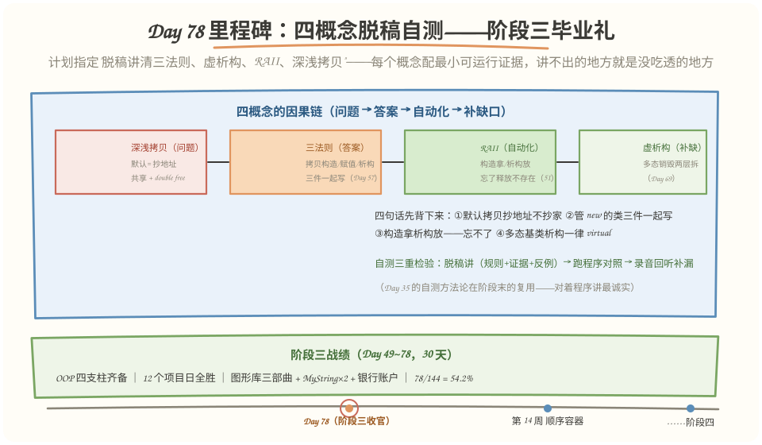
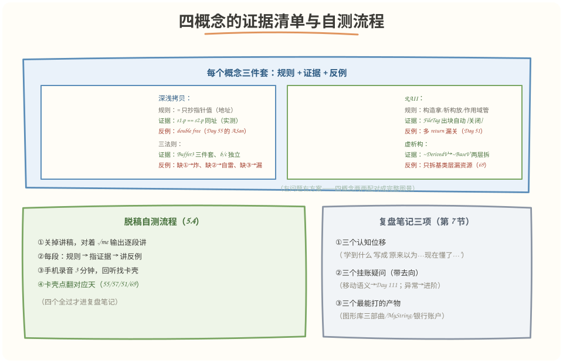
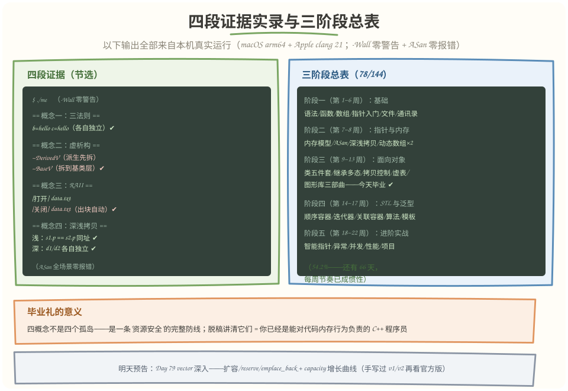

# 第 78 天（里程碑）：阶段大自测——脱稿讲清四概念

> **今日目标**：完成本教程后，你能做到：**脱稿**讲清三法则、虚析构、RAII、深浅拷贝（每个概念：一句话规则 + 一个最小例子 + 一个反例后果）；用程序化讲稿自测（跑一遍对照自己的复述）；整理阶段三的复盘笔记（认知位移 + 挂账疑问）。
> **预计时间**：脱稿自测 40 分钟＋复盘整理 40 分钟
> **前置准备**：完成 Day 49~77（阶段三的全部——今天是它们的毕业礼）。
> **今日产出**：四概念的程序化讲稿（含实测输出）、复盘笔记模板与示例。

## 1. 今天解决什么问题？

计划阶段三的收官仪式：**脱稿讲清三法则、虚析构、RAII、深浅拷贝** + 整理复盘笔记。四个概念是 OOP 资源管理的四大支柱——它们相互勾连（三法则管复制、虚析构管多态销毁、RAII 管生命期、深浅拷贝是三法则的动因），脱稿讲清它们 = 阶段三真的到手了。

方法论沿用 Day 35 的自测经验：**对着程序讲**（每个概念配最小可运行证据）——讲不出的地方就是没吃透的地方。

## 2. 先看全貌：四个概念的地图



**图 1**：四概念的关系图（深浅拷贝是问题 → 三法则是答案 → RAII 是自动化 → 虚析构管多态销毁）；每个概念的"一句话规则 + 证据"卡片。

四句话先背下来：

1. **深浅拷贝**：默认拷贝抄地址不抄家——含指针成员时共享+double free；
2. **三法则**：管裸资源的类，拷贝构造/拷贝赋值/析构三件一起写；
3. **RAII**：构造拿资源、析构放资源——"忘了释放"从语法上不存在；
4. **虚析构**：多态基类析构一律 virtual——否则 delete 基类指针漏拆派生层。

## 3. 脱稿讲稿：四个概念各三段

### 3.1 深浅拷贝（问题的起点）

- **一句话规则**：`=` 对指针成员只抄地址——两个对象共用一块内存（共享改动 + double free）。
- **最小例子**：`Shallow s2 = s1` 后 `s1.p == s2.p`（实测同址）——改一个动另一个、析构两次炸。
- **反例后果**：Day 55 的 ShallowString 实验——普通编译静默、ASan 报 attempting double-free。
- **脱稿检验**：能画出"两根指针一块内存"和"两块内存各一根"的对照图吗？

### 3.2 三法则（答案的正文）

- **一句话规则**：类里有 new（裸资源）→ 拷贝构造 + 拷贝赋值 + 析构三件套一起写，缺一漏风。
- **最小例子**：Buffer3 的三件套（深拷贝构造 / 三步式赋值含自赋值检查 / delete 析构）——`b` 和 `c = b` 各自独立（实测）。
- **反例后果**：缺①→double free；缺②→赋值踩自雷；缺③→泄漏（Day 57 的漏风模型）。
- **脱稿检验**：能说出三件各漏什么、为什么必须"一起"写吗？

### 3.3 RAII（答案的自动化）

- **一句话规则**：把资源绑定到对象生命期——构造拿、析构放，作用域管一切。
- **最小例子**：FileTag 块内声明——出块自动打印 `[关闭]`（实测零 close 调用）。
- **反例后果**：手动 close 在多 return 路径下漏关（Day 51 的迷宫实验）。
- **脱稿检验**：能解释"为什么 RAII 连异常路径都覆盖"吗？（栈展开时局部对象照样析构——进阶话题的一句话版。）

### 3.4 虚析构（多态的收尾）

- **一句话规则**：会被继承且经基类指针 delete 的类，析构必须 virtual。
- **最小例子**：`BaseV* p = new DerivedV(); delete p;`——实测先 `~DerivedV` 后 `~BaseV`（两层都拆）。
- **反例后果**：非虚版只拆基类层——派生类资源静默泄漏（Day 69 的 1000 字节实验）。
- **脱稿检验**：能说出虚析构和虚函数的绑定规则为什么一模一样吗？（析构也是"经基类指针调用的函数"。）

## 4. 图解四概念的关系



**图 2**：四概念的因果链（浅拷贝的问题 → 三法则的手写答案 → RAII 的自动化 → 虚析构补上多态销毁的缺口）；右下是脱稿自测的流程（讲→跑→对照→补漏）。

按图逐步讲：

1. **从问题出发**：深浅拷贝是"为什么需要三法则"的动因——先讲问题再讲答案最有逻辑；
2. **看答案的两级**：三法则手动挡（每处 new 配三件）、RAII 自动挡（资源进对象让作用域管）；
3. **补多态的缺口**：前三个管"单继承下的复制和销毁"，虚析构管"经基类指针的销毁"——四者拼完整图；
4. **自测走流程**：对着 5.3 的输出逐个讲——讲卡了就翻对应天（55/57/51/69）。

## 5. 动手实践：程序化讲稿

### 5.1 准备文件

```bash
cd ai-compiler-roadmap/tutorials/day-078/examples
```

主角：`milestone_explain.cpp`（四概念各配最小证据）。

### 5.2 编写代码

见本目录完整代码——四个部分：Buffer3（三法则）、BaseV/DerivedV（虚析构）、FileTag（RAII）、Shallow/Deep（深浅拷贝）。

### 5.3 运行与观察

```bash
g++ -Wall milestone_explain.cpp -o me && ./me
```

实际执行结果（本机）：

```text
== 概念一：三法则（手写三件套的类） ==
  规则：类管裸资源（new）→ 拷贝构造/拷贝赋值/析构三件一起写
  b=hello c=hello（各自独立）

== 概念二：虚析构（delete 基类指针） ==
  规则：多态基类析构一律 virtual——否则派生类资源漏拆
  ~DerivedV（派生先拆）
  ~BaseV（虚析构：拆到基类层）

== 概念三：RAII（资源获取即初始化） ==
  规则：构造拿资源、析构放资源——'忘了释放'从语法上不存在
  [打开] data.txt
  （块内使用……）
  [关闭] data.txt（出块自动）

== 概念四：深浅拷贝（含指针成员的复制） ==
  浅拷贝：s1.p == s2.p → 同址（共享！）
  深拷贝：d1/d2 各自独立（hi/hi）
```



**图 3**：四段输出（每段对应一个概念的"证据"）+ 阶段三的战绩总表。

### 5.4 脱稿自测的执行法

**关掉这份讲稿**，对着 `./me` 的输出逐段讲：每段先说规则、再指证据、再讲反例后果。**录音自查**（手机录 3 分钟）——回听时卡壳/含糊的点就是漏洞，翻对应天补。四个全过再进入复盘笔记（第 7 节）。

## 6. 常见错误与排查

**错误 1：三法则背得出但讲不出"为什么缺一漏风"**

- 现象：能默写三件套、说不出各自的反例；
- 原因：只记了答案没记问题；
- 定位：回 Day 57 的漏风模型（缺①②③各漏什么）；
- 修复：用"问题→答案"的顺序重讲一遍。

**错误 2：虚析构和三法则混淆**

- 现象：把虚析构说成三法则的一部分；
- 原因：都是"析构相关"；
- 定位：虚析构管的是**经基类指针 delete**（多态销毁）；三法则管的是**复制语义**；
- 修复：一句话分界——三法则管复制、虚析构管多态销毁。

**错误 3：RAII 讲成"智能指针"**

- 现象：RAII 的例子只会说 unique_ptr；
- 原因：跳过了手写版（FileTag/MyString）；
- 定位：RAII 是**模式**（构造拿/析构放），智能指针是它的标准库实现之一；
- 修复：先讲 FileTag（手写版）再说智能指针是其推广。

## 7. 今日练习

### 必做练习（脱稿四讲 + 录音自查）

关掉讲稿，对着 `./me` 的四段输出逐个讲（每段：规则 → 指证据 → 讲反例），手机录音 3 分钟——回听找卡壳点，翻对应天补漏。四个全过后写复盘笔记（下方模板）。

### 选做挑战（互考模式）

找一位同学（或未来的自己）互考：对方随机点一个概念，你脱稿讲、对方对照本教程的"三件套"打分（规则/证据/反例各一分）——12 分制，10 分以上算毕业。讲不全的地方往往正是"以为懂了"的地方。

### 复盘笔记模板（必做练习的产出物）

```
# 阶段三复盘（Day 49~78：面向对象）

## 三个认知位移（示例）
1. 类不是"带函数的 struct"——是"不变量的守护者"（private 的意义从 Day 49 重新理解）
2. 多态不是语法糖——虚表的一次间接跳转让"加类型不改老码"成立（v1→v3 的实证）
3. 拷贝控制不是细节——是"对象语义"的定义（值语义 vs 引用语义的分水岭）

## 三个挂账疑问（示例）
1. 移动语义（Day 111）——"偷资源"怎么比"抄资源"快？
2. 异常安全（进阶）——RAII 说"异常路径也覆盖"，栈展开具体怎么走？
3. 多重继承的虚表——Day 73 说多继承多 vptr，第二张表长什么样？

## 三个最能打的项目产物
1. 图形库三部曲（v1→v3）——数据驱动的完整闭环
2. MyString v1/v2——三法则从手写到自动
3. 银行账户——static/mutable/日志组合的第一次实战
```

## 8. 今日验收

- [ ] 我脱稿讲清了四概念（每个：规则 + 证据 + 反例后果——录音自查过）
- [ ] 我的讲稿与 5.3 的输出对得上（程序化证据齐全）
- [ ] 我能说出四概念的因果链（浅拷贝问题 → 三法则 → RAII → 虚析构补缺口）
- [ ] 复盘笔记三项齐全（认知位移/挂账疑问/项目产物）
- [ ] 挂账疑问都标了去向（哪一周/哪一天回来看）

## 9. 一句话总结与下阶段预告

今天的问题是"阶段三的四大支柱是不是真的到手了"；方法上，脱稿讲 + 程序化证据 + 录音自查的三重检验，复盘笔记把"学过"沉淀为"拥有"；实践上，四概念的最小证据全部实测；验证标准是任何人问起任一概念，你能三分钟讲清并跑出证据。**阶段三（面向对象）收官——78/144 天（54.2%），图形库三部曲 + 12 个项目日全胜。** 下周进入 **阶段四（STL 与泛型）· Day 79：vector 深入**——扩容机制、reserve、emplace_back：手写过 v1/v2 的你，现在要看"官方版"怎么造。
