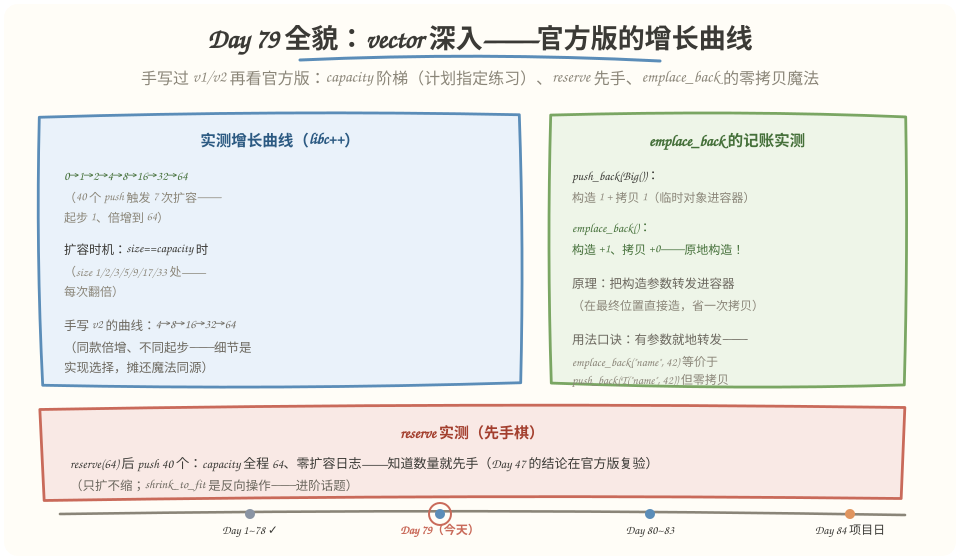
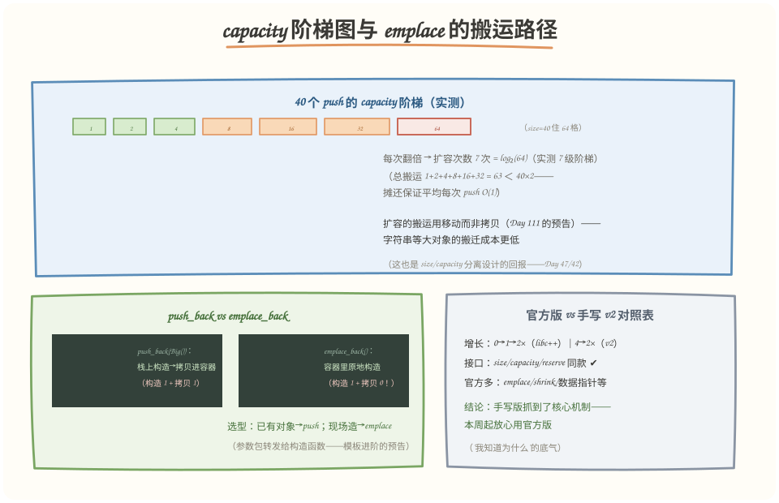
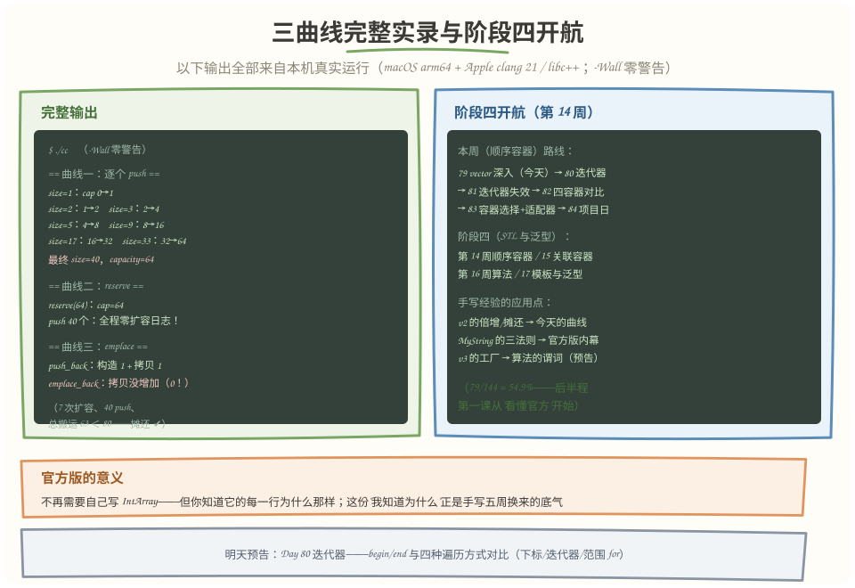

# 第 79 天：vector 深入——扩容机制、reserve、emplace_back

> **今日目标**：完成本教程后，你能做到：实测 vector 的 capacity 增长曲线（libc++ 的 0→1→2×阶梯——计划指定练习）；用构造/拷贝计数证明 emplace_back 的零拷贝优势；说出官方版与手写 v2 的同与异（倍增摊还同源、接口细节差异）；复验 reserve 先手策略。
> **预计时间**：学习 20 分钟＋实践 40 分钟
> **前置准备**：完成 Day 42/47/78（手写 v1/v2 的倍增与 reserve 是今天的对照系）。
> **今日产出**：三曲线实测（增长阶梯 7 级、reserve 零扩容、emplace 零拷贝）、官方 vs 手写对照表。

## 1. 今天解决什么问题？

阶段四（STL）第一课：**vector 深入**。你在第 7~8 周手写过两版动态数组（v1 五件套、v2 倍增+reserve）——今天用同样的探针看**官方版**怎么工作：capacity 阶梯长什么样（计划指定的增长曲线练习）、emplace_back 到底省了什么（构造记账实测）、以及确认手写版抓到的机制和官方同源。

核心心态转换：**不再需要自己写 IntArray，但你要知道它每一行为什么那样**——手写五周换来的就是这份"我知道为什么"的底气。

## 2. 先看全貌：今天的内容位于哪里？



**图 1**：左卡蓝是实测增长曲线（0→1→2→4→…→64 的七级阶梯）；右卡绿是 emplace_back 的记账（拷贝 +0！）；下方红卡是 reserve 复验。

三步概括今天：

1. 曲线：size==capacity 触发翻倍——扩容 log₂N 次、总搬运 O(N)；
2. emplace：参数转发进容器原地构造——省一次拷贝；
3. 手写 v2 与官方同源（倍增摊还），细节差异是实现选择。

## 3. 核心概念：先用直觉，再给准确定义

### 3.1 增长曲线：官方的阶梯

- **一句通俗解释**：vector 的容量按倍增生长——满了翻倍；40 个 push 触发 7 级阶梯（0→1→2→4→8→16→32→64）。
- **一个类比**：储蓄翻倍——1 元起步每次翻番，7 次后 64 元；途中偶尔"搬家"（扩容搬运）但次数是对数级的。
- **对应到技术上是**：实测——扩容发生在 size 1/2/3/5/9/17/33 处（每次 size==capacity）；**总搬运 1+2+4+8+16+32=63**（< 40×2）——摊还保证平均每次 push O(1)（Day 47 的数学在官方版原样成立）。与手写 v2 的差别：**起步容量**（libc++ 从 1 起、v2 从 4 起）——实现选择，摊还机制同源。类比的边界：增长因子依标准库而异（libc++ 2 倍、部分 MSVC 1.5 倍）——**代码不能依赖具体曲线**，只能依赖"均摊 O(1)"的复杂度承诺。
- **常见误解**："vector 扩容是 O(N) 所以慢"——单次是 O(N) 但均摊 O(1)（40 次 push 才搬 63 个元素）；担心就 reserve（今天的曲线二）。

### 3.2 emplace_back：原地构造

- **一句通俗解释**：push_back 是"先在外面造好再搬进来"（临时对象+拷贝）；emplace_back 是"把材料直接送进容器里造"（原地构造零拷贝）。
- **一个类比**：买家具——push_back（成品搬进门，拆装一次）；emplace_back（板件送进门当场组装，省一趟搬运）。
- **对应到技术上是**：实测记账——`push_back(Big())`：构造 1 + **拷贝 1**（临时进容器）；`emplace_back()`：构造 +1、**拷贝 +0**（原地）。带参用法：`v.emplace_back("name", 42)` ≈ `v.push_back(T("name", 42))` 但省中间临时。**选型**：已有对象→push；现场造→emplace。类比的边界：对 int/double 这类平凡类型两者无差（拷贝就是几个字节）；**大对象**（string/多字段类）emplace 的节省才可观——今天用 32 字节的 Big 放大信号。
- **常见误解**："emplace 总是更好"——传**已存在的对象**时 emplace 也得拷贝它（省不了）；优势只在"现场造"的场景。

### 3.3 官方版与手写 v2 的对照

- **一句通俗解释**：核心机制（size/capacity 分离、倍增摊还、reserve 先手）官方和你的 v2 同源；官方多的是工程细节（emplace/shrink_to_fit/异常保证）。
- **一个类比**：自家灶台 vs 商用厨房——火候原理一样（你学到的）；商用版多了定时器、安全阀（工程打磨）。
- **对应到技术上是**：对照表（图 2 右下）——增长（同倍增、不同起步）、接口（size/capacity/reserve 同款 ✔）、官方独有（emplace/shrink/异常安全）。**本周起放心用官方版**：每个行为都有"我知道为什么"的注脚（扩容为什么翻倍、reserve 为什么单向、at 为什么查 size）。类比的边界：手写版的意义不是替代而是**理解**——它让你读官方文档时事事有共鸣。
- **常见误解**："手写的 v2 白写了"——恰恰相反：没有 v2，今天的曲线只是数字；有了 v2，每级阶梯都是老朋友。

## 4. 图解核心机制



**图 2**：上半部分蓝卡是 capacity 阶梯图（七级、实测数值标注）+ 摊还账本（总搬运 63 < 80）；左下绿卡是 push/emplace 的路径对照（临时+拷贝 vs 原地）；右下灰卡是官方 vs v2 对照表。

按图逐步讲：

1. **对着阶梯数次数**：7 级对应 log₂(64)——push N 次的扩容是对数级的（这是倍增的回报）；
2. **算一遍摊还账**：总搬运 63、push 40 次——平均每次 1.575 个元素——O(1) 的直觉；
3. **看两条搬运路径**：push_back 的"栈上造+拷贝入"vs emplace 的"容器内造"——记账数字（1+1 vs 1+0）就是路径差的证据；
4. **翻对照表收官**：手写版抓到的全是核心机制——本周用官方版时把每个行为挂回 v2 的对应实现。

## 5. 动手实践：完成一个最小可运行例子

### 5.1 准备文件

```bash
cd ai-compiler-roadmap/tutorials/day-079/examples
```

主角：`capacity_curve.cpp`（三曲线实验）。

### 5.2 编写代码

记账工具与曲线核心（完整代码见本目录）：

```cpp
struct Big {
    double payload[4];                  // 32 字节——放大信号
    static int constructions;
    static int copies;
    Big() { ++constructions; }
    Big(const Big&) { ++copies; }
};

// 曲线一：观察每次扩容
std::vector<int> v;
std::size_t last_cap = 0;
for (int i = 0; i < 40; ++i) {
    v.push_back(i);
    if (v.capacity() != last_cap) {
        std::cout << "size=" << v.size() << " 时扩容：capacity "
                  << last_cap << " → " << v.capacity() << std::endl;
        last_cap = v.capacity();
    }
}

// 曲线三：记账对比（先 reserve 排除搬运干扰）
a.push_back(Big());      // 构造 1 + 拷贝 1
b.emplace_back();        // 构造 1 + 拷贝 0
```

### 5.3 运行与观察

```bash
g++ -Wall capacity_curve.cpp -o cc && ./cc
```

实际执行结果（本机）：

```text
== 曲线一：逐个 push_back（观察 capacity 阶梯） ==
  size=1 时扩容：capacity 0 → 1
  size=2 时扩容：capacity 1 → 2
  size=3 时扩容：capacity 2 → 4
  size=5 时扩容：capacity 4 → 8
  size=9 时扩容：capacity 8 → 16
  size=17 时扩容：capacity 16 → 32
  size=33 时扩容：capacity 32 → 64
  最终：size=40，capacity=64

== 曲线二：reserve 先手（一次到位） ==
  reserve(64) 后：capacity=64
  push 40 个后：size=40，capacity=64（全程零扩容日志！）

== 曲线三：emplace_back vs push_back（构造记账） ==
  push_back 1 个：构造 1 次，拷贝 1 次
  emplace_back 1 个：累计构造 2 次，累计拷贝 1 次（没增加！）

== 与手写 v2 的对照 ==
  libc++ 的增长因子：0→1→2→4→8…（起步 1，倍增）
  手写 v2（Day 47）：4→8→16→32→64（起步 4，倍增）
  同款摊还魔法：偶发搬迁被平常廉价 push 摊平——平均 O(1)
```



**图 3**：左上完整输出（三曲线标注）；右侧是阶段四路线和手写经验的应用点；下方橙卡是官方版的意义。

### 5.4 修改一个输入再观察：大对象的 emplace 优势放大

把 Big 的 payload 从 `[4]`（32B）改成 `[1000]`（8KB），两版各 push/emplace 100 个（都先 reserve）——重跑记账：push 版**拷贝 100 次**（每次 8KB 的搬运）、emplace 版**拷贝 0 次**。再把两版计时（`<chrono>`）对比——大对象场景 emplace 的节省从"计数差异"变成"毫秒差异"。**一小一大**：emplace 的价值随对象大小线性放大的实证。

## 6. 常见错误与排查

**错误 1：依赖具体增长曲线写代码**

- 现象：假设"push 后 capacity 一定翻倍"；
- 原因：增长因子是实现细节（libc++ 2x、MSVC 可能 1.5x）；
- 定位：跨平台行为不一致；
- 修复：只依赖"均摊 O(1)"和 reserve 的显式控制。

**错误 2：对已有对象用 emplace 期待省拷贝**

- 现象：`v.emplace_back(existing_obj)` 拷贝计数没降；
- 原因：emplace 省的是"临时对象的构造+拷贝"；已有对象无论如何要拷进来；
- 定位：对比记账（今天的工具）；
- 修复：已有对象用 push（语义更直白）；现场造才 emplace。

**错误 3：忘了 reserve 导致频繁扩容的误解**

- 现象：担心 push 慢；
- 原因：没算摊还账（均摊 O(1) 其实很快）；
- 定位：今天的总搬运 63 < 80；
- 修复：默认不 reserve（倍增已摊平）；确知数量才 reserve（曲线二的先手）。

## 7. 今日练习

### 必做练习（计划指定：观察 capacity 增长曲线）

把曲线一的 push 目标从 40 改成 1000——记录扩容次数（应为 10 次：到 1024）和最终 capacity；再画出手写 v2 同样 push 1000 的曲线（4→…→1024，8 次）——两条曲线并排放进 notes.md，标注"同源倍增、不同起步"。预期产出：两条曲线的数据表。

### 选做挑战

"shrink_to_fit 探索"：push 1000 个后 `v.resize(10)`——观察 capacity（**不变**！resize 只动 size）；再 `v.shrink_to_fit()`——capacity 变 10。把 resize/shrink 的分工写进笔记（resize 管 size、shrink 管 capacity——两把钥匙各开各的门）。

## 8. 今日验收

- [ ] 我的曲线一实测通过：7 级阶梯、最终 size=40/capacity=64
- [ ] 我的 reserve 曲线零扩容日志；能说出什么时候值得 reserve
- [ ] 我的 emplace 记账证明零拷贝（构造 1+拷贝 0 vs push 的 1+1）
- [ ] 我能说出官方与 v2 的同（倍增摊还/reserve）与异（起步容量/工程接口）
- [ ] 我知道不能依赖具体增长曲线（只依赖均摊 O(1) 的承诺）

## 9. 一句话总结与明天预告

今天的问题是"官方 vector 和我手写的有什么同异"；机制上，倍增摊还同源（7 级阶梯、总搬运 63）、reserve 先手复验、emplace 用原地构造省一次拷贝（记账实证）；实践上，三曲线、对照表、大对象放大全部实测；验证标准是看到任何 capacity 数字能说出"到下一级还差几个 push"。明天 **Day 80：迭代器**——begin/end 与四种遍历方式对比（下标/迭代器/范围 for）：容器的中介语言开课。
