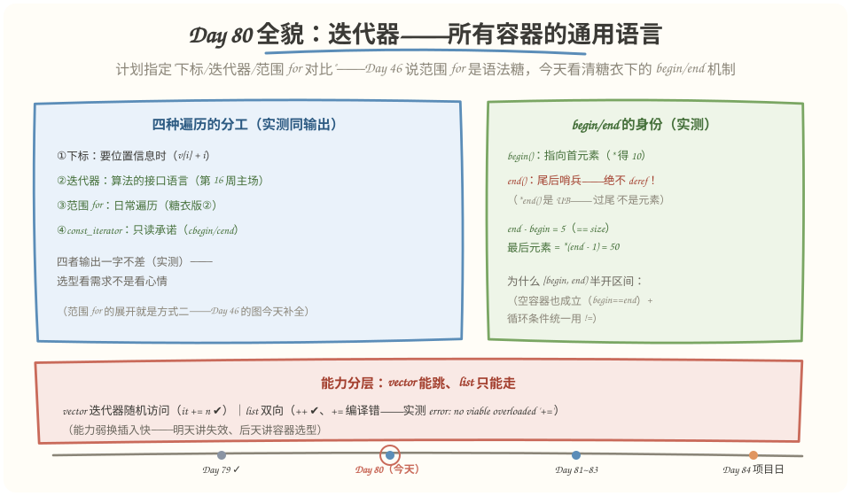
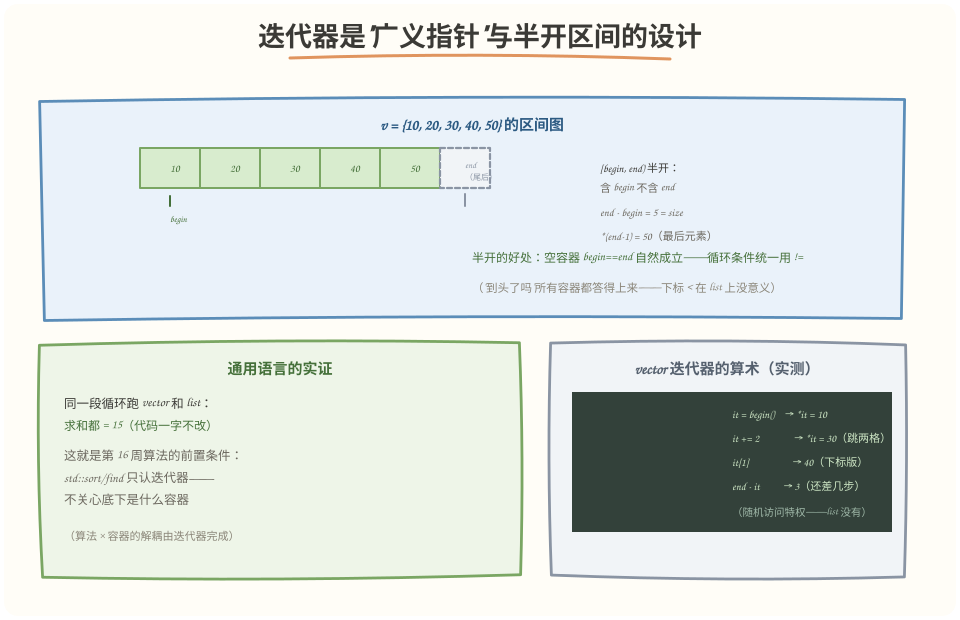
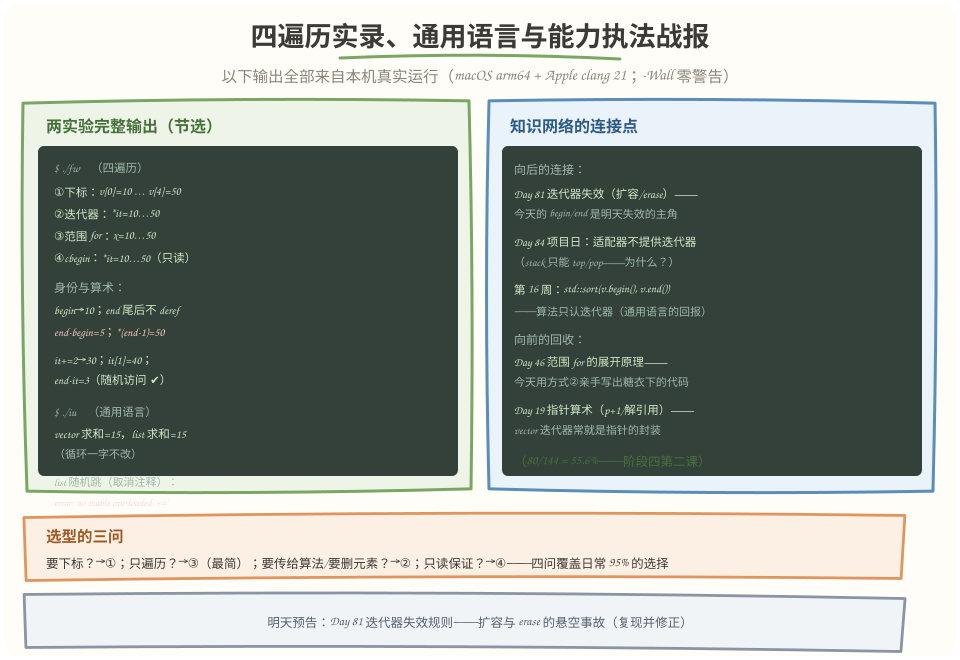

# 第 80 天：迭代器——begin/end 与四种遍历方式

> **今日目标**：完成本教程后，你能做到：用四种方式遍历 vector（下标/迭代器/范围 for/cbegin——实测同输出）并按需求选型；说出 begin/end 的身份（end 是尾后哨兵绝不 deref、[begin,end) 半开区间）；演示迭代器的通用性（同一段循环跑 vector 和 list）；实测能力分层（vector 能 `+=n`、list 编译错）。
> **预计时间**：学习 20 分钟＋实践 40 分钟
> **前置准备**：完成 Day 46/79（范围 for 的展开是今天的糖衣解剖；vector 的扩容是明天失效的主角）。
> **今日产出**：四遍历对照、区间图、通用语言实证、能力分层执法线。

## 1. 今天解决什么问题？

Day 46 学范围 for 时说它是"迭代器循环的语法糖"——今天把糖衣剥开看清 **begin/end 机制**。计划指定的练习正是"下标/迭代器/范围 for 对比"。三个层次递进：**语法**（四种遍历怎么写）；**语义**（end 为什么是尾后哨兵、半开区间 [begin,end) 的设计）；**架构**（迭代器是所有容器的通用语言——第 16 周算法只认它）。

能力分层的执法也今天亮相：vector 迭代器能 `+= 2` 随机跳、list 的编译直接错——为什么，明天讲失效时见分晓。

## 2. 先看全貌：今天的内容位于哪里？



**图 1**：左卡蓝是四种遍历的分工（同输出、按需选型）；右卡绿是 begin/end 的身份；下方红卡是能力分层。

三步概括今天：

1. 四遍历同输出：下标要位置、范围 for 最简、迭代器是算法接口、cbegin 只读；
2. [begin, end) 半开：end 是尾后哨兵（deref 是 UB）、end-begin==size；
3. 迭代器 = 通用语言：同一段循环跑任意容器；能力分层看容器（vector 随机/list 双向）。

## 3. 核心概念：先用直觉，再给准确定义

### 3.1 迭代器：广义的指针

- **一句通俗解释**：迭代器是"位置"的抽象——像指针（`*` 解引用、`++` 前进）但不限于内存地址（list 的迭代器是节点把手）。
- **一个类比**：博物馆导览器——`*` 是"讲解当前展品"、`++` 是"下一件"；vector 的导览能跳着走（+=n）、list 的只能顺着走。
- **对应到技术上是**：实测——`*it` 得元素、`it != v.end()` 判终点、`++it` 前进；vector 迭代器额外支持 `it += 2`（跳两格）、`it[1]`（下标版）、`end - it`（差值）——随机访问特权。**Day 19 的指针算术在 vector 迭代器上原样成立**（它常就是原生指针的封装）。类比的边界：迭代器**不保证**是指针（list 的是类封装）——所以解引用语义相同、算术能力看容器。
- **常见误解**："迭代器就是指针"——对 vector 常是、对 list 不是；把它当"位置抽象"最稳。

### 3.2 end 的身份与半开区间

- **一句通俗解释**：`end()` 指向**最后一个元素的后一格**（尾后哨兵）——它不是元素、绝不能解引用；`[begin, end)` 左闭右开。
- **一个类比**：跑道终点线——线本身不是赛道的一部分（不可站）；跑到线前就算完成（`!= end` 时还在赛道）。
- **对应到技术上是**：实测——`*v.begin()` 得 10（首元素）；`v.end() - v.begin() == 5`（== size）；`*(v.end()-1)` 得 50（最后元素——end 退一步）。**半开的两大好处**：空容器 `begin==end` 自然成立（循环零次）；循环条件统一用 `!=`（"<" 在 list 的离散节点上没意义——`!=` 只问"到头了吗"）。**`*v.end()` 是 UB**——尾后不是元素（注释里的雷、绝不踩）。类比的边界：`end-1` 合法（随机访问容器）；list 上要 `--end` 同样合法但 `end-1` 不行（又是能力分层）。
- **常见误解**："end 指向最后一个元素"——不；它指向"再往后一格"；最后元素是 `*(end-1)`。

### 3.3 通用语言与能力分层

- **一句通俗解释**：所有容器都说"迭代器"这门语言——同一段循环不改一字跑 vector 和 list；但每种容器的迭代器**能力**不同（vector 随机跳、list 只能走）。
- **一个类比**：USB 接口——鼠标键盘硬盘都插得上（通用）；但 USB2/3 的速度不同（能力分层）——接口统一、速率看设备。
- **对应到技术上是**：实测——同一段 `for (auto it = c.begin(); it != c.end(); ++it)` 跑 vector 和 list 求和都得 15（**代码一字不改**）；list 上 `it += 2` **编译错**（`no viable overloaded '+='`——链表节点不连续、不能跳）。**为什么这重要**：第 16 周的 `std::sort(v.begin(), v.end())` 只认迭代器——算法和容器靠这门语言解耦（sort 不关心底下是 vector 还是别的）。类比的边界：能力弱的换的是**结构优势**——list 的插入删除 O(1)（不用搬全家）——后天选型课的主角。
- **常见误解**："迭代器循环比范围 for 快"——同一段机器码（糖衣关系）；选型看需求（要下标信息/要传算法）不是性能。

## 4. 图解核心机制



**图 2**：上半部分蓝卡是 {10,20,30,40,50} 的区间图（begin 指首、end 指尾后虚格、半开标注、end-begin=5）；左下绿卡是通用语言的实证（同一段循环两种容器）；右下灰卡是 vector 迭代器的算术实测。

按图逐步讲：

1. **对着区间图走一遍**：五格实元素 + 一个虚格（end）；`!=` 循环走到虚格前停——这就是"遍历全部"的几何含义；
2. **数 end-begin**：正好 5——半开区间的长度公式（空容器 = 0 也成立）；
3. **跑一遍通用循环**：vector 和 list 同码同果——把这段代码记住，第 16 周的算法调用就是它的直接推广；
4. **试一次 list 的 +=**：编译错误是**能力分层**的执法（不是 bug）——容器结构决定迭代器能力。

## 5. 动手实践：完成一个最小可运行例子

### 5.1 准备文件

```bash
cd ai-compiler-roadmap/tutorials/day-080/examples
```

两个程序：`four_ways.cpp`（四遍历对比）、`iterator_universal.cpp`（通用语言 + 能力分层）。

### 5.2 编写代码

核心（完整代码见本目录）：

```cpp
// 方式二：迭代器（算法的接口语言）
for (auto it = v.begin(); it != v.end(); ++it) {
    std::cout << *it;                       // * 解引用（像指针）
}

// 通用语言：同一段循环跑任意容器
for (auto it = lst.begin(); it != lst.end(); ++it) { sum += *it; }

// vector 的随机访问特权
auto it = v.begin();
it += 2;                // 跳两格 → 30
std::cout << it[1];     // 下标版 → 40
std::cout << v.end() - it;   // 差值 → 3
```

### 5.3 运行与观察

```bash
g++ -Wall four_ways.cpp -o fw && ./fw
```

实际执行结果（本机，节选）：

```text
== 方式一：下标遍历 ==
  v[0] = 10 … v[4] = 50

== 方式二：迭代器遍历 ==
  *it = 10（迭代器像指针：* 解引用）… *it = 50

== 方式三：范围 for（迭代器的语法糖） ==
  x = 10 … x = 50

== 方式四：const_iterator（只读遍历） ==
  *it = 10（cbegin/cend——只读通道）… *it = 50

== begin/end 的身份 ==
  v.begin() 指向首元素：10
  v.end() 指向尾后（不 deref！）
  end - begin = 5（== size）
  最后一个元素 = *(end - 1) = 50

== 迭代器的算术（vector 随机访问） ==
  it 起点值 = 10
  it += 2 后 = 30
  it[1] = 40（随机访问版下标）
  end - it = 3（还能走几步）
```

```bash
g++ -Wall iterator_universal.cpp -o iu && ./iu
```

```text
== 同一段循环，两种容器 ==
  vector 求和 = 15，list 求和 = 15（循环代码一字不改！）

== 为什么用 != 而不是 < ==
  list 的迭代器是链表节点指针——节点地址不连续，
  '<' 没有意义；'!=' 只问"到头了吗"——所有容器都答得上来
```



**图 3**：左上两实验完整输出（含 list `+=` 的编译错误原文）；右侧是知识网络的连接点（明天失效/第 16 周算法/Day 46 展开/Day 19 指针算术）；下方橙卡是选型三问。

### 5.4 修改一个输入再观察：*end() 的雷区亲测

把 `four_ways.cpp` 里 `// *v.end();` 的注释放开——ASan 版编译运行（预期报错）：本机实测 `heap-buffer-overflow` 或 `stack-buffer-overflow`（读到了界外——end 那格不是元素）；普通版可能打出垃圾值（UB 老朋友）。**一注一放**：尾后哨兵的"不可解引用"从规则变成目击。恢复注释——全绿。（顺带：`*(end-1)` 和 `*--end()` 都是安全的"最后元素"写法——前者要求随机访问、后者通用但改了迭代器。）

## 6. 常见错误与排查

**错误 1：`error: no viable overloaded '+='`（list 迭代器跳格）**

- 现象：list 上写 `it += n`；
- 原因：list 迭代器是双向不是随机访问——链表节点不连续；
- 定位：报错指向 += 行；
- 修复：循环 `++it` 一步步走；确需跳格换 vector。

**错误 2：解引用 end() 后行为诡异**

- 现象：`*v.end()` 打出垃圾或崩；
- 原因：end 是尾后哨兵——那格不是元素；
- 定位：找代码里的 `*end` / `end()[i]`；
- 修复：最后元素用 `*(end-1)`；循环条件用 `!= end` 且循环体不 deref end。

**错误 3：循环条件用 `<` 在别的容器上崩**

- 现象：vector 上 `it < end` 能跑、换 list 编译错；
- 原因：`<` 需要连续内存的序——list 没有；
- 定位：编译错误直接指出；
- 修复：习惯统一用 `!=`（所有容器通吃）。

## 7. 今日练习

### 必做练习（计划指定：三遍历对比）

把四遍历各改写成"倒序遍历"（从最后打到第一）：下标版 `i--` 下山、迭代器版从 `end()` 出发 `--it` 到 begin、范围 for 的倒序要用反向迭代器（`rbegin/rend`——查资料自学）。验证三者输出都是 50 40 30 20 10。预期产出：三段倒序代码 + 一句 rbegin/rend 的理解。

### 选做挑战

"手搓糖衣"：把 `for (int x : v) { cout << x; }` 手动展开成完整的迭代器循环（对照 Day 46 的展开图）——再给自定义类（比如 Day 76 的图形库容器）加 begin/end（返回内部 vector 的迭代器），让范围 for 直接能跑：`for (auto& s : shape_lib) { s->report(); }`——**让你的类说迭代器语言**（进阶：这是第 17 周模板课的预告）。

## 8. 今日验收

- [ ] 我的四遍历实测同输出；能按三问选型（位置/最简/算法接口/只读）
- [ ] 我能画出 [begin, end) 区间图并说出半开的两大好处（空容器/统一 !=）
- [ ] 我实测了 end 不 deref（5.4 的雷区）和 end-begin==size
- [ ] 我的同一段循环跑通 vector 和 list（通用语言实证）
- [ ] 我实测了 list 的 += 编译错（能力分层）并知道为什么

## 9. 一句话总结与明天预告

今天的问题是"遍历容器的通用语言是什么"；机制上，迭代器是广义指针（解引用/前进/判终）、[begin,end) 半开区间统一所有容器、能力分层由容器结构决定；实践上，四遍历、区间身份、通用语言、能力执法全部实测；验证标准是看到任何循环能说出"糖衣下是哪段迭代器代码、这个容器能跳吗"。明天 **Day 81：迭代器失效规则**——vector 扩容与 erase 的悬空事故：今天的 begin/end 将成为明天的"事故现场"，复现并修正（计划指定练习）。
