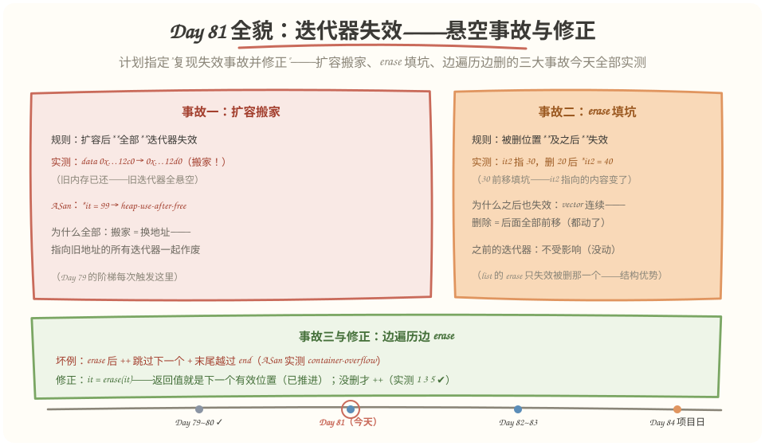
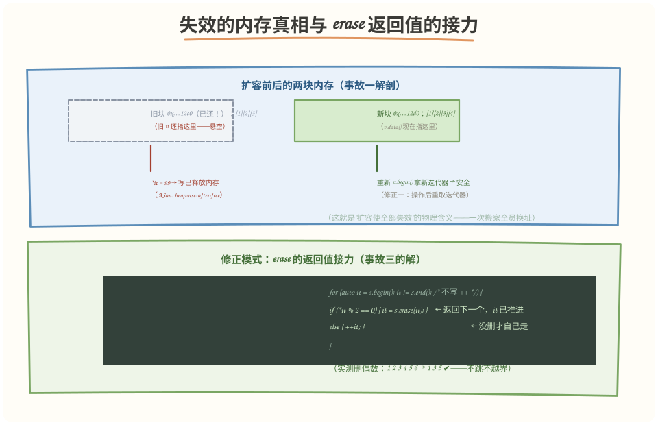
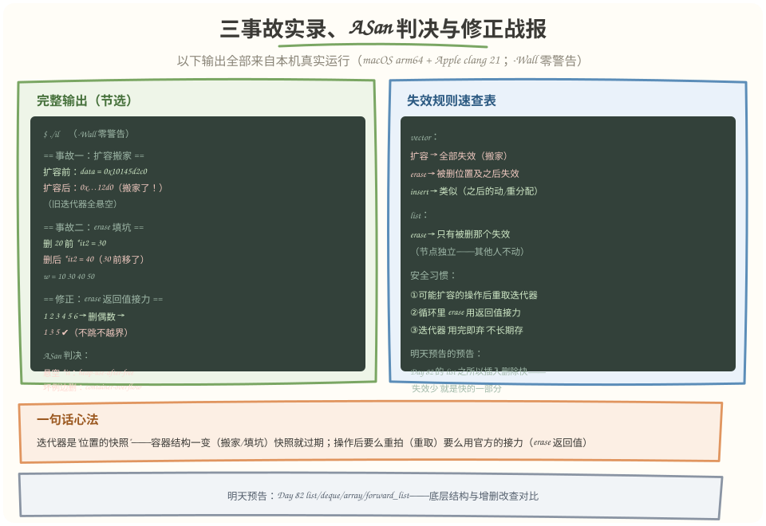

# 第 81 天：迭代器失效规则——扩容与 erase 的悬空事故

> **今日目标**：完成本教程后，你能做到：复现三大失效事故（扩容搬家全失效、erase 填坑后半失效、边遍历边删的双坑）并用 ASan 取证；用 erase 返回值接力修正边删循环（实测 1 3 5）；背出 vector 与 list 的失效规则差；养成三个安全习惯（重取/接力/不长期存）。
> **预计时间**：学习 20 分钟＋实践 45 分钟
> **前置准备**：完成 Day 79~80（扩容机制是事故一的根源；迭代器身份是今天的"快照"视角）。
> **今日产出**：三事故实录（data 地址搬家、*it2 值变化、坏例 ASan 判决）、erase 接力修正实测。

## 1. 今天解决什么问题？

迭代器是"位置的快照"——容器结构一变，快照就过期。计划今天集中剖析**两类结构变化**：**扩容**（搬家——旧地址全员作废）和 **erase**（填坑——被删位置及之后全动）。最经典的复合事故是"边遍历边 erase"：删了偶数再 `++` 会跳过下一个、末尾还会越过 end——两个坑一次踩（计划指定"复现并修正"）。

修正是今天的高光：`it = s.erase(it)` 的**返回值接力**——erase 返回"被删位置的下一个有效迭代器"，删除时它已替你推进、没删才自己 `++`。

## 2. 先看全貌：今天的内容位于哪里？



**图 1**：左卡红是事故一（扩容搬家——实测 data 从 0x…12c0 变 0x…12d0）；右卡橙是事故二（erase 填坑——实测 \*it2 从 30 变 40）；下方绿卡是事故三的坏例与修正。

三步概括今天：

1. 扩容 → **全部**失效（一次搬家全员换址）；erase → **被删位置及之后**失效（连续内存填坑）；
2. 边删坏例双坑：erase 后 ++ 跳过元素 + 末尾越过 end（ASan 实测 container-overflow）；
3. 修正：`it = erase(it)` 接力——返回值就是下一个有效位置。

## 3. 核心概念：先用直觉，再给准确定义

### 3.1 扩容失效：一次搬家全员换址

- **一句通俗解释**：扩容 = 搬新家——旧房子（旧内存）还了，所有写着旧地址的迭代器一起作废。
- **一个类比**：公司整体搬迁——你名片上印的旧办公楼地址全失效；按旧地址找过去（解引用旧迭代器）是闯空门（已释放内存）。
- **对应到技术上是**：实测——扩容前 `data = 0x10145d2c0`、扩容后 `0x…12d0`（**搬家**）；ASan 亲测旧迭代器写值：`heap-use-after-free`（写已还内存）。**为什么是"全部"**：Day 79 的阶梯每次翻倍都搬新块——旧块上的每个位置（迭代器）一起过期。修正姿势：扩容性操作（push_back/insert/reserve）后**重取**迭代器（`v.begin()` 再拍一次快照）。类比的边界：**引用和指针同样失效**（`int* p = v.data()` 也是旧地址）——不只迭代器。
- **常见误解**："push_back 只加在尾部，旧迭代器应该没事"——扩容时搬家全员作废；只有未触发扩容的 push 才安全（但你不总知道触发没有——重取最稳）。

### 3.2 erase 失效：连续内存的填坑

- **一句通俗解释**：vector 删除 = 后面元素前移填坑——被删位置**及之后**的迭代器指向的内容全变了。
- **一个类比**：排队删人——中间走了一个，后面全员前进一步；你记的"第 3 位是张三"（迭代器）现在站的是李四（内容变了）。
- **对应到技术上是**：实测——it2 指 30，`erase` 删 20 后 `*it2 = 40`（30 前移到原 20 的位置、40 顶到 it2 处）；w 变成 10 30 40 50。**之前的迭代器不受影响**（10 之前没动）——这就是"被删位置及之后"的边界。**list 对照**：链表删除只摘节点——其他节点不动、迭代器不失效（只有被删那个作废）——结构优势（Day 82 的主角预告）。类比的边界：insert 同理（插入点之后的元素后移/可能触发扩容双坑）。
- **常见误解**："erase 只废那一个"——vector 不是（填坑全员动）；那是 list 的规则——容器结构决定失效范围。

### 3.3 边删坏例与返回值接力

- **一句通俗解释**：坏例 `for (...; ++it) { if (...) erase(it); }` 双坑——erase 后 ++ 跳过下一个（该查的没查）+ 删到末尾时 ++ 越过 end（UB）。
- **一个类比**：点名删人——叫到 2 号出去后你喊"下一个"（++），但队伍已经前移——你实际跳过了原 3 号；删到队尾再喊"下一个"就喊出了队伍外。
- **对应到技术上是**：实测坏例（{1,2,3,4} 删偶数）——ASan 报 **container-overflow**（越过 end 的访问）。**修正**（返回值接力）：`it = s.erase(it);`——erase 返回被删位置的下一个**有效**迭代器（删除时已推进）；没删才 `++it`。实测 {1,2,3,4,5,6} → **1 3 5** ✔（不跳不越界）。类比的边界：这个模式只适合**边遍历边删**；更地道的做法是 **erase-remove 惯用法**（`v.erase(remove_if(...), v.end())`——第 16 周算法课的正主），今天的接力是它的手写理解版。
- **常见误解**："erase 返回 void"——不；它返回下一个有效迭代器（正是为了接力设计的）——不用返回值等于扔掉了官方的救命绳。

## 4. 图解核心机制



**图 2**：上半部分蓝卡是扩容前后两块内存的对照（旧块虚线标注"已还"、旧迭代器指向它=悬空；新块是 data 现指的）；下半部分绿卡是修正模式的代码（erase 返回值接力的三行核心）。

按图逐步讲：

1. **对着两块内存走一遍**：旧块 [1][2][3]（虚线——已还）vs 新块 [1][2][3][4]——旧迭代器的箭头落在虚线上（悬空的几何含义）；
2. **看接力的三行代码**：不写 `++`（循环头留空）——删除时 `it = erase(it)` 已推进、没删才 `++it`——两个分支各走各的路；
3. **对比坏例的执行流**：erase(2) → ++ → 指到 4（跳过了 3！）→ erase(4) → ++ → 越过 end（container-overflow）——画出这条流就懂了为什么"删偶数只删到一半"；
4. **记安全三习惯**：可能扩容的操作后重取迭代器；循环里 erase 用返回值接力；迭代器"用完即弃"不长期存——三条覆盖日常 95% 的失效场景。

## 5. 动手实践：完成一个最小可运行例子

### 5.1 准备文件

```bash
cd ai-compiler-roadmap/tutorials/day-081/examples
```

主角：`invalidate_lab.cpp`（三事故 + 修正的完整实验）。

### 5.2 编写代码

修正模式核心（完整代码见本目录）：

```cpp
// 事故一：扩容搬家（data 地址对照）
int* raw = v.data();
v.push_back(4); v.push_back(5);               // 触发扩容
std::cout << (v.data() != raw ? "搬家了！" : "没搬");   // 实测：搬家
// *it = 99;                                  // ✘ 旧迭代器悬空（ASan 版炸）

// 修正：erase 返回值接力（边删的正确姿势）
for (auto it = s.begin(); it != s.end(); /* 不写 ++ */) {
    if (*it % 2 == 0) {
        it = s.erase(it);                     // erase 返回"下一个"——已推进！
    } else {
        ++it;                                 // 没删才 ++
    }
}
```

### 5.3 运行与观察

```bash
g++ -Wall invalidate_lab.cpp -o il && ./il
```

实际执行结果（本机）：

```text
== 事故一：扩容使全部迭代器失效 ==
  扩容前：data = 0x10145d2c0
  扩容后：data = 0x10145d2d0（搬家了！旧地址全部作废）
  （旧迭代器 it 仍存着旧地址——用它就是悬空访问）

== 事故二：erase 使被删位置及之后的失效 ==
  删除前：*it2 = 30
  删除 20 后：*it2 = 40（值变了——元素前移填坑）
  w 现在是：10 30 40 50

== 事故三：边遍历边 erase 的经典死循环 ==
  坏例行为：删 2 后 ++ 跳到 4——4 被删后 ++ 越过 end——UB！
  （偶数只删到一半 + 末尾越界读——两个坑一次踩）

== 修正：erase 返回下一个有效迭代器 ==
  删偶数后：1 3 5 （1 3 5 ✔——正确且安全）
```

**ASan 判决**（两探针实测）：

```text
悬空写（*it = 99）：  ERROR: AddressSanitizer: heap-use-after-free
坏例边删（++ 越界）：  ERROR: AddressSanitizer: container-overflow
```



**图 3**：左上完整输出（三事故+修正标注）；右侧是失效规则速查表（vector vs list）与安全三习惯；下方橙卡是一句话心法。

### 5.4 修改一个输入再观察：坏例的执行流亲描

把坏例的注释放开（ASan 版编译运行）——container-overflow 现形。然后在纸上**逐行描执行流**：it 指 1（奇不删 ++）→ 指 2（删！erase 返回指 3 的迭代器，但坏例没用它）→ ++（跳到 4！3 被跳过）→ 指 4（删！erase 返回 end）→ ++（**越过 end**）→ `it != end` 比较…… Boom。描完这条流，"为什么只删到一半 + 为什么越界"全部落地。恢复注释、换修正版——**一坏一好**的执行流对照是今天最值得画进 notes.md 的图。

## 6. 常见错误与排查

**错误 1：程序偶发崩在遍历中（ASan 报 container-overflow）**

- 现象：边遍历边 erase 的循环崩；
- 原因：erase 后 ++ 越过 end（或跳过元素）；
- 定位：看循环头有没有 `++` 和 erase 同用；
- 修复：返回值接力（`it = erase(it)`；删时不 ++）。

**错误 2：ASan 报 heap-use-after-free（迭代器位置）**

- 现象：扩容性操作后用旧迭代器；
- 原因：搬家全员换址——旧快照过期；
- 定位：报告的地址和"allocated/freed here"栈；
- 修复：操作后重取（`it = v.begin()`）；或提前 reserve 避免中途扩容。

**错误 3：存了迭代器过段时间用，行为随机**

- 现象：保存的迭代器时好时坏；
- 原因：中间任何插入/删除都可能让它失效；
- 定位：审计迭代器的生命期（保存点到使用点之间有结构变化吗）；
- 修复：习惯三——迭代器用完即弃；确需位置信息存**下标**（重算迭代器）。

## 7. 今日练习

### 必做练习（计划指定：复现并修正）

把修正版改成"删除所有 3 的倍数"（{1..12} → 1 2 4 5 7 8 10 11）——先手推执行流（哪些删哪些跳），再实测对答案。预期产出：手推清单 + 实测输出一致的确认。

### 选做挑战

"reserve 预防术"：把事故一改成先 `reserve(10)` 再 push 5 个——实测 data 地址**不变**（没触发搬家——预留够了）——旧迭代器依然有效！把"重取迭代器 vs 提前 reserve"两种修正思路的适用场景写进 notes.md（不确定量→重取；确定量→reserve 更优）。

## 8. 今日验收

- [ ] 我实测了扩容搬家（data 地址变化）和旧迭代器悬空（ASan heap-use-after-free）
- [ ] 我实测了 erase 填坑（*it2 从 30 变 40）并能说出失效边界
- [ ] 我描过坏例的执行流（跳元素 + 越过 end）且 ASan 的 container-overflow 现形
- [ ] 我的修正版（erase 接力）实测 1 3 5 正确
- [ ] 我能背出 vector 与 list 的失效规则差 + 安全三习惯

## 9. 一句话总结与明天预告

今天的问题是"容器结构一变迭代器怎么办"；机制上，扩容搬家全员失效、erase 填坑后半失效（vector 的连续性代价）、坏例双坑用返回值接力修正；实践上，三事故、两条 ASan 判决、接力修正全部实测；验证标准是看到任何"改容器"的代码能指出哪些迭代器过期、怎么救。明天 **Day 82：list / deque / array / forward_list**——底层结构与增删改查对比：今天的"list 失效少"正是它结构优势的预告。
