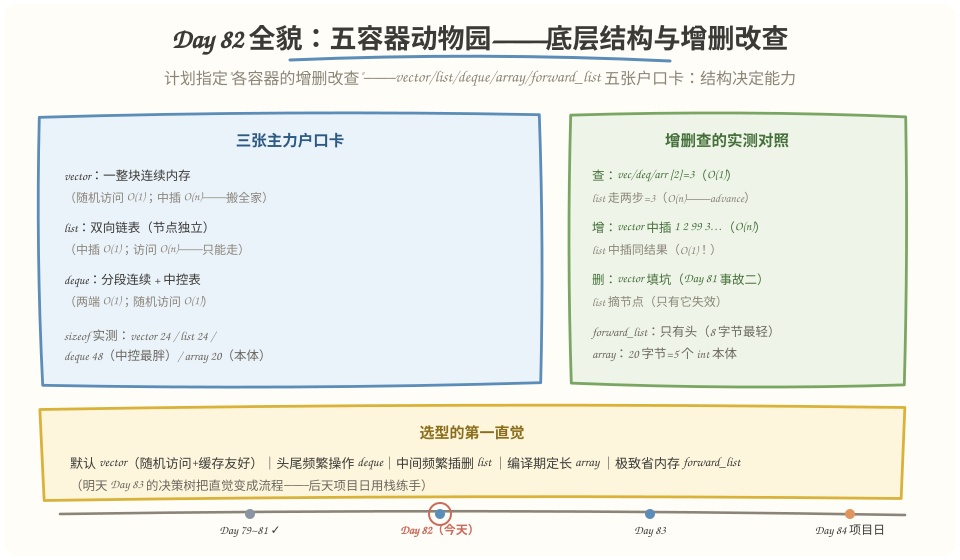
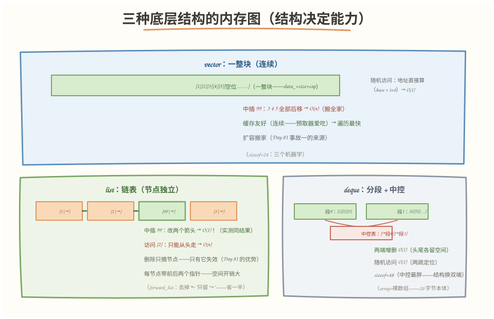
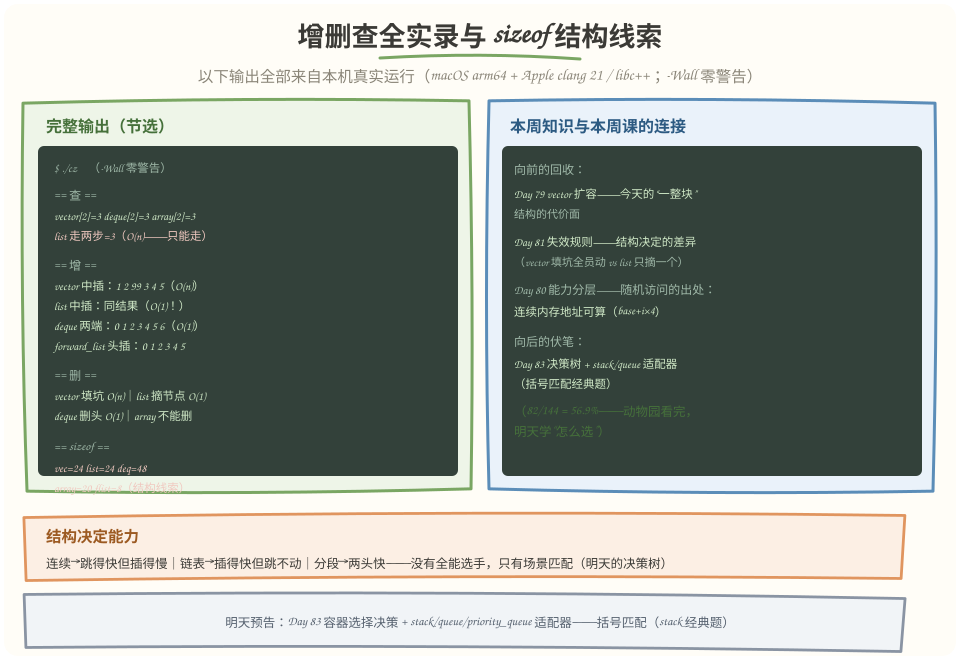

# 第 82 天：list / deque / array / forward_list——底层结构与增删改查

> **今日目标**：完成本教程后，你能做到：说出五种容器的底层结构（vector 一整块/list 双向链/deque 分段+中控/array 裸数组/forward_list 单向链）；实测增删查的复杂度差异（随机访问/中插/两端操作）；用 sizeof 读出结构线索（24/24/48/20/8）；给出选型第一直觉。
> **预计时间**：学习 20 分钟＋实践 45 分钟
> **前置准备**：完成 Day 79~81（扩容和失效是结构差异的两条主线——今天总装）。
> **今日产出**：五容器动物园（增删查全对照）、三种底层结构内存图、sizeof 结构线索。

## 1. 今天解决什么问题？

vector 之外还有四种常用顺序容器——计划今天把它们的**底层结构和增删改查**一次对比。核心认识一句话：**结构决定能力**——vector 的"一整块连续"给了随机访问 O(1) 但中插 O(n)（搬全家）；list 的"节点独立"给了中插 O(1) 但访问只能走 O(n)；deque 的"分段+中控"让两头都快；array 是定长裸数组；forward_list 砍掉反向指针换最轻的 8 字节。

本周前三天的知识（扩容/迭代器/失效）全是结构差异的表现——今天把"为什么"补齐。

## 2. 先看全貌：今天的内容位于哪里？



**图 1**：左卡蓝是三张主力户口卡（结构+复杂度）；右卡绿是增删查的实测对照；下方黄卡是选型第一直觉。

三步概括今天：

1. 五结构：一整块/双向链/分段+中控/裸数组/单向链；
2. 三能力：查（随机 vs 走）、增（O(n) vs O(1)）、删（填坑 vs 摘节点）；
3. sizeof 是结构的指纹（24/24/48/20/8）。

## 3. 核心概念：先用直觉，再给准确定义

### 3.1 vector vs list：连续与链的经典对决

- **一句通俗解释**：vector 是"一整排连座"（第 3 座直接走到）、list 是"一串寻宝点"（只能顺藤摸瓜）。
- **一个类比**：电影院（vector：座位号直接定位；插入一个人全场后移）vs 寻宝路线（list：每个点只知下一个；插一个点只需改两个箭头）。
- **对应到技术上是**：实测——查：`vec[2]` 和 `lst 走两步` 都得 3（但前者 O(1) 地址可算、后者 O(n) 逐节点走）；增：中插 99 两版输出相同 `1 2 99 3 4 5`（vector 后面三个全搬 O(n)、list 只改两个指针 O(1)）。**vector 的隐藏优势：缓存友好**（连续内存预取器爱吃——遍历实际速度常远超链表，尽管复杂度同为 O(n)）。类比的边界：list 每节点多两个指针（空间开销）——小对象链表的内存开销可能翻倍。
- **常见误解**："list 中插 O(1) 所以 list 更快"——插本身 O(1) 但**走到插入点**是 O(n)；且缓存的现实常让 vector 的"搬全家"反而更快——测量再定（第 19 周性能课）。

### 3.2 deque 与 array：两头快与定长轻

- **一句通俗解释**：deque 是"分段放映厅+中控索引"（两头进出都快、还能两跳定位）；array 是"焊死的座位"（编译期定长、零元数据）。
- **一个类比**：deque 像火车（车头车尾随时挂/摘车厢、车厢编号可定位）；array 像家里的固定长凳（长度焊死、但就是木板本身——没有附加结构）。
- **对应到技术上是**：实测——`deq.push_front(0)`（头插 O(1)——vector 没有这个操作）+ `deq[2]` 随机访问 O(1)（中控表两跳定位：先算段号再算段内偏移）；sizeof 实测 **deque=48**（中控最胖——结构换双端能力）、**array=20**（= 5 个 int 本体，零元数据）。array 的定位：编译期已知长度（如三阶矩阵的 3×3）——省去 vector 的动态机制。类比的边界：deque 的中插仍是 O(n)（段内搬）；它的优势区间是"两头频繁"（队列/滑窗）。
- **常见误解**："array 是 vector 的低配版"——它是不同的工具（定长场景更轻更快）；C 数组的现代替代品。

### 3.3 forward_list：砍一半的极简主义

- **一句通俗解释**：forward_list 去掉"←"指针只留"→"——不能回头、但每个节点省一个指针。
- **一个类比**：单行道——只能前进不能掉头；换来的是路更窄（省内存）。
- **对应到技术上是**：实测——`flst.push_front(0)` 头插 O(1)；sizeof **8**（只有头把手——最轻）。适用场景：内存极度敏感（嵌入式）、只需前向遍历的链；**代价**：没有 back/size（连这些元数据都省了——要 size 自己数）、不能反向遍历。类比的边界：日常几乎不用它——但它的存在说明了"结构可以按需求裁剪到多细"。
- **常见误解**："forward_list 是坏的 list"——它是刻意裁剪的 list（目标场景下更优）；工具没有好坏只有匹配。

## 4. 图解核心机制



**图 2**：上半部分蓝卡是 vector 的一整块（连续+随机访问的地址计算式 base+i×4）；左下绿卡是 list 的链式（中插 99 只改两个箭头）；右下灰卡是 deque 的分段+中控（两跳定位）。

按图逐步讲：

1. **对着 vector 算地址**：第 i 个元素 = base + i×sizeof(T)——O(1) 的来源；中插的"搬全家"也是这张图（3 4 5 右移一格）；
2. **对着 list 数箭头**：插 99 改两个箭头（2→99、99→3）——O(1)；但"走到 2"要两步——访问 O(n)；
3. **看 deque 的两跳**：中控表先定段、段内再偏移——随机访问的 O(1) 是两跳实现的（比 vector 的一跳略慢但两头快）；
4. **sizeof 对结构**：24（三件套）/24（头把手）/48（中控）/20（裸本体）/8（最轻把手）——数字就是结构指纹。

## 5. 动手实践：完成一个最小可运行例子

### 5.1 准备文件

```bash
cd ai-compiler-roadmap/tutorials/day-082/examples
```

主角：`container_zoo.cpp`（五容器增删查全对照）。

### 5.2 编写代码

核心对照（完整代码见本目录）：

```cpp
std::vector<int> vec = {1, 2, 3, 4, 5};
std::list<int> lst = {1, 2, 3, 4, 5};

// 查：随机 vs 走
std::cout << vec[2];                          // O(1)——地址可算
auto lit = lst.begin();
std::advance(lit, 2);                          // O(n)——逐节点走
std::cout << *lit;

// 增：中插对照（同输出不同代价）
vec.insert(vec.begin() + 2, 99);               // O(n)：后面全搬
lst.insert(std::next(lst.begin(), 2), 99);     // O(1)：改两个箭头
```

### 5.3 运行与观察

```bash
g++ -Wall container_zoo.cpp -o cz && ./cz
```

实际执行结果（本机）：

```text
== 五容器的"查"（访问方式对比） ==
  vector[2] = 3（随机访问 O(1)）
  deque[2]  = 3（随机访问 O(1)——分段连续）
  array[2]  = 3（随机访问 O(1)——栈上定长）
  list 走两步 = 3（O(n)——advance 逐个 ++）

== 五容器的"增"（插入位置对比） ==
  vector 中插 99：1 2 99 3 4 5 （O(n)：3 4 5 都后移了）
  list   中插 99：1 2 99 3 4 5 （O(1)：邻节点改指向）
  deque  头插 0 尾插 6：0 1 2 3 4 5 6 （两端 O(1)——分段映射）
  forward_list 头插 0：0 1 2 3 4 5 （单向：省一个指针的空间）

== 五容器的"删" ==
  vector 删中：O(n)（后面前移填坑——Day 81 的事故二）
  list   删中：O(1)（摘节点——只有它失效）
  deque  删头：O(1)（两端快）
  forward_list 删头：O(1)
  array：不能删（定长——出生即固定）

== sizeof 的结构线索 ==
  sizeof(vector) = 24（指针+size+cap 三件套）
  sizeof(list)   = 24（头节点把手）
  sizeof(deque)  = 48（中控映射表）
  sizeof(array)  = 20（= 5 个 int 本体！无元数据）
  sizeof(forward_list) = 8（最轻的头把手）
```



**图 3**：左上完整输出（查/增/删/sizeof 四段）；右侧是本周知识的三天连接（79 扩容→结构、81 失效→结构、80 分层→出处）；下方橙卡是"结构决定能力"心法。

### 5.4 修改一个输入再观察：list 没有下标的执法

把 `lst 走两步` 那行改成 `lst[2]`——**编译错误**（`type 'std::list<int>' does not provide a subscript operator`——list 根本没有下标运算符）。对照 vec[2] 编译通过。**一有一无**：随机访问不是所有容器的标配——它是"连续内存"结构的会员特权（Day 80 能力分层的容器级呈现）。恢复 advance 版——全绿。

## 6. 常见错误与排查

**错误 1：`error: type 'std::list<int>' does not provide a subscript operator`（list 用下标）**

- 现象：`lst[2]` 编译失败；
- 原因：list 没有 operator[]——链表不能跳；
- 定位：报错指向下标行；
- 修复：advance 走过去（O(n)）；确需下标换 vector。

**错误 2：`error: no member named 'push_back'`（forward_list）**

- 现象：forward_list 调 push_back；
- 原因：单向链没有尾指针——尾插要走到尾（O(n)）所以干脆不提供；
- 定位：报错列出的候选（只有 push_front）；
- 修复：头插 + 逆序思维；或换 list。

**错误 3：选了 list 以为更快结果更慢**

- 现象：换 list 后遍历/小插入性能反降；
- 原因：缓存不友好 + 每节点指针开销；"中插 O(1)"的前提是已到位置；
- 定位：性能剖析（第 19 周）；
- 修复：默认 vector（缓存友好的 O(n) 常胜链表的 O(1)+O(n) 走路）——除非测量说 otherwise。

## 7. 今日练习

### 必做练习（计划指定：各容器的增删改查）

给动物园加"改"（写）：对五种容器各把第 3 个元素改成 77——vec/deq/arr 用下标、list/flst 用迭代器走过去。验证五版输出一致（…77…）。预期产出：五段"改"的代码 + 一句复杂度对比。

### 选做挑战

"deque 头插 vs vector 头插"的性能直觉实验：各插 10 万个头元素（`insert(begin(), x)`）并用 `<chrono>` 计时——deque 应该是秒级内、vector 可能慢一个数量级（每插一次搬全部）。把两个数字记进 notes.md——"两头频繁选 deque"的量化证据。

## 8. 今日验收

- [ ] 我能画出三种底层结构（一整块/链式/分段+中控）的内存图
- [ ] 我的增删查对照实测通过（含 list 走两步的 O(n) 和中插的同果异价）
- [ ] 我的 sizeof 五个数字对上（24/24/48/20/8）并能解释每个
- [ ] 我实测了 list 无下标的编译执法（5.4）
- [ ] 我能背出选型第一直觉（默认 vec/两头 deq/中间 lst/定长 arr）

## 9. 一句话总结与明天预告

今天的问题是"五种容器各自的看家本领和代价"；机制上，结构决定能力（连续→跳快插慢/链式→插快跳不动/分段→两头快），sizeof 是结构指纹；实践上，增删查全对照、三种内存图、下标执法全部实测；验证标准是看到任何容器名能画出结构和报出复杂度。明天 **Day 83：容器选择决策 + stack/queue/priority_queue 适配器**——括号匹配（stack 经典题）：把今天的直觉变成决策流程，再学三个"穿容器外衣"的适配器。
