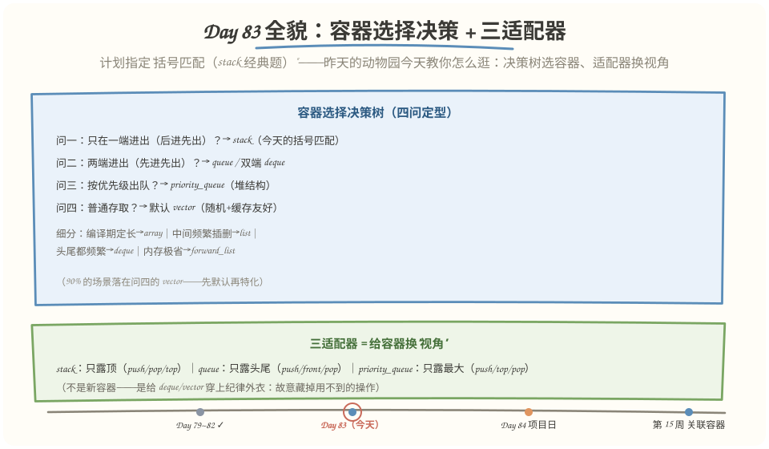
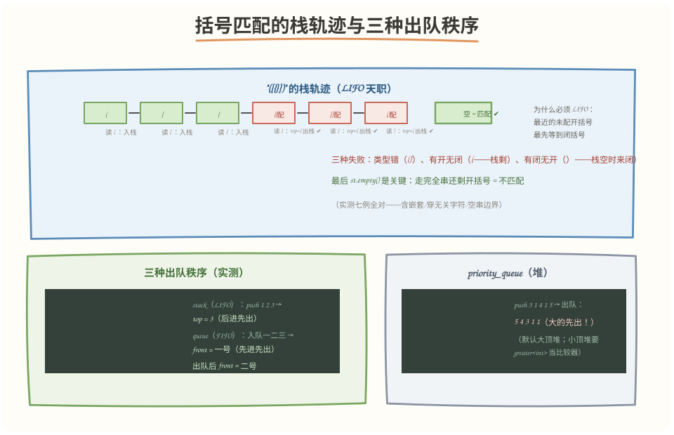
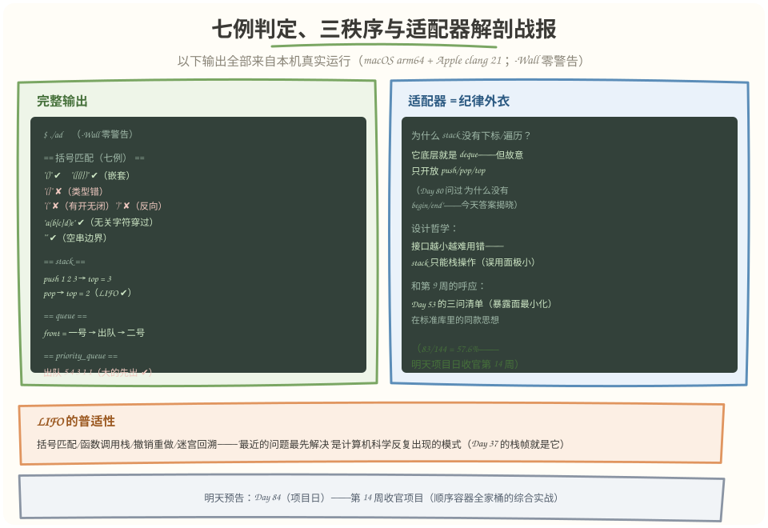

# 第 83 天：容器选择决策 + 适配器——括号匹配

> **今日目标**：完成本教程后，你能做到：用四问决策树给场景选容器（stack/queue/priority/vector）；实现括号匹配（计划指定练习——三种失败模式全测）；说出三适配器的本质（给容器穿纪律外衣——故意藏掉操作）；解释 LIFO 为什么是这题的天职。
> **预计时间**：学习 20 分钟＋实践 45 分钟
> **前置准备**：完成 Day 79~82（动物园五种容器是决策树的素材）。
> **今日产出**：括号匹配（七例全测）、三适配器秩序对照、决策树。

## 1. 今天解决什么问题？

昨天的动物园认识了五种容器——今天回答两个实际问题：**怎么选**（决策树——把直觉变成流程）；**stack/queue/priority_queue 是什么**（适配器——不是新容器，是给现有容器穿"纪律外衣"）。计划指定的练习**括号匹配**是 stack 的经典题：三种括号 `()[]{}` 的嵌套校验——LIFO（后进先出）正是它的天职（最近的未配开括号最先等到闭括号）。

顺带回答 Day 80 埋的疑问："为什么适配器没有 begin/end"——今天答案揭晓：故意藏的（接口越小越难用错）。

## 2. 先看全貌：今天的内容位于哪里？



**图 1**：上方蓝卡是四问决策树（单端/双端/优先级/普通→四适配器+vector）；下方绿卡是三适配器的纪律外衣本质。

三步概括今天：

1. 决策四问：单端 LIFO→stack、双端 FIFO→queue、优先级→priority_queue、普通→vector（90% 场景）；
2. 适配器 = 容器 + 纪律（只露该露的操作——底层默认 deque）；
3. 括号匹配是 LIFO 天职：开入栈、闭配顶、终判空。

## 3. 核心概念：先用直觉，再给准确定义

### 3.1 决策树：四问定型

- **一句通俗解释**：选容器先问四个问题——只一端进出？两端进出？按优先级？都不是？——答案分别指向四个工具。
- **一个类比**：快递分拣——退货件走一条流水线（stack 式：最新到的先处理）、普通件排队（queue：先来先服务）、加急件插队（priority_queue）、大宗存储进仓库（vector）。
- **对应到技术上是**：决策树（图 1）——**90% 的场景落在第四问的 vector**（默认再特化）；细分补充：定长 array、中插 list、双端 deque、极省 forward_list（昨天的户口卡做后盾）。类比的边界：决策树是起点不是终点——性能敏感场景要测量（第 19 周）；但"先默认 vector 再特化"几乎不会错。
- **常见误解**："每个场景都要精心选容器"——反着来：默认 vector、出现明确的访问模式（单端/优先级）才升级到适配器。

### 3.2 适配器：纪律外衣

- **一句通俗解释**：stack/queue/priority_queue 不是新容器——它们把底层容器（默认 deque）包起来，**只开放模式需要的操作**。
- **一个类比**：给全能工人发工牌——工牌上只印这次任务的权限（stack 只能 push/pop/top）；他本来的能力还在（底层是 deque）但门禁不刷。
- **对应到技术上是**：实测——stack 的 push 1 2 3 后 top=3（LIFO）、pop 后 top=2；queue front=一号（FIFO）；priority_queue 出队 5 4 3 1 1（大顶堆）。**为什么故意藏操作**：接口越小越难用错——括号匹配用 stack 就不可能"中途插队"（语言层面禁止）；这也是 Day 80"适配器没有 begin/end"的答案。**与 Day 53 的呼应**：三问清单的"暴露面最小化"在标准库里的同款思想。类比的边界：适配器可以换底座（`stack<int, vector<int>>`——第六个模板参数）；默认 deque 因为两头都 O(1)。
- **常见误解**："stack 是独立容器"——它是模板类适配器；没有自己的存储（借用底座的）。

### 3.3 括号匹配：LIFO 天职

- **一句通俗解释**：扫字符串——开括号入栈、闭括号找栈顶配对（配则弹出）、扫完栈空即匹配。
- **一个类比**：舞伴配对——进场的人领号码牌入队（栈）；离场时必须和**最近一个未配对**的进场者握手离开（LIFO）。
- **对应到技术上是**：实测七例全对——`()` ✔、`([{}])` ✔（嵌套：{ 后进先配 }）、`a(b[c]d)e` ✔（无关字符穿）、空串 ✔；**三种失败模式**：`(]`（类型错——top 是 ( 配不上 ]）、`(`（有开无闭——**扫完栈非空**）、`)`（有闭无开——**栈空时来闭括号**）。**为什么必须 LIFO**：嵌套结构里最近的未配开括号最先等到它的闭括号——FIFO 会错（`([)]` 用 queue 判不出）。**终判 `st.empty()`** 是新手最常漏的一步（只检查中途不算完整）。类比的边界：本版只查三种括号；真实语言的括号语义（字符串里的括号不算）要预处理——进阶编译课的话题。
- **常见误解**："配对成功就是匹配"——还要终判栈空（`(` 单独存在时中途全"配功"但栈剩一个）；两个检查缺一不可。

## 4. 图解核心机制



**图 2**：上半部分蓝卡是 `([{}])` 的栈轨迹（入三个 → 逐个配弹出 → 空=✔）；下方绿/灰卡是三种出队秩序的实测对照（LIFO/FIFO/堆序）。

按图逐步讲：

1. **对着轨迹走一遍**：`(→[`  `{` 入栈三次 → `}` 配 `{` 弹 → `]` 配 `[` 弹 → `)` 配 `(` 弹 → 空——嵌套的解法全在这条时间线里；
2. **数三种失败的判定点**：类型错（配对瞬间）、有闭无开（栈空时来闭）、有开无闭（终判非空）——三道闸各拦一种；
3. **对比三种秩序**：同是 push，出队顺序三种（3/一号/5）——模式决定秩序；
4. **回接 Day 37**：函数调用栈就是 stack——"最近调用的最先返回"和"最近开括号最先配对"是同一个 LIFO。

## 5. 动手实践：完成一个最小可运行例子

### 5.1 准备文件

```bash
cd ai-compiler-roadmap/tutorials/day-083/examples
```

主角：`adapters.cpp`（括号匹配 + 三适配器秩序）。

### 5.2 编写代码

括号匹配核心（完整代码见本目录）：

```cpp
bool brackets_match(const std::string& s) {
    std::stack<char> st;
    for (char c : s) {
        if (c == '(' || c == '[' || c == '{') {
            st.push(c);                        // 开括号入栈
        } else if (c == ')' || c == ']' || c == '}') {
            if (st.empty()) { return false; }  // 闸一：有闭无开
            char open = st.top(); st.pop();    // 最近的开括号出栈（LIFO）
            if ((c == ')' && open != '(') || /* ... 类型配对 */) {
                return false;                  // 闸二：类型错
            }
        }
    }
    return st.empty();                         // 闸三：终判栈空（有开无闭）
}
```

### 5.3 运行与观察

```bash
g++ -Wall adapters.cpp -o ad && ./ad
```

实际执行结果（本机）：

```text
== 括号匹配（stack 的 LIFO 天职） ==
  "()" → 匹配 ✔
  "([{}])" → 匹配 ✔
  "(]" → 不匹配 ✘
  "(" → 不匹配 ✘
  ")" → 不匹配 ✘
  "a(b[c]d)e" → 匹配 ✔
  "" → 匹配 ✔

== stack：LIFO（后进先出） ==
  push 1 2 3 后 top = 3（最后进的最先可见）
  pop 后 top = 2
  size = 2（无下标、无遍历——只有顶）

== queue：FIFO（先进先出） ==
  入队 一二三 后 front = 一号（最先来的先服务）
  出队后 front = 二号

== priority_queue：按优先级出队 ==
  push 3 1 4 1 5 后出队顺序：5 4 3 1 1 （大的先出）
```



**图 3**：左上完整输出（七例判定+三秩序）；右侧是"适配器=纪律外衣"的解答（含 Day 80 疑问的回收）；下方橙卡是 LIFO 的普适性。

### 5.4 修改一个输入再观察：终判的必要性亲测

把 `return st.empty();` 改成 `return true;`（漏掉终判）——重跑：`"("` 从 ✘ 变 **✔**（中途没失败但栈剩一个没配——漏网）！恢复终判——`"("` 回到 ✘。**一漏一全**：终判 `st.empty()` 是完整算法不可缺的第三道闸（和前两道各拦一种失败）——这正是新手最常漏的地方，实测一次就刻进脑子。

## 6. 常见错误与排查

**错误 1：漏终判 `st.empty()`——单开括号判成匹配**

- 现象：`"("` 返回 true（5.4 的实测）；
- 原因：只检查了中途的配对，忘了"栈剩 = 有开无闭"；
- 定位：构造单开括号测试；
- 修复：最后 `return st.empty();`。

**错误 2：闭括号来了不查栈空就 top()**

- 现象：`")"` 输入时崩（UB）；
- 原因：栈空时 top() 无效；
- 定位：闭括号分支的开头；
- 修复：`if (st.empty()) return false;` 先拦（今天的闸一）。

**错误 3：把 queue 当 stack 用（front/back 分不清）**

- 现象：配对逻辑用 queue 写——嵌套判错；
- 原因：FIFO 取的是**最早**的（最外层开括号）——嵌套应该先配最内层；
- 定位：想"最近的先配"还是"最早的先配"；
- 修复：LIFO 场景用 stack（决策树第一问）。

## 7. 今日练习

### 必做练习（计划指定：括号匹配）

扩展引号匹配：单引号 `'…'` 和双引号 `"…"` 也要配对（提示：开闭同字符——入栈时记"这是引号"，同字符再来时弹）。测试 `"it's"` ✔、`"unclosed` ✘、`'(("` ✘。预期产出：扩展版 + 新测试组。

### 选做挑战

"用 queue 实现栈"：两个 queue 倒腾出 LIFO（push 进 q1；pop 时把 q1 前 n-1 个倒进 q2、取最后一个）——体会适配器底层可换的原理（stack 只是"行为契约"，任何能提供这行为的结构都行）。这是面试经典题，也是"适配器 vs 容器"的最佳注脚。

## 8. 今日验收

- [ ] 我的括号匹配七例全对（含嵌套/穿字符/空串/三种失败）
- [ ] 我实测了漏终判的后果（5.4：`"("` 变 ✔——三道闸缺一不可）
- [ ] 我的三秩序对照通过（LIFO/FIFO/堆序各有实测）
- [ ] 我能背出四问决策树并解释"为什么默认 vector"
- [ ] 我能说出适配器的本质（纪律外衣）并回收 Day 80 的疑问

## 9. 一句话总结与明天预告

今天的问题是"怎么选容器、stack 家族凭什么存在"；机制上，决策四问定型、适配器是容器加纪律（接口小误用少）、括号匹配是 LIFO 天职（三道闸：栈空拦闭/类型错/终判空）；实践上，七例判定、三秩序、漏终判实验全部实测；验证标准是看到任何场景能走完决策树、看到括号串能描出栈轨迹。明天 **Day 84（项目日）：第 14 周收官**——顺序容器全家桶的综合实战（详细需求明天揭晓）。
