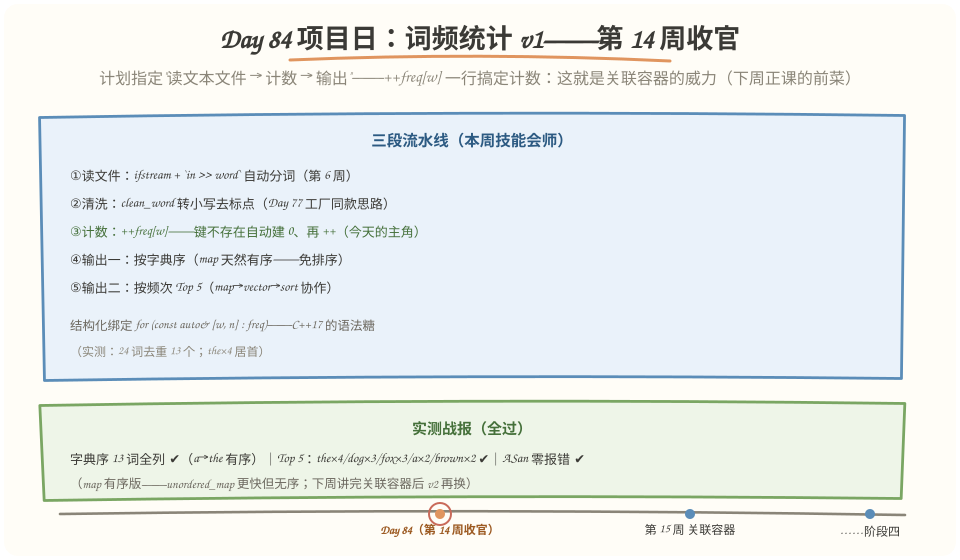
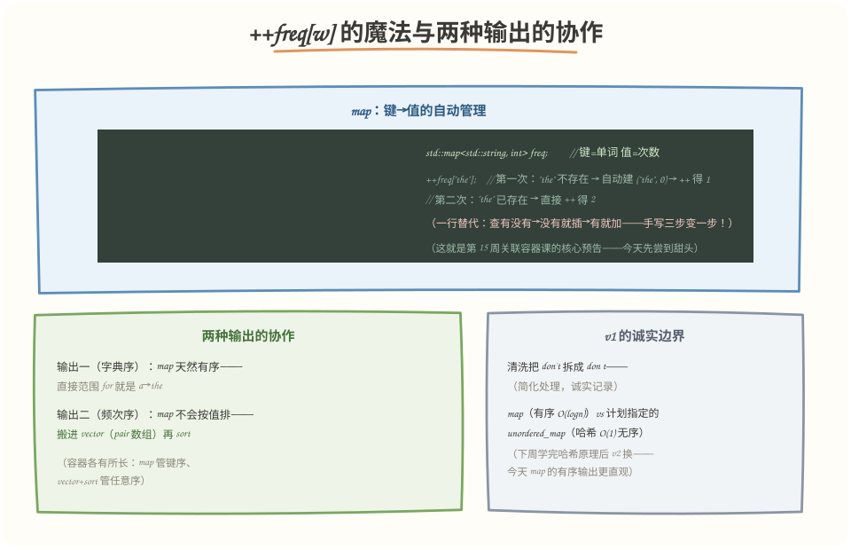
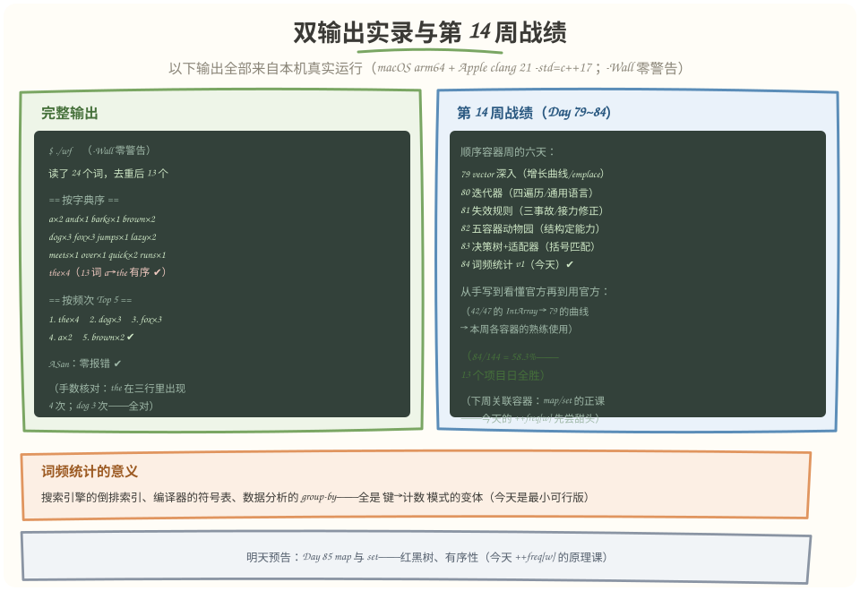

# 第 84 天（项目日）：词频统计 v1——读文件、计数、输出

> **今日目标**：完成本教程后，你能做到：实现完整的词频统计（读文本文件 → 清洗 → `++freq[w]` 计数 → 双路输出）；解释 map 的键值自动管理（不存在自动建 0 再 ++——手写三步变一步）；用 map+vector 协作完成"按频次 Top N"；手数核对计数正确性。
> **预计时间**：闭卷实现 50 分钟＋对照 30 分钟
> **前置准备**：完成 Day 79~83；合上教程——第 14 周的收官答卷。
> **今日产出**：约 70 行、`-Wall` 零警告 + ASan 零报错的词频统计器（24 词去重 13、双路输出）。

## 1. 今天解决什么问题？

计划第 14 周指定的收官项目：**词频统计 v1——读文本文件 → unordered_map 计数 → 输出**。这是"键 → 计数"模式的最小可行版——搜索引擎的倒排索引、编译器的符号表、数据分析的 group-by 全是它的变体。

今天用 **map**（有序版）而非计划原文的 unordered_map：一是 map 的字典序输出更直观（第二种输出才需要排序协作）；二是哈希原理下周才讲——先尝 `++freq[w]` 的甜头、学完原理再换哈希版（v2 的路线，诚实记录）。

## 2. 先看全貌：今天的内容位于哪里？



**图 1**：上方蓝卡是五段流水线（读文件/清洗/计数/字典序输出/Top 5 输出——本周技能会师）；下方绿卡是战报。路线图：**第 14 周今天收官（84/144 = 58.3%）**。

三步概括今天：

1. `++freq[w]`：键不存在自动建 0 再 ++——计数一行搞定；
2. map 天然有序（字典序免费）；按频次要 vector+sort 协作；
3. map vs unordered_map：有序 O(log n) vs 哈希 O(1) 无序——下周正课。

## 3. 核心概念：先用直觉，再给准确定义

### 3.1 ++freq[w]：键值的自动管理

- **一句通俗解释**：`++freq["the"]`——"the" 不存在就自动创建（值 0）再 ++；存在就直接 ++。手写的"查有没有→没有就插→有就加"三步合成一步。
- **一个类比**：签到表——报到时在表上找自己名字（没有就添一行）、画一道正字；map 把这三步承包了。
- **对应到技术上是**：实测——24 个词进来、13 个键存活（the×4、dog×3、fox×3…）；`operator[]` 的语义就是"不存在则默认构造"——这正是计数的完美工具。类比的边界：`operator[]` 会**插入**不存在的键——只想查询不改时用 `find/count`（下周的课）；今天的计数场景正是"要插入"的场景。
- **常见误解**："先检查键在不在再 ++"——不需要；operator[] 自动处理。写了 if 反而画蛇添足。

### 3.2 双路输出：两种容器的协作

- **一句通俗解释**：map 的序是**键序**（字典序）——免费但要频次序就得把数据搬进 vector 再 sort。
- **一个类比**：图书馆按书名排架（map 键序）——想要"借阅排行"就得把书目抄到一张表上重排（vector+sort）。
- **对应到技术上是**：实测——输出一（范围 for 直接遍历 map：a→the 有序 ✔）；输出二（`vector<pair<string,int>> items(freq.begin(), freq.end())` + lambda sort 降序 → Top 5 ✔）。**容器各有所长**：map 管键序、vector+sort 管任意序——协作而非竞争。类比的边界：C++17 的结构化绑定 `for (const auto& [w, n] : freq)` 让遍历 map 更直观（今天的 -std=c++17 就是为此）。
- **常见误解**："map 能按值排序吗"——不能（它的序是键序）；按值排的标准做法就是今天的搬运+sort。

### 3.3 map vs unordered_map：有序与哈希

- **一句通俗解释**：map 是"排好序的电话簿"（查找 O(log n)、遍历天然有序）；unordered_map 是"哈希桶"（查找 O(1) 但无序）。
- **一个类比**：字典（map：按拼音排——翻到附近就能查但慢一点）vs 门牌号索引（unordered：直接算出位置——最快但没有顺序）。
- **对应到技术上是**：今天选 map 的两个理由——输出一直接有序（直观）；哈希原理未学（下周正课）。**v2 路线**：学完哈希后换 unordered_map（计数场景哈希通常更快）+ 需要有序输出时再临时排序——两版的取舍写进 notes.md。类比的边界：数据量小（万级以下）两者无感差别；**需要有序遍历**是 map 的不可替代场景。
- **常见误解**："unordered_map 总是更快"——哈希有计算开销+冲突可能；小数据和需要序的场景 map 不输。

## 4. 图解核心机制



**图 2**：上半部分蓝卡是 ++freq[w] 的展开（不存在→建 0→++ vs 存在→直接 ++）；左下绿卡是两种输出的协作（map 键序免费/频次序靠搬运）；右下灰卡是 v1 的诚实边界（清洗简化、map vs unordered 的 v2 路线）。

按图逐步讲：

1. **对着展开走一遍**：第一次 "the" 的三步（查/建/++）被 operator[] 打包——这就是"关联容器"的关联含义（键自动管理）；
2. **看两种输出的分工**：字典序遍历 map（零成本）；频次序三步走（搬 vector/lambda sort/取前五）；
3. **读诚实边界**：清洗把 don't 拆成 don t（简化）；map 是有意的选型（有序直观 + 哈希未学）——v2 的改进清单已经列好；
4. **连接历史技能**：ifstream 分词（第 6 周）、清洗函数（Day 77 工厂思路）、lambda sort（Day 48 起）——第 14 周的收官项目把三阶段的技能线拧成一股。

## 5. 动手实践：完成一个最小可运行例子

### 5.1 准备文件

```bash
cd ai-compiler-roadmap/tutorials/day-084/examples
```

主角：`word_freq.cpp`（约 70 行完整版）。

### 5.2 编写代码

核心（完整代码见本目录）：

```cpp
std::map<std::string, int> freq;                 // 键=单词 值=次数
std::ifstream in(fname);
std::string word;
while (in >> word) {                             // 自动分词（空白分隔）
    std::string w = clean_word(word);            // 转小写去标点
    if (w.empty()) { continue; }
    ++freq[w];                                   // 核心：一行计数！
}

// 输出一：字典序（map 天然有序）
for (const auto& [w, n] : freq) {                // C++17 结构化绑定
    std::cout << w << " × " << n;
}

// 输出二：频次 Top 5（搬运+排序）
std::vector<std::pair<std::string, int>> items(freq.begin(), freq.end());
std::sort(items.begin(), items.end(),
          [](const auto& a, const auto& b) { return a.second > b.second; });
```

### 5.3 运行与观察

```bash
g++ -Wall -std=c++17 word_freq.cpp -o wf && ./wf
```

实际执行结果（本机）：

```text
读了 24 个词，去重后 13 个

== 按字典序（map 的天然序） ==
  a × 2
  and × 1
  barks × 1
  brown × 2
  dog × 3
  fox × 3
  jumps × 1
  lazy × 2
  meets × 1
  over × 1
  quick × 2
  runs × 1
  the × 4

== 按频次 Top 5 ==
  1. the × 4
  2. dog × 3
  3. fox × 3
  4. a × 2
  5. brown × 2
```

```bash
g++ -Wall -std=c++17 -fsanitize=address word_freq.cpp -o wfa && ./wfa
```

```text
（ASan 零报错）
```



**图 3**：左上完整输出（双路+手数核对注解）；右侧是第 14 周六天战绩；下方橙卡是词频统计的行业意义。

**手数核对**：测试文本三行里 "the" 出现 4 次（第 1 行 2 次 + 第 2 行 2 次）✔、"dog" 3 次 ✔、"fox" 3 次 ✔——计数正确性人工验证。

### 5.4 修改一个输入再观察：真实文本上跑

把 sample.txt 换成自己的任意英文文本（或复制一段新闻存成 mytext.txt、改 fname）——重跑：词数、去重数、Top 5 全部自动更新。观察两点：①真实文本的 Top 1 几乎总是 the/a/of 这类**停用词**（搜索引擎要去掉它们才能看出主题——v2 的改进方向）；②大文本（几千词）的运行毫秒级——map 的 O(log n) 在这个量级毫无压力。**一测一观**：项目从"玩具"走向"可用"的一步。

## 6. 常见错误与排查

**错误 1：编译报 C++17 extension 警告（结构化绑定）**

- 现象：`[w, n]` 分解声明被警告；
- 原因：默认标准低于 C++17；
- 定位：报错指向 for 行；
- 修复：`-std=c++17`（今天开发时亲历）或改用 `.first/.second`。

**错误 2：计数把 "The" 和 "the" 算成两个**

- 现象：同一词大小写各算各的；
- 原因：清洗没转小写（或只转了首字母）；
- 定位：对比 freq 里的大小写键；
- 修复：clean_word 里逐字符 tolower（今天的实现）。

**错误 3：Top 5 打出全部词（没有截断）**

- 现象：排序后全部输出；
- 原因：循环条件漏了 `i < 5`；
- 定位：看输出二循环的条件；
- 修复：`i < items.size() && i < 5`（越界和截断双防）。

## 7. 今日练习

### 必做练习

给输出二加"并列处理"：第 5 名若有多词同频则全部列出（如 a×2 和 brown×2 和 lazy×2 和 quick×2 都是 2——是否全列？设计你的规则并实现）。预期产出：规则说明 + 新 Top 输出。

### 选做挑战

"停用词过滤"：建一个 `std::set<std::string> stopwords = {"the", "a", "and", "over", ...}`（set 也是下周主角——键集合），计数前查一下在不在集合里（`stopwords.count(w)`）跳过。重跑 Top 5——真实主题词浮出水面（quick/brown/dog/fox…）。这是搜索引擎预处理的最小版。

## 8. 今日验收

- [ ] 我的词频统计三段全通（读文件/清洗计数/双路输出）
- [ ] 我的 ++freq[w] 用得其所（没画蛇添足的 if 检查）
- [ ] 双路输出对上（字典序 13 词/Top 5）且手数核对通过
- [ ] ASan 零报错 + -Wall 零警告（-std=c++17 的教训记住）
- [ ] 我能说出 map vs unordered_map 的取舍和 v2 路线

## 9. 一句话总结与明天预告

今天的问题是"键值计数怎么做才简洁"；机制上，`++freq[w]` 把查/建/加三步合成一步（关联容器的核心价值）、map 键序免费、频次序靠 vector 协作；实践上，读文件、清洗、双路输出、真实文本试跑全部落地；验证标准是看到任何"统计次数"的需求能直接写出 ++freq[w]。**第 14 周收官——84/144 天（58.3%），13 个项目日全胜。** 明天进入 **第 15 周 · Day 85：map 与 set**——红黑树、有序性：今天 `++freq[w]` 背后的原理课正式开讲。
