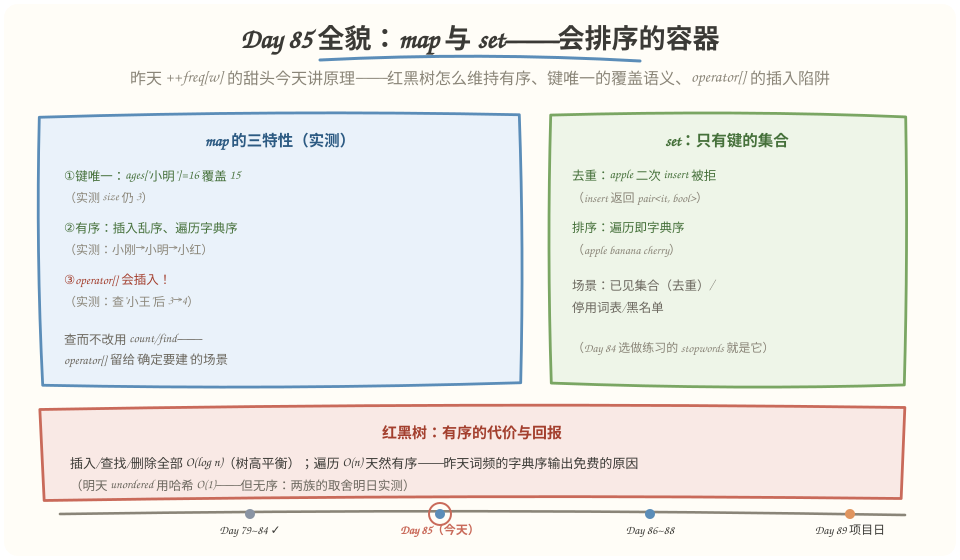
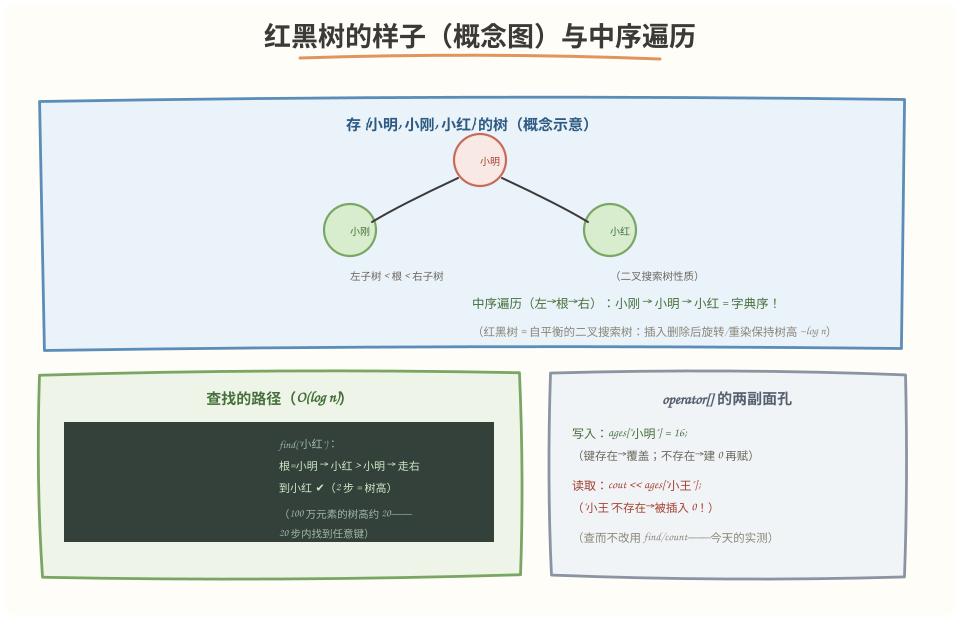

# 第 85 天：map 与 set——红黑树、有序遍历

> **今日目标**：完成本教程后，你能做到：说出 map 的三特性（键唯一覆盖/有序遍历/operator[] 会插入）并各配实测；用 set 去重（insert 的 pair 返回值）和排序；画出红黑树的概念图（二叉搜索树 + 中序遍历 = 字典序）；完成计划指定的单词计数字典序输出；避开 operator[] 的查询陷阱。
> **预计时间**：学习 20 分钟＋实践 45 分钟
> **前置准备**：完成 Day 84（词频 v1 用了 map——今天补原理）。
> **今日产出**：map 三特性实测、set 去重排序、operator[] 陷阱实证、词频字典序（计划指定练习）。

## 1. 今天解决什么问题？

昨天 `++freq[w]` 一行计数、遍历还天然字典序——今天回答**为什么**：map 底层是**红黑树**（自平衡二叉搜索树），中序遍历就是键序。三个配套认知：**键唯一**（同键赋值是覆盖不是新增）；**operator[] 有两副面孔**（写入口和查询口——后者会偷偷插入！今天实测这个陷阱）；**set 是去掉值的 map**（只有键的集合——去重和排序一体）。

明天 unordered 族用哈希换速度——两族的取舍是本周主线。

## 2. 先看全貌：今天的内容位于哪里？



**图 1**：左卡蓝是 map 三特性（各配实测）；右卡绿是 set 的去重排序；下方红卡是红黑树的代价与回报。

三步概括今天：

1. map：键唯一（覆盖）+ 有序（中序遍历）+ operator[] 慎查（会插入）；
2. set：去重 + 排序一体（insert 返回 pair 判新旧）；
3. 红黑树：全操作 O(log n)、遍历 O(n) 天然有序。

## 3. 核心概念：先用直觉，再给准确定义

### 3.1 map：有序的键值对

- **一句通俗解释**：map 是"自动排序的字典"——键像词条、值像释义；插入乱序、遍历永远按键序。
- **一个类比**：图书馆编目——新书上架不管什么顺序，目录卡永远按书名排好等你查。
- **对应到技术上是**：实测——插入（小明/小红/小刚/小明）乱序，遍历得 `小刚(16) 小明(16) 小红(14)`（字典序）；`ages["小明"]=16` 后 size 仍 3（**覆盖**——15 被 16 替换，键唯一）。**中序遍历**的原理（图 2）：左子树 < 根 < 右子树——递归走左→根→右正好是升序。类比的边界：**multimap** 允许重复键（Day 87）；今天的 map 是"一键一值"。
- **常见误解**："map 按插入序遍历"——不；按键序（插入序的是 vector——想保插入序就用序列容器）。

### 3.2 operator[] 的两副面孔

- **一句通俗解释**：写 `ages["小明"] = 16` 是赋值口（键在则覆盖、不在则建）；读 `cout << ages["小王"]` 是**陷阱口**——"小王"不存在会被**插入**（值 0）。
- **一个类比**：酒店入住系统——报名字"查一下有没有房"，系统却直接给你开了一间（新建记录）——本想查询却改了状态。
- **对应到技术上是**：实测——访问前 size=3，`ages["小王"]` 打出 0 后 size=**4**（被插入了！）。**查而不改的正确姿势**：`count(key)`（返回 0/1）或 `find(key)`（返回迭代器，end() 表示没有）——两者都实测通过。**什么时候用 operator[]**：确定"不在就要建"的场景——昨天的 `++freq[w]` 正是（词不存在建 0 再 ++）。类比的边界：at(key) 也可查（不存在抛异常——第 12 周预告）。
- **常见误解**："operator[] 读值没副作用"——有（插入默认值）；这是 map 最经典的坑，今天实测一次永记。

### 3.3 set 与红黑树

- **一句通俗解释**：set 是"只有键没有值的 map"——去重和排序一体完成；红黑树是两者的共同地基（自平衡的搜索树）。
- **一个类比**：签到表（set）——只记名字不记别的；重复报到被拒、名单自动按序排好。
- **对应到技术上是**：实测——`insert(apple)` 第二次返回的 pair 的 second 为 **false**（已存在被拒）；遍历得 `apple banana cherry`（自动排序）。**红黑树的角色**（概念）：二叉搜索树性质（左<根<右）保证中序遍历有序；**红黑规则**（节点染色+旋转）保证树高 ~log n——100 万元素约 20 层，查找 20 步内。**全操作 O(log n)** 是 map/set 的复杂度承诺。类比的边界：真实的红黑树维持规则（旋转/重染）是进阶数据结构课的内容——今天记住"自平衡搜索树 → 有序 + log n"这个因果就够。
- **常见误解**："set 就是 vector 去重"——set 还有 O(log n) 的查找和有序维护；要"保序去重"另想办法（vector + set 查重的组合）。

## 4. 图解核心机制



**图 2**：上半部分蓝卡是存三个键的概念树（左子树<根<右子树）+ 中序遍历的顺序推导；左下绿卡是查找路径（2 步 = 树高）；右下灰卡是 operator[] 的两副面孔。

按图逐步讲：

1. **对着树走中序**：左（小刚）→ 根（小明）→ 右（小红）——正好字典序；"遍历有序"不是魔法是树性质；
2. **沿查找路径数步**：find("小红") 从根走右一步到——O(log n) 的直观（树高即步数）；
3. **看两副面孔的分岔**：赋值（覆盖/新建）vs 读取（**也会新建**！）——陷阱的几何位置就在"不存在"这个分支；
4. **连接 Day 84**：词频的 `++freq[w]` 用对了 operator[]（"不在就建"正是所需）、字典序输出免费的原因今天落地。

## 5. 动手实践：完成一个最小可运行例子

### 5.1 准备文件

```bash
cd ai-compiler-roadmap/tutorials/day-085/examples
```

主角：`map_set.cpp`（三特性 + set + 词频）。

### 5.2 编写代码

核心（完整代码见本目录）：

```cpp
std::map<std::string, int> ages;
ages["小明"] = 15;  ages["小红"] = 14;  ages["小刚"] = 16;
ages["小明"] = 16;                          // 覆盖（键唯一）

for (const auto& [name, age] : ages) { ... } // 遍历：字典序！

// operator[] 陷阱（实测前后 size）
std::cout << ages["小王"];                   // 不存在 → 被插入（值 0）！
// 查而不改：
if (ages.count("小明")) { ... }              // count：0/1
auto it = ages.find("小红");                 // find：迭代器

std::set<std::string> seen;
bool inserted = seen.insert(w).second;       // pair<迭代器, 是否新插入>
```

### 5.3 运行与观察

```bash
g++ -Wall -std=c++17 map_set.cpp -o ms && ./ms
```

实际执行结果（本机）：

```text
== map：键值对 + 有序 ==
  插入顺序：小明 小红 小刚 小明（重复）
  遍历输出（字典序）：小刚(16) 小明(16) 小红(14)
  （插入乱序、遍历有序——红黑树在维持序）
  size = 3（小明的 15 被覆盖——键唯一）

== 查找三兄弟 ==
  count(小明) = 1（存在）
  find(小红) → 小红 = 14
  count(小王) = 0（不存在）
  访问前 size = 3
  ages["小王"]（只想看看）= 0
  访问后 size = 4（被插入了！——operator[] 的陷阱）

== set：只有键的集合 ==
  insert(apple) → 新插入
  insert(banana) → 新插入
  insert(apple) → 已存在（忽略）
  insert(cherry) → 新插入
  insert(banana) → 已存在（忽略）
  set 内容（字典序）：apple banana cherry （自动去重+排序）

== 计划指定练习：单词计数按字典序输出 ==
  brown × 1
  dog × 1
  fox × 1
  lazy × 1
  quick × 1
  the × 3
```


**图 3**：左上完整输出（三特性/set/词频各段标注）；右侧是昨天与今天的知识连接；下方橙卡是选型指南。

### 5.4 修改一个输入再观察：陷阱的规避亲测

把 `std::cout << ages["小王"]` 改成 `std::cout << (ages.count("小王") ? "存在" : "不存在")`——重跑：size 访问前后都是 3（**count 不插入**）！再换成 `ages.find("小王") != ages.end()` 同样安全。**一险两安**：operator[] 查询的副作用 vs count/find 的纯查询——三种写法各跑一次 size 对照，陷阱和正确姿势都进了肌肉记忆。

## 6. 常见错误与排查

**错误 1：查询后 map 变大（多出值为 0 的键）**

- 现象：打印一下 map 里没有的键，size 涨了；
- 原因：operator[] 的插入副作用；
- 定位：对比操作前后的 size（今天的实测法）；
- 修复：查用 count/find；operator[] 只在"不在就要建"时用。

**错误 2：以为同键两次 [] 会新增两条**

- 现象：预期 size+1 实际不变；
- 原因：map 键唯一——第二次是覆盖；
- 定位：打印值（15 变 16 了吗）；
- 修复：概念修正——要重复键用 multimap（Day 87）。

**错误 3：set 去重后想按插入序遍历**

- 现象：遍历顺序和插入顺序不一样；
- 原因：set 按键序不保插入序；
- 定位：对比插入序和遍历序；
- 修复：保插入序用 vector+set 查重的组合；或接受键序。

## 7. 今日练习

### 必做练习（计划指定：单词计数按字典序输出）

从键盘（或文件）读入一行英文，`++freq[w]` 计数后按字典序输出全部"词 × 次数"。预期产出：输入 `to be or not to be` → 输出 be×2 / not×1 / or×1 / to×2（字典序）。

### 选做挑战

"成绩表的两种视图"：`map<string, int>` 存 5 个学生成绩——①按键序（姓名）输出（map 直接遍历）；②按分数降序 Top 3（Day 84 的 vector 搬运法）。体会同一份数据两种视角的容器协作。

## 8. 今日验收

- [ ] 我的三特性实测通过（覆盖/有序/operator[] 陷阱——各配证据）
- [ ] 我的 set 去重排序通过（insert 的 second 判新旧）
- [ ] 我能画出概念树并推出中序遍历 = 字典序
- [ ] 我实测了 count/find 不插入（5.4 的一险两安）
- [ ] 我的词频字典序输出（计划指定练习）通过

## 9. 一句话总结与明天预告

今天的问题是"map 为什么又快又有序"；机制上，红黑树（自平衡搜索树）给全操作 O(log n) 和中序遍历的天然序，键唯一决定覆盖语义，operator[] 的两副面孔要用对场景；实践上，三特性、set 去重、陷阱规避、词频字典序全部实测；验证标准是看到任何 map 用法能说出"这个操作会不会插入、遍历什么序"。明天 **Day 86：unordered_map / unordered_set**——哈希原理与自定义 key 的哈希：map vs unordered_map 的性能对比实验（计划指定）——O(log n) 和 O(1) 的对决。
