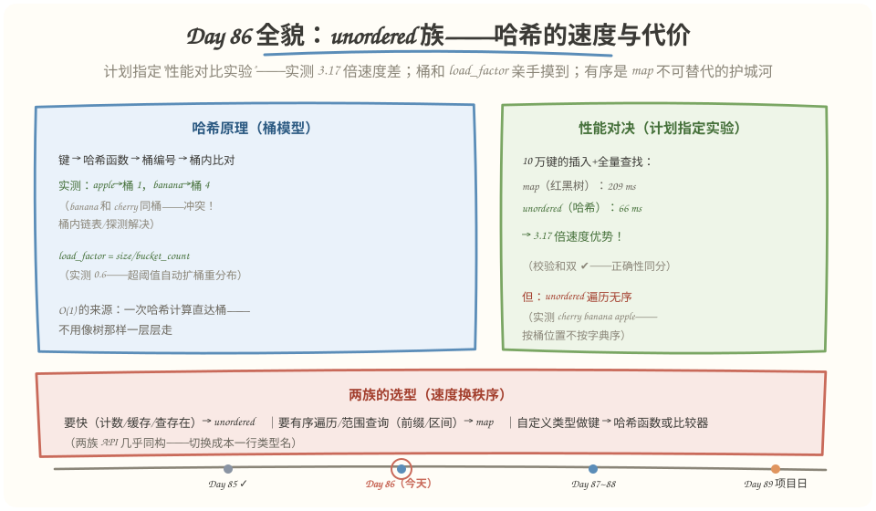
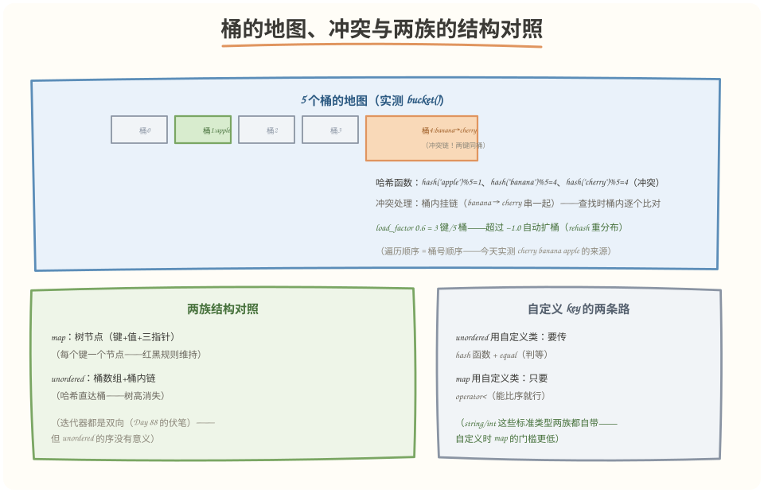
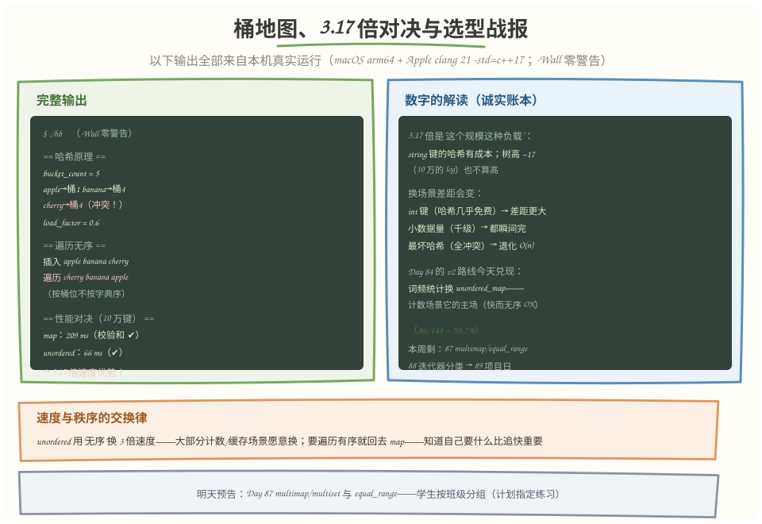

# 第 86 天：unordered_map / unordered_set——哈希原理与性能对决

> **今日目标**：完成本教程后，你能做到：画出桶模型（哈希函数→桶→冲突链）并用 bucket()/load_factor() 实测；完成计划指定的 map vs unordered_map 性能对比（实测 3.17 倍）；说出两族的选型（速度 vs 有序）和自定义 key 的门槛差；解释 unordered 遍历无序的原因。
> **预计时间**：学习 20 分钟＋实践 45 分钟
> **前置准备**：完成 Day 85（红黑树是对照系；昨天 operator[] 今天照用）。
> **今日产出**：桶地图实测（含冲突目击）、10 万键性能对决（209ms vs 66ms）、选型指南。

## 1. 今天解决什么问题？

昨天 map 用红黑树拿到 O(log n) + 有序——今天的问题：**能不能更快**？答案：**哈希表**（unordered 族）——一次哈希计算直达桶，O(1) 平均。计划指定的性能对比实验今天实测：**10 万键的插入+全量查找，map 209ms vs unordered 66ms（3.17 倍）**。

代价也明确：**无序**（遍历按桶位不按字典序——实测 cherry banana apple）和**最坏退化**（哈希全冲突时 O(n)）。速度与秩序的交换律是今天的主线。

## 2. 先看全貌：今天的内容位于哪里？



**图 1**：左卡蓝是哈希原理（桶模型——实测 apple→桶1、banana/cherry 同桶冲突）；右卡绿是性能对决（3.17 倍）；下方红卡是两族选型。

三步概括今天：

1. 哈希：键→哈希函数→桶→桶内比对——O(1) 的来源；
2. 对决：10 万键 unordered 快 3.17 倍（校验和双 ✔）；
3. 选型：要快 unordered、要有序 map——自定义 key 时 map 门槛更低。

## 3. 核心概念：先用直觉，再给准确定义

### 3.1 桶模型：O(1) 的来源

- **一句通俗解释**：哈希表像"编好号的储物柜"——钥匙（键）经公式（哈希函数）直接算出柜号，一步到位。
- **一个类比**：教室储物柜——学号尾号 % 柜子数就是你的柜（不用挨个找）；两个人尾号撞了（冲突）就共柜排队。
- **对应到技术上是**：实测——`bucket_count = 5`；`um.bucket("apple") = 1`、`banana = 4`、**`cherry` 也在桶 4（冲突！）**——桶内挂链（banana→cherry 串着）；`load_factor = 0.6`（3 键 / 5 桶——超过 ~1.0 自动 rehash 扩桶重分布）。**O(1) 的直觉**：一次哈希计算（常数）直达桶 + 桶内极短比对。类比的边界：**最坏退化**——哈希函数设计差（或恶意构造的键）全撞一桶 → 链表 O(n)；标准库的哈希对内建类型质量有保证。
- **常见误解**："哈希表查找永远 O(1)"——是**平均** O(1)；最坏 O(n)（理论存在，实践中好哈希难触发）。

### 3.2 无序的遍历：桶位即序

- **一句通俗解释**：unordered 的遍历按**桶编号**走——和插入序、字典序都无关。
- **一个类比**：仓库盘点——按货架号（桶位）清点，不是按进货时间也不是按品名字母。
- **对应到技术上是**：实测——插入 apple banana cherry，遍历得 **cherry banana apple**（按桶位：桶4的两项先出……具体序依实现）；同一个程序换个桶数遍历序可能变——**绝不依赖它**。**这就是 Day 84 选 map 的原因**（字典序输出免费）——今天 v2 路线兑现：纯计数场景（不要序）换 unordered 拿 3 倍速度。类比的边界：unordered 的迭代器仍是双向（能 ++/--——Day 88 分类表见）；只是这个"序"没有语义。
- **常见误解**："unordered 遍历是随机的"——不是随机是确定（按桶位）——但实现细节决定，语义上当作"无序"对待。

### 3.3 两族选型与自定义 key

- **一句通俗解释**：快且不要序 → unordered；要有序遍历/范围查询 → map；两族 API 几乎同构（切换 = 改一个类型名）。
- **一个类比**：送快递——同城急件（unordered：抄近道不管顺路序）vs 按门牌号挨家送（map：有序但慢一点）。
- **对应到技术上是**：实测 3.17 倍（10 万 string 键）——**数字的诚实解读**：规模/键型/负载都会变这个数（int 键差距更大、千级数据都瞬间、最坏哈希退化）；结论不是"unordered 无脑快"而是"计数/缓存场景选它、要序回去 map"。**自定义 key 的门槛差**：unordered 要提供 hash 函数 + equal（判等）；map 只要 operator<（能比序）——自定义类型做键时 map 更省事。类比的边界：标准类型（string/int/pair 等组合）两族都开箱即用——差异只在自定义类。
- **常见误解**："反正 unordered 快就总用它"——需要有序输出（昨天的词频字典序）就得 map 或"unordered+临时排序"（后者的排序成本可能吃掉速度优势——量级大时）。

## 4. 图解核心机制



**图 2**：上半部分蓝卡是 5 个桶的地图（实测：桶1 的 apple、桶4 的冲突链 banana→cherry、空桶 0/2/3）+ load_factor 的扩桶机制；左下绿卡是两族的结构对照（树节点 vs 桶数组+链）；右下灰卡是自定义 key 的两条路。

按图逐步讲：

1. **对着桶地图走查找**：hash("apple")%5=1 → 直达桶 1 → 比对命中——两步（对比树的 ~17 层）；
2. **看冲突链的样子**：banana 和 cherry 同桶串着——查找 cherry 要桶内多比一次（冲突的代价）；
3. **读 load_factor 的防线**：0.6 < 1.0 没触发扩桶；键再增多 → rehash（桶数翻倍、全部重分布）——摊还的另一种形态；
4. **记两族的门槛**：自定义 key 时 unordered 要 hash+equal、map 只要 <——选型多一个维度。

## 5. 动手实践：完成一个最小可运行例子

### 5.1 准备文件

```bash
cd ai-compiler-roadmap/tutorials/day-086/examples
```

主角：`hash_bench.cpp`（桶演示 + 性能对决）。

### 5.2 编写代码

核心（完整代码见本目录）：

```cpp
// 桶的透视
std::unordered_map<std::string, int> um;
um["apple"] = 1;  um["banana"] = 2;  um["cherry"] = 3;
std::cout << um.bucket_count()          // 桶数
          << um.bucket("apple")          // 某键落在哪个桶
          << um.load_factor();           // 负载因子

// 性能对决（计划指定实验）
template <typename MapT>
long long bench(const char* name, int n) {
    MapT m;
    for (int i = 0; i < n; ++i) { m["key_" + std::to_string(i)] = i; }     // 插入
    for (int i = 0; i < n; ++i) { sum += m["key_" + std::to_string(i)]; }  // 全量查找
    // 计时 + 校验和（sum == n*(n-1)/2 证明结果正确）
}
```

### 5.3 运行与观察

```bash
g++ -Wall -std=c++17 hash_bench.cpp -o hb && ./hb
```

实际执行结果（本机）：

```text
== 哈希原理演示（桶 + 哈希函数） ==
  bucket_count = 5（桶的数量——哈希函数把键映射到桶）
  apple 在桶 1，banana 在桶 4，cherry 在桶 4
  load_factor = 0.6（size/bucket_count——超过阈值自动扩桶）

== 遍历顺序：无序！ ==
  插入序：apple banana cherry
  遍历序：cherry banana apple
  （取决于桶位置——与插入序和字典序都无关）

== 计划指定实验：map vs unordered_map 性能对比 ==
  map（红黑树）：100000 个键的插入+全量查找 = 209 ms（校验和 ✔）
  unordered_map（哈希）：100000 个键的插入+全量查找 = 66 ms（校验和 ✔）
  unordered/map 速度比 = 3.16667 倍

== 但有序输出只有 map 能免费给 ==
  map 遍历：apple banana cherry （字典序 ✔）
```



**图 3**：左上完整输出（桶/无序/对决/有序四段）；右侧是数字的诚实解读（3.17 倍的适用边界）和 v2 路线；下方橙卡是速度与秩序的交换律。

### 5.4 修改一个输入再观察：数据量的缩放实验

把 n 从 100000 改成 10000 和 1000000 各跑一轮——观察倍数变化：预期 1 万时差距缩小（都很快、启动开销占比大）、100 万时可能扩大（树高 20 vs 哈希常数）。**三档规模**的性能曲线就是"数字的诚实解读"的实证——结论从"unordered 快"升级为"**规模越大差距越稳、小数据随便选**"。把三档数字填进 notes.md 的表格（今天的选做练习同款）。

## 6. 常见错误与排查

**错误 1：依赖 unordered 的遍历顺序**

- 现象：换编译器/加数据后输出序变了；
- 原因：遍历按桶位——实现细节；
- 定位：审计代码有没有对遍历序的隐含依赖（如依次处理要序的）；
- 修复：要序用 map；或收集后排序。

**错误 2：自定义类型做 unordered 的键编译错**

- 现象：`unordered_map<MyClass, int>` 报没匹配的哈希；
- 原因：没有 hash 函数（也不知道怎么算桶号）；
- 定位：报错提 hash / hash_fn；
- 修复：传自定义 hash（struct 重载 operator()）；或改 map 只要 operator<。

**错误 3：把 unordered_map 当"升级版 map"全面替换**

- 现象：替换后字典序输出乱了；
- 原因：两族的根本差异（有序 vs 哈希）；
- 定位：看输出哪里的序变了；
- 修复：按场景选——要序的地方回 map（Day 84 的双容器策略）。

## 7. 今日练习

### 必做练习（计划指定：性能对比实验）

三档规模（1 万/10 万/100 万）跑 map vs unordered——把"耗时/倍数"填成三行表格。观察趋势并写一句结论（参考：规模越大 unordered 的优势越稳定；小数据两者都瞬间）。预期产出：三行实测表 + 趋势结论。

### 选做挑战

"Day 84 词频 v2"：把昨天的 word_freq.cpp 换成 unordered_map（类型名一行改动）——跑同样文本：输出序变了（无序）但**计数完全相同**；再对 1 万词的文本计时对比 map 版——今天 3.17 倍的迷你复现。v2 的取舍记录：纯计数用 unordered、要字典序输出的场景再换回或后排序。

## 8. 今日验收

- [ ] 我的桶演示通过（bucket_count/bucket()/load_factor 亲手摸到 + 冲突目击）
- [ ] 我的性能对决实测（10 万键：209ms vs 66ms = 3.17 倍，校验和双 ✔）
- [ ] 我能解释 unordered 遍历无序的原因（桶位即序——绝不依赖）
- [ ] 我能背出两族选型（快→unordered / 序→map）和自定义 key 门槛差
- [ ] 我做过三档规模的缩放观察（5.4）或 v2 迷你复现（选做）

## 9. 一句话总结与明天预告

今天的问题是"map 能更快吗、代价是什么"；机制上，哈希桶模型（一次计算直达桶）给平均 O(1)、实测 3.17 倍；代价是无序遍历（桶位即序）和理论退化；实践上，桶透视、性能对决、缩放实验全部实测；验证标准是看到任何关联容器选择能说出"要速度还是要秩序、自定义 key 的门槛"。明天 **Day 87：multimap / multiset 与 equal_range**——学生按班级分组（计划指定练习）：一键多值和范围查询。
