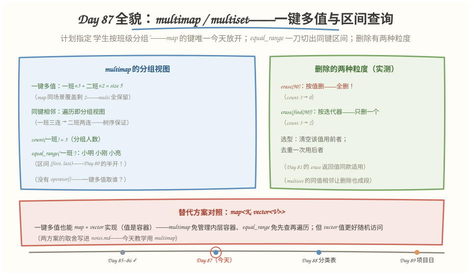
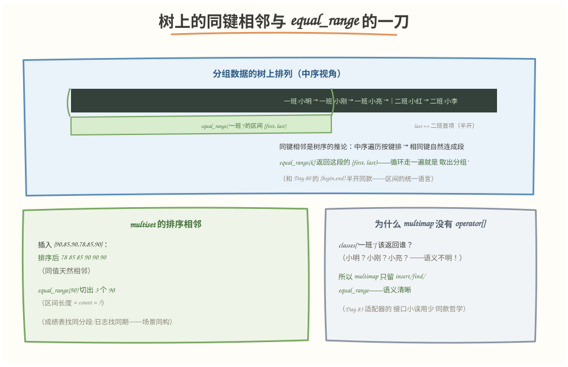
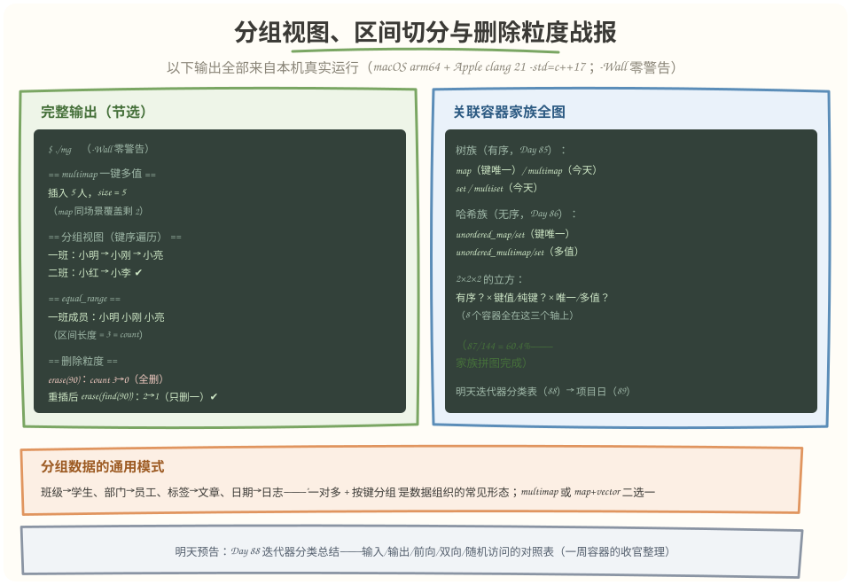

# 第 87 天：multimap / multiset 与 equal_range——一键多值

> **今日目标**：完成本教程后，你能做到：用 multimap 实现学生按班级分组（计划指定练习——一键多值全保留、同键相邻）；用 equal_range 切出同键区间（[first, last) 的半开语义）；区分删除的两种粒度（erase(值) 全删 vs erase(find) 只删一个）；说出 multimap 为什么没有 operator[] 和 map<K, vector<V>> 替代方案的取舍。
> **预计时间**：学习 20 分钟＋实践 40 分钟
> **前置准备**：完成 Day 85~86（树序是同键相邻的地基；equal_range 复用 Day 80 的区间语言）。
> **今日产出**：班级分组（5 人两班）、equal_range 区间切分、删除粒度对照、家族 2×2×2 全图。

## 1. 今天解决什么问题？

map 的键唯一在"分组"场景是障碍——一个班有多个人、一个标签有多篇文章。今天的 **multimap**（一键多值）正是解药：同键插入全保留、树序让同键**相邻**成段——`equal_range(key)` 一刀切出这段 `[first, last)`。计划指定的练习"学生按班级分组"全覆盖。

配套两个细粒度知识：**删除的两种粒度**（按值全删 vs 按迭代器只删一个——实测对照）；**multimap 为什么没有 operator[]**（一键多值取谁？语义不明所以不提供——接口小误用少的哲学）。

## 2. 先看全貌：今天的内容位于哪里？



**图 1**：左卡蓝是 multimap 的分组视图（同键相邻 + equal_range）；右卡绿是删除的两种粒度；下方红卡是 map<K, vector<V>> 替代方案。

三步概括今天：

1. multimap：一键多值（insert 全保留）、同键相邻（遍历即分组）；
2. equal_range(key)：返回 [first, last)——取出该键全部值；
3. 删除两粒度：erase(值) 全删、erase(find(值)) 只删一个。

## 3. 核心概念：先用直觉，再给准确定义

### 3.1 一键多值：分组的天赋

- **一句通俗解释**：multimap 允许同一个键挂多个值——像通讯录里"张家"有三个成员。
- **一个类比**：楼的信箱——101 室（键）可以有三个住户（值）各收各的信；map 版的 101 只认最后登记的一人（覆盖）。
- **对应到技术上是**：实测——插入一班×3、二班×2 后 size=**5**（对照 map 同操作只剩 2——覆盖）；**遍历即分组**（一班三连 → 二班两连——树序把同键排在一起）。**count** 变成分组人数（count(一班)=3）。类比的边界：multimap **没有 operator[]**——`classes["一班"]` 返回谁（小明/小刚/小亮）语义不明，标准库干脆不提供（接口小误用少——Day 83 适配器的同款哲学）。
- **常见误解**："multimap 是坏的 map"——是**语义不同**的 map（一对多 vs 一对一）；分组场景它才是正解。

### 3.2 equal_range：一刀切出区间

- **一句通俗解释**：`equal_range(key)` 返回该键那一段的 `[first, last)`——循环走一遍就是"取出分组"。
- **一个类比**：图书馆按主题排架——"计算机类"的书连续排列；equal_range 就是管理员一次指出这段的起止。
- **对应到技术上是**：实测——`auto [first, last] = classes.equal_range("一班")`，循环得 `小明 小刚 小亮`（区间长度 = count = 3）；multiset 上同款（{78 85 85 **90 90 90**} 的 90 段长 3）。**半开语义**和 Day 80 的 [begin, end) 一脉相承——区间是容器的统一语言。**为什么能做到一刀**：树序保证同键相邻（中序遍历按键排 → 相同键连成段）——这是 Day 85 红黑树的直接推论。类比的边界：unordered_multimap 也有 equal_range——但同键不一定相邻靠桶内链接（原理不同、用法相同）。
- **常见误解**："equal_range 返回所有匹配的容器"——不；返回**迭代器对**（区间端点）——你再用循环取内容。

### 3.3 删除粒度与替代方案

- **一句通俗解释**：erase(值) 把该值**全部**删掉；erase(find(值)) 只删**一个**——粒度自选。
- **一个类比**：清库存——"90 分的全划掉"（按值）vs "划掉一个 90"（按位置）。
- **对应到技术上是**：实测——`erase(90)` 后 count 3→0（全删）；重插 {90,85,90} 后再 `erase(scores.find(90))`，count 2→1（只删一个——**去重的正确姿势**）。**替代方案 map<K, vector<V>>**：值是容器也能一对多——优势（内层可随机访问/排序）劣势（手动管理两层、取分组要先 find 再遍历内层）；multimap 的优势（equal_range 一步、同键自动有序相邻）。两方案的取舍是经典设计题——今天的教学选 multimap（计划指定），notes.md 里留对照。类比的边界：数据量大且分组内频繁随机访问 → vector 版更优；分组只整体遍历 → multimap 更简。
- **常见误解**："erase(值) 和 erase(find(值)) 一样"——粒度完全不同（全删 vs 一个）——今天的实测就是证据。

## 4. 图解核心机制



**图 2**：上半部分蓝卡是分组数据的树上排列（一班三项连排 → 二班两项连排 + equal_range 的区间框）；左下绿卡是 multiset 的排序相邻（78 85 85 | 90 90 90 的段）；右下灰卡是"为什么没有 operator[]"的语义解答。

按图逐步讲：

1. **对着序列数相邻**：一班的三项连续、二班的两项连续——树序（Day 85）的直接推论；"遍历即分组"不需要任何额外代码；
2. **看 equal_range 的框**：[first, last) 框住一班三项、last 恰是二班首项（半开）——Day 80 区间语言的复用；
3. **看 multiset 的 90 段**：排序让同值天然成段——成绩分段/日志同期的场景同构；
4. **读 operator[] 的缺席理由**：语义不明 → 不提供——multimap 的接口哲学。

## 5. 动手实践：完成一个最小可运行例子

### 5.1 准备文件

```bash
cd ai-compiler-roadmap/tutorials/day-087/examples
```

主角：`multi_group.cpp`（分组 + equal_range + 删除粒度）。

### 5.2 编写代码

核心（完整代码见本目录）：

```cpp
std::multimap<std::string, std::string> classes;     // 键=班级 值=学生
classes.insert({"一班", "小明"});
classes.insert({"一班", "小刚"});                     // 同键再插——不覆盖！
classes.insert({"一班", "小亮"});

// equal_range 取出一班全部
auto [first, last] = classes.equal_range("一班");
for (auto it = first; it != last; ++it) {
    std::cout << it->second << ' ';                  // 小明 小刚 小亮
}

// 删除粒度对照
scores.erase(90);                   // 全删（count 3→0）
scores.insert({90, 85, 90});        // 重插两个 90（count=2）
scores.erase(scores.find(90));      // 只删一个（2→1）
```

### 5.3 运行与观察

```bash
g++ -Wall -std=c++17 multi_group.cpp -o mg && ./mg
```

实际执行结果（本机）：

```text
== multimap：一键多值 ==
  插入 5 人（一班×3、二班×2），size = 5
  （map 同场景会覆盖——multimap 全保留）

== 按班级分组视图（键序遍历） ==
  一班：小明
  一班：小刚
  一班：小亮
  二班：小红
  二班：小李
  （一键多值连续排列——同键相邻，键序分组）

== count：一班有几人 ==
  count(一班) = 3
  count(二班) = 2
  count(三班) = 0（不存在）

== equal_range：取出一班的全部 ==
  一班成员：小明 小刚 小亮 （区间长度 = 3）

== multiset：可重复的集合 ==
  插入 {90, 85, 90, 78, 85, 90}，size = 6
  排序后：78 85 85 90 90 90
  count(90) = 3（重复全保留）

== equal_range 在 multiset：90 分的有谁（位置区间） ==
  90 分区间长度 = 3
  （排序序列里同值相邻——equal_range 一刀切出区间）

== 删除策略对照 ==
  erase(90) 后 count(90) = 0（全删）
  erase(find(90)) 后 count(90) = 1（只删一个！）
```



**图 3**：左上完整输出（分组/区间/粒度三段标注）；右侧是关联容器家族 2×2×2 全图（有序×键值×唯一三轴的八个容器）；下方橙卡是分组模式的通用性。

### 5.4 修改一个输入再观察：新增一班学生

在 insert 区加 `classes.insert({"一班", "小新"})`——重跑：分组视图自动更新（一班四人连排）、count(一班)=4、equal_range 区间长度 4——**不需要任何"重新分组"的代码**（树序自动维护）。这就是 multimap 相比"手写分组结构"的维护红利：分组逻辑内建在容器序里。对照 map+vector 版做同样的事：要 find("一班") 再 push_back——两步且要判空。

## 6. 常见错误与排查

**错误 1：multimap 上用 operator[] 编译错**

- 现象：`classes["一班"]` 不编译；
- 原因：multimap 没有这个操作（一键多值取谁不明）；
- 定位：报错列出的可用成员（insert/find/equal_range）；
- 修复：equal_range（全部）或 find（第一个）。

**错误 2：想删一个重复值却全删了**

- 现象：`erase(90)` 把三个 90 全清了；
- 原因：按值删 = 全删语义；
- 定位：对比删除前后 count；
- 修复：只删一个用 `erase(find(值))`（今天的实测）。

**错误 3：equal_range 的结果当容器用**

- 现象：对 [first, last] 做 push_back 之类；
- 原因：它是迭代器对不是容器；
- 定位：报错的成员名；
- 修复：循环遍历区间取内容；需要容器就把结果拷进 vector。

## 7. 今日练习

### 必做练习（计划指定：学生按班级分组）

扩展成完整分组报表：加 10 个学生（三个班），①按班输出全员（键序遍历）②用 equal_range 统计每班人数③找出人数最多的班。预期产出：三段输出 + 人数最多的结论。

### 选做挑战

"map<vector> 对照版"：同样的分组数据用 `map<string, vector<string>>` 实现 ①②③——对比两版代码量和你觉得哪版更顺手。把对照结论写进 notes.md（这是"容器选型"的真实手感——比背规则更有用）。

## 8. 今日验收

- [ ] 我的 multimap 分组通过（一键多值全保留、size=5）
- [ ] 我的 equal_range 切分正确（一班三人、区间长度=count）
- [ ] 我实测了删除两种粒度（3→0 全删 vs 重插后 2→1 只删一）
- [ ] 我能说出 multimap 没有 operator[] 的原因
- [ ] 我能默写关联家族 2×2×2 三轴（有序/键值/唯一）

## 9. 一句话总结与明天预告

今天的问题是"一键多值的分组怎么做"；机制上，multimap 全保留同键、树序让同键相邻成段（遍历即分组）、equal_range 一刀切出 [first, last)；实践上，班级分组、区间统计、删除粒度、替代方案对照全部实测；验证标准是看到任何一对多数据能选出 multimap 或 map+vector 并说出理由。明天 **Day 88：迭代器分类总结**——输入/输出/前向/双向/随机访问五类对照表（Day 80/82 埋的能力分层今天收网成表）。
