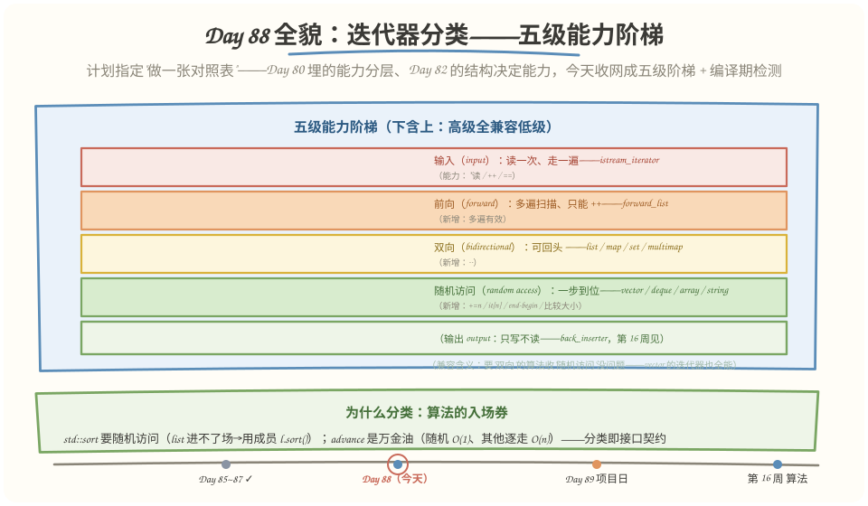
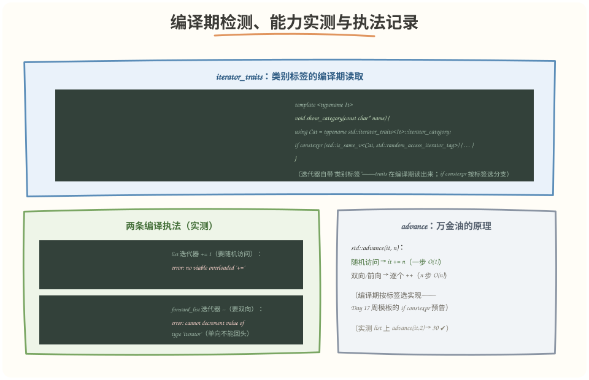
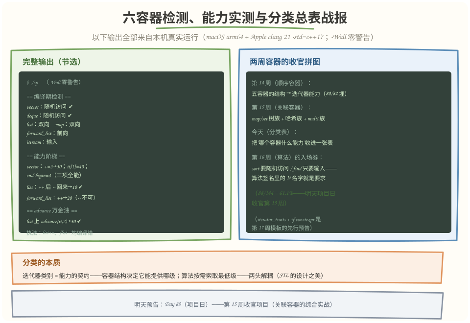

# 第 88 天：迭代器分类总结——五级能力阶梯

> **今日目标**：完成本教程后，你能做到：默画五级阶梯（输入→前向→双向→随机访问，下含上）并说出各级的新增能力；用 iterator_traits 在编译期检测类别（六个容器实测）；用编译错误证明能力执法（list 的 +=、forward_list 的 --）；解释分类的意义（算法的入场券——STL 两头解耦）。
> **预计时间**：学习 20 分钟＋实践 40 分钟
> **前置准备**：完成 Day 85~87（两周容器的结构知识是分类的底座）。
> **今日产出**：六容器类别检测、五级阶梯图、两条编译执法、分类总表（计划指定的对照表）。

## 1. 今天解决什么问题？

Day 80 说"vector 能跳、list 只能走"（能力分层）、Day 82 说"结构决定能力"——今天把这两条线**收网成正式的五级分类**（计划指定"做一张对照表"）。五个类别（输入/前向/双向/随机访问/输出）是迭代器的**能力契约**：容器按结构申报它能给哪级、算法按需求索取最低级——两头的解耦正是 STL 的设计之美。

今天的探针还藏了一个彩蛋：`iterator_traits` + `if constexpr` 在**编译期**读类别选分支——这是第 17 周模板课的先行预告。

## 2. 先看全貌：今天的内容位于哪里？



**图 1**：蓝卡是五级阶梯（从输入到随机访问逐级增能 + 输出迭代器注记）；绿卡是分类的意义（算法入场券）。

三步概括今天：

1. 五级阶梯：输入（单遍读）→前向（多遍 ++）→双向（可 --）→随机访问（+=n/[ ]/差值）；
2. 各容器归位：vector/deque/array/string 随机、list/map/set 双向、forward_list 前向；
3. 分类 = 契约：算法签名里的迭代器名就是能力要求（sort 要随机访问）。

## 3. 核心概念：先用直觉，再给准确定义

### 3.1 五级阶梯：能力逐级叠加

- **一句通俗解释**：迭代器分五档——像驾照等级（C1 能开 C2 的车，反之不行）；高级全兼容低级。
- **一个类比**：阅读权限——浏览一次（输入）、可反复看但不能翻回（前向）、可以往回翻页（双向）、能直接跳到第 N 页（随机访问）。
- **对应到技术上是**：实测归位——vector/deque（**随机访问**：`+=2`→30、`it[1]`→40、`end-begin`=4 三项全能）；list/map（**双向**：`++` 后 `--` 回来 ✔）；forward_list（**前向**：只 `++` ✔）；istream_iterator（**输入**：单遍）。**下含上**：要双向的算法收随机访问没问题（vector 的迭代器全能）。类比的边界：**输出迭代器**（只写不读——back_inserter）是独立的一支，第 16 周算法课见；今天的主线是读侧四级。
- **常见误解**："分类是给编译器看的跟我无关"——写出 `list 上 +=` 就编译错；选容器时想"要不要传给 sort"就要看类别——它是你每天在用的契约。

### 3.2 编译期检测：iterator_traits

- **一句通俗解释**：每个迭代器自带"类别标签"（iterator_tag）；`iterator_traits` 在编译期读出它——程序按标签选分支。
- **一个类比**：工牌上的权限等级——闸机（traits）读卡（标签）决定开哪道门（if constexpr 分支）。
- **对应到技术上是**：实测——`show_category<vector<int>::iterator>` 打"随机访问"……六个容器各归各位；实现用 `if constexpr (std::is_same_v<Cat, random_access_iterator_tag>)`——**编译期**分支（不匹配的分支不编译——所以探针能对不同类别打印不同文案）。**advance 的原理同款**：随机访问走 `+=`（O(1)）、其他逐 `++`（O(n)）——标签决定实现（实测 list 上 advance(it,2) 逐走到 30）。类比的边界：这是**标签分发**的最简形态——第 17 周模板元编程的正课内容；今天看懂"编译期读标签选路"即可。
- **常见误解**："类别检测是运行时的 if"——不是；iterator_traits 全在编译期（零运行开销）——这就是模板的威力。

### 3.3 分类的意义：算法的入场券

- **一句通俗解释**：算法签名里的迭代器参数名就是能力要求——`sort(RandIt, RandIt)` 只收随机访问；`find(InIt, InIt, val)` 只要输入。
- **一个类比**：游乐场设施的门牌——"过山车：需 1.4 米以上"（sort 要随机访问）；"旋转木马：不限"（find 只要能走）。
- **对应到技术上是**：实测执法——list 的迭代器 `+=` 编译错（`no viable overloaded '+='`——没有随机访问能力）；forward_list 的 `--` 编译错（`cannot decrement`——单向不能回头）。**sort 与 list**：std::sort 进不了 list（要随机访问）——所以 list 自带成员 `l.sort()`（按双向能力实现的归并——第 16 周细讲）。**STL 的解耦**：算法只要最低必要能力（不绑死容器）、容器申报结构能给的能力（不管谁用）——70+ 算法 × 8 容器不需要 70×8 份代码。类比的边界：`distance/advance` 这类万金油按标签自动选最优路径——统一接口下的性能自适应。
- **常见误解**："list 不能 sort"——能（成员版 l.sort()）；只是**std::sort** 这个泛型版进不了场——两条路各有理由。

## 4. 图解核心机制



**图 2**：上半部分蓝卡是 show_category 的实现（iterator_traits 读标签 + if constexpr 编译期分支）；左下绿卡是两条编译执法的原文；右下灰卡是 advance 万金油的原理（标签选路）。

按图逐步讲：

1. **读一遍探针代码**：traits 读标签 → if constexpr 比对 → 编译期选分支——"程序按类型定制行为"的最小样本；
2. **看两条执法的报错**：`no viable overloaded '+='`（list 没这个能力）和 `cannot decrement`（单向不能回头）——类别是**编译期**契约不是运行时检查；
3. **理解 advance 的两条路**：同一个 `advance(it, 2)` 在 vector 一步到位、在 list 逐走——签名统一、实现按能力自适应；
4. **展望第 16 周**：算法签名（`template <typename RandIt>`）——那时类别要求写在脸面上；今天的表就是入场券清单。

## 5. 动手实践：完成一个最小可运行例子

### 5.1 准备文件

```bash
cd ai-compiler-roadmap/tutorials/day-088/examples
```

主角：`category_probe.cpp`（检测 + 实测 + 执法）。

### 5.2 编写代码

核心（完整代码见本目录）：

```cpp
template <typename It>
void show_category(const char* name) {
    using Cat = typename std::iterator_traits<It>::iterator_category;
    if constexpr (std::is_same_v<Cat, std::random_access_iterator_tag>) {
        std::cout << name << "：随机访问\n";
    } else if constexpr (std::is_same_v<Cat, std::bidirectional_iterator_tag>) {
        std::cout << name << "：双向\n";
    } // … 前向/输入同理
}

show_category<std::vector<int>::iterator>("vector");    // 随机访问
show_category<std::list<int>::iterator>("list");         // 双向
show_category<std::forward_list<int>::iterator>("forward_list");  // 前向
```

### 5.3 运行与观察

```bash
g++ -Wall -std=c++17 category_probe.cpp -o cp && ./cp
```

实际执行结果（本机）：

```text
== 各容器迭代器的类别（编译期检测） ==
  vector：随机访问（+= n / it[i] / end-begin 全行）
  deque：随机访问（+= n / it[i] / end-begin 全行）
  list：双向（++ / -- 行；+= n 不行）
  map：双向（++ / -- 行；+= n 不行）
  forward_list：前向（只有 ++ 行）
  istream（输入流）：输入（单遍扫描）

== 能力阶梯的实测（每级一例） ==
  vector：it += 2 → 30；it[1] = 40；end-begin = 4
  list：++ 后 -- 回来 → 10（双向 ✔）
  forward_list：++ → 20（前向 ✔；-- 不可）

== 为什么分类：算法的入场券 ==
  std::sort 要求随机访问 → vector/deque ✔、list ✘
  （list 有自己的成员 sort——l.sort()）
  std::advance 万金油：随机访问 O(1)、其他 O(n) 逐走
  list 上 advance(it, 2) → 30（逐走到位）

== 分类总表 ==
  输入      ：istream_iterator（单遍读）
  前向      ：forward_list（++；多遍可）
  双向      ：list/map/set（++/--）
  随机访问  ：vector/deque/array/string（+=n/[]/差值）
  （输出迭代器：back_inserter 等——第 16 周算法课见）
```

**编译执法**（两探针实测）：

```text
list 的 lit += 1：     error: no viable overloaded '+='
forward_list 的 --fit：error: cannot decrement value of type 'iterator'
```



**图 3**：左上完整输出（检测/实测/总表三段）；右侧是两周容器的收官拼图和第 16 周入场券；下方橙卡是分类的本质。

### 5.4 修改一个输入再观察：ostream_iterator 的输出侧

加 `show_category<std::ostream_iterator<int>>("ostream（输出）")`——编译报错或归类到 output（本机 libc++ 的实现差异——**输出迭代器**的 traits 支持不完整是已知状况）。这正好补上第五类：输出（只写不读——`*it = x` 合法、`x = *it` 不行）。配合 `std::copy(v.begin(), v.end(), std::ostream_iterator<int>(std::cout, " "))` 的一行打印——输出迭代器的实战预览（第 16 周的 copy 算法）。

## 6. 常见错误与排查

**错误 1：`error: no viable overloaded '+='`（list 上跳格）**

- 现象：list 迭代器 `+= n`；
- 原因：list 是双向不是随机访问；
- 定位：类别表（今天的总表）；
- 修复：advance(it, n)（万金油）或换 vector。

**错误 2：`error: cannot decrement`（forward_list 回头）**

- 现象：forward_list 迭代器 `--`；
- 原因：单向链不能回头（前向级别）；
- 定位：类别表；
- 修复：从头再走（重取 begin）；或换 list。

**错误 3：给 std::sort 传 list 的迭代器**

- 现象：编译错（不满足随机访问要求）；
- 原因：sort 要跳着比较（快排式的随机访问）；
- 定位：报错提 random_access；
- 修复：`l.sort()`（成员版，按双向能力实现）。

## 7. 今日练习

### 必做练习（计划指定：做一张对照表）

亲手画/写五级对照表（类别 × 新增能力 × 代表容器 × 一条实测）——合上教程写、写完对图 1 检查。预期产出：手写表 + 缺漏标注。

### 选做挑战

"类别探测扩展"：给 show_category 加上输出迭代器分支（`std::output_iterator_tag`——注意 5.4 提到的 traits 差异可能要 SFINAE 或直接特化）——再测 `back_inserter(v)` 的类别。这是对今天探针的深挖（traits 的现实复杂性）。

## 8. 今日验收

- [ ] 我能默画五级阶梯并说出各级新增能力（输入→前向→双向→随机）
- [ ] 我的六容器检测实测通过（vector/deque 随机、list/map 双向、flist 前向）
- [ ] 我亲测了两条编译执法（list 的 +=、flist 的 --）
- [ ] 我能说出分类的意义（算法入场券 + STL 两头解耦）
- [ ] 我知道 advance 按标签自适应（随机 O(1)、逐走 O(n)）

## 9. 一句话总结与明天预告

今天的问题是"迭代器的能力体系怎么一张表说清"；机制上，五级阶梯（下含上）、iterator_traits 编译期读标签、算法按最低必要能力索取——容器与算法的解耦；实践上，六容器检测、能力实测、两条执法、advance 原理全部落地；验证标准是看到任何容器的迭代器能立刻报出类别、看到算法签名能说出要求。明天 **Day 89（项目日）：第 15 周收官**——关联容器的综合实战（详细需求明天揭晓）。
