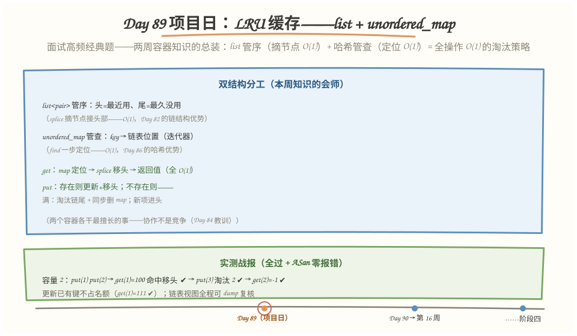
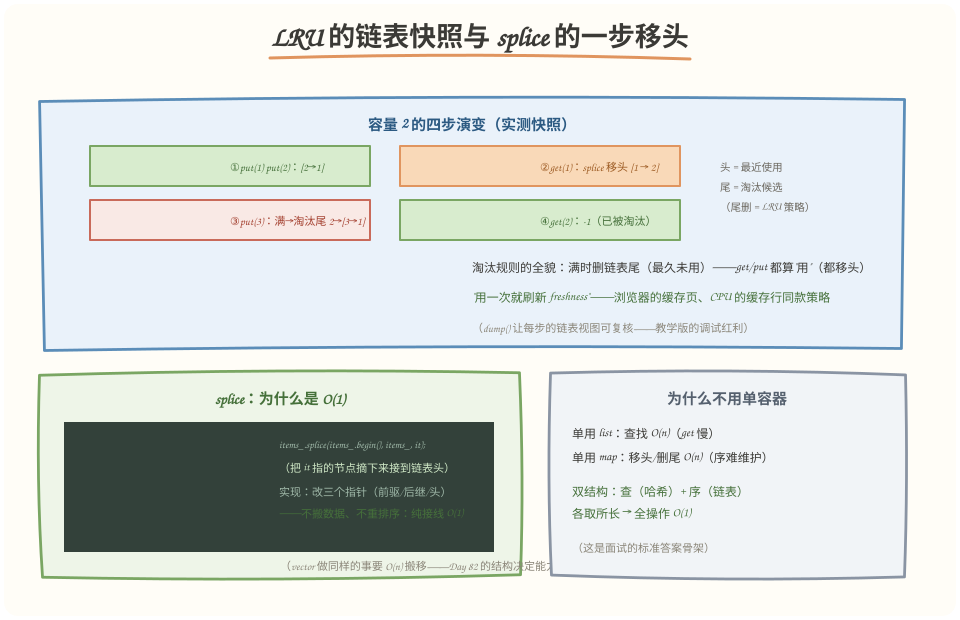
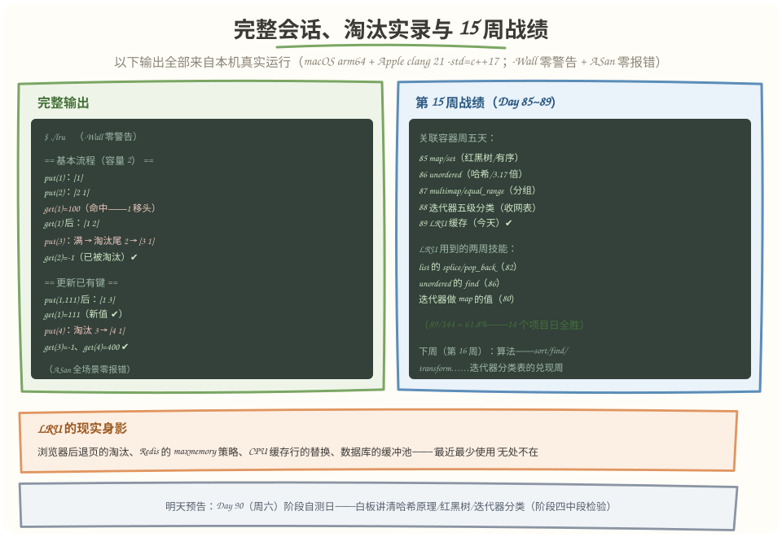

# 第 89 天（项目日）：LRU 缓存——list + unordered_map

> **今日目标**：完成本教程后，你能做到：实现全操作 O(1) 的 LRU 缓存（双结构协作：list 管序 + 哈希管查）；说出 splice 为什么 O(1)（改三个指针——纯接线）；实测淘汰语义（满删尾、get/put 都刷新、更新不占名额）；解释为什么单容器做不到（list 查慢 / map 序难维护）。
> **预计时间**：实现 50 分钟＋对照 30 分钟
> **前置准备**：完成 Day 85~88；合上教程——第 15 周第 5 天的答卷（也是面试高频题的完整答案）。
> **今日产出**：约 50 行、`-Wall` 零警告 + ASan 零报错的 LRU 缓存，完整淘汰会话。

## 1. 今天解决什么问题？

计划指定的经典题：**LRU 缓存**（Least Recently Used，最近最少使用）——容量满时淘汰"最久没用"的那条。它是浏览器后退页、Redis 缓存、CPU 缓存行的共同策略，也是**面试高频题**（要求全操作 O(1)）。

单容器做不到 O(1)：单 list 查找 O(n)、单 map 移头删尾难。答案正是**两周知识的总装**——双结构各取所长：**list 管序**（头=最近用、尾=淘汰候选；splice 摘节点 O(1)）+ **unordered_map 管查**（key→链表位置，find 一步定位）。

## 2. 先看全貌：今天的内容位于哪里？



**图 1**：上方蓝卡是双结构分工（list 管序 + map 管查——各干最擅长的事）；下方绿卡是实测战报。路线图：**第 15 周第 5 天（89/144 = 61.8%）**。

三步概括今天：

1. get：map 定位 → splice 移头 → 返回（全 O(1)）；
2. put：存在则更新+移头；满则删尾（同步两结构）+ 新项进头；
3. 单容器做不到——双结构协作是标准答案骨架。

## 3. 核心概念：先用直觉，再给准确定义

### 3.1 LRU 语义：用一次就刷新

- **一句通俗解释**：缓存容量有限——每次 get/put 都算"用"（被用项移到"最新"端）；满时淘汰"最久没用"的（另一端）。
- **一个类比**：冰箱贴——每次看过的便利贴挪到最上面（最新）；冰箱满了扔最底下的（最久没看）。
- **对应到技术上是**：实测四步演变（容量 2）——put(1) put(2) 得 `[2→1]`；get(1)=100 命中（1 移头得 `[1→2]`）；put(3) 满（淘汰尾 2 得 `[3→1]`）；get(2)=-1（被淘汰）。**dump() 方法**把每步的链表视图打出来——教学版的调试红利（淘汰对不对一目了然）。类比的边界：**更新已有键不占名额**（put(1,111) 只更新+移头——实测 get(1)=111 且没触发淘汰）。
- **常见误解**："put 才刷新使用时间"——get 也算用（也移头）——标准 LRU 语义两者都刷新。

### 3.2 splice：O(1) 的纯接线

- **一句通俗解释**：`splice(目的位置, 源链表, 迭代器)` 把节点从原位摘下接到新位——**不搬数据只改指针**。
- **一个类比**：火车车厢重挂——把 3 号车厢从中间摘下挂到车头——摘挂钩重接，车厢里的人货不动。
- **对应到技术上是**：实测——`get(1)` 内部一句 `items_.splice(items_.begin(), items_, it->second)` 就把命中项移到头；实现是改三个指针（前驱/后继/头）——O(1)。**对比 vector 做同样的事**： erase + insert 两段搬移 O(n)——Day 82"结构决定能力"的实战兑现（链表的 O(1) 摘插正是为此而生）。**map 的值存链表迭代器**（`unordered_map<int, list<...>::iterator>`）——Day 80 的迭代器当"位置把手"用；splice 不使迭代器失效（只改接线不动节点）——LRU 正确性的关键。类比的边界：splice 只在**同一条链表**内接（跨链表的 splice 变体另说）。
- **常见误解**："移到头要遍历"——不用；map 已存了位置（迭代器直达）——双结构协作的意义正在此。

### 3.3 为什么双结构：单容器的死胡同

- **一句通俗解释**：list 查得慢（O(n) 走）、map 序难维护（O(n) 移头）——两个各干一半，合起来全 O(1)。
- **一个类比**：图书管理——只有书架（list：按使用频率排但找书要挨个看）、只有目录（map：找得快但重排费劲）；目录记书架位置（map 存链表迭代器）两头都快。
- **对应到技术上是**：今天的实现——`get`：`pos_.find(key)`（哈希 O(1)）→ `splice` 移头（O(1)）→ 返回（O(1)）；`put` 淘汰：`items_.back()` 拿尾部 key（O(1)）→ `pos_.erase` + `pop_back`（O(1)）——**全操作 O(1)** 达标。**同步两结构**是正确性关键：淘汰时两边都要删（漏了 map 就是悬空迭代器——ASan 会抓）；新项两头都要记。类比的边界：这是**空间换时间**的经典模式（多一份 map 的内存）——工程常规。
- **常见误解**："LRU 就是个链表"——单链表面试过不了（get 不是 O(1)）；双结构是标准答案的骨架。

## 4. 图解核心机制



**图 2**：上半部分蓝卡是容量 2 的四步演变快照（put/put → get 移头 → put 淘汰尾 → get 验证 -1）；左下绿卡是 splice 的 O(1) 原理（三个指针的接线）；右下灰卡是"为什么不用单容器"的死胡同分析。

按图逐步讲：

1. **对着快照走流程**：头=最新、尾=淘汰候选——每个操作后的链表视图都是语义的直接呈现（dump 的价值）；
2. **数 splice 的三个指针**：摘下（改前驱后继）+ 接头（改头指针）——数据零搬运（对比 vector 的搬移）；
3. **看死胡同的两条路**：单 list 的 get 要 O(n) 找、单 map 的移头要 O(n) 重排——双结构各补各的短板；
4. **记面试骨架**：list 管序 + map 管查 + map 值是迭代器 + 淘汰同步删两边——四句话就是这个经典题的完整答案。

## 5. 动手实践：完成一个最小可运行例子

### 5.1 准备文件

```bash
cd ai-compiler-roadmap/tutorials/day-089/examples
```

主角：`lru_cache.cpp`（约 50 行完整版）。

### 5.2 编写代码

核心（完整代码见本目录）：

```cpp
class LRUCache {
private:
    int capacity_;
    std::list<std::pair<int, int>> items_;                     // (key, value)——头=最新
    std::unordered_map<int, std::list<std::pair<int, int>>::iterator> pos_;

public:
    int get(int key) {
        auto it = pos_.find(key);
        if (it == pos_.end()) { return -1; }
        items_.splice(items_.begin(), items_, it->second);     // O(1) 移头
        return it->second->second;
    }

    void put(int key, int value) {
        auto it = pos_.find(key);
        if (it != pos_.end()) {                                 // 已存在：更新+移头
            it->second->second = value;
            items_.splice(items_.begin(), items_, it->second);
            return;
        }
        if ((int)items_.size() >= capacity_) {                  // 满：淘汰尾
            pos_.erase(items_.back().first);                    // 同步删 map！
            items_.pop_back();
        }
        items_.push_front({key, value});
        pos_[key] = items_.begin();
    }
};
```

### 5.3 运行与观察

```bash
g++ -Wall -std=c++17 lru_cache.cpp -o lru && ./lru
```

实际执行结果（本机）：

```text
== 基本流程（容量 2） ==
  put(1)：[1 ]（头=最近）
  put(2)：[2 1 ]（头=最近）
  get(1) = 100（命中——1 移到头）
  get(1) 后：[1 2 ]（头=最近）
  put(3)：容量满 → 淘汰尾部的 2
  put(3) 后：[3 1 ]（头=最近）
  get(2) = -1（已被淘汰 → -1）

== 更新已有键（不占新名额） ==
  put(1,111) 后：[1 3 ]（头=最近）
  get(1) = 111（新值 ✔）
  put(4) 后（3 被淘汰）：[4 1 ]（头=最近）
  get(3) = -1、get(4) = 400
```

```bash
g++ -Wall -std=c++17 -fsanitize=address lru_cache.cpp -o lrua && ./lrua
```

```text
（ASan 全场景零报错——淘汰同步删两结构的正确性盖章）
```



**图 3**：左上完整输出（四步演变 + 更新语义两段）；右侧是第 15 周前五天战绩和 LRU 的现实身影；下方橙卡预告明天的词频统计 v2。

### 5.4 修改一个输入再观察：淘汰顺序的验证

把容量改成 3，依次 put(1)~put(4)、再 get(2)、put(5)——手推每步的链表视图（**先写预测再跑**）：put(4) 时容量 3 未满（1 2 3 → 4 2 3？不对——4 是新的进头得 [4 3 2 1]？容量 3 满 3 个——[4 3 2]，1 被淘汰）……手推和 dump 对照。**LRU 最容易错的就是淘汰时机和顺序**——容量 3 的手推练完，容量 N 的心智模型就稳了。

## 6. 常见错误与排查

**错误 1：淘汰时忘了删 map（悬空迭代器）**

- 现象：下次 get 用到悬空迭代器——UB/崩；
- 原因：只 pop_back 了链表、pos_ 里还留着那项；
- 定位：ASan 的 use-after-free 报告指向 map 的值；
- 修复：淘汰两句都写（`pos_.erase(尾key)` + `pop_back`）——今天的实现。

**错误 2：get 命中后忘记移头**

- 现象：刚 get 过的项被淘汰了（语义错）；
- 原因：get 只返回值没 splice；
- 定位：dump 观察 get 后链表没变；
- 修复：get 里也 splice 移头（"用一次刷新一次"）。

**错误 3：更新已有键时走了淘汰分支**

- 现象：put 已有键导致别的项被淘汰；
- 原因：没先查存在性（直接走满容量分支）；
- 定位：put 后 dump 看容量；
- 修复：先 find——存在则更新+移头 return（今天的分支结构）。

## 7. 今日练习

### 必做练习

给 LRU 加"统计"：记录 get 命中/未命中次数，提供 `hit_rate()` 方法。跑一组 20 次的混合访问（容量 3、键 1~5 随机）——输出命中率。预期产出：命中率数字 + 一句"容量越大命中率越高"的验证（容量 5 重跑对照）。

### 选做挑战

"LFU 变体探索"：把淘汰策略改成 LFU（最不经常使用——淘汰访问次数最少的）——需要额外存频次、且同频次要退回 LRU。写思路（不必完整实现）：用什么结构存频次、同频怎么破？——这是面试的进阶追问，今天的 LRU 是它的地基。

## 8. 今日验收

- [ ] 我的 LRU 全操作 O(1)（双结构 + splice——面试骨架四句话能背）
- [ ] 我的淘汰语义实测正确（满删尾、get/put 都刷新、更新不占名额）
- [ ] 我能说出 splice 的 O(1) 原理（三个指针接线、零数据搬移）
- [ ] 我能解释单容器的死胡同（list 查慢/map 序难）
- [ ] ASan 零报错（淘汰同步删两结构的正确性）

## 9. 一句话总结与明天预告

今天的问题是"有限容量下'最近最少使用'怎么 O(1) 地维护"；机制上，list 管序（splice 纯接线）+ 哈希管查（迭代器直达）——双结构各取所长、同步两处是正确性关键；实践上，四步演变、淘汰语义、更新分支、ASan 验证全部实测；验证标准是任何操作序列能手推链表视图。**第 15 周还剩一天——89/144 天（61.8%），14 个项目日全胜。** 明天 **Day 90（项目日）：词频统计 v2——Top-N 与双排序**——第 15 周收官项目（详细需求明天揭晓）。
