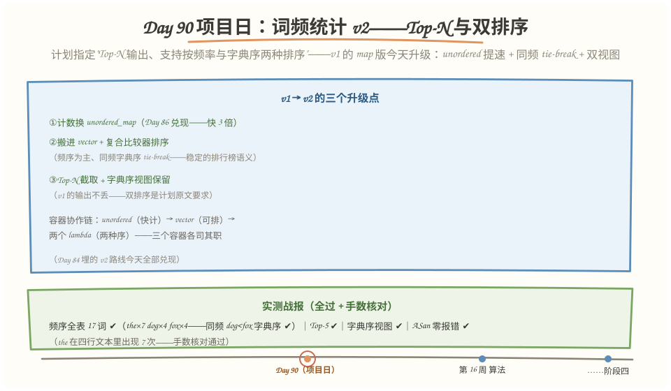
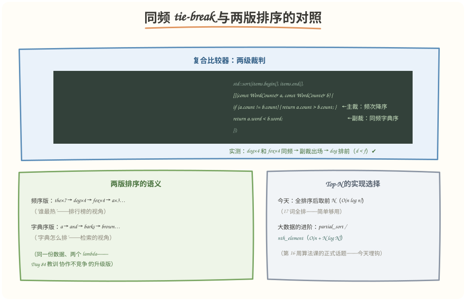

# 第 90 天（项目日）：词频统计 v2——Top-N 与双排序

> **今日目标**：完成本教程后，你能做到：把 v1 升级到 v2（unordered 提速 + Top-N + 双排序——计划指定的三个要求全兑现）；写复合比较器（频序为主、同频字典序 tie-break）；解释两版排序的语义（排行榜视角 vs 检索视角）；手数核对计数正确性。
> **预计时间**：实现 45 分钟＋对照 30 分钟
> **前置准备**：完成 Day 85~89（Day 84 埋的 v2 路线——哈希/排序知识今天全用上）。
> **今日产出**：约 80 行、`-Wall` 零警告 + ASan 零报错的词频 v2（频序全表 + Top-5 + 字典序双视图）。

## 1. 今天解决什么问题？

计划第 15 周收官项目：**词频统计 v2——Top-N 输出、支持按频率与字典序两种排序**。v1（Day 84）当时埋了 v2 路线（"学完哈希后换 unordered"）——今天全部兑现：**计数换 unordered_map**（Day 86 的 3 倍速度）；**复合比较器排序**（频序为主、同频字典序 tie-break——排行榜的稳定语义）；**Top-N 截取** + **字典序视图保留**（双排序是计划原文要求）。

容器协作链升级为三节：unordered（快计）→ vector（可排）→ 两个 lambda（两种序）——各司其职。

## 2. 先看全貌：今天的内容位于哪里？



**图 1**：上方蓝卡是 v1→v2 的三个升级点（各标注出处天数）；下方绿卡是战报。路线图：**90/144 = 62.5%——正好走完全程的八分之五**。

三步概括今天：

1. 计数：unordered_map（Day 86 兑现——纯计数不要序选哈希）；
2. 排序：复合比较器（频次降序为主、同频字典序 tie-break）；
3. 双视图：Top-N（排行榜）+ 字典序（检索）——同一数据两个视角。

## 3. 核心概念：先用直觉，再给准确定义

### 3.1 复合比较器：两级裁判

- **一句通俗解释**：排序规则有主副两级——频次不同听主裁（降序）、频次相同副裁出场（字典序）。
- **一个类比**：考试排名——总分不同按总分、总分相同按姓名笔画——两级规则让榜面稳定可复现。
- **对应到技术上是**：实测——dog×4 和 fox×4 同频 → 副裁 `a.word < b.word` → **dog 排前**（d<f）✔；a×3/and×3/quick×3 三连同频也按字典序。**为什么需要 tie-break**：没有它同频项的顺序取决于 sort 的内部实现（不稳定）——每次运行可能不同；加了它榜面确定。**严格弱序**（Day 48 的老规矩）：复合比较器也要满足——两级都不"相等或大"才算小。类比的边界：副裁可以有更多级（三级的赛事：分→净胜球→名字）——lambda 里继续嵌 if。
- **常见误解**："同频项顺序无所谓"——要复现的排行榜（比如测试断言）必须 tie-break；否则是隐藏的不稳定源。

### 3.2 两版排序：排行榜与检索

- **一句通俗解释**：频序版答"谁最热"、字典序版答"字典里怎么排"——同一份数据的两个视角，各有用户。
- **一个类比**：书店的书——销量榜（频序：买得最多的在前）和书架（字典序：按书名排）——两种陈列服务两种需求。
- **对应到技术上是**：实测——频序：the×7→dog×4→fox×4→a×3…（Top-5 从这里截取）；字典序：a→and→barks→brown→cat…（v1 的视图保留）。**实现**：同一 items 两次 sort、两个 lambda——数据不动规则动。类比的边界：两种排序都**全排** O(n log n)——数据大时字典序版可以直接用 map 版 v1（天然有序免排序）——两版实现的取舍看场景（今天的 vector 版统一简洁）。
- **常见误解**："v2 取代了 v1"——不；v2 是**扩展**（v1 的字典序视图保留）——计划原文"两种排序"就是双视图的意思。

### 3.3 Top-N：从全排到截取

- **一句通俗解释**：全排序后取前 N——最直接的 Top-N；数据大时有更快的进阶（第 16 周预告）。
- **一个类比**：全班排名只要前五——可以把全班都排一遍再看前五（今天）；也可以只办一场"争前五"的淘汰赛（partial_sort/nth_element——更快）。
- **对应到技术上是**：今天 O(n log n) 全排 + 循环取前 5（17 词的场景毫无压力）；**进阶钩子**：`std::partial_sort`（只保证前 N 有序——O(n log N)）和 `nth_element`（第 N 个就位——平均 O(n)）是第 16 周算法课的正式话题——今天埋钩、下周兑现。类比的边界：N 接近 n 时 partial_sort 的优势消失（都退化为全排）——进阶也有适用区。
- **常见误解**："Top-N 必须用堆"——堆（priority_queue）是一种 O(n log N) 方案；排序截取、partial_sort 都行——按数据规模和代码简洁度选。

## 4. 图解核心机制



**图 2**：上半部分蓝卡是复合比较器的代码（主裁频次降序 + 副裁字典序——dog/fox 的实例标注）；左下绿卡是两版排序的语义（排行榜 vs 检索）；右下灰卡是 Top-N 的实现选择（今天的全排 vs 进阶的 partial_sort）。

按图逐步讲：

1. **读比较器的两级**：`count != count` 时主裁说了算；相等时落到 `word < word`——两级裁判的完整代码就是这四行；
2. **看 dog/fox 的裁决实例**：同频 4 → 副裁 d<f → dog 前——榜面确定的来源；
3. **对比两个视角**：频序是"热度"（the 遥遥领先）、字典序是"位置"（a 打头）——用户的两种问题各答各的；
4. **记 Top-N 的三档**：全排截取（今天）→ partial_sort（下周）→ nth_element（下周）——按 n 和 N 的关系选。

## 5. 动手实践：完成一个最小可运行例子

### 5.1 准备文件

```bash
cd ai-compiler-roadmap/tutorials/day-090/examples
```

主角：`word_freq_v2.cpp`（约 80 行完整版）。

### 5.2 编写代码

核心（完整代码见本目录）：

```cpp
std::unordered_map<std::string, int> freq;          // v2 升级①：哈希计数
while (in >> word) {
    std::string w = clean_word(word);
    if (!w.empty()) { ++freq[w]; }
}

std::vector<WordCount> items;                        // 升级②：搬运
items.reserve(freq.size());
for (const auto& [w, n] : freq) { items.push_back({w, n}); }

std::sort(items.begin(), items.end(), [](const WordCount& a, const WordCount& b) {
    if (a.count != b.count) { return a.count > b.count; }   // 主裁：频次降序
    return a.word < b.word;                                  // 副裁：同频字典序
});

for (int i = 0; i < N && i < (int)items.size(); ++i) {       // 升级③：Top-N
    std::cout << items[i].word << " × " << items[i].count;
}
```

### 5.3 运行与观察

```bash
g++ -Wall -std=c++17 word_freq_v2.cpp -o wf2 && ./wf2
```

实际执行结果（本机）：

```text
读了 38 词，去重 17 个（unordered 计数）

== 按频率排序（同频按字典序）—— 全部 ==
  the × 7
  dog × 4
  fox × 4
  a × 3
  and × 3
  quick × 3
  brown × 2
  cat × 2
  lazy × 2
  barks × 1 …（省略）

== Top-5 ==
  1. the × 7
  2. dog × 4
  3. fox × 4
  4. a × 3
  5. and × 3

== 按字典序排序（前 10 展示） ==
  a × 3
  and × 3
  barks × 1
  brown × 2 …（省略）
```

```bash
g++ -Wall -std=c++17 -fsanitize=address word_freq_v2.cpp -o wf2a && ./wf2a
```

```text
（ASan 零报错）
```


**图 3**：左上完整输出（频序/Top-5/字典序三段）；右侧是 v1→v2 的全程和下周预告；下方橙卡是 Top-N 的世界。

**手数核对**：测试文本四行里 "the" 出现 2+2+0+3 = **7 次** ✔（第三行没有 the、第四行 3 个）；dog 出现 4 次 ✔；同频组（dog/fox、a/and/quick、brown/cat/lazy）各按字典序 ✔。

### 5.4 修改一个输入再观察：tie-break 的反面验证

把比较器的副裁删掉（只留 `return a.count > b.count;`）——重跑多次：同频组（a/and/quick）的**顺序可能变**（sort 不稳定 + unordered 的插入序本身不定）——今天机器上碰巧稳定、明天换个文本就乱。**一有一无**：tie-break 的价值从"理论"变"目击"（不稳定排序 + 无序来源 = 榜面随机）。恢复副裁——榜面复现。把这个对照写进 notes.md——排行榜代码的 checklist 第 1 条就是"比较器要全序"。

## 6. 常见错误与排查

**错误 1：同频项每次运行顺序不同**

- 现象：Top-5 的第 4/5 名换来换去；
- 原因：比较器没 tie-break + sort 不稳定；
- 定位：同频组内对比多次运行；
- 修复：复合比较器加副裁（今天的两级裁判）。

**错误 2：`error: invalid comparator`（比较器不满足严格弱序）**

- 现象：sort 运行中崩或报断言；
- 原因：比较器写成了 `<=`（相等也返回 true——矛盾）；
- 定位：检查 lambda 的返回逻辑；
- 修复：严格 `<` 或 `>`（Day 48 的老规矩在复合版同样适用）。

**错误 3：Top-N 循环越界（N > size）**

- 现象：小文本取 Top-10 时崩；
- 原因：循环条件只查了 `i < N`；
- 定位：崩溃在小数据集；
- 修复：`i < N && i < (int)items.size()` 双条件（今天的写法）。

## 7. 今日练习

### 必做练习

给 v2 加"停用词过滤"（Day 84 选做的正式兑现）：`std::set<std::string> stopwords = {"the", "a", "and", "over"}` 计数前查一下跳过。重跑 Top-5——真实主题词上位（quick/dog/fox/brown…）。预期产出：过滤前后的 Top-5 对照。

### 选做挑战

"partial_sort 预习"：把全排序那行换成 `std::partial_sort(items.begin(), items.begin()+5, items.end(), 比较器)`——验证 Top-5 结果相同（前 5 有序、后面不保证）。跑一遍体会"只排前 N"的语义——下周算法课的正课内容今天先摸一下。

## 8. 今日验收

- [ ] 我的 v2 三升级全落地（unordered 计数/复合比较器/Top-N + 双视图）
- [ ] 同频 tie-break 实测（dog×4 在 fox×4 前——字典序副裁）
- [ ] 我实测了无 tie-break 的不稳定（5.4 的一有一无）
- [ ] 手数核对通过（the×7 等）+ ASan 零报错
- [ ] 我能说出两版排序各自的用户问题（热度/位置）

## 9. 一句话总结与明天预告

今天的问题是"词频统计怎么升级成产品级排行榜"；机制上，复合比较器的两级裁判保证榜面复现、unordered 计数兑现 Day 86 的选型、双视图服务两种用户问题；实践上，频序全表、Top-5、字典序、tie-break 反证全部实测；验证标准是看到任何排行榜需求能写出全序的比较器。明天进入 **第 16 周 · Day 91：非修改算法**——find / find_if / count_if / all_of：算法周从"只看不改"的查询族开场（sort 家族 Day 93 正式开课）。
