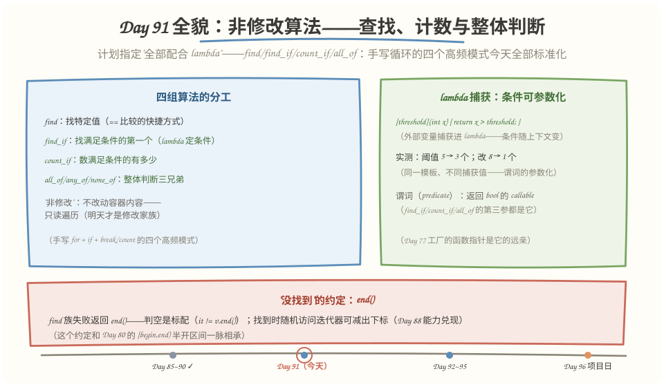
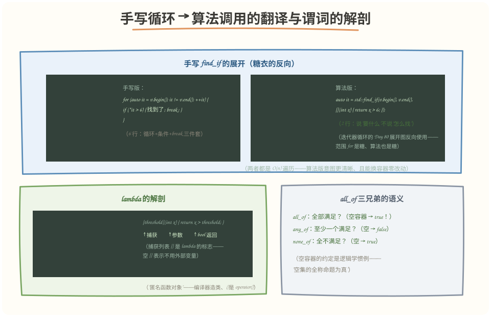
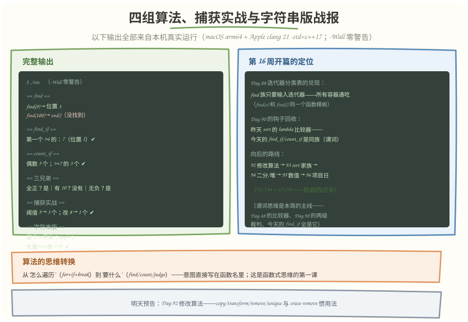

# 第 91 天：非修改算法——find / find_if / count_if / all_of

> **今日目标**：完成本教程后，你能做到：用四组非修改算法替代手写循环（find/find_if/count_if/三兄弟——各配 lambda）；用捕获让谓词参数化（threshold 改一下同一模板出不同结果）；说出 find 族失败返回 end() 的约定和判空写法；完成字符串版的实战。
> **预计时间**：学习 20 分钟＋实践 40 分钟
> **前置准备**：完成 Day 88/90（迭代器分类是算法的入场券；昨天 sort 的 lambda 是今天谓词的同族）。
> **今日产出**：四组算法实测（含捕获参数化）、手写 vs 算法的翻译对照、字符串版实战。

## 1. 今天解决什么问题？

第 16 周（算法库）开篇：**非修改算法**——只读遍历、不碰容器内容的查找/计数/判断家族。计划指定"全部配合 lambda"——这正好是**谓词思维**的第一课：从"怎么遍历"（for + if + break）转到"要什么"（find_if/count_if/all_of 函数名即意图）。

四组覆盖手写循环的四个最高频模式：找特定值（find）、找满足条件的第一个（find_if）、数满足条件的有多少（count_if）、整体判断（all_of/any_of/none_of）——今天全部标准化。

## 2. 先看全貌：今天的内容位于哪里？



**图 1**：左卡蓝是四组算法的分工（各配实测）；右卡绿是 lambda 捕获的参数化；下方红卡是 end() 约定。

三步概括今天：

1. find 找值、find_if 找条件、count_if 计数、三兄弟整体判断——全配 lambda；
2. 谓词可捕获外部变量（threshold 参数化——同一模板不同结果）；
3. 失败约定 end()——判空是标配（半开区间的延伸）。

## 3. 核心概念：先用直觉，再给准确定义

### 3.1 四组算法：手写循环的标准化

- **一句通俗解释**：find 族是"搜查队"（找到就回报位置）、count_if 是"点名员"（数出符合的人数）、三兄弟是"陪审团"（全体/任一/全不——三种裁决）。
- **一个类比**：图书馆——find_if 像图书管理员找出第一本红色封面（条件你定）、count_if 数红色封面有几本、all_of 问"是不是全是红的"。
- **对应到技术上是**：实测——`find(9)` 得位置 3（找到）；`find(100)` 得 end()（没找到）；`find_if(>6)` 得 7（位置 1——第一个满足的）；`count_if(偶)` = 3、`count_if(>=7)` = 3；`all_of(>0)`=是、`any_of(==10)`=没有、`none_of(<0)`=是。**"非修改"**：全程只读——容器内容一字不变（明天才是修改家族）。**翻译对照**（图 2）：手写 6 行（循环+条件+break）→ 算法 2 行（说"要什么"）——意图在函数名里。类比的边界：算法版和手写版**同为 O(n) 遍历**——收益是意图清晰和换容器零改动（find 对 vector/list 同一个模板）——不是速度。
- **常见误解**："算法比手写循环快"——复杂度相同（都走一遍）；快的是**阅读和维护**。

### 3.2 谓词与捕获：条件的参数化

- **一句通俗解释**：谓词（predicate）就是"返回 bool 的条件函数"；lambda 的**捕获**能把外部变量带进条件——阈值不用硬编码。
- **一个类比**：安检的判断标准——金属探测器（lambda）的灵敏度（threshold）由安检级别（外部变量）决定——换个级别同一台机器。
- **对应到技术上是**：实测——`[threshold](int x){ return x > threshold; }`：阈值 5 → 3 个、改 8 → 1 个（**同一模板、不同捕获值**）。lambda 解剖（图 2）：`[捕获](参数) { 返回 }`——`[]` 是标志（空表示不用外部变量）。**谓词的谱系**：Day 48 的比较器老规矩（返回 bool 的 `<`）、Day 90 的两级裁判、今天的 find_if 第三参——全是谓词思维（本周主线）。类比的边界：捕获是**值拷贝**（`[threshold]` 拷一份进 lambda）——lambda 里的修改不影响外面；要引用捕获 `[&threshold]`（进阶用法，第 17 周细讲）。
- **常见误解**："lambda 里的 threshold 是外面的变量"——是**捕获时拷的快照**；外面改了要重新调用（今天的两次调用正是——第二次重新捕获新值）。

### 3.3 end() 约定与空容器

- **一句通俗解释**：find 族失败返回 end()（尾后哨兵）——`it != v.end()` 是判空标配；三兄弟对空容器有逻辑学惯例。
- **一个类比**：搜查队报告"搜到队伍末尾没找到"（end）——而不是说"没找到"两个字（要你听懂暗号）。
- **对应到技术上是**：实测——`find(100)` 返回 end()（判空后打"没找到"）；找到时随机访问迭代器可减出下标（`it - v.begin()` = 3——Day 88 能力的兑现；list 上不能减只能用找到的迭代器）。**三兄弟的空容器惯例**：all_of（空 → true——"空集的全称命题为真"）、any_of（空 → false）、none_of（空 → true）——数学惯例不是 bug。类比的边界：end() 约定和 Day 80 的 [begin, end) 半开一脉相承——"没找到"就是"走到了区间外"。
- **常见误解**："all_of 空容器返回 false"——返回 true（逻辑学惯例）；要防这个语义就先查 empty。

## 4. 图解核心机制



**图 2**：上半部分蓝卡是手写 find_if vs 算法版的对照（6 行 → 2 行——Day 80 展开图的反向使用：算法也是糖）；左下绿卡是 lambda 的解剖（[捕获](参数){返回}——三段标志）；右下灰卡是三兄弟的语义表（含空容器惯例）。

按图逐步讲：

1. **对着两版代码走一遍**：手写版的 for/if/break 三件套在算法版里浓缩成函数名——**意图直接写在名字里**（find_if = 找满足条件的）；
2. **解剖 lambda 三段**：`[]` 捕获、`()` 参数、`{return}` 谓词体——今天的所有 lambda 都长这个样子；
3. **记三兄弟的语义**：全部/至少一个/全不——配上空容器的逻辑学惯例（all 和 none 空 → true、any 空 → false）；
4. **连接谓词谱系**：Day 48 比较器 → Day 90 两级裁判 → 今天 find_if——本周算法课的"条件思维"一以贯之。

## 5. 动手实践：完成一个最小可运行例子

### 5.1 准备文件

```bash
cd ai-compiler-roadmap/tutorials/day-091/examples
```

主角：`non_modify.cpp`（四组算法 + 捕获实战）。

### 5.2 编写代码

核心（完整代码见本目录）：

```cpp
std::vector<int> v = {3, 7, 2, 9, 4, 8, 1};

auto it = std::find(v.begin(), v.end(), 9);                 // 找值
auto big = std::find_if(v.begin(), v.end(),                 // 找条件
                        [](int x) { return x > 6; });
int evens = std::count_if(v.begin(), v.end(),               // 计数
                          [](int x) { return x % 2 == 0; });
bool all_pos = std::all_of(v.begin(), v.end(),              // 整体判断
                           [](int x) { return x > 0; });

int threshold = 5;                                            // 捕获参数化
int above = std::count_if(v.begin(), v.end(),
                          [threshold](int x) { return x > threshold; });
```

### 5.3 运行与观察

```bash
g++ -Wall -std=c++17 non_modify.cpp -o nm && ./nm
```

实际执行结果（本机）：

```text
== find：找值 ==
  find(9) → 位置 3（随机访问迭代器可减——Day 88 的能力）
  find(100) → end()（没找到）

== find_if：找满足条件的第一个 ==
  第一个 >6 的：7（位置 1）

== count_if：数满足条件的个数 ==
  偶数个数：3
  >=7 的个数：3

== all_of / any_of / none_of：整体判断三兄弟 ==
  全部为正？是
  有 10 吗？没有
  没有负数？是

== lambda 的捕获：条件可以是外部变量 ==
  >5 的个数：3（threshold 被捕获进 lambda）
  阈值改 8 后：1（同一 lambda 模板、不同捕获值）

== 字符串版实战 ==
  第一个 a 开头的：apple
  长度 >=6 的：3 个
```



**图 3**：左上完整输出（四组算法+捕获+字符串六段）；右侧是第 16 周开篇定位和谓词谱系；下方橙卡是算法的思维转换。

### 5.4 修改一个输入再观察：谓词错误的安全网

把 count_if 的谓词写成 `x % 2`（忘了 `== 0`——返回 int 不是 bool）——**能编译**（int 隐式转 bool：非 0 即 true）且结果碰巧对（奇数 %2=1=true 计数、偶数=0=false 不计——数出来是奇数个数 4）。把条件反过来才发现数错了。**对照**：写 `return x % 2 == 0;` 明确 bool——意图无歧义。谓词**最好显式返回 bool**（`== 0`/`> threshold` 这类完整表达式）——隐式转换的"碰巧对"是最隐蔽的坑。

## 6. 常见错误与排查

**错误 1：find 的结果没判空就解引用**

- 现象：找不到时崩（解引用 end() 是 UB）；
- 原因：忘了 `!= v.end()` 检查；
- 定位：崩溃点的迭代器来源；
- 修复：`if (auto it = std::find(...); it != v.end())` 判空后再用（if 初始化语句的写法一举两得）。

**错误 2：all_of 空容器返回 true 造成逻辑错**

- 现象：空数据集"全部通过"了校验；
- 原因：逻辑学惯例（空集全称命题真）；
- 定位：加打印 size 确认空；
- 修复：先 `if (v.empty())` 分流——业务语义自己定。

**错误 3：谓词隐式转换的"碰巧对"（5.4）**

- 现象：`x % 2` 忘写 `== 0`——编译过、结果碰巧符合预期；
- 原因：int 隐式转 bool；
- 定位：审计谓词的返回类型；
- 修复：显式 bool 表达式（`== 0` / `> t` 完整写）。

## 7. 今日练习

### 必做练习（计划指定：全部配合 lambda）

用四组算法处理 `vector<string> names = {"Alice", "Bob", "Anna", "Charlie", "Andrew"}`：①find_if 找第一个 A 开头的；②count_if 数 A 开头的个数；③all_of 判断是否都非空；④用捕获找一个"长度等于用户变量 n"的名字。预期产出：四段输出 + 捕获的演示。

### 选做挑战

"组合拳"：用 count_if + all_of 写一个"成绩单体检"——①数不及格（<60）的人数；②all_of 判断是否全员及格；③none_of 判断有没有满分（==100）。三个结果拼成一句中文报告（"42 人中 3 人不及格，全员及格：否，有满分：是"）——算法结果进字符串的格式化实战。

## 8. 今日验收

- [ ] 我的四组算法实测通过（各配 lambda——计划指定）
- [ ] 我的捕获参数化演示成功（阈值 5→3 个、8→1 个）
- [ ] 我能背出 find 失败的 end() 约定和三兄弟的空容器惯例
- [ ] 我做过谓词隐式转换的反面实验（5.4）
- [ ] 我能说出"非修改"的含义（只读——明天才是修改家族）

## 9. 一句话总结与明天预告

今天的问题是"查找/计数/判断的手写循环怎么标准化"；机制上，find/find_if/count_if/三兄弟各管一个模式、谓词（lambda）参数化条件、end() 约定统一"没找到"；实践上，四组实测、捕获实战、字符串版、隐式转换反面教材全部落地；验证标准是看到任何 for+if+break 能说出对应的算法名。明天 **Day 92：修改算法**——copy / transform / remove / unique 与 erase-remove 惯用法：改变容器内容的家族开课。
