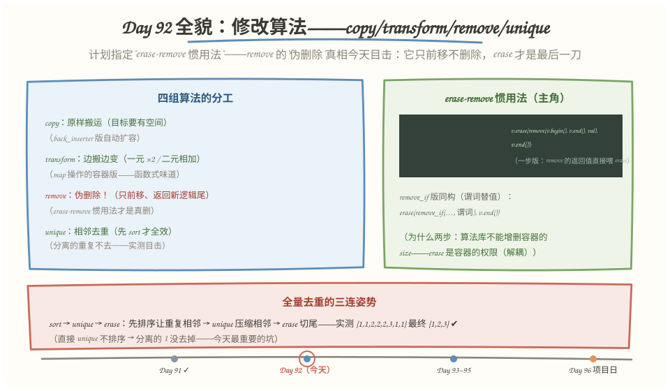
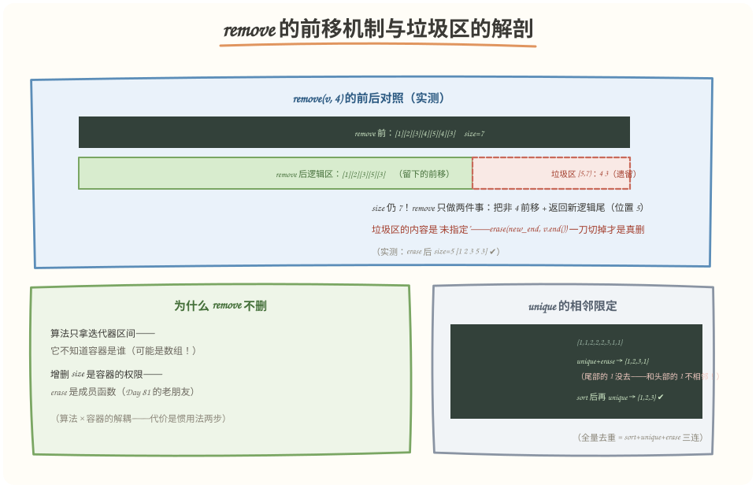
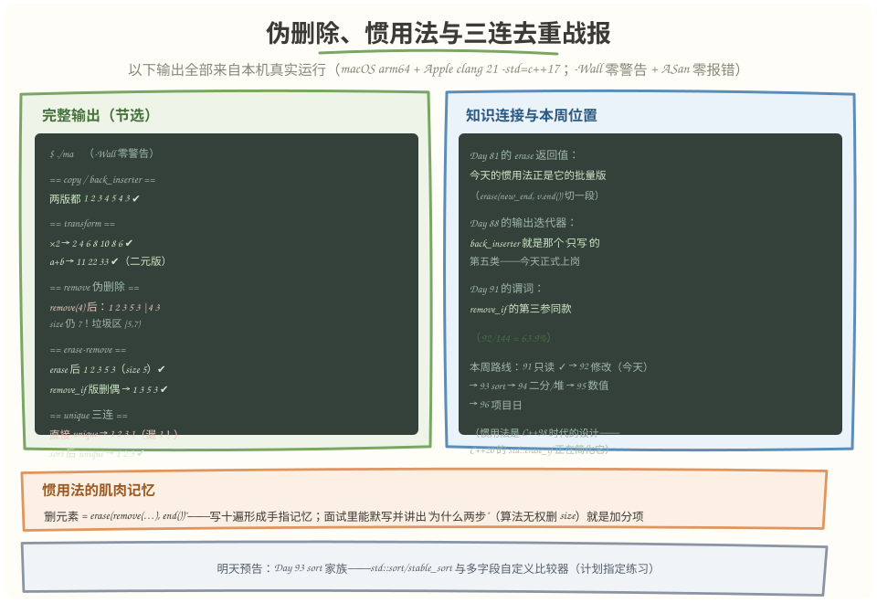

# 第 92 天：修改算法——copy / transform / remove / unique

> **今日目标**：完成本教程后，你能做到：用 copy/transform 搬运和变换（back_inserter 自动扩容——Day 88 输出迭代器上岗）；**目击 remove 的伪删除**（只前移、size 不变、垃圾区实测）；默写 erase-remove 惯用法并说出"为什么两步"（算法无权删 size）；掌握全量去重三连（sort + unique + erase）。
> **预计时间**：学习 20 分钟＋实践 45 分钟
> **前置准备**：完成 Day 91（谓词是 remove_if 的第三参；Day 81 的 erase 是今天的老朋友）。
> **今日产出**：四组算法实测、remove 伪删除目击、惯用法与三连去重。

## 1. 今天解决什么问题？

昨天的算法只读——今天的家族**修改内容**：copy（原样搬）、transform（边搬边变）、remove（删——但它是**伪删除**！）、unique（去重——但只去**相邻**的！）。两个"但是"正是今天的核心：remove 不删 size、unique 不排 distant——**erase-remove 惯用法**（计划指定）和 **sort+unique+erase 三连**是补完这两刀的姿势。

背后的设计原因值得记：算法只拿迭代器区间——它不知道容器是谁（可能是数组）、增删 size 是容器的权限——解耦的代价是惯用法两步。

## 2. 先看全貌：今天的内容位于哪里？



**图 1**：左卡蓝是四组算法的分工；右卡绿是 erase-remove 惯用法（主角）；下方红卡是全量去重三连。

三步概括今天：

1. copy/transform：搬运与变换（back_inserter 免预留）；
2. remove 伪删除：只前移 + 返回新逻辑尾——erase 切尾才真删；
3. unique 只去相邻——sort 先排才全效（三连）。

## 3. 核心概念：先用直觉，再给准确定义

### 3.1 copy 与 transform：搬运的两档

- **一句通俗解释**：copy 是"原样搬家"、transform 是"边搬边加工"（一元变一个、二元合两个）。
- **一个类比**：物流——copy 是直送（原箱装车）；transform 是分拣加工（每件贴新标签或两箱合并）。
- **对应到技术上是**：实测——copy 到**预留好空间**的 dest（目标 begin() 当落点）；**back_inserter 版**（空容器自动 push_back——Day 88 的输出迭代器正式上岗）；transform 一元（×2 得 2 4 6 8 10 8 6）和二元（a+b 得 11 22 33——两列逐位相加）。类比的边界：copy 要求目标**装得下**（越界是 UB——ASan 能抓）；back_inserter 牺牲一点性能换安全（自动扩容）。
- **常见误解**："copy 会自动扩容目标"——不会（begin() 只是位置）；要自动扩容用 back_inserter。

### 3.2 remove 的伪删除：前移 + 垃圾区

- **一句通俗解释**：remove(v, 4) 把非 4 的元素**前移压缩**、返回新逻辑尾——**size 不变**！尾部留下的是未指定垃圾。
- **一个类比**：书架抽书——把要留的书往前推齐，尾部空出来的格子还挂在书架上（size 没变）；真正扔格子要找管理员（erase）。
- **对应到技术上是**：实测——{1,2,3,4,5,4,3} remove(4) 后：**前段 [1,2,3,5,3]（留下的前移）+ 垃圾区 [4,3]（位置 5~7）**、size 仍 7。**惯用法**：`v.erase(std::remove(v.begin(), v.end(), 4), v.end())` 一行两步（remove 的返回值直接喂 erase 的起点）——实测后 size=5、内容干净。**为什么两步**：算法只有迭代器（不知道容器是谁、可能是数组）——增删 size 是容器成员函数的权限（erase——Day 81 的老朋友）——解耦的代价。类比的边界：垃圾区内容"未指定"——不要读它（这次实测碰巧是 4 3，换个编译器可能不同）。
- **常见误解**："remove 返回删除后的容器"——不；返回**迭代器**（新逻辑尾）；忘了 erase 是最经典的 bug（size 不变、尾部垃圾）。

### 3.3 unique 与三连去重

- **一句通俗解释**：unique 只去**相邻**的重复——分离两处的重复它看不见；全量去重要先 sort 让重复相邻。
- **一个类比**：排队去重——只把**挨着的**同名合并；同名的不挨着（中间隔了别人）就漏了——先按名字整队（sort）再合并才全效。
- **对应到技术上是**：实测——{1,1,2,2,2,3,1,1} 直接 unique+erase 得 **{1,2,3,1}**（尾部的 1 没去——和头部的不相邻！）；先 sort 再三连得 **{1,2,3}** ✔。**三连**：sort（重复相邻）→ unique（压缩相邻）→ erase（切尾——unique 和 remove 一样是伪删除，返回新逻辑尾）。**remove_if 版同构**：`erase(remove_if(…, 谓词), v.end())`——按条件删的惯用法（实测删偶数得 1 3 5 3）。类比的边界：要保序去重（不 sort）就得用 set 辅助（Day 85 的"已见集合"）——两种去重按"要不要保原序"选。
- **常见误解**："unique 去所有重复"——只去相邻；分离的要用 sort+unique 或 set。

## 4. 图解核心机制



**图 2**：上半部分蓝卡是 remove(v,4) 的前后对照（逻辑区前移 + 垃圾区虚框 + size 仍 7）；左下绿卡是"为什么 remove 不删"的权限解答；右下灰卡是 unique 的相邻限定（漏 1 的实测）。

按图逐步讲：

1. **对着两段格子走一遍**：remove 把 1,2,3,5,3 推到前面、垃圾区 [5,7) 虚框标着"未指定"——伪删除的几何全貌；
2. **看惯用法的接线**：remove 的返回值（新尾）正是 erase 的第一参——两步在一行里咬合；
3. **读权限解答**：算法拿的是区间不是容器——删 size 越权；erase 是容器的人——分工不是缺陷；
4. **记三连的顺序**：sort → unique → erase——顺序错（先 unique 后 sort）漏重复（实测目击）。

## 5. 动手实践：完成一个最小可运行例子

### 5.1 准备文件

```bash
cd ai-compiler-roadmap/tutorials/day-092/examples
```

主角：`modify_algos.cpp`（四组算法 + 惯用法 + 三连）。

### 5.2 编写代码

核心（完整代码见本目录）：

```cpp
// remove 的伪删除（目击）
auto new_end = std::remove(v.begin(), v.end(), 4);   // size 不变！
v.erase(new_end, v.end());                            // 切尾才真删

// 惯用法一步版
v.erase(std::remove(v.begin(), v.end(), 4), v.end());

// 按条件删（谓词版）
v.erase(std::remove_if(v.begin(), v.end(),
                       [](int x) { return x % 2 == 0; }), v.end());

// 全量去重三连
std::sort(u.begin(), u.end());
u.erase(std::unique(u.begin(), u.end()), u.end());

// transform（back_inserter 自动扩容）
std::transform(v.begin(), v.end(), std::back_inserter(doubled),
               [](int x) { return x * 2; });
```

### 5.3 运行与观察

```bash
g++ -Wall -std=c++17 modify_algos.cpp -o ma && ./ma
```

实际执行结果（本机，节选）：

```text
== remove：'伪删除'的真相 ==
  remove 前：1 2 3 4 5 4 3
  remove 后（注意尾部！）：1 2 3 5 3 4 3
  size 仍是 7（remove 不删元素——只是把'留下的'前移，返回新逻辑尾）
  新逻辑尾之后的 [5, 7) 是'垃圾区'

== erase-remove 惯用法（真正删除） ==
  erase 后：1 2 3 5 3
  size = 5（这才删干净——两步合成惯用法）

== remove_if + erase：按条件删 ==
  删偶数后：1 3 5 3

== unique：相邻去重（先排序才全效） ==
  原数组：1 1 2 2 2 3 1 1
  unique+erase 后：1 2 3 1
  （分离的 1 没去——unique 只看相邻！）
  先 sort 再 unique 后：1 2 3
  （全量去重的正确姿势：sort + unique + erase 三连）
```

```bash
g++ -Wall -std=c++17 -fsanitize=address modify_algos.cpp -o maa && ./maa
```

```text
（ASan 零报错）
```



**图 3**：左上完整输出（四组算法/伪删除/惯用法/三连各段标注）；右侧是知识连接（Day 81 erase/Day 88 输出迭代器/Day 91 谓词）和本周位置；下方橙卡是肌肉记忆口诀。

### 5.4 修改一个输入再观察：垃圾区的"未指定"亲测

remove 后把垃圾区两个位置改成别的值（`v[5] = 99; v[6] = 88;`）再 erase——结果不变（erase 把整段切掉，改不改无所谓）。再试**不 erase 只读垃圾区**——这次读到 4 3（上次 remove 留下的）——换个数据（remove 5 试试）垃圾区内容不同——**"未指定"的实证**：垃圾区不是"剩下的原元素"而是实现留下的任何东西。**写代码永远只信 [begin, new_end)**——这是 remove 的契约。

## 6. 常见错误与排查

**错误 1：remove 后忘了 erase——size 不变、尾部垃圾**

- 现象：删除后打印多出元素、size 没变；
- 原因：remove 是伪删除（今天的主角坑）；
- 定位：对比 remove 前后的 size（不变即中招）；
- 修复：惯用法一行 `v.erase(std::remove(...), v.end())`。

**错误 2：unique 不 sort 就指望全量去重**

- 现象：分离的重复还在；
- 原因：unique 只看相邻；
- 定位：对比预期和实际（今天实测的 {1,2,3,1}）；
- 修复：三连 sort+unique+erase；要保原序用 set 辅助。

**错误 3：copy 的目标没预留空间**

- 现象：ASan 报越界或数据写飞；
- 原因：目标空容器直接 begin() 当落点；
- 定位：ASan 的报告位置；
- 修复：目标 resize 到够大，或用 back_inserter。

## 7. 今日练习

### 必做练习（计划指定：erase-remove 惯用法）

`vector<int> data = {5, 3, 8, 3, 9, 3, 1}`——①惯用法删所有 3（预期 {5,8,9,1}）；②remove_if+erase 删所有奇数（预期 {8}）。每步打印 size 和内容对照。预期产出：两组删除的前后对照。

### 选做挑战

"三连 vs set 去重"：同一份含重复的 vector 分别用①sort+unique+erase（原地、排序后）和②遍历+set 查重+push 到新 vector（保原序）去重——对比结果和代码量。把"要序用三连、保序用 set"的取舍写进 notes.md。

## 8. 今日验收

- [ ] 我目击了 remove 的伪删除（前移 + size 不变 + 垃圾区实测）
- [ ] 我能默写 erase-remove 惯用法并说出"为什么两步"（算法无权删 size）
- [ ] 我的 transform 两版通过（一元 ×2 / 二元相加 + back_inserter）
- [ ] 我实测了 unique 的相邻限定（直接用漏 1、sort 后三连干净）
- [ ] 我知道垃圾区"未指定"不能读（5.4 实证）

## 9. 一句话总结与明天预告

今天的问题是"删除和去重的正确姿势是什么"；机制上，remove/unique 是伪删除（前移+新逻辑尾——算法无权动 size）、erase 补最后一刀（惯用法两步）、全量去重三连（sort 先让重复相邻）；实践上，四组算法、伪删除目击、三连去重、垃圾区实证全部落地；验证标准是看到任何"删元素"的需求能默写惯用法并讲出两步的原因。明天 **Day 93：sort 家族**——std::sort / stable_sort 与多字段自定义比较器（分数降序、同分按姓名——计划指定练习；Day 90 的两级裁判正式开课）。
