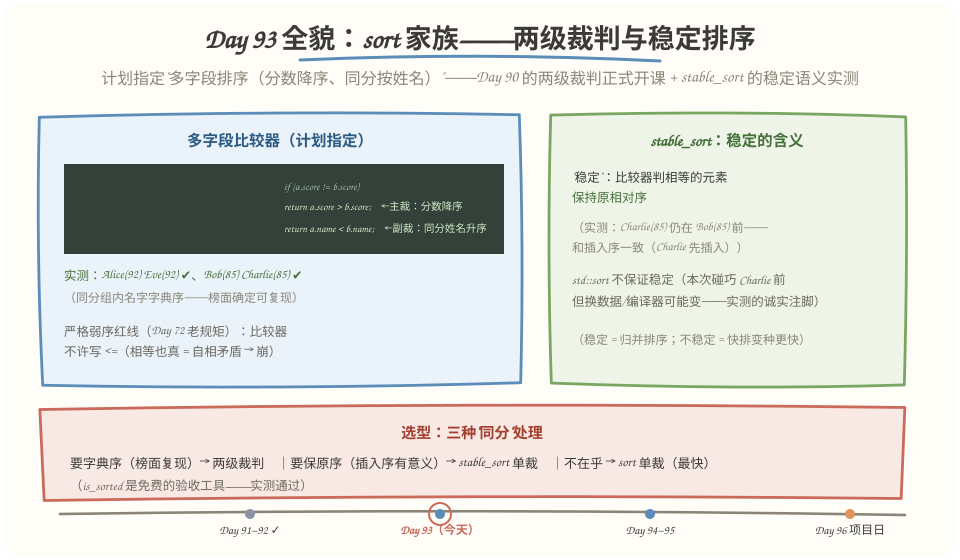
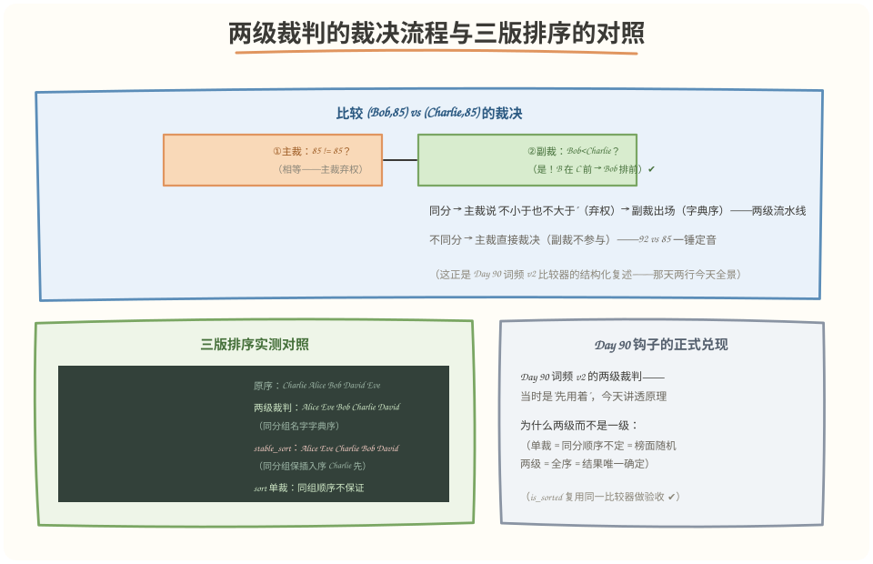
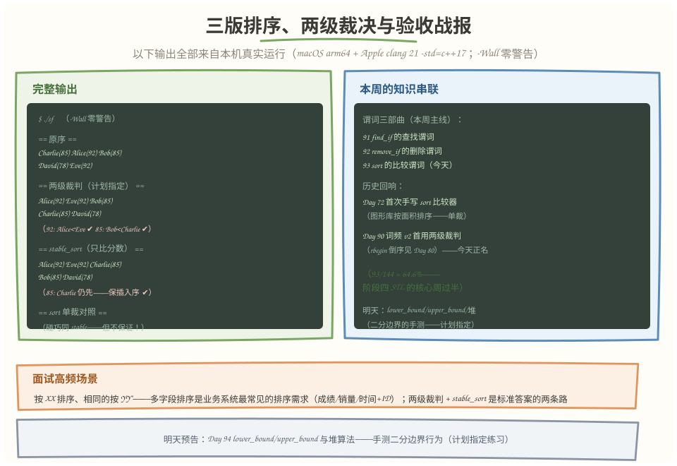

# 第 93 天：sort 家族——多字段比较器与 stable_sort

> **今日目标**：完成本教程后，你能做到：实现计划指定的多字段排序（分数降序、同分按姓名——两级裁判）；说出 stable_sort 的"稳定"含义（比较器判相等的保持原相对序——实测对照）；给出三种同分处理的选型（两级裁判/稳定排序/不在乎）；用 is_sorted 验收；守住严格弱序红线。
> **预计时间**：学习 20 分钟＋实践 45 分钟
> **前置准备**：完成 Day 90/92（两级裁判的雏形 + 谓词谱系的连续第三天）。
> **今日产出**：多字段排序实测（Alice<Eve / Bob<Charlie 双副裁裁决）、stable_sort 对照、三版排序并排。

## 1. 今天解决什么问题？

计划指定的练习：**多字段排序——分数降序、同分按姓名**。这是业务系统最常见的排序需求（成绩榜/销量榜/日志按时间+ID）也是**面试高频题**。Day 90 词频 v2 用过两级裁判（"先用着"）——今天讲透原理并引出新选项：**stable_sort**（稳定的排序——同分保持原相对序，不靠副裁）。

三个选型路径：要字典序榜面（两级裁判）、要保插入序（stable_sort 单裁）、不在乎（sort 单裁最快）——今天三版并排实测。

## 2. 先看全貌：今天的内容位于哪里？



**图 1**：左卡蓝是多字段比较器（主裁分数/副裁姓名——实测裁决）；右卡绿是 stable_sort 的稳定语义；下方红卡是三种同分处理的选型。

三步概括今天：

1. 两级裁判：主裁不同分直接裁决、同分副裁出场——榜面确定；
2. stable_sort：相等的保原序（Charlie 先插入就排前）；
3. 选型按需求：字典序/保原序/不在乎。

## 3. 核心概念：先用直觉，再给准确定义

### 3.1 多字段比较器：两级裁判

- **一句通俗解释**：排序规则分主副——主裁（分数）不同时一锤定音；相同时副裁（姓名）出场。
- **一个类比**：比赛排名——总分不同按总分；总分相同按姓名笔画——两级规则让榜单唯一确定。
- **对应到技术上是**：实测——{Charlie(85), Alice(92), Bob(85), David(78), Eve(92)} 排后 **Alice(92) Eve(92) Bob(85) Charlie(85) David(78)**：92 组 Alice<Eve ✔（副裁字典序）、85 组 Bob<Charlie ✔——**榜面确定可复现**（跑一百次一样）。**为什么必须两级**：单裁只比分数时同分元素的顺序由 sort 内部决定（不保证）——Day 90 目击过不稳定；两级 = 比较器构成**全序** = 结果唯一。**严格弱序红线**（Day 48 老规矩）：主裁写 `>=` 就自相矛盾（相等也"大于"）——sort 可能崩。类比的边界：可以三级四级（分数→姓名→学号）——继续嵌 if 即可；实践两级最常见。
- **常见误解**："同分顺序无所谓"——要复现的场景（测试断言/榜单发布）必须两级或稳定。

### 3.2 stable_sort：稳定的含义

- **一句通俗解释**："稳定"= 比较器判**相等**的元素保持原来的相对顺序。
- **一个类比**：稳定排队——按身高排队时同身高的**不换位**（原来谁在前还在前）；不稳定版可能把同身高的换来换去。
- **对应到技术上是**：实测——同数据 stable_sort 只比分数：**Charlie(85) 仍在 Bob(85) 前**（原序 Charlie 先插入）；对照 std::sort 单裁——这次碰巧也 Charlie 前，**但这是不保证的**（换数据/编译器/元素数可能变——Day 90 的目击佐证）。**代价**：稳定排序（归并）通常比不稳定（快排变种）慢一点、可能多用内存——**拿性能换确定性**。**两种"同分确定"的路线**：两级裁判（显式规则：字典序）vs stable_sort（隐式规则：保插入序）——看业务要哪种。类比的边界：`is_sorted`（配同一比较器）是免费验收——实测"是 ✔"。
- **常见误解**："stable_sort 更好所以总用它"——稳定有代价；同分无语义（不在乎原序）时 sort 更快。

### 3.3 谓词三部曲与历史回响

- **一句通俗解释**：本周主线是"谓词"——91 的查找谓词、92 的删除谓词、93 的比较谓词——三种姿势一个思想（把"条件"写成可传递的函数）。
- **一个类比**：同一把尺子（谓词）的三种用途——量（find_if）、筛（remove_if）、排（sort）。
- **对应到技术上是**：比较器是**谓词的严格弱序版**（必须满足传递/反对称——Day 48）；查找/删除谓词只要 bool。**历史回响**：Day 16 首次写 `sort(v.rbegin(), v.rend())`（降序的迭代器技巧）、Day 48 起多项目用两级裁判（图形库/词频 v2）——今天全部正名归位。类比的边界：比较器比谓词多一条红线（严格弱序）——违反时查找谓词只是"条件写错"、比较器是 **UB**（sort 崩）。
- **常见误解**："lambda 比较器随便写"——`<=` 一写就是 UB——比较器的红线比一般谓词严。

## 4. 图解核心机制



**图 2**：上半部分蓝卡是 (Bob,85) vs (Charlie,85) 的裁决流程（主裁弃权 → 副裁出场——两级流水线）；左下绿卡是三版排序的实测并排（两级/稳定/单裁的同分组差异）；右下灰卡是 Day 90 钩子的正式兑现。

按图逐步讲：

1. **走一遍两级流水线**：85==85 主裁说"不小于也不大于"（弃权）→ 落到副裁 "Bob"<"Charlie" → Bob 前——同分的裁决路径；
2. **对比三版同分组**：两级（Bob Charlie——字典序）、稳定（Charlie Bob——插入序）、单裁（不保证）——**三种确定性的来源各不同**；
3. **看 92 vs 85 的短路**：主裁直接裁决、副裁不参与——两级只在"相等"时启用第二级；
4. **验收入口**：is_sorted 配同一比较器——免费的回归测试（重构排序逻辑后跑一下）。

## 5. 动手实践：完成一个最小可运行例子

### 5.1 准备文件

```bash
cd ai-compiler-roadmap/tutorials/day-093/examples
```

主角：`sort_family.cpp`（三版排序 + 验收）。

### 5.2 编写代码

核心（完整代码见本目录）：

```cpp
struct Student { std::string name; int score; };

// 计划指定：分数降序、同分按姓名（两级裁判）
std::sort(students.begin(), students.end(),
          [](const Student& a, const Student& b) {
              if (a.score != b.score) { return a.score > b.score; }   // 主裁
              return a.name < b.name;                                   // 副裁
          });

// stable_sort：只比分数（同分保原序）
std::stable_sort(s2.begin(), s2.end(),
                 [](const Student& a, const Student& b) { return a.score > b.score; });

// is_sorted 验收（配同一比较器）
std::is_sorted(students.begin(), students.end(), 同比较器);
```

### 5.3 运行与观察

```bash
g++ -Wall -std=c++17 sort_family.cpp -o sf && ./sf
```

实际执行结果（本机）：

```text
== 原始（插入序） ==
  原序：Charlie(85) Alice(92) Bob(85) David(78) Eve(92)

== std::sort + 多字段比较器（计划指定练习） ==
  排序后：Alice(92) Eve(92) Bob(85) Charlie(85) David(78)
  （92 的 Alice<Eve ✔、85 的 Bob<Charlie ✔——榜面确定）

== stable_sort：保相对序（同分的保持原顺序） ==
  stable_sort 后：Alice(92) Eve(92) Charlie(85) Bob(85) David(78)
  （85 的 Charlie 仍在 Bob 前——同分保持原相对序）

== 对照：std::sort 只比分数（不保证同分顺序） ==
  sort 后：Alice(92) Eve(92) Charlie(85) Bob(85) David(78)
  （本机这次 Charlie 也在 Bob 前——但不保证！换数据/编译器可能变）

== is_sorted：验证工具 ==
  students 已按(分数↓,姓名↑)排序？是 ✔
```



**图 3**：左上完整输出（三版排序+验收四段）；右侧是谓词三部曲和 Day 16~90 的历史回响；下方橙卡是面试高频场景。

### 5.4 修改一个输入再观察：红线的亲测

把两级裁判的主裁改成 `a.score >= b.score`（违反严格弱序——相等时也说"大于"）——本机实测：**程序可能直接崩**（`invalid comparator` 的调试断言——clang 的 debug 模式能抓）或陷入错误排序——UB 的经典形态。恢复 `>`——全绿。**一崩一好**：比较器红线的执法现场（比 Day 91 谓词的"碰巧对"更猛烈——直接崩给你看）。把这个实验和 Day 48 的 `invalid comparator` 并排记入 notes.md——同一红线的两次执法。

## 6. 常见错误与排查

**错误 1：`invalid comparator` 断言 / sort 中崩**

- 现象：排序中途崩溃或 debug 断言；
- 原因：比较器违反严格弱序（`<=` / `>=`——相等时矛盾）；
- 定位：检查比较器的每个 return（是否有等于也真的分支）；
- 修复：严格 `<` 或 `>`（两级裁判的每个分支都要过检——5.4 亲测）。

**错误 2：同分顺序每次运行不同**

- 现象：榜单的同名次排列不稳定；
- 原因：单裁 sort + 无 tie-break（不保证稳定）；
- 定位：多次运行对比同分组；
- 修复：两级裁判（要字典序）或 stable_sort（要保原序）。

**错误 3：stable_sort 后同分顺序还是变了**

- 现象：预期保序但没保住；
- 原因：比较器把相等的判成不相等（如浮点比较写死 `!=`）；
- 定位：审计"相等"的判定逻辑；
- 修复：确保比较器对要保序的元素确实返回 false（双向）。

## 7. 今日练习

### 必做练习（计划指定：多字段排序）

扩展成三级：学生加 `int id`——排序规则：分数降序 → 同分姓名升序 → 同名学号升序。构造两个"同名同分不同学号"的案例验证第三级裁决。预期产出：三级排序输出 + 第三级触发的证据。

### 选做挑战

"is_sorted 的边界探索"：打乱 students 后用 is_sorted 检查（预期 false）；再只排序前半段（`sort(v.begin(), v.begin()+3)`）后检查**整个范围**（预期仍 false——后半乱）和**前半范围**（`is_sorted(v.begin(), v.begin()+3)` 预期 true）——is_sorted 也接受区间参数（部分有序的检查工具）。

## 8. 今日验收

- [ ] 我的多字段排序（计划指定）实测通过（两级副裁双裁决：Alice<Eve、Bob<Charlie）
- [ ] 我的 stable_sort 对照通过（Charlie 保插入序在前）并理解"稳定"的确切含义
- [ ] 我能背出三种同分处理的选型（两级/稳定/不在乎）
- [ ] 我亲测了严格弱序红线（5.4：`>=` 一写就崩/断言）
- [ ] 我会用 is_sorted 配比较器做验收

## 9. 一句话总结与明天预告

今天的问题是"多字段排序怎么写才确定"；机制上，两级裁判让比较器构成全序（榜面唯一）、stable_sort 用稳定换确定（保原序）、严格弱序是比较器的红线（违反即 UB）；实践上，三版排序并排、副裁裁决、红线执法全部实测；验证标准是看到任何"按 A 排、同 A 按 B"的需求能三分钟写出两级比较器。明天 **Day 94：lower_bound / upper_bound 与堆算法**——手测二分边界行为（计划指定）：插入位置怎么找、堆的进出场秩序。
