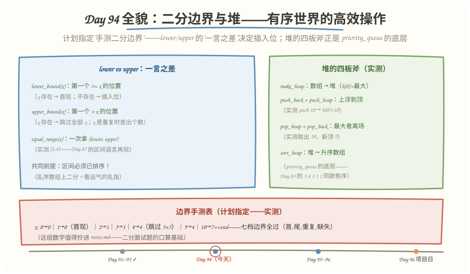
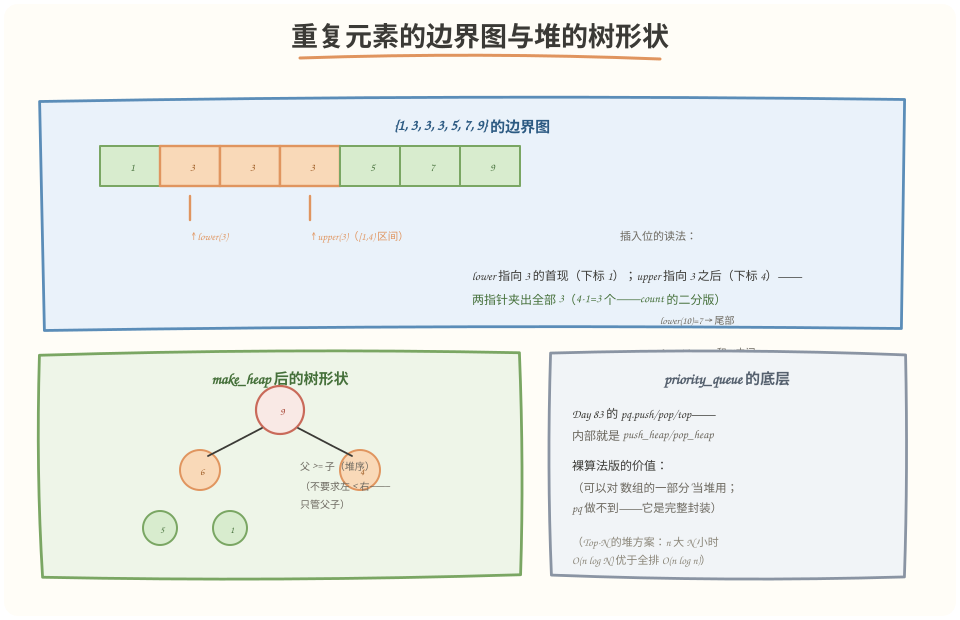
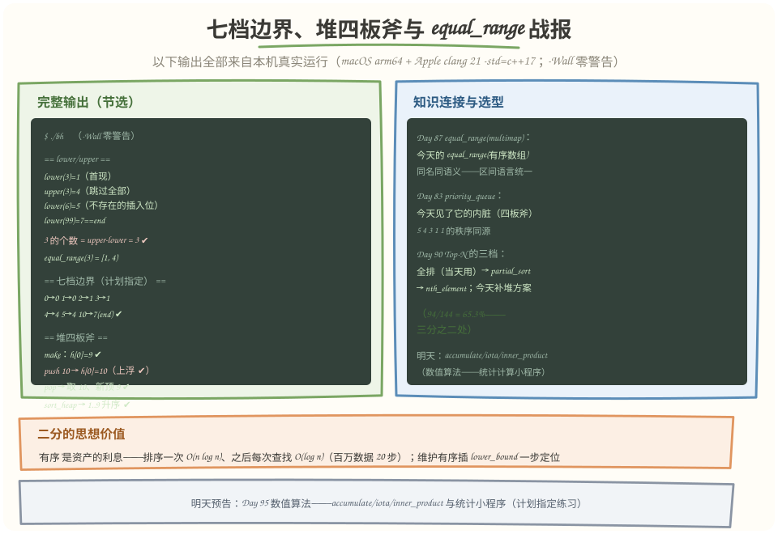

# 第 94 天：lower_bound / upper_bound 与堆算法

> **今日目标**：完成本教程后，你能做到：说出 lower（第一个 >=x）与 upper（第一个 >x）的一言之差并各配实测；手算七档插入边界（计划指定——首/尾/重复/缺失全覆盖）；用 upper-lower 数出重复元素个数、equal_range 一次拿区间；演示堆四板斧（make/push/pop/sort）并指出 priority_queue 的底层就是它。
> **预计时间**：学习 20 分钟＋实践 45 分钟
> **前置准备**：完成 Day 87/83/90（equal_range 的区间语言、pq 的秩序、Top-N 的三档）。
> **今日产出**：七档边界手测、堆四板斧实测、equal_range 与 count 的二分版。

## 1. 今天解决什么问题？

两个"有序世界的高效操作"今天同台：**二分边界**（lower_bound/upper_bound——在有序数组上 O(log n) 定位插入点/重复区间）和**堆算法**（make/push/pop/sort_heap——priority_queue 的裸版）。计划指定的"手测二分边界"是重点：lower 和 upper 的**一言之差**（>= vs >）决定了"3 的首现"还是"3 之后"——七档边界（首/尾/重复/缺失）今天全部实测。

堆四板斧揭开 Day 83 priority_queue 的内脏：5 4 3 1 1 的出队秩序原来一直是它在干活。

## 2. 先看全貌：今天的内容位于哪里？



**图 1**：左卡蓝是 lower/upper 的一言之差；右卡绿是堆四板斧；下方红卡是七档边界手测表（计划指定）。

三步概括今天：

1. lower(>=x) 首现/插入位、upper(>x) 跳过全部 x——差 = 个数；
2. 堆：make（h[0]=最大）、push 上浮、pop 离场、sort 转有序；
3. 前提：二分要有序、堆只管父子序。

## 3. 核心概念：先用直觉，再给准确定义

### 3.1 lower vs upper：一言之差

- **一句通俗解释**：lower_bound 找"第一个不小于 x 的"（x 存在则首现）；upper_bound 找"第一个大于 x 的"（跳过全部 x）。
- **一个类比**：排队插位——"站在第一个不低于你的人前面"（lower）vs "站在所有和你一样高的人后面"（upper）——同一队人两种站法。
- **对应到技术上是**：实测——{1,3,3,3,5,7,9}：lower(3)=**1**（首现）、upper(3)=**4**（跳过三个 3）、差=3 个 ✔；lower(6)=5（6 不存在——第一个 >6 的位置即插入位）、lower(99)=7==end（都小插尾）。**equal_range** 一次拿两个（[1, 4)——Day 87 multimap 同名同语义，区间语言统一）。**前提红线**：区间必须已排序——乱序上二分 = 看运气。类比的边界：两者都返回迭代器（位置不是值）；下标要减 begin（随机访问的特权）。
- **常见误解**："lower_bound 是查找"——是**定位**（找到返回位置、没找到返回插入位——永远不返回"没找到"）；判存在用 `lower+解引用核对` 或 count。

### 3.2 堆算法：priority_queue 的内脏

- **一句通俗解释**：堆是"父 >= 子"的完全二叉树（数组存储）——堆顶永远最大；四板斧管它的建/进/出/散。
- **一个类比**：公司的晋升链——CEO 在顶（堆顶最大）；新人从底层干起、能力超群一路上报（push 上浮）；CEO 离职由最强副手顶上（pop）。
- **对应到技术上是**：实测——make_heap 后 h[0]=**9**（最大者就位）；push_back(10)+push_heap → h[0]=**10**（新王上浮）；pop_heap+pop_back → 取出 10、新顶 9（最大者离场）；sort_heap → **1 1 2 3 4 5 6 9**（升序——堆排的完成态）。**与 Day 83 的连接**：pq.push/pop/top 的内部正是这四板斧——**5 4 3 1 1** 的秩序同源。类比的边界：堆只保证**父子序**不保证左右序（中间元素无序——所以只能用 h[0] 不能随机取第 k 大）；裸算法版能对**数组的一部分**当堆用（pq 做不到——完整封装）。
- **常见误解**："make_heap 后数组有序"——只有堆序（父>=子）——h[0] 是最大但 h[1] 和 h[2] 无大小关系；要有序还得 sort_heap。

### 3.3 Top-N 的堆方案（Day 90 钩子兑现）

- **一句通俗解释**：n 大 N 小的 Top-N 用小顶堆维护"当前前 N"——新元素比堆顶大才进——O(n log N) 优于全排 O(n log n)。
- **一个类比**：选秀前五——不用全员排名（全排），只维护"目前五强"（堆）——新人挑战最弱守门员，赢则换。
- **对应到技术上是**：Day 90 的三档（全排 → partial_sort → 堆方案）今天补上第三档的原理：`priority_queue<int, vector<int>, greater<>>`（小顶堆）存前 N、遍历替换——n 百万 N 为 5 时 log N≈2.3 vs log n≈20——百倍差距。类比的边界：N 接近 n 时堆优势消失（都退化为全排）；堆方案代码更长——n 不大时全排最简。
- **常见误解**："堆排序（sort_heap）是最快的排序"——它 O(n log n) 但常数通常比 std::sort 大；堆的价值在**增量维护最大值**（Top-N/优先调度）不在一次性排序。

## 4. 图解核心机制



**图 2**：上半部分蓝卡是 {1,3,3,3,5,7,9} 的边界图（lower(3) 和 upper(3) 两支箭头夹出 3×3 的区间）；左下绿卡是 make_heap 后的树形状（父>=子、左右无序）；右下灰卡是 priority_queue 底层和 Top-N 的堆方案。

按图逐步讲：

1. **对着格子数区间**：[1,4) 夹住三个 3——upper-lower=3 就是 count 的二分版（有序数组的计数免遍历）；
2. **看插入位的读法**：lower(4)=4 → 插在 3 和 5 之间；lower(10)=7=end → 插尾——七档边界的口算基础；
3. **看堆树的高度**：父>=子一路向下（9>6>5 等）但兄弟无序（6 和 4 谁左谁右无所谓）——堆序的准确含义；
4. **连回 Top-N 三档**：全排（简单）/partial_sort（下周可用）/堆（n 大 N 小最优）——按规模选。

## 5. 动手实践：完成一个最小可运行例子

### 5.1 准备文件

```bash
cd ai-compiler-roadmap/tutorials/day-094/examples
```

主角：`binary_heap.cpp`（二分边界 + 堆四板斧）。

### 5.2 编写代码

核心（完整代码见本目录）：

```cpp
std::vector<int> v = {1, 3, 3, 3, 5, 7, 9};              // 有序（含重复）

auto lo = std::lower_bound(v.begin(), v.end(), 3);        // 第一个 >= 3
auto up = std::upper_bound(v.begin(), v.end(), 3);        // 第一个 > 3
std::cout << (up - lo);                                    // 3 的个数

auto [l, u] = std::equal_range(v.begin(), v.end(), 3);     // 一次拿两个

std::make_heap(h.begin(), h.end());                        // h[0] = 最大
h.push_back(10); std::push_heap(h.begin(), h.end());       // 上浮
std::pop_heap(h.begin(), h.end());                         // 顶沉底
int top = h.back(); h.pop_back();                           // 取出
std::sort_heap(h.begin(), h.end());                        // 堆 → 升序
```

### 5.3 运行与观察

```bash
g++ -Wall -std=c++17 binary_heap.cpp -o bh && ./bh
```

实际执行结果（本机，节选）：

```text
== lower_bound：第一个 >= x 的位置 ==
  lower_bound(3) → 下标 1（第一个 >= 3 的——3 的首现）
  lower_bound(6) → 下标 5（6 不存在——第一个 > 6 的位置）
  lower_bound(99) → 下标 7 == end()（都小——插尾部）

== upper_bound：第一个 > x 的位置 ==
  upper_bound(3) → 下标 4（3 的最后一个之后——跳过全部 3）

== 二者的差 = x 的个数 ==
  3 的个数 = upper - lower = 3
  equal_range(3) = [1, 4)（一次调用拿两个——Day 87 的区间语言）

== 插入位置的边界手测（计划指定） ==
  lower_bound(0) → 下标 0
  lower_bound(1) → 下标 0
  lower_bound(2) → 下标 1
  lower_bound(3) → 下标 1
  lower_bound(4) → 下标 4
  lower_bound(5) → 下标 4
  lower_bound(10) → 下标 7（end——插尾）

== 堆算法：make/push/pop/sort ==
  make_heap 后 h[0] = 9（堆顶=最大 ✔）
  push 10 后 h[0] = 10（新最大上浮到顶）
  pop_heap → 取出 10（最大者离场；新堆顶 = 9）
  sort_heap 后（升序）：1 1 2 3 4 5 6 9
```



**图 3**：左上完整输出（二分/七档/堆三段）；右侧是知识连接（equal_range 同名/pq 内脏/Top-N 三档）和三分之二宣言；下方橙卡是二分的思想价值。

### 5.4 修改一个输入再观察：无序数组上二分的翻车

把 v 改成无序（`{9, 3, 1, 3, 5, 3, 7}`）后跑 lower_bound(3)——本机实测返回的下标**不再指向首现**（二分在错误前提下的"自信错误"——可能找到某个 3 但不是第一个，也可能完全跳过）。**一序一乱**：二分的红线（有序前提）从规则变目击。恢复有序版——边界表复现。把这个实验记进 notes.md：**二分 bug 的第一嫌疑人永远是"数据真的有序吗"**。

## 6. 常见错误与排查

**错误 1：无序数组上用 lower_bound——结果错但不报错**

- 现象：返回的位置不是首现/插入位；
- 原因：二分的前提（有序）被违反；
- 定位：打印数组确认序（或 is_sorted 检查）；
- 修复：先 sort 再二分；或数据源保证有序（如 set 转 vector）。

**错误 2：忘了 push_heap / pop_heap 的配套**

- 现象：push_back 后 h[0] 不再是最大；
- 原因：堆的维护是手动的（四板斧要配套：push_back+push_heap、pop_heap+pop_back）；
- 定位：对比操作后的 h[0]；
- 修复：成对调用；或直接用 priority_queue（自动维护——今天的选型）。

**错误 3：sort_heap 用在非堆的数组上**

- 现象：结果不是升序（UB）；
- 原因：sort_heap 的前提是"已经是堆"；
- 定位：检查是否 make_heap 过；
- 修复：先 make_heap 再 sort_heap；或直接用 std::sort（无堆前提）。

## 7. 今日练习

### 必做练习（计划指定：手测二分边界）

换一组数据 {2, 2, 2, 2, 2}（全相同）+ {1, 2, 4, 8}（无重复）各跑七档边界——预测先于实测，把两组数字表并进 notes.md。预期产出：两张边界表 + 预测对错标注。

### 选做挑战

"手写二分对照"：自己写 while 循环的 lower_bound（lo/hi 夹逼）对比 std 版结果一致——体会"off-by-one"的经典坑（`lo <= hi` 还是 `lo < hi`、`hi = mid` 还是 `hi = mid-1`）。这是面试手写二分的练习——标准库版是答案。

## 8. 今日验收

- [ ] 我能背出 lower（>=x 首现/插入位）和 upper（>x 跳过全部）的一言之差
- [ ] 我的七档边界手测全过（计划指定——0→0 到 10→end）
- [ ] 我用 upper-lower 数出 3 个 3、equal_range 拿到 [1,4)
- [ ] 我的堆四板斧实测通过（make 9/push 10/pop 取 10/sort 升序）
- [ ] 我实测了无序数组上二分的"自信错误"（5.4）

## 9. 一句话总结与明天预告

今天的问题是"有序数组怎么高效定位、堆怎么维护最大"；机制上，lower/upper 一言之差定边界（差=个数、equal_range 统一区间语言）、堆四板斧是 pq 的内脏（父子序非全序）；实践上，七档边界、堆四板斧、无序翻车全部实测；验证标准是看到任何有序数组能口算 lower/upper 的位置。明天 **Day 95：数值算法**——accumulate / iota / inner_product 与统计计算小程序（计划指定练习）：算法周的收官前站。
