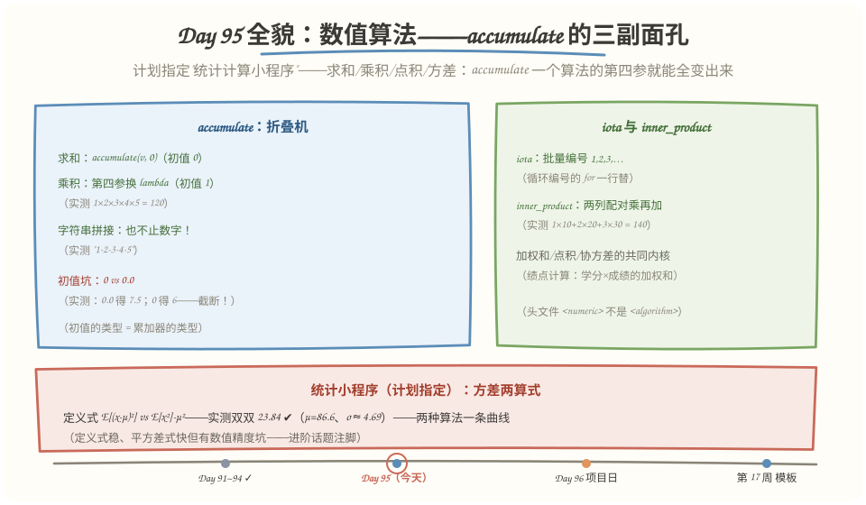
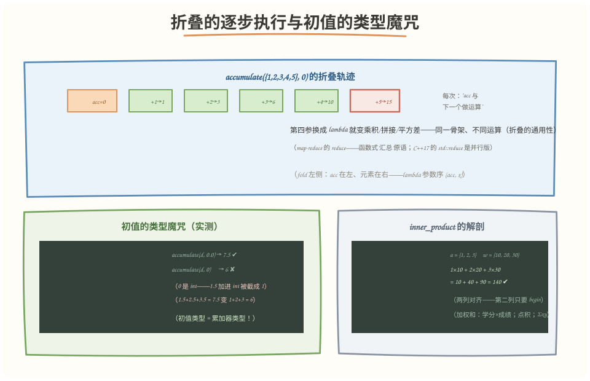
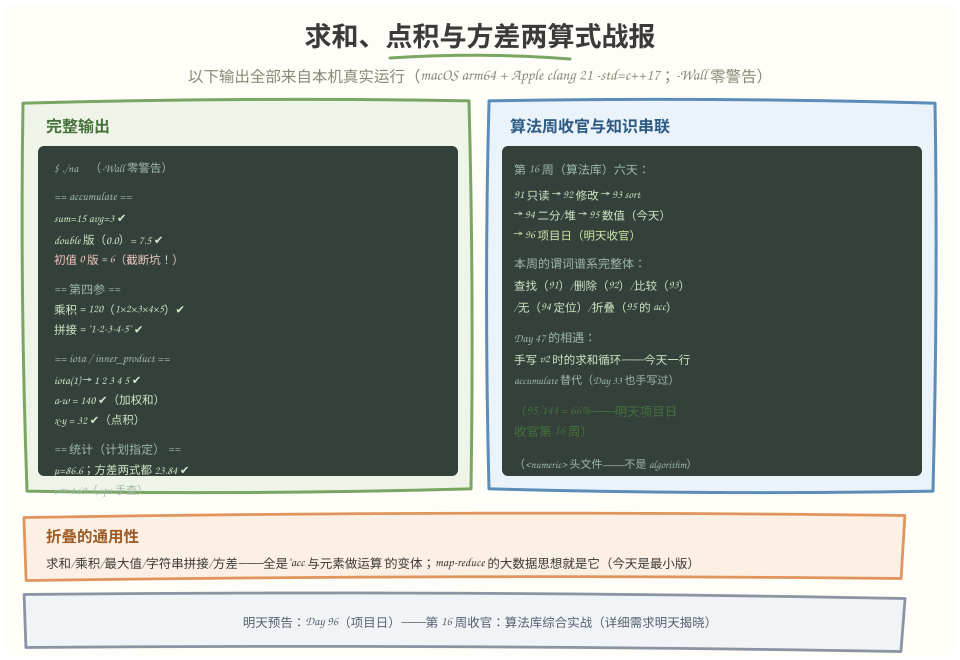

# 第 95 天：数值算法——accumulate / iota / inner_product

> **今日目标**：完成本教程后，你能做到：用 accumulate 求和/乘积/拼接（第四参换运算——折叠的通用性）；避开初值类型坑（0 vs 0.0——实测截断）；用 iota 批量编号、inner_product 算加权和/点积；完成计划指定的统计小程序（方差两算式对照一致）。
> **预计时间**：学习 20 分钟＋实践 40 分钟
> **前置准备**：完成 Day 91~94（谓词谱系的最后一环：折叠运算的 acc）。
> **今日产出**：accumulate 三副面孔（和/积/串）、初值坑实证、方差两算式（双双 23.84）。

## 1. 今天解决什么问题？

算法周的收官前站：**数值算法**（`<numeric>` 头文件——不是 algorithm！）。三个工具一个思想：**折叠**（fold——"acc 与元素做运算"的迭代）。accumulate 是主力（求和/乘积/最大值/字符串拼接全靠第四参变换）；iota 批量编号（循环编号一行替）；inner_product 两列配对（加权和/点积/Σxy 的共同内核）。

计划指定的**统计计算小程序**用方差两算式收尾：定义式 E[(x-μ)²] 和平方差式 E[x²]−μ²——两条路一个答案（实测双双 23.84）。

## 2. 先看全貌：今天的内容位于哪里？



**图 1**：左卡蓝是 accumulate 的三副面孔（和/积/串+初值坑）；右卡绿是 iota 与 inner_product；下方红卡是统计小程序。

三步概括今天：

1. accumulate(v, 初值[, 运算])——折叠机（初值类型=累加器类型！）；
2. iota 批量编号、inner_product 两列配对乘加；
3. 方差两算式对照（定义式/平方差式）。

## 3. 核心概念：先用直觉，再给准确定义

### 3.1 accumulate：折叠机

- **一句通俗解释**：把一列东西"叠"进一个累加器——每次"acc 和下一个做运算"（默认加、可换）。
- **一个类比**：滚雪球——从初值那颗核开始，每滚过一个元素就"沾"上它（默认沾=加；换规则可以变成乘或拼接）。
- **对应到技术上是**：实测——求和 `accumulate(v, 0)`=15；乘积（初值 1 + lambda `acc*x`）=**120**；字符串拼接（初值 `to_string(v[0])` + lambda）=**"1-2-3-4-5"**（不止数字！）。**折叠轨迹**（图 2）：0 →+1→ 1 →+2→ 3 →+3→ 6 →+4→ 10 →+5→ **15**——五步的 acc 变化链。**lambda 参数序**：`(acc, x)`——acc 在左（左折叠）。类比的边界：accumulate 是**顺序**折叠（不许重排——带状态的运算安全）；C++17 的 `std::reduce` 是并行版（可重排——运算要满足结合律才能用）。
- **常见误解**："accumulate 只能加"——第四参换 lambda 什么都能叠（乘积/最大值/拼接/平方差今天全演示）。

### 3.2 初值类型坑：0 vs 0.0

- **一句通俗解释**：初值的类型决定累加器的类型——`0`（int）叠 double 会把每步结果截断成 int。
- **一个类比**：量杯——拿整数刻度的杯子装 1.5 升（每倒一次都按整刻度截读）——三次下来 7.5 变 6。
- **对应到技术上是**：实测——`accumulate(d, 0.0)`=**7.5** ✔；`accumulate(d, 0)`=**6** ✘（1.5+2.5+3.5 的每步结果被截断：1.5 沾到 int acc 变 1，1+2.5=3.5 又截 3……）。**机制**：模板推导从初值定 acc 类型——`0` 推出 `int`——之后每步 `acc + double` 的结果转回 int 存。**防御姿势**：double 数据配 `0.0`（今天的代码注释里写着）；或显式模板参 `accumulate<double>(...)`。类比的边界：int 数据配 0.0 也会升 double（结果对但类型变——通常无害）。
- **常见误解**："初值就是个起点数"——它还是**类型锚点**；类型错了整条折叠链全歪（今天的 6 vs 7.5）。

### 3.3 iota 与 inner_product

- **一句通俗解释**：iota 给容器填连续编号（1,2,3,…）；inner_product 两列对齐"配对乘再总加"。
- **一个类比**：iota 是发号码牌（一排人从 1 开始发）；inner_product 是舞伴配对计分——每对分数相乘、所有对相加。
- **对应到技术上是**：实测——`iota(idx, 1)` 填出 1 2 3 4 5（编号循环一行替）；`inner_product(a, w, 0)` = 1×10+2×20+3×30 = **140**（加权求和——**绩点计算**的原理：学分×成绩）；点积 x·y=32。**方差的平方差式**正是 inner_product 的应用：`E[x²]−μ²` 的 E[x²] 就是 `inner_product(scores, scores, 0.0)/n`——实测两式都 **23.84** ✔。类比的边界：inner_product 的第二列只给 begin（不检查长度——两列不等长是 UB，保证对齐是调用者责任）。
- **常见误解**："inner_product 是内积专属"——它是"配对乘加"的通用骨架（加权和/协方差/最小二乘的 Σxy 全是它）。

## 4. 图解核心机制



**图 2**：上半部分蓝卡是 {1,2,3,4,5} 的折叠轨迹（acc 的五步变化链）；左下绿卡是初值类型魔咒（0.0→7.5 vs 0→6 的实测对照）；右下灰卡是 inner_product 的解剖（两列对齐乘加）。

按图逐步讲：

1. **沿轨迹数 acc**：0→1→3→6→10→15——每步"acc 与下一个"的运算结果就是新 acc——折叠的机械本质；
2. **看两版初值的分岔**：0.0 的链条保住小数（7.5）、0 的链条每步截断（6）——类型魔咒的几何呈现；
3. **看两列的对齐**：a 和 w 逐位配对（1,10）（2,20）（3,30）——乘完总加——加权和的骨架；
4. **连回方差两算式**：定义式用 accumulate+lambda（减均值平方）、平方差式用 inner_product（自乘）——两个算法一个统计量。

## 5. 动手实践：完成一个最小可运行例子

### 5.1 准备文件

```bash
cd ai-compiler-roadmap/tutorials/day-095/examples
```

主角：`numeric_algos.cpp`（三算法 + 统计小程序）。

### 5.2 编写代码

核心（完整代码见本目录）：

```cpp
#include <numeric>                                            // 注意：不是 algorithm！

int sum = std::accumulate(v.begin(), v.end(), 0);             // 求和
int product = std::accumulate(v.begin(), v.end(), 1,          // 乘积（初值 1）
                              [](int acc, int x) { return acc * x; });
double dsum = std::accumulate(d.begin(), d.end(), 0.0);       // 0.0！不是 0

std::iota(idx.begin(), idx.end(), 1);                         // 批量编号
int dot = std::inner_product(a.begin(), a.end(), w.begin(), 0);   // 配对乘加

// 方差两算式（统计小程序）
double mean = accumulate(scores, 0.0) / n;
double var1 = accumulate(scores, 0.0, [mean](acc, s) { auto d = s - mean; return acc + d*d; }) / n;
double var2 = inner_product(scores, scores, 0.0) / n - mean * mean;
```

### 5.3 运行与观察

```bash
g++ -Wall -std=c++17 numeric_algos.cpp -o na && ./na
```

实际执行结果（本机）：

```text
== accumulate：求和（自定义初值防坑） ==
  sum = 15
  avg = 3
  double 求和 = 7.5（初值 0.0——写 0 会截断成 int！）
  初值写 0 的版本 = 6（1.5+2.5 被截成 1+2 —— 坑！）

== accumulate 的第四参：自定义运算 ==
  阶乘风格乘积 = 120
  字符串拼接 = 1-2-3-4-5（accumulate 不止数字！）

== iota：批量编号 ==
  iota(1)：1 2 3 4 5

== inner_product：点积 ==
  a·w = 140（1×10+2×20+3×30——加权求和的原理）
  x·y = 32（向量点积）

== 统计小程序（计划指定）：方差的两算式 ==
  均值 = 86.6
  方差（定义式）= 23.84
  方差（E[x²]-mean²）= 23.84（两式一致 ✔）
  标准差 ≈ 4.69（sqrt 手查——近似值）
```



**图 3**：左上完整输出（求和/第四参/两列/统计四段）；右侧是算法周收官串联和 Day 33/47 手写求和的回响；下方橙卡是折叠的通用性。

### 5.4 修改一个输入再观察：拼接初值的选择题

字符串拼接那行把初值从 `std::to_string(v[0])` + `v.begin()+1` 改成空串 `""` + `v.begin()`——输出变成 `"-1-2-3-4-5"`（开头多个连字符——空初值也要走一次"acc-x"运算）。**两种修法**：初值用首元素（今天的写法——从第二元素开始叠）或 lambda 里判 acc 空。**一对错**：折叠的初值和运算要配套设计——这也是 Day 48"严格弱序"式的契约思维（初值是折叠的"第零个元素"）。

## 6. 常见错误与排查

**错误 1：double 求和结果偏小（截断）**

- 现象：7.5 变 6 这类整数化；
- 原因：初值写 0（int）——累加器被推导成 int；
- 定位：对照 0.0 版的结果（今天的实测法）；
- 修复：初值 0.0（或显式模板参 accumulate<double>）。

**错误 2：`error: no member named 'accumulate'`**

- 现象：编译报没有这个函数；
- 原因：忘了 `#include <numeric>`（accumulate 不在 algorithm 里）；
- 定位：报错指向 accumulate 行；
- 修复：加 `<numeric>`。

**错误 3：inner_product 两列长度不齐——结果错/UB**

- 现象：算出的加权和不对或偶发崩；
- 原因：第二列比第一列短（越界读）；
- 定位：打印两列 size；
- 修复：保证第二列 >= 第一列长度（调用者责任——文档写明）。

## 7. 今日练习

### 必做练习（计划指定：统计计算小程序）

扩展统计器：输入一组成绩（cin 或硬编码），输出均值/方差/标准差/最高分/最低分（accumulate+minmax_element 组合——minmax_element 是 Day 91 家族的亲戚）。预期产出：五项统计的完整报表。

### 选做挑战

"加权平均分"：两列数据（成绩 {85, 90, 78}、学分 {4, 3, 2}）用 inner_product 算加权和、accumulate 算总学分——相除得加权平均（绩点的原理）。预期：`inner_product/accumulate = 780/9 ≈ 86.67`。

## 8. 今日验收

- [ ] 我的 accumulate 三副面孔通过（15/120/"1-2-3-4-5"）
- [ ] 我实测了初值坑（0.0→7.5 vs 0→6——类型魔咒目击）
- [ ] 我的 iota/inner_product 通过（编号/140/32）
- [ ] 我的方差两算式一致（双双 23.84——计划指定的统计小程序）
- [ ] 我知道这些算法在 &lt;numeric&gt;（不是 algorithm）

## 9. 一句话总结与明天预告

今天的问题是"求和/乘积/点积这些数值杂活怎么标准化"；机制上，accumulate 是折叠机（第四参换运算——初值类型是累加器类型的锚）、iota 管编号、inner_product 管两列配对乘加；实践上，三副面孔、初值坑、方差两算式全部实测；验证标准是看到任何"叠起来算一个数"的需求能选出正确的算法和初值。明天 **Day 96（项目日）：第 16 周收官**——算法库综合实战：本周全部武器（查找/修改/排序/二分/数值）的会师。
