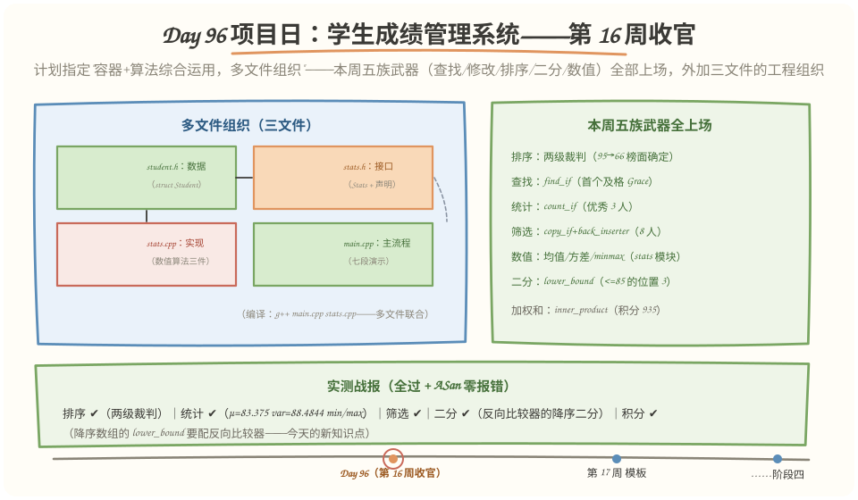
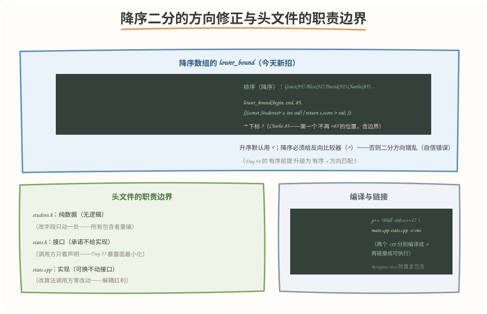
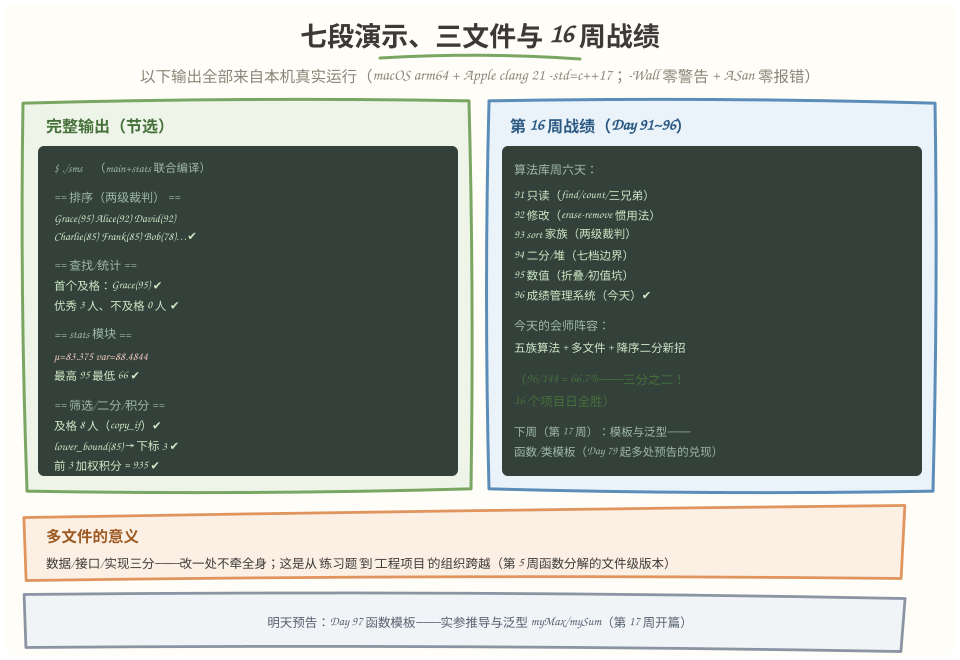

# 第 96 天（项目日）：学生成绩管理系统——容器 + 算法综合运用

> **今日目标**：完成本教程后，你能做到：用多文件组织三文件工程（student.h 数据 / stats.h 接口 / stats.cpp 实现 + main.cpp）；把本周五族算法综合运用（排序两级裁判/find_if/count_if/copy_if/数值/二分）；掌握**降序数组的 lower_bound**（反向比较器——今天的新招）；联合编译验证（g++ main.cpp stats.cpp）。
> **预计时间**：实现 50 分钟＋对照 30 分钟
> **前置准备**：完成 Day 91~95；合上教程——第 16 周的收官答卷。
> **今日产出**：三文件工程（`-Wall` 零警告 + ASan 零报错）、六段算法演示（μ=83.375、积分 935）。

## 1. 今天解决什么问题？

计划指定的收官项目：**学生成绩管理系统——容器 + 算法综合运用，多文件组织**。两个层面的综合：**算法层**（本周五族武器全上场——Day 91 只读/92 修改/93 排序/94 二分堆/95 数值）；**工程层**（多文件组织——student.h 数据、stats.h 接口、stats.cpp 实现的三分职责，第 5 周函数分解的文件级升级）。

今天的新知识点藏在二分里：**降序数组的 lower_bound 要配反向比较器**（`s.score > val`）——Day 94 的"有序前提"升级为"有序 + 方向匹配"。

## 2. 先看全貌：今天的内容位于哪里？



**图 1**：左卡蓝是三文件组织（依赖箭头 + 联合编译）；右卡绿是本周五族武器的上场清单；下方绿卡是战报。路线图：**第 16 周今天收官（96/144 = 66.7%——三分之二！）**。

三步概括今天：

1. 三文件：数据/接口/实现三分——改一处不牵全身；
2. 五族算法会师：排序/查找/统计/筛选/数值/二分六段演示；
3. 降序二分：反向比较器（`>`）——方向匹配。

## 3. 核心概念：先用直觉，再给准确定义

### 3.1 多文件组织：职责三分

- **一句通俗解释**：数据（student.h）、接口（stats.h）、实现（stats.cpp）分三个文件——改实现不动接口、改数据全重编（影响面透明）。
- **一个类比**：餐厅——菜单（stats.h：客人看的承诺）、厨房（stats.cpp：怎么做随时换）、食材清单（student.h：基础数据）——改菜谱不用重印菜单。
- **对应到技术上是**：实测——`g++ -Wall -std=c++17 main.cpp stats.cpp -o sms` 联合编译（两个 .cpp 分别编译再链接）；`#pragma once` 防重复包含。**职责边界**：student.h 纯数据无逻辑；stats.h 只有声明（调用方看承诺——Day 53 暴露面最小化）；stats.cpp 可换实现（改算法调用方零改动——解耦红利）。类比的边界：小项目单文件更快；**多人协作/复用模块**时多文件的价值显现（今天练的是组织能力）。
- **常见误解**："头文件里也能写实现"——能（inline/模板必须），但普通函数写在头文件被多文件包含会**重复定义**链接错——今天的 stats.cpp 分离正是解法。

### 3.2 降序二分：方向匹配

- **一句通俗解释**：lower_bound 默认配升序（`<`）；数组是降序时必须给**反向比较器**（`s.score > val`）——否则二分方向错乱。
- **一个类比**：查字典从前往后翻（升序）；查倒序的榜单（第一名在前）要**从后往前**的翻法——方向反了永远翻不到。
- **对应到技术上是**：实测——降序榜 `Grace(95) Alice(92) David(92) Charlie(85)…` 上 `lower_bound(…, 85, [](s, val){ return s.score > val; })` → 下标 **3**（Charlie——第一个"不再 >85"的位置，**含边界**）。**比较器语义**："元素还在 85 的'前面'吗"——降序里 `>` 85 的都在前段，二分找第一个假的位置。**Day 94 红线升级**：有序还不够——**方向也要匹配**（升序配 `<`、降序配 `>`）。类比的边界：第四参比较器的形参是 `(元素, 值)` 的顺序（和 sort 的 `(元素, 元素)` 不同——写反编译错或结果怪）。
- **常见误解**："lower_bound 只能配升序"——配反向比较器就能二分降序（今天实证）；忘配才是错。

### 3.3 五族会师与选型回顾

- **一句通俗解释**：今天的六段演示正好把本周的"什么时候用什么"过了一遍——排序（榜）/查找（第一个）/统计（几个）/筛选（名单）/数值（报表）/二分（定位）。
- **一个类比**：工具箱年终盘点——每件工具上手一次，顺一遍"什么活用什么家伙"。
- **对应到技术上是**：实测——两级裁判（Grace→Eve 榜面确定）；find_if（首个及格 Grace）；count_if（优秀 3 人/不及格 0）；copy_if+back_inserter（及格 8 人名单）；stats 模块（μ=83.375、var=88.4844、min/max 66/95）；inner_product 加权积分（前 3 名 5/3/2 权重 → **935**）。**选型回顾**：要位置 find/要个数 count/要名单 copy_if/要汇总 accumulate——意图选算法（Day 91 的思维转换毕业考）。类比的边界：真实系统还要加输入校验/持久化（文件）——今天的核心是算法组织，外围从简。
- **常见误解**："综合项目就是堆功能"——综合的意义是**选型判断**（每个需求秒答"用什么"）——今天六段各考一次。

## 4. 图解核心机制



**图 2**：上半部分蓝卡是降序二分的方向修正（反向比较器的代码 + 下标 3 的实测）；左下绿卡是三文件的职责边界（改哪动哪的透明表）；右下灰卡是联合编译的命令。

按图逐步讲：

1. **对着降序榜走二分**：95/92/92 都 `>85`（前段）→ 85 不 `>`（第一个假）→ 下标 3——方向匹配的几何；
2. **读职责边界表**：改字段（student.h 全重编）/改实现（只重编 stats.cpp）/改接口（两处都动）——影响面透明；
3. **看联合编译**：两个 .cpp 独立编译成 .o 再链接——"改 main 不用重编 stats"的增量编译价值；
4. **连 Day 94 的红线**：有序前提 → 有序 + 方向匹配——二分知识的完整版。

## 5. 动手实践：完成一个最小可运行例子

### 5.1 准备文件

```bash
cd ai-compiler-roadmap/tutorials/day-096/examples
```

四个文件：`student.h`（数据）、`stats.h`（接口）、`stats.cpp`（实现）、`main.cpp`（主流程）。

### 5.2 编写代码

核心（完整代码见本目录）：

```cpp
// stats.cpp——数值算法的实现（Day 95 的实战）
Stats compute_stats(const std::vector<Student>& students) {
    Stats s{};
    s.mean = std::accumulate(students.begin(), students.end(), 0.0,
                             [](double acc, const Student& st) { return acc + st.score; }) / n;
    // 方差（定义式）…… minmax_element（最高最低）……
}

// main.cpp——降序二分（今天新招）
auto pos = std::lower_bound(students.begin(), students.end(), 85,
                            [](const Student& s, int val) { return s.score > val; });
// → 下标 3（Charlie——降序配反向比较器）

// 加权积分（前 3 名）
int points = std::inner_product(top3.begin(), top3.end(), weights.begin(), 0);
```

### 5.3 运行与观察

```bash
g++ -Wall -std=c++17 main.cpp stats.cpp -o sms && ./sms
```

实际执行结果（本机，节选）：

```text
  原始：Alice(92) Bob(78) Charlie(85) David(92) Eve(66) Frank(85) Grace(95) Heidi(74)

== 排序（两级裁判：分数降序、同分姓名升序） ==
  排序后：Grace(95) Alice(92) David(92) Charlie(85) Frank(85) Bob(78) Heidi(74) Eve(66)

== 查找（find_if） ==
  第一个及格的：Grace（95）

== 分段统计（count_if + 谓词） ==
  优秀(>=90)：3 人；不及格(<60)：0 人

== 统计模块（stats.h/cpp 的数值算法） ==
  均值 = 83.375；方差 = 88.4844
  最高 = 95；最低 = 66

== 筛选及格名单（copy_if + back_inserter） ==
  及格 8 人：Grace Alice David Charlie Frank Bob Heidi Eve

== 二分定位（lower_bound 有序前提） ==
  第一个 <=85 分的位置：下标 3（Charlie——含边界）

== 加权排名积分（inner_product：前 3 名加权） ==
  前 3 名加权积分 = 935（5/3/2 权重）
```

```bash
g++ -Wall -std=c++17 -fsanitize=address main.cpp stats.cpp -o smsa && ./smsa
```

```text
（ASan 零报错）
```



**图 3**：左上完整输出（六段演示标注）；右侧是第 16 周六天战绩和三分之二宣言；下方橙卡是多文件的意义。

**手算核对**：8 人总分 95+92+92+85+85+78+74+66 = 667 → 667/8 = **83.375** ✔；前 3 加权 95×5+92×3+92×2 = 475+276+184 = **935** ✔。

### 5.4 修改一个输入再观察：改实现不改接口的解耦实证

把 stats.cpp 的方差实现从定义式换成平方差式（`inner_product(scores, scores, 0.0)/n - mean*mean`——Day 95 的 var2）——**只重编 stats.cpp、main.cpp 一字不动**（可以 touch 验证或直接全编，但接口没变）。重跑：方差输出基本一致（浮点尾差可能 <0.001——两式的数值特性差异）。**一改一不动**：接口/实现分离的解耦红利从口头变实证——这就是多文件组织的核心回报。

## 6. 常见错误与排查

**错误 1：`undefined symbol` 链接错**

- 现象：编译过、链接时报 compute_stats 找不到；
- 原因：只编了 main.cpp（stats.cpp 没参与）；
- 定位：链接错误提的函数名；
- 修复：`g++ main.cpp stats.cpp`（都列上；或分别 -c 再链）。

**错误 2：降序数组上 lower_bound 结果乱**

- 现象：定位的下标不是预期的"第一个不大于"；
- 原因：忘了反向比较器（默认按升序二分降序数据）；
- 定位：检查第四参（有没有 `>` 版 lambda）；
- 修复：`[](s, val){ return s.score > val; }`（今天的新招）。

**错误 3：头文件里的函数被重复定义**

- 现象：多文件包含同一头文件后链接报 duplicate symbol；
- 原因：头文件里写了非 inline 的函数实现；
- 定位：链接错误的符号来源；
- 修复：实现挪 .cpp（今天的组织）；或头文件里加 inline。

## 7. 今日练习

### 必做练习

加"等级分布"功能：按 [100,90)/[90,80)/[80,70)/[70,60)/[60,0) 五段各数人数（count_if×5 或一次遍历+数组计数）——输出分布条形（`优秀：3 ▓▓▓`）。预期产出：五行分布报告。

### 选做挑战

"加文件模块"：新增 rank.h/rank.cpp（排名模块：is_sorted 验收 + 前 N 名截取 + 加权积分）——main 里 include 使用。体会四文件的组织（模块再拆一层）和"接口先行"的开发流（先写 rank.h 定承诺、再填实现）。

## 8. 今日验收

- [ ] 我的三文件工程联合编译通过（-Wall 零警告 + ASan 零报错）
- [ ] 我的六段算法演示全过（排序/查找/统计/筛选/数值/二分）
- [ ] 我掌握了降序二分（反向比较器——今天新招）并知道"方向匹配"
- [ ] 手算核对通过（μ=83.375、积分 935）
- [ ] 我实证过改实现不动接口的解耦（5.4）

## 9. 一句话总结与明天预告

今天的问题是"一周的算法怎么拧成一股工程"；机制上，多文件三分职责（数据/接口/实现——改哪动哪透明）、五族算法按意图选型（位置/个数/名单/汇总各有所属）、降序二分要方向匹配（反向比较器）；实践上，六段演示、手算核对、解耦实证全部落地；验证标准是看到任何数据处理需求能报出"哪个算法 + 放哪个文件"。**第 16 周收官——96/144 天（66.7%，三分之二），16 个项目日全胜。** 明天 **Day 97（周日）复盘日**——算法周笔记整理：谓词谱系、惯用法清单、选型决策的收网。
