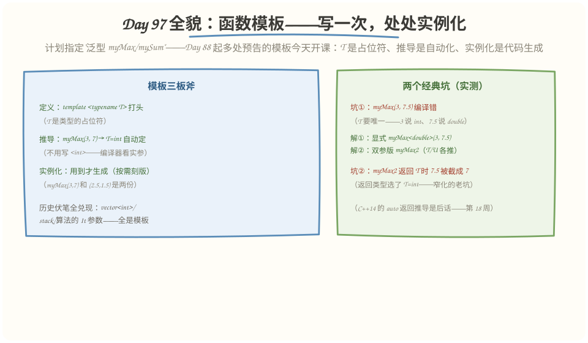
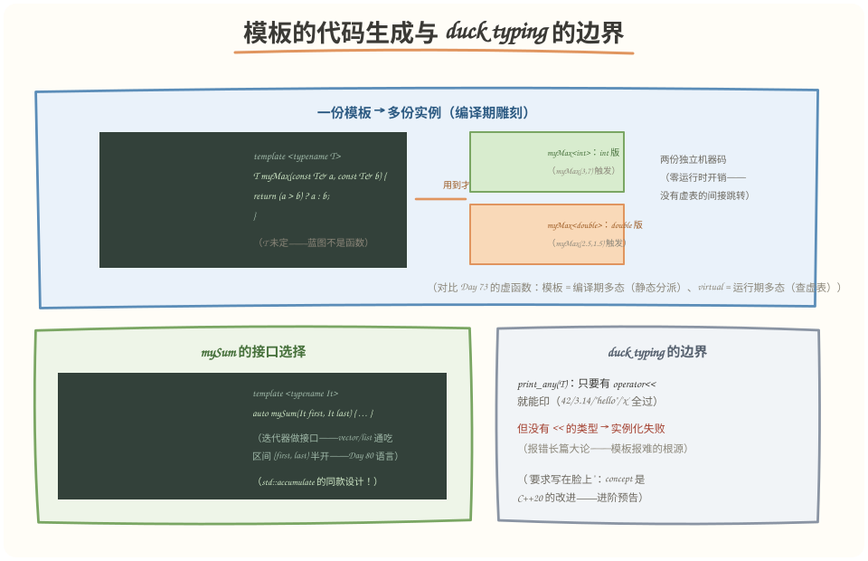
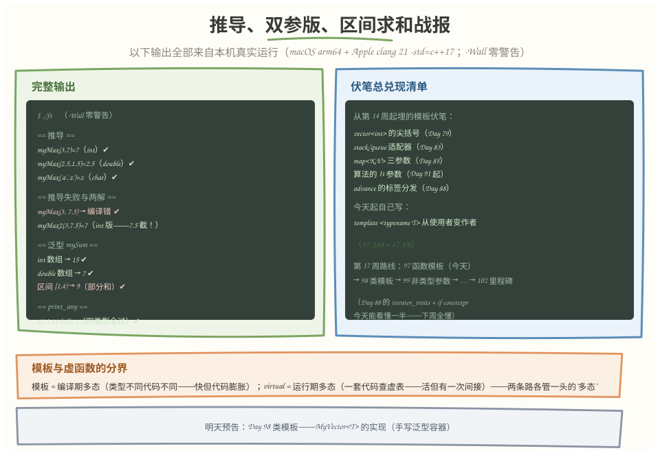

# 第 97 天：函数模板——实参推导与泛型 myMax / mySum

> **今日目标**：完成本教程后，你能做到：定义函数模板（`template <typename T>` 打头）并让编译器自动推导实参类型；处理推导失败的经典场景（`myMax(3, 7.5)` 的两解——显式指定/双参数版）；实现泛型 myMax/mySum（计划指定——mySum 用迭代器做接口通吃容器）；说出模板与虚函数的分界（编译期 vs 运行期多态）。
> **预计时间**：学习 20 分钟＋实践 45 分钟
> **前置准备**：完成 Day 88~96（模板的伏笔埋了两周——今天从使用者变作者）。
> **今日产出**：泛型 myMax/mySum 实测（int/double/char/区间四态）、推导失败执法、print_any 的 duck typing。

## 1. 今天解决什么问题？

第 17 周（模板与泛型）开课。**两周的伏笔今天总兑现**：vector 的尖括号、stack/map 的多参数、算法的 It 参数、advance 的标签分发——全是模板。今天的身份转换：**从用模板到写模板**。三个核心：**定义**（T 是类型占位符）、**推导**（myMax(3,7) 自动定 T=int——不用写 `<int>`）、**实例化**（编译器按用到的类型各刻一份——编译期代码生成、零运行时开销）。

计划指定的泛型 **myMax / mySum** 是练手载体——mySum 用迭代器做接口正好复刻 std::accumulate 的设计。

## 2. 先看全貌：今天的内容位于哪里？



**图 1**：左卡蓝是模板三板斧（定义/推导/实例化）；右卡绿是两个经典坑（推导冲突 + 返回窄化）。路线图：**97/144 = 67.4%，第 17 周开篇**。

三步概括今天：

1. 定义：`template <typename T>` + T 占位——蓝图不是函数；
2. 推导：调用时看实参定 T（3→int、2.5→double）；冲突要显式或双参版；
3. 实例化：用到才刻版（编译期多态——和 virtual 的分界）。

## 3. 核心概念：先用直觉，再给准确定义

### 3.1 实参推导：编译器的自动配型

- **一句通俗解释**：调用 `myMax(3, 7)` 时编译器看实参（3 和 7 都是 int）推出 T=int——不用手写 `<int>`。
- **一个类比**：填表模板——"姓名：___"的空格（T）由你填的内容（实参类型）自动定墨水颜色。
- **对应到技术上是**：实测——`myMax(3,7)`=7（T=int）、`myMax(2.5,1.5)`=2.5（T=double）、`myMax('a','z')`=z（T=char）——**一个模板三用**。显式指定也行（`myMax<int>(3,7)`）但通常不必（推导更简洁）。**推导失败的经典**：`myMax(3, 7.5)`——3 说 int、7.5 说 double、**T 要唯一** → 编译错（实测 `no matching function`）。**两解**：①显式 `myMax<double>(3, 7.5)`（统一升 double）；②双参数版 myMax2（T/U 各推各的）。类比的边界：显式指定的场景——**推导不出**（如返回类型）或**想统一**（混合类型升档）。
- **常见误解**："模板函数运行时选类型"——不；**编译期**就定死了（每类型一份独立代码）；运行时没有任何类型判断。

### 3.2 双参数版与返回窄化

- **一句通俗解释**：`template <typename T, typename U>` 允许两参数不同型——但返回类型选 T 时另一边会被窄化（7.5 截成 7）。
- **一个类比**：双语翻译——两边各说各的语言（T/U）；但回复只能用一种（返回 T）——另一种的内容要硬翻（截断）。
- **对应到技术上是**：实测——`myMax2(3, 7.5)` = **7**（T=int 版返回——7.5 被截！）。**根因**：返回类型写死 T；7.5 > 3 时返回 `T(7.5)` = 7。**正解预告**：C++14 的**返回类型推导**（`auto myMax3(...) { return a > b ? a : b; }`——按表达式推最合适类型）或 `common_type`（Day 100 前后的进阶）。今天先认识坑、明天后天补全解。类比的边界：两个同类型调用（myMax2(3,7)）无此问题——窄化只在混型时发生。
- **常见误解**："双参数版更通用所以更好"——混型的窄化坑要意识到；同型场景单参数版更安全。

### 3.3 duck typing 与模板的边界

- **一句通俗解释**：模板对 T 的要求是**隐式**的——用到什么就要什么（`a > b` 要 `>`、`<<` 要输出运算符）——"走起来像鸭子就是鸭子"。
- **一个类比**：万能插座——不问设备身份（类型），只看插头形状（需要的运算符）能不能插上。
- **对应到技术上是**：实测——print_any 印了 42/3.14/"hello"/'x' 四种类型（都有 `operator<<`）；myMax 要 `>`（自定义类没写 `>` 就实例化失败——报错冗长是模板的著名痛点）。**实例化时机**：**用到才编译**那份代码——没调用的类型组合不检查（头文件模板放 .h 的原因——今天错误 3 展开）。**C++20 concepts** 把隐式要求变显式（`requires` 写在脸上）——进阶预告。类比的边界：duck typing 的报错深——错误出现在**实例化点**（不是定义点）；读模板报错从"note: candidate"往下找第一行真正原因。
- **常见误解**："模板接受任何类型"——只接受**满足其用到运算**的类型；不满足的报错（只是报得啰嗦）。

## 4. 图解核心机制



**图 2**：上半部分蓝卡是一份模板 → 多份实例的编译期雕刻（int 版/double 版独立机器码 + 与虚函数的对比）；左下绿卡是 mySum 的接口选择（迭代器——accumulate 同款设计）；右下灰卡是 duck typing 的边界。

按图逐步讲：

1. **看蓝图和两份实例**：模板是蓝图（T 未定不是函数）；myMax(3,7) 触发刻 int 版、(2.5,1.5) 触发 double 版——**各自独立、零运行时开销**；
2. **对比虚函数**：模板编译期多态（静态分派、代码膨胀）/ virtual 运行期多态（一套代码、虚表间接）——Day 73 知识的另一半今天补全；
3. **读 mySum 的接口**：迭代器版通吃容器和区间（[1,4) 部分和实测 9）——**std::accumulate 的设计复刻**；
4. **记 duck typing 边界**：要求隐式（用到什么要什么）——print_any 四类型过、无 `<<` 的类型败。

## 5. 动手实践：完成一个最小可运行例子

### 5.1 准备文件

```bash
cd ai-compiler-roadmap/tutorials/day-097/examples
```

主角：`func_templates.cpp`（myMax/myMax2/mySum/print_any）。

### 5.2 编写代码

核心（完整代码见本目录）：

```cpp
template <typename T>
T myMax(const T& a, const T& b) {
    return (a > b) ? a : b;                 // T 要有 >
}

template <typename T, typename U>            // 双参数版（混型）
T myMax2(const T& a, const U& b) {
    return (a > b) ? a : T(b);               // 返回 T——U 会被窄化！
}

template <typename It>                        // 泛型求和（迭代器接口）
auto mySum(It first, It last) {
    typename std::iterator_traits<It>::value_type total{};   // 元素类型零初始化
    for (It it = first; it != last; ++it) { total += *it; }
    return total;
}
```

### 5.3 运行与观察

```bash
g++ -Wall -std=c++17 func_templates.cpp -o ft && ./ft
```

实际执行结果（本机，节选）：

```text
== 模板实参推导（不用写 <int>） ==
  myMax(3, 7) = 7（推导 T=int）
  myMax(2.5, 1.5) = 2.5（推导 T=double）
  myMax('a', 'z') = z（推导 T=char）

== 推导失败的经典场景 ==
  myMax(3, 7.5) → 编译错（T 推不出唯一类型）
  解决①：显式 myMax<double>(3, 7.5)
  解决②：双参数版本 myMax2（T/U 各推各的）
  myMax2(3, 7.5) = 7（返回 T=int——注意 7.5 被截！）

== 泛型 mySum（容器通吃） ==
  mySum(int 数组) = 15
  mySum(double 数组) = 7
  mySum(部分区间 [1,4)) = 9
  （同一个函数模板——容器和区间都吃）

== print_any：模板的 duck typing ==
42 3.14 hello x
  （T 是什么都能印——只要它有 operator<<）

== 模板是编译期的代码生成器 ==
  myMax(3,7) 和 myMax(2.5,1.5) 是两个不同的函数实例
  （编译器按用到的类型各刻一份——零运行时开销）
```

**推导失败执法**（探针实测）：

```text
/tmp/fail.cpp:2:14: error: no matching function for call to 'myMax'
```



**图 3**：左上完整输出（推导/失败两解/区间求和/四类型打印）；右侧是**伏笔总兑现清单**（Day 79/83/85/88/91 的模板伏笔全归位）；下方橙卡是模板与虚函数的分界。

### 5.4 修改一个输入再观察：duck typing 的反面教材

定义一个没有 `operator<` 的结构体（如 `struct Point { int x, y; };`）调 `myMax(Point{1,2}, Point{3,4})`——**编译错**（实例化失败：T 没有 `>`——报错一大串）。给 Point 加了 `bool operator>(const Point&) const` 后编译通过。**一无一有**：duck typing 的要求清单（用到什么补什么）从口头变目击——这也是读模板报错的练习（从长报错里找 "no match for 'operator>'" 那行真因）。

## 6. 常见错误与排查

**错误 1：`no matching function for call to 'myMax'`（混型推导失败）**

- 现象：`myMax(3, 7.5)` 编译错；
- 原因：T 要唯一——int 和 double 打架；
- 定位：报错的 candidate 注释（两个需求不一致）；
- 修复：显式 `<double>` 或双参数版（注意返回窄化——今天实测的 7）。

**错误 2：模板报错长篇大论看不懂**

- 现象：一屏的 candidate/note；
- 原因：实例化失败的连锁报告；
- 定位：**从最上面的 error 往下找第一处真因**（通常是 no match for operator）；
- 修复：按真因补运算符或换类型；经验：模板错只看头尾。

**错误 3：模板函数的声明和实现分文件后链接错**

- 现象：main.cpp include 了 .h（只有声明）→ undefined symbol；
- 原因：模板**用到才实例化**——.cpp 里的实现编译时不知道 main 要什么类型；
- 定位：链接错误的符号是模板函数；
- 修复：实现放头文件（今天的做法）；或显式实例化（进阶话题）。

## 7. 今日练习

### 必做练习（计划指定：泛型 myMax/mySum）

扩展 myMax 成三参数版（`template <typename T> T myMax3(T a, T b, T c)`）；mySum 加初值参数版（`mySum(first, last, init)`——init 的类型定返回类型，Day 95 初值坑的模板视角）。预期产出：两版扩展 + int/double 各一测。

### 选做挑战

"模板 swap"：写 `mySwap(T& a, T& b)`（标准库 std::swap 的复刻）——测 int/双元素数组（`int (&arr)[2]` 的引用数组——进阶：模板推导数组引用）；再想：为什么 std::swap 的参数必须是引用（值传递交换不了——Day 49 的老知识）。

## 8. 今日验收

- [ ] 我的 myMax 三类型推导通过（int/double/char——计划指定）
- [ ] 我的 mySum 迭代器版通吃（int/double/部分区间）
- [ ] 我实测了推导失败（3, 7.5 编译错）和双参版的窄化（7.5→7）
- [ ] 我能说出模板与虚函数的分界（编译期/运行期多态）
- [ ] 我做过 duck typing 的反面教材（无 > 的类型实例化失败——5.4）

## 9. 一句话总结与明天预告

今天的问题是"一份代码怎么服务多种类型"；机制上，模板是编译期蓝图（T 占位）、推导自动配型（要唯一）、实例化按需雕刻（零运行时开销——和 virtual 的分界）；实践上，myMax/mySum、推导失败、窄化坑、duck typing 边界全部实测；验证标准是看到任何尖括号能说出"T 是谁、什么时候定的"。明天 **Day 98：类模板**——MyVector\<T\> 的实现（手写泛型容器）：把今天的函数模板推广到类。
