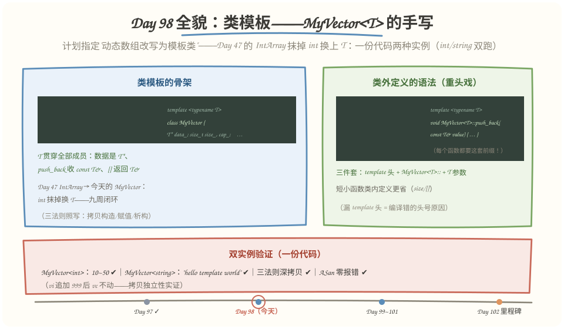
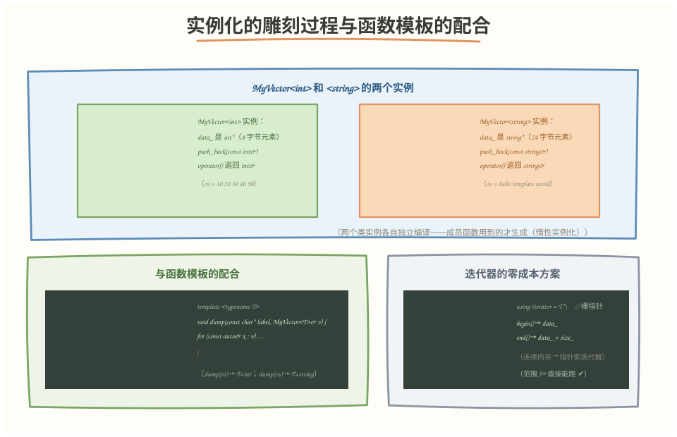
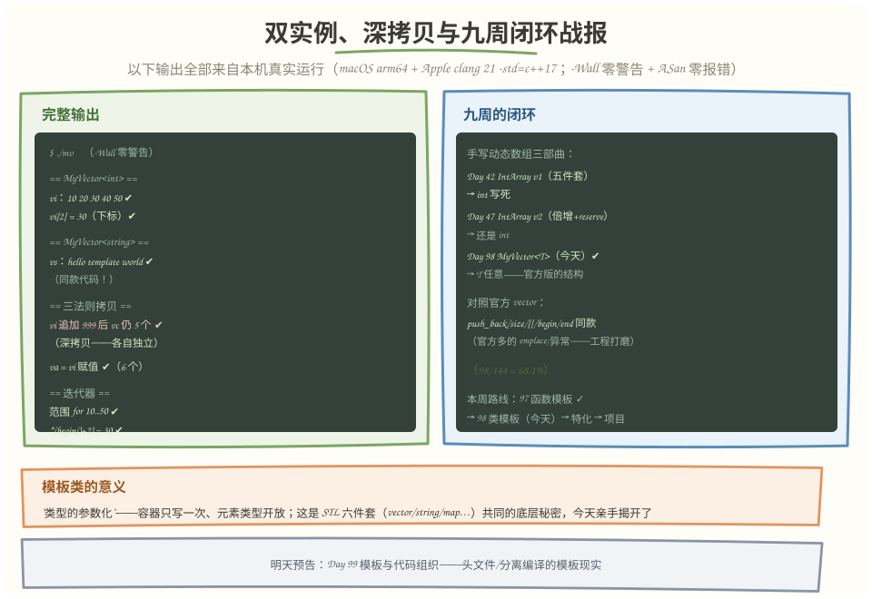

# 第 98 天：类模板——MyVector&lt;T&gt; 的实现

> **今日目标**：完成本教程后，你能做到：把 Day 47 的 IntArray 改写成模板类 MyVector\<T\>（计划指定——int 抹掉换 T）；在类外定义成员函数（**每个都要 template 头 + MyVector\<T\>::** 的三件套语法）；跑通双实例（int/string 同款代码）；类模板配函数模板（dump\<T\>）；迭代器用裸指针的零成本方案。
> **预计时间**：实现 50 分钟＋对照 30 分钟
> **前置准备**：完成 Day 97（函数模板）+ Day 47（IntArray v2——今天的底版）。
> **今日产出**：约 90 行 MyVector\<T\>（三法则+倍增+迭代器，`-Wall` 零警告 + ASan 零报错）。

## 1. 今天解决什么问题？

计划指定的练习：**把动态数组改写为模板类 `MyVector<T>`**。Day 42/47 手写过两版 IntArray——都是 int 写死；今天把 int 抹掉换成 **T**：数据成员 `T*`、接口收 `const T&`、返回 `T&`——**类型的参数化**。这是九周前后的闭环（42→47→98），也是官方 vector 的底层秘密（STL 六件套全是类模板）。

重头戏是**类外定义成员函数的语法**：每个函数都要 `template <typename T>` 打头 + `MyVector<T>::` 限定——三件套缺一不可（漏 template 头是编译错的头号原因）。

## 2. 先看全貌：今天的内容位于哪里？



**图 1**：左卡蓝是类模板骨架（T 贯穿成员 + Day 47 对照）；右卡绿是类外定义三件套；下方红卡是双实例验证。

三步概括今天：

1. 定义：`template <typename T> class MyVector`——T 贯穿数据/接口；
2. 类外：template 头 + `MyVector<T>::` + T 参数——三件套；
3. 双实例：int/string 各刻一份（惰性——用到才生成）。

## 3. 核心概念：先用直觉，再给准确定义

### 3.1 T 的贯穿：类型的全面参数化

- **一句通俗解释**：类里所有出现 int 的地方都换成 T——数据、参数、返回值——这个类就"不挑食"了。
- **一个类比**：服装版型——S/M/L 三个尺码不是三套版型（写死的 int），是一套带"尺寸参数"的版型（T）——按需裁剪。
- **对应到技术上是**：实测——`MyVector<int> vi`（data_ 是 int\*、push_back(const int&)）；`MyVector<string> vs`（data_ 是 string\*）——**同款代码双实例**。**对照 Day 47**：IntArray 的 int 出现在 8 处——全换 T 就完成了模板化（九周闭环：42→47→98）。**三法则照写**（拷贝构造/赋值/析构——T 版一字不少；深拷贝实测：vi 追加 999 后 vc 仍是 5 个）。类比的边界：T 要满足用到的运算（这里只要可拷贝构造——绝大多数类型都行）。
- **常见误解**："模板类运行时换类型"——编译期就定死（`MyVector<int>` 和 `<string>` 是两个独立的类）；运行时无任何类型判断。

### 3.2 类外定义：三件套语法

- **一句通俗解释**：类外写成员函数要三件套——`template <typename T>` 头 + `MyVector<T>::` 限定 + 参数里的 T——缺一编译错。
- **一个类比**：外交公文——信头（template 头）+ 落款单位（MyVector\<T\>::）+ 内容（函数签名）——三样齐全才有效。
- **对应到技术上是**：实测代码——`template <typename T> void MyVector<T>::push_back(const T& value) { … }`——和类内声明配对。**为什么每个都要**：类外定义是独立于类的"重新入模"——编译器看到 template 头才知道 T 是模板参数不是真类型。**实用策略**：短小函数（size/`[]`）类内直接定义（省事且隐式 inline）；大函数类外（可读性）。**头文件现实**（Day 99 预告）：类模板的成员函数几乎都放 .h——分离到 .cpp 会链接错（用到才实例化的机制所致）。类比的边界：类内定义不需要三件套（已在模板上下文里）。
- **常见误解**："写一个 template 头管所有类外函数"——不；**每个**函数都要自己的头（编译器逐函数解析）。

### 3.3 实例化机制与惰性

- **一句通俗解释**：`MyVector<int> vi` 触发编译器刻一个 int 版类；**成员函数用到才刻**（惰性）——没用到的成员不生成代码。
- **一个类比**：按需印刷——书稿（模板）在手里；有人买哪章印哪章（惰性）——没人买的章不印（省纸）。
- **对应到技术上是**：双实例的行为差异——`MyVector<int>` 和 `MyVector<string>` 是**两个独立的类**（sizeof 可能不同——元素大小不同）；成员函数按**调用到的**生成（dump(vi) 触发 dump\<int\>、dump(vs) 触发 dump\<string\>——函数模板配合类模板的常见组合）。**惰性的好处**：T 缺某运算也只影响用到该运算的函数（其他成员照用）。**迭代器零成本方案**：`using iterator = T*`——连续内存的指针天然满足随机访问迭代器（begin/end 实测 + 范围 for 直接跑）。类比的边界：惰性也是"模板放 .cpp 链接错"的根源（Day 99 正课）。
- **常见误解**："模板类的所有成员都会实例化"——只有用到的；这也是为什么有 bug 的模板成员有时"不爆"（没被调用）。

## 4. 图解核心机制



**图 2**：上半部分蓝卡是两个实例的对照（int 版 4 字节元素 vs string 版 24 字节元素——成员类型全随 T 变）；左下绿卡是函数模板配合类模板（dump\<T\> 收 MyVector\<T\>&）；右下灰卡是裸指针迭代器的零成本方案。

按图逐步讲：

1. **对比两个实例框**：data_ 类型、参数类型、返回类型全随 T 换——"类型的参数化"的完整图景；
2. **读 dump 的配合**：函数模板的 T 从 MyVector\<T\> 推导（dump(vi) → T=int）——泛型对泛型的组合；
3. **看裸指针迭代器**：`using iterator = T*` + begin/end 三行——范围 for 和指针算术全通（Day 80/88 知识的免费搭乘）；
4. **连九周闭环**：42 的 int 版 → 47 的倍增版 → 今天的 T 版——一条线走完"手写容器的进化史"。

## 5. 动手实践：完成一个最小可运行例子

### 5.1 准备文件

```bash
cd ai-compiler-roadmap/tutorials/day-098/examples
```

主角：`my_vector.cpp`（约 90 行完整版）。

### 5.2 编写代码

核心（完整代码见本目录）：

```cpp
template <typename T>
class MyVector {
    T* data_;
    std::size_t size_, capacity_;
public:
    MyVector();                                  // 类内声明
    void push_back(const T& value);              // 类外定义
    std::size_t size() const { return size_; }   // 短小函数类内定义
    T& operator[](std::size_t i) { return data_[i]; }
    using iterator = T*;                          // 裸指针迭代器
    iterator begin() { return data_; }
    iterator end() { return data_ + size_; }
};

// 类外定义：三件套！
template <typename T>                            // ① template 头
void MyVector<T>::push_back(const T& value) {    // ② MyVector<T>:: ③ T 参数
    if (size_ == capacity_) {
        std::size_t new_cap = (capacity_ == 0) ? 1 : capacity_ * 2;   // 倍增（Day 47/79）
        T* new_data = new T[new_cap];
        for (std::size_t i = 0; i < size_; ++i) { new_data[i] = data_[i]; }
        delete[] data_;
        data_ = new_data; capacity_ = new_cap;
    }
    data_[size_++] = value;
}

// 函数模板配合类模板
template <typename T>
void dump(const char* label, MyVector<T>& v) { … }
```

### 5.3 运行与观察

```bash
g++ -Wall -std=c++17 my_vector.cpp -o mv && ./mv
```

实际执行结果（本机）：

```text
== MyVector<int>：整型版 ==
  vi：10 20 30 40 50 （size=5）
  vi[2] = 30（下标访问）

== MyVector<std::string>：字符串版（同款代码！） ==
  vs：hello template world （size=3）

== 三法则拷贝（Day 57 的模板版） ==
  vc（拷贝）：10 20 30 40 50 （size=5）
  vi（原，追加后）：10 20 30 40 50 999 （size=6）
  （各自独立——深拷贝 ✔）
  va（赋值后）：10 20 30 40 50 999 （size=6）

== 迭代器（裸指针——随机访问） ==
  范围 for（糖衣）：10 20 30 40 50
  指针算术：*(vc.begin() + 2) = 30

== 类外定义的语法要点 ==
  每个类外定义都要 template <typename T> 打头
  返回类型写 MyVector<T>::（带尖括号）
  类内短函数直接定义更省事（size/[] 那样）
```

```bash
g++ -Wall -std=c++17 -fsanitize=address my_vector.cpp -o mva && ./mva
```

```text
（ASan 零报错——三法则的模板版正确性盖章）
```



**图 3**：左上完整输出（双实例/三法则/迭代器/语法四段）；右侧是九周闭环（42→47→98）和对照官方 vector；下方橙卡是模板类的意义。

### 5.4 修改一个输入再观察：三件套缺一的执法

把 push_back 类外定义的 `template <typename T>` 头删掉——编译错（`T` 未声明——编译器不知道 T 是什么）。只留 template 头删 `MyVector<T>::` 的尖括号（写 `MyVector::`）——也错（非模板类的语法）。**三缺一各试一次**：三件套的必要性从规则变目击——这也是记忆锚点（忘了语法就想起今天的三次报错）。

## 6. 常见错误与排查

**错误 1：`error: 'T' was not declared`（类外定义漏 template 头）**

- 现象：类外成员函数编译错；
- 原因：没有 `template <typename T>` 头——T 不被认识；
- 定位：报错指向类外定义的第一行；
- 修复：补三件套（5.4 亲测）。

**错误 2：`error: implicit instantiation of undefined template`（模板类成员分离到 .cpp）**

- 现象：声明在 .h、实现在 .cpp——链接时 undefined；
- 原因：模板用到才实例化——.cpp 编译时不知道别人要用什么 T；
- 定位：链接错误的符号是模板成员；
- 修复：成员函数放头文件（今天做法）；Day 99 细讲组织。

**错误 3：拷贝后两对象数据串味（浅拷贝老坑）**

- 现象：vi 追加后 vc 也变；
- 原因：模板类的三法则没写（默认拷贝是浅的——Day 57 的教训在模板版复发）；
- 定位：对照追加前后两对象；
- 修复：三法则全写（今天的拷贝构造/赋值/析构）。

## 7. 今日练习

### 必做练习（计划指定：动态数组改模板类）

给 MyVector\<T\> 加 `pop_back()`（尾删——size 减一 + 下标析构可略）和 `empty()`；再实例化 `MyVector<double>` 存三个成绩并求平均（配 Day 97 的 mySum 或手写循环）。预期产出：新成员 + double 实例的输出。

### 选做挑战

"模板 Stack"：把 Day 83 用过的 stack 亲手写一份——`template <typename T> class MyStack`（内部用 MyVector\<T\> 存储——模板套模板）：push/pop/top/empty 四接口。测 int 和 string 双实例——体会"适配器 + 模板"的组合（官方 stack 的最小复刻）。

## 8. 今日验收

- [ ] 我的 MyVector\<T\> 双实例通过（int 10~50 / string "hello template world"）
- [ ] 我的类外定义三件套全对（template 头 + MyVector\<T\>:: + T 参数）
- [ ] 三法则模板版实测（vi 追加 999 后 vc 独立——深拷贝）+ ASan 零报错
- [ ] 裸指针迭代器跑通（范围 for + 指针算术）
- [ ] 我试过三件套缺一的编译错（5.4 的三次执法）

## 9. 一句话总结与明天预告

今天的问题是"类怎么不挑类型"；机制上，T 贯穿成员实现类型参数化（双实例各自独立）、类外定义要三件套（漏一编译错）、成员函数惰性实例化（用到才刻）；实践上，九周闭环（42→47→98）的手写容器进化史完成；验证标准是看到任何类能标出"哪几处换 T 就模板化"。明天 **Day 99：模板与代码组织**——头文件/分离编译的模板现实：今天"成员放 .h"的做法明天讲透为什么。
