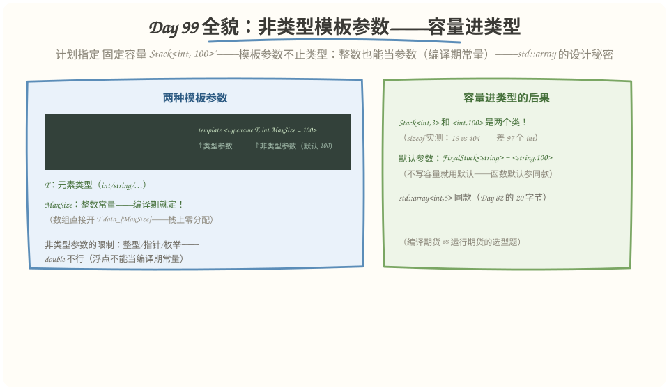
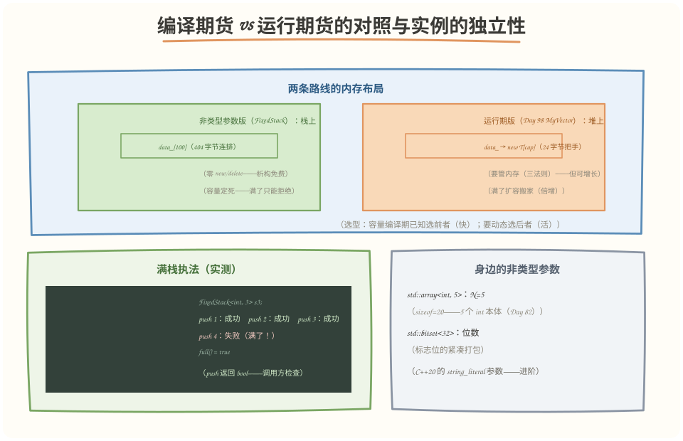
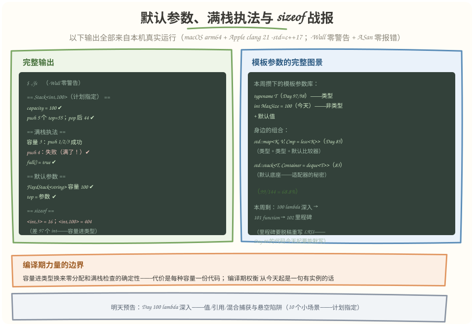

# 第 99 天：非类型模板参数与默认模板参数

> **今日目标**：完成本教程后，你能做到：定义非类型模板参数（`int MaxSize = 100`——容量是编译期常量）；实现计划指定的固定容量 `Stack<int, 100>`（数组直接开、满栈拒绝、零分配）；说出"容量进类型"的后果（每个容量是独立的类——sizeof 实测 16 vs 404）；对照编译期货与运行期货的选型。
> **预计时间**：学习 20 分钟＋实践 40 分钟
> **前置准备**：完成 Day 97~98（类型参数的地基——今天加非类型）。
> **今日产出**：FixedStack\<T, MaxSize=100\>（`-Wall` 零警告 + ASan 零报错）、满栈执法、双 sizeof。

## 1. 今天解决什么问题？

模板参数不止能是**类型**（typename T）——还能是**值**（`int MaxSize`）：容量、位数、上限这些**编译期常量**都能进模板。计划指定的 `Stack<int, 100>` 正是案例：容量 100 写进类型——**数组直接开在栈上**（零 new/delete、析构免费）、满栈检查是确定性的（返回 false 而不是扩容）。

这也是 **std::array\<int, N\>** 的设计秘密（Day 82 的 20 字节之谜今天揭晓）+ **默认模板参数**（`MaxSize = 100`——不写就用默认，函数默认参的同款便利）。

## 2. 先看全貌：今天的内容位于哪里？



**图 1**：左卡蓝是两种模板参数（类型 T + 非类型 MaxSize=100）；右卡绿是容量进类型的后果。路线图：**99/144 = 68.8%**。

三步概括今天：

1. 非类型参数：编译期常量——数组直接开、容量能查；
2. 默认参数：`FixedStack<string>` = `<string, 100>`；
3. 后果：每容量一个类（sizeof 16 vs 404）——编译期权衡。

## 3. 核心概念：先用直觉，再给准确定义

### 3.1 非类型参数：值进模板

- **一句通俗解释**：模板参数不止"什么类型"还能"多大"——`FixedStack<int, 3>` 是"元素 int、容量 3"的栈（容量是类型的一部分）。
- **一个类比**：定制柜子——除了选材质（类型 T），还能报尺寸（容量 100）——图纸（模板）带着尺寸一起进车间（编译器）。
- **对应到技术上是**：实测——`template <typename T, int MaxSize = 100>` + `T data_[MaxSize];`（**数组直接开**——MaxSize 是编译期常量所以合法）；`FixedStack<int, 100>::capacity()` 编译期返回 100；`FixedStack<int, 3>` 的满栈执法（push 1/2/3 成功、**push 4 失败**、full()=true）。**限制**：非类型参数只能是整型/指针/枚举——**double 不行**（浮点不是编译期常量语境）。类比的边界：容量不同的两个实例**互不相同**（见 3.3）——不是同一个类的不同配置。
- **常见误解**："非类型参数是构造函数的参数"——不；它在**类型名里**（`FixedStack<int, 3>` 的 3）——编译期定死、每个值一份代码。

### 3.2 默认模板参数

- **一句通俗解释**：`MaxSize = 100` 给了默认值——`FixedStack<string>` 等价 `FixedStack<string, 100>`（少写一个参数）。
- **一个类比**：套餐默认中杯——不特别说明就按中杯做（要大杯再报数）。
- **对应到技术上是**：实测——`FixedStack<std::string> sd` 的 capacity() = **100**（默认生效）、push/top 正常。**身边的默认参组合**：`std::map<K, V, Cmp = less<K>>`（默认字典序——Day 85 没写第三参就在用）、`std::stack<T, Container = deque<T>>`（默认底座 deque——Day 83 的适配器秘密）、`std::greater<int>`（Day 83 小顶堆要显式给——因为默认是大顶）。**规则**：默认参靠右（和函数默认参一样）——有默认的后面不能再有没默认的。类比的边界：显式给就覆盖（`<int, 3>` 覆盖 100）。
- **常见误解**："默认参数是运行时的 fallback"——编译期就定了（实例化哪份代码）。

### 3.3 容量进类型：独立类与编译期权衡

- **一句通俗解释**：`FixedStack<int,3>` 和 `<int,100>` 是**两个不同的类**——sizeof 不同（16 vs 404）、代码各自生成。
- **一个类比**：3 层楼和 100 层楼的图纸是两张图——虽然设计风格一样（同一个模板刻的）。
- **对应到技术上是**：实测——sizeof 差 **97 个 int**（容量进类型的直接证据）。**编译期货 vs 运行期货**：非类型版（栈上数组——零分配、析构免费、满栈确定拒绝）vs Day 98 MyVector 版（堆上 new——三法则要管、但能增长）。**选型**：容量编译期已知（固定深度的队列/环形缓冲）选前者；要动态生长选后者。**std::array\<int, N\>** 正是非类型参数的官方应用（Day 82 的"20 字节 = 5 个 int 本体"今天原理落地）。类比的边界：每容量一份代码是**代码膨胀**的代价——容量种类很多时（1~1000 各要一份）要慎重。
- **常见误解**："非类型参数版的栈更高级"——是**不同场景**的工具；固定容量图快、动态容量图活——没有高下。

## 4. 图解核心机制



**图 2**：上半部分蓝卡是两条路线的内存布局对照（栈上 404 字节连排 vs 堆上 24 字节把手）；左下绿卡是满栈执法（push 4 失败的实测）；右下灰卡是身边的非类型参数（array/bitset）。

按图逐步讲：

1. **对比两块内存**：FixedStack 的 data_ 就在对象里（栈上连排）——零分配零析构；MyVector 的 data_ 是把手（堆上另开）——灵活但三法则；
2. **数满栈的三次成功一次失败**：容量 3 的确定性边界——push 返回 bool 让调用方决策（不扩容不抛错）；
3. **读身边的案例**：std::array\<int,5\> 的 N、bitset\<32\> 的位数——非类型参数早就在用（今天认识它）；
4. **记选型口诀**：编译期知容量选 Fixed（快）、运行期才知道选 Vector（活）。

## 5. 动手实践：完成一个最小可运行例子

### 5.1 准备文件

```bash
cd ai-compiler-roadmap/tutorials/day-099/examples
```

主角：`fixed_stack.cpp`（FixedStack 完整实现 + 四组演示）。

### 5.2 编写代码

核心（完整代码见本目录）：

```cpp
template <typename T, int MaxSize = 100>     // 类型 + 非类型（默认 100）
class FixedStack {
    T data_[MaxSize];                        // 编译期常量——数组直接开！
    int top_ = -1;
public:
    bool push(const T& value) {
        if (top_ + 1 >= MaxSize) { return false; }   // 满——确定拒绝
        data_[++top_] = value;
        return true;
    }
    static constexpr int capacity() { return MaxSize; }   // 编译期可查
    // pop/top/empty/full 同理……
};

FixedStack<int, 100> s100;                   // 计划指定的形态
FixedStack<int, 3> s3;                       // 小容量版（另一个类！）
FixedStack<std::string> sd;                  // 默认参数 = <string, 100>
```

### 5.3 运行与观察

```bash
g++ -Wall -std=c++17 fixed_stack.cpp -o fs && ./fs
```

实际执行结果（本机）：

```text
== 计划指定：Stack<int, 100> ==
  capacity = 100
  push 5 个后 top = 55
  pop 后 top = 44

== 非类型参数的执法：小容量满栈 ==
  push 1：成功
  push 2：成功
  push 3：成功
  push 4：失败（满了！）
  full() = true

== 默认参数：不写容量就是 100 ==
  FixedStack<string> 的容量 = 100（没写第二个参数——默认生效）
  top = 参数

== 每个容量是独立的类 ==
  Stack<int,3> 和 Stack<int,100> 是两个不同的类
  sizeof(FixedStack<int,3>) = 16
  sizeof(FixedStack<int,100>) = 404
  （容量进类型——sizeof 差 97 个 int）

== 和运行期限定的对照 ==
  非类型参数：编译期定容量——数组直接开（栈上零分配）
  运行期 new[]：灵活但要管内存（Day 98 的 MyVector 路线）
  （std::array<int,N> 同款设计——N 是非类型参数）
```

```bash
g++ -Wall -std=c++17 -fsanitize=address fixed_stack.cpp -o fsa && ./fsa
```

```text
（ASan 零报错——满栈检查的边界正确性盖章）
```



**图 3**：左上完整输出（四组演示）；右侧是模板参数的完整图景（本周攒的参数库 + 身边的组合）；下方橙卡是编译期力量的边界。

### 5.4 修改一个输入再观察：浮点参数的执法

把非类型参数改成 `double MaxSize`（`template <typename T, double Max>`）——**编译错**（"a non-type template parameter cannot have type double"——浮点不能当编译期常量）。再试 `FixedStack<int, 3> a; FixedStack<int, 100> b; a = b;`——也错（**不同类型不能赋值**——两个独立的类）。**两错一对**：非类型参数的边界（什么值能进、实例互不相通）从规则变目击。

## 6. 常见错误与排查

**错误 1：`non-type template parameter cannot have type double`**

- 现象：模板参数写 double；
- 原因：非类型参数只收整型/指针/枚举（编译期常量语境）；
- 定位：报错直接指参数列表；
- 修复：换 int/size_t；浮点上限用构造函数参数（运行期）。

**错误 2：不同容量的栈互相赋值编译错**

- 现象：`s3 = s100` 不编译；
- 原因：不同模板实参 = 不同类型（容量进类型）；
- 定位：报错提 no match for operator=；
- 修复：逐元素拷贝；或统一用同一种容量。

**错误 3：push 的返回值没检查——静默丢数据**

- 现象：满了继续 push、数据悄悄没了；
- 原因：FixedStack 的设计是返回 false（不抛不扩）——调用方必须查；
- 定位：审计 push 调用点；
- 修复：`if (!s.push(x)) { /* 处理满 */ }`（今天的演示都查了）。

## 7. 今日练习

### 必做练习（计划指定：固定容量 Stack\<int, 100\>）

给 FixedStack 加 `dump()`（打印全部元素和 top_ 位置）；实例化 `FixedStack<int, 5>` 做完整的"压满-弹空"循环（push 5 个 → dump → pop 3 个 → dump → 再 push 2 个 → dump）。预期产出：三段 dump 的对照。

### 选做挑战

"环形缓冲"：`FixedStack` 改造成 `RingBuffer<T, N>`（满时**覆盖最老的**而不是拒绝——head/tail 双指针取模环绕）。这是嵌入式/音频流的经典结构——非类型参数的容量 + 编译期已知 = 零分配的环形队列。

## 8. 今日验收

- [ ] 我的 FixedStack\<T, MaxSize=100\> 实现通过（计划指定的 Stack\<int,100\> 形态）
- [ ] 满栈执法实测（容量 3：三次成功一次失败 + full()=true）
- [ ] 默认参数实测（FixedStack\<string\> 容量 100）
- [ ] sizeof 双数字对上（16 vs 404——容量进类型）
- [ ] 我能说出编译期/运行期两条路线的选型和身边案例（array/bitset）

## 9. 一句话总结与明天预告

今天的问题是"模板参数还能是什么"；机制上，非类型参数让值（容量）进类型（编译期常量——数组直接开、满栈确定拒绝、每容量独立类）、默认参数省书写（=100 不写就用）；实践上，FixedStack 四组演示、满栈执法、sizeof 证据、浮点执法全部实测；验证标准是看到 `Stack<int, 100>` 能说出"100 是类型的一部分意味着什么"。明天 **Day 100：lambda 深入**——值/引用/混合捕获与悬空陷阱（10 个小场景——计划指定）：Day 91 埋的 `[threshold]` 今天全面展开。
