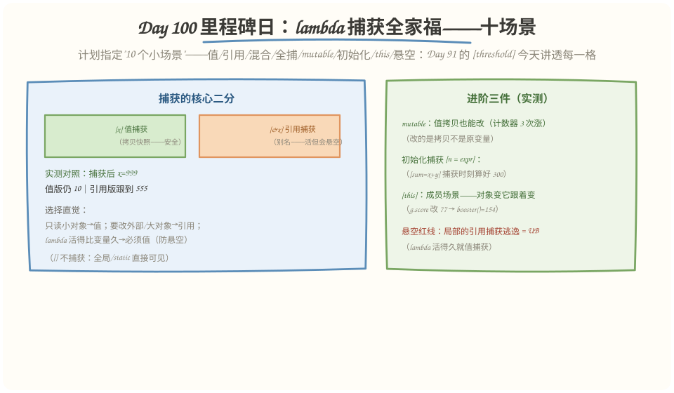
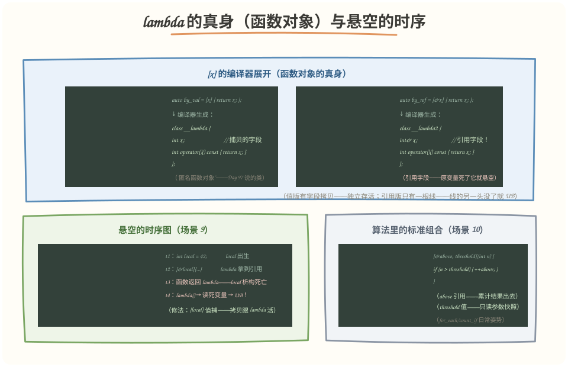
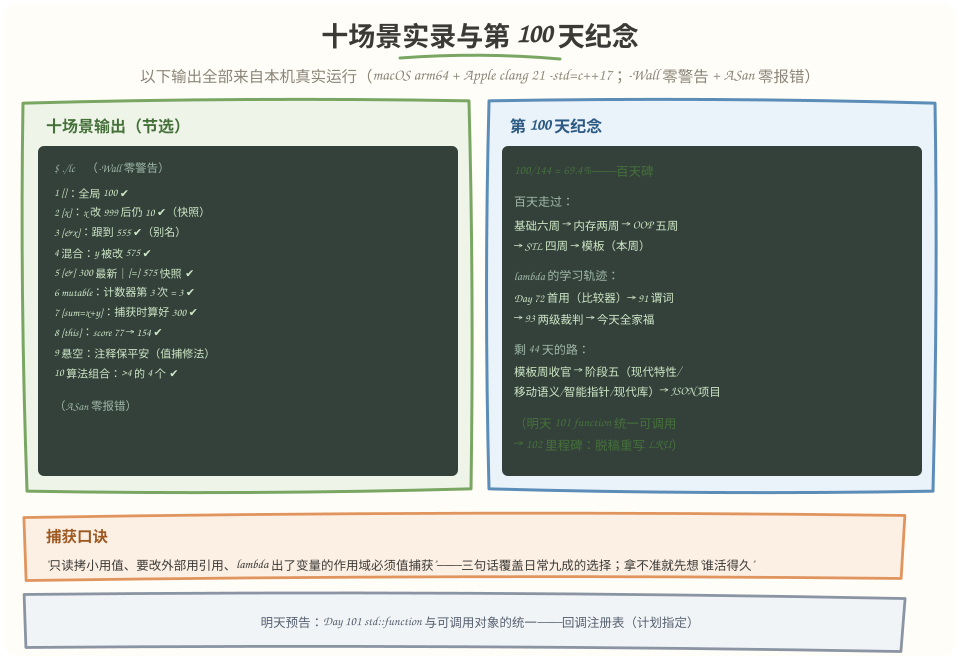

# 第 100 天（百天纪念）：lambda 深入——捕获全家福与悬空陷阱

> **今日目标**：完成本教程后，你能做到：背出捕获二分（值=拷贝快照安全 / 引用=别名活但会悬空）并各配实测；写混合捕获（`[x, &y]`——只读值 + 可变引用的标准组合）和全捕获（`[&]`/`[=]`）；用 mutable 和初始化捕获（`[n = expr]`）；捕获 this（成员场景）；**识别悬空红线**（lambda 活得比局部变量久 → 必须值捕获）。
> **预计时间**：学习 20 分钟＋实践 45 分钟
> **前置准备**：完成 Day 91~99（`[threshold]` 从 91 用到今天——现在是原理课）。
> **今日产出**：计划指定的 10 个捕获场景全实测（含 this 和悬空陷阱）。

## 1. 今天解决什么问题？

lambda 从 Day 48（比较器）用到今天——捕获列表 `[]` 一直是"照葫芦画瓢"。今天把**捕获**讲透：值 vs 引用的语义差异（快照 vs 别名——实测对照）、混合/全捕获、mutable、初始化捕获、this 捕获，以及最关键的**悬空陷阱**（引用捕获的局部变量死了、lambda 还活着——UB）。

计划指定的 **10 个小场景**全部实测——每个场景一行结论。今天也是**第 100 天**（100/144 = 69.4%）——百天碑。

## 2. 先看全貌：今天的内容位于哪里？



**图 1**：左卡蓝是捕获的核心二分（值/引用的对照实测）；右卡绿是进阶三件（mutable/初始化/this）+ 悬空红线。

三步概括今天：

1. 二分：`[x]` 拷贝快照（x 改 999 里面仍 10）、`[&x]` 别名（跟到 555）；
2. 组合：`[x, &y]` 混合、`[&]`/`[=]` 全捕、`[n = expr]` 初始化、`[this]` 成员；
3. 红线：lambda 逃逸出变量作用域 → 引用捕获 = 悬空 UB。

## 3. 核心概念：先用直觉，再给准确定义

### 3.1 值与引用：快照与别名

- **一句通俗解释**：`[x]` 是"拍照"（捕获那一刻的拷贝——原变量再变不影响照片）；`[&x]` 是"挂电话线"（实时同步——原变它也变，线断了就是悬空）。
- **一个类比**：快递地址——值捕获像"把货拍下来发你"（发完卖家改库存与你无关）；引用像"给你仓库钥匙"（库存实时变——但仓库拆了钥匙就开不了门）。
- **对应到技术上是**：实测——场景 2：`[x]` 捕获后 x=999，lambda 里仍 **10**（快照）；场景 3：`[&x]` 后 x=555，lambda 里 **555**（别名）。**真身**（图 2 的编译器展开）：值版的类带 `int x;`（字段拷贝——独立存活）；引用版带 `int& x;`（引用字段——**原变量死了它就悬空**——这是 3.3 红线的机制根源）。类比的边界：值拷贝有成本（大对象拷整个）——只读大对象可 `[&]`（作用域内安全）或 const 引用捕获。
- **常见误解**："引用捕获更快所以总用引用"——快但险（作用域一过就悬空）；选择先问"谁活得久"。

### 3.2 混合与全捕获

- **一句通俗解释**：`[x, &y]` 各取所需（x 拷贝只读、y 引用可改）；`[&]`/`[=]` 一网打尽（全部引用/全部值）。
- **一个类比**：搬家清单——逐项标注（混合：这件带副本、那件留地址）或"全带上"/"全抄录"（全捕获的粗放）。
- **对应到技术上是**：实测——场景 4：`[x, &y]` 调用后 y 从 20 变 **575**（引用改了外部）；场景 5：x/y 改后 `[&]` 看到 **300**（最新）、`[=]` 看到 **575**（捕获时快照）。**场景 10 的标准组合**：`[&above, threshold]`（above 引用——累计结果出去；threshold 值——只读参数快照）——**算法里日常九成长这样**（for_each/count_if 配捕获）。**全捕获的取舍**：`[&]` 省事但一眼看不出依赖谁（审代码难）；`[=]` 拷贝多但隔离好——工程规范常禁全捕获（显式列出更可审）。类比的边界：`[=]` 捕 this 时捕的是**指针的拷贝**（不是对象拷贝——场景 8 的坑）。
- **常见误解**："`[=]` 把对象整个拷进去了"——对 this 是拷指针；理解成对象拷贝会误判生命周期。

### 3.3 mutable、初始化捕获与 this

- **一句通俗解释**：mutable 让值捕获的字段**可改**（改的是拷贝）；`[n = expr]` 在捕获处**算表达式**；`[this]` 拿对象的指针（成员实时可见）。
- **一个类比**：mutable 是"给照片发可编辑权限"（改照片不动原物）；初始化捕获是"出发前把路费算好装兜里"（表达式求值在捕获时刻）；this 是"带着对讲机连着大本营"（成员状态实时）。
- **对应到技术上是**：实测——场景 6：`[n = 0]() mutable` 计数器第 3 次调用返回 **3**（内部 n 在涨、外界看不到）；场景 7：`[sum = x + y]` 捕获时算好 **300**（之后 x/y 再变不跟）；场景 8：`[this]` 后 g.score 改 77 → booster() = **154**（this 指针对象实时）。**悬空红线**（场景 9 的时序图）：函数里 `return [&local]{...}` ——local 在函数返回时死亡、lambda 带着**死引用**逃逸 → 再调用是 **UB**。**修法**：值捕获 `[local]`（拷贝跟 lambda 活）。**判定口诀**："lambda 活得比变量久 → 必须值"。类比的边界：this 捕获同样有悬空版（对象析构后 lambda 还调成员——异步回调的经典坑）。
- **常见误解**："mutable 能改外部变量"——改的是**拷贝**（原变量不动）；要改外部得引用捕获。

## 4. 图解核心机制



**图 2**：上半部分蓝卡是值/引用两版的编译器展开对照（`int x;` 字段 vs `int& x;` 引用字段——悬空的机制根源）；左下绿卡是场景 9 的悬空时序（t1 出生 → t2 拿引用 → t3 死亡 → t4 UB）；右下灰卡是场景 10 的算法标准组合。

按图逐步讲：

1. **读两版展开的差异**：值版自带数据（独立存活）、引用版只有一根线（线的另一头没了就断）——悬空不是玄学是**引用字段的必然**；
2. **走悬空的四拍时序**：local 出生 → lambda 拿引用 → local 死 → lambda 调用读死变量——每一拍都能在代码里指出来；
3. **记标准组合**：`[&结果, 只读参数]`——算法回调的九成形态（累计出去 + 参数进来）；
4. **连 Day 97**：lambda 就是编译器生成的匿名函数对象——捕获列表 = 那个类的**字段表**（`[x, &y]` = 一个 int 字段 + 一个引用字段）。

## 5. 动手实践：完成一个最小可运行例子

### 5.1 准备文件

```bash
cd ai-compiler-roadmap/tutorials/day-100/examples
```

主角：`lambda_capture.cpp`（十场景全演示）。

### 5.2 编写代码

核心（完整代码见本目录）：

```cpp
int x = 10, y = 20;

auto by_val = [x] { return x; };              // 快照
auto by_ref = [&x] { return x; };             // 别名
auto mixed  = [x, &y] { y += x; return y; };  // 混合：值只读 + 引用可改
auto all_ref = [&] { return x + y; };         // 全引用
auto all_val = [=] { return x + y; };         // 全值

auto counter = [n = 0]() mutable { return ++n; };    // 初始化捕获 + mutable
auto init_cap = [sum = x + y] { return sum; };        // 表达式捕获

struct Game {
    int score = 50;
    auto get_booster() { return [this] { return score * 2; }; }   // this
};

// 算法标准组合（场景 10）
std::for_each(v.begin(), v.end(), [&above, threshold](int n) {
    if (n > threshold) { ++above; }
});
```

### 5.3 运行与观察

```bash
g++ -Wall -std=c++17 lambda_capture.cpp -o lc && ./lc
```

实际执行结果（本机，节选）：

```text
== 场景 2：值捕获 [x] ==
  捕获后 x 改 999，lambda 里仍是 10（拷贝快照）

== 场景 3：引用捕获 [&x] ==
  捕获后 x 改 555，lambda 里是 555（跟着变——是别名）

== 场景 4：混合捕获 [x, &y] ==
  调用前 y = 20；mixed() = 575；调用后 y = 575（y 被改了！）

== 场景 5：全捕获 [&] 和 [=] ==
  [&] 版看到 x+y = 300（最新值）
  [=] 版看到 x+y = 575（捕获时的快照）

== 场景 6：mutable——值捕获也能改（改的是拷贝） ==
  第三次调用 counter() = 3（内部 n 在涨）

== 场景 7：初始化捕获 [n = x + 1] ==
  [sum = x + y] 捕获时算好 = 300（捕获时刻 100+200）

== 场景 8：捕获 this（成员场景的模拟） ==
  g.score 改 77 后 booster() = 154（this 是指针——跟着对象变）

== 场景 9：悬空陷阱——引用捕获局部变量的 lambda 逃逸 ==
  （正确写法：[local] 值捕获——拷贝活下来）

== 场景 10：容器算法里的捕获（本周的日常） ==
  >4 的有 4 个（引用累计 + 值只读的标准组合）
```

```bash
g++ -Wall -std=c++17 -fsanitize=address lambda_capture.cpp -o lca && ./lca
```

```text
（ASan 零报错）
```



**图 3**：左上十场景输出（每格一行结论）；右侧是**第 100 天纪念**（百天轨迹 + lambda 学习史 + 剩余路线）；下方橙卡是捕获口诀。

### 5.4 修改一个输入再观察：悬空的 ASan 目击

把场景 9 的注释放开（真的 `return [&local] { return local; };`）——ASan 版编译运行：调用逃逸的 lambda 报 **stack-use-after-return**（读已死局部——悬空的官方判决）。普通版可能"碰巧"打出垃圾（UB 老朋友）。**一注释一放开**：红线从口诀变目击——这就是"lambda 活得久必须值捕获"的全部理由。

## 6. 常见错误与排查

**错误 1：回调打出垃圾值/崩（悬空引用）**

- 现象：异步回调、存起来的 lambda 调用时行为诡异；
- 原因：引用捕获的局部变量已死（场景 9/5.4）；
- 定位：ASan 的 stack-use-after-return 报告；
- 修复：值捕获；或延长变量生命（shared_ptr——第 18 周）。

**错误 2：`error: 'x' cannot be implicitly captured`（没写捕获列表）**

- 现象：lambda 里用了外部变量但 [] 是空的；
- 原因：`[]` 明确说"不捕获"——用了就报错（比静默全局访问安全）；
- 定位：报错指到用变量的那行；
- 修复：按需加 `[x]`/`[&x]`/`[&]`。

**错误 3：值捕获想改外部——改了个寂寞**

- 现象：lambda 里 `x = 新值`、外部 x 没变；
- 原因：值捕获改的是拷贝（mutable 也只改拷贝）；
- 定位：对比 lambda 内外的值；
- 修复：要改外部用 `[&x]`（且确认作用域安全）。

## 7. 今日练习

### 必做练习（计划指定：10 个小场景）

把十场景的**预测表**先写在纸上（每格：值还是引用？输出多少？）——跑完对答案。错的那格回看本教程对应小节。预期产出：预测 vs 实测的对照表 + 错题标注。

### 选做挑战

"生成器闭包"：`make_counter(start)` 返回一个 lambda（`[n = start]() mutable { return ++n; }`）——创建两个不同起点的计数器（10 和 100）互不干扰地各调三次。这是"闭包 = 带状态的函数"的最小体验（函数式编程的核心概念）。

## 8. 今日验收

- [ ] 我的十场景全实测（计划指定——含 this 和悬空注释）
- [ ] 值/引用的语义我能各配一个数字证据（10 vs 555）
- [ ] 混合捕获 `[x, &y]` 的标准组合我能默写（场景 10 同款）
- [ ] mutable/初始化捕获/this 各有用例（计数器/300/154）
- [ ] 我目击过悬空的 ASan 判决（5.4 的 stack-use-after-return）

## 9. 一句话总结与明天预告

今天的问题是"捕获列表里的每个符号到底意味着什么"；机制上，值捕获是字段拷贝（快照——独立存活）、引用捕获是引用字段（别名——悬空的根源）、mutable 改拷贝、初始化捕获在捕获时刻求值、this 是指针；实践上，十场景、悬空时序、ASan 判决全部落地；验证标准是看到任何捕获列表能说出"每格是快照还是线、谁活得久"。**第 100 天（100/144 = 69.4%）——百天碑。** 明天 **Day 101：std::function 与可调用对象的统一**——回调注册表（计划指定）：lambda/函数指针/仿函数装进同一个盒子。
