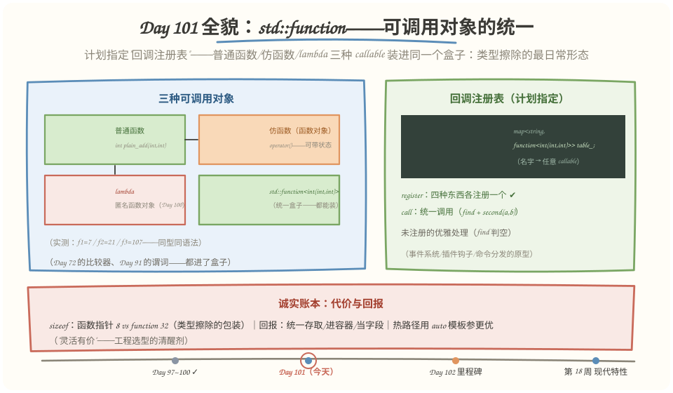
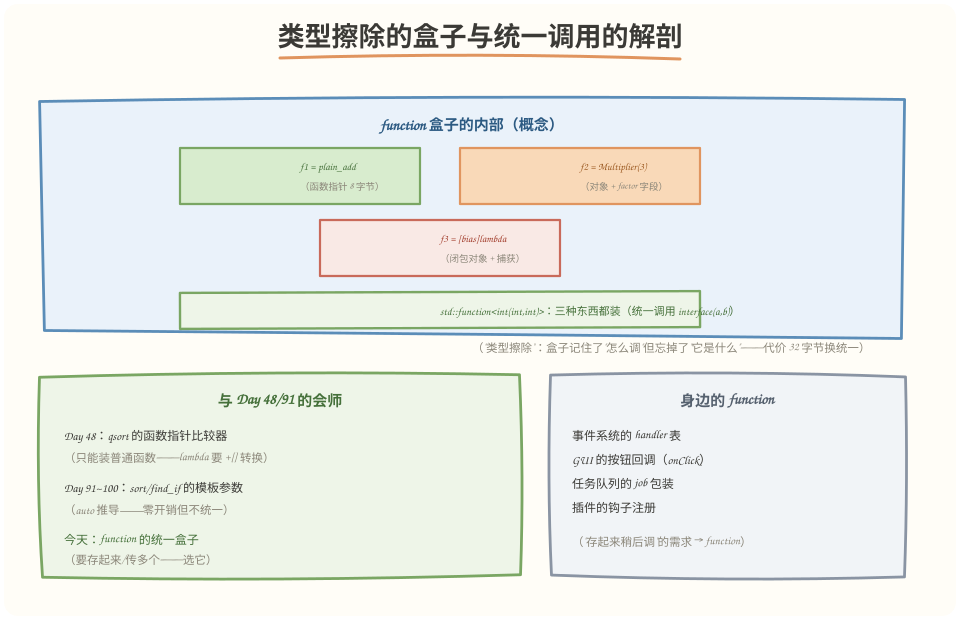
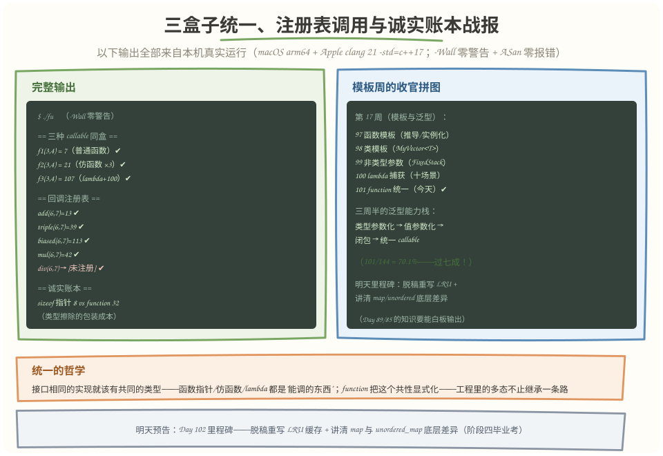

# 第 101 天：std::function 与可调用对象的统一

> **今日目标**：完成本教程后，你能做到：说出三种可调用对象（普通函数/仿函数/lambda）并用同一个 `std::function<int(int,int)>` 装；实现计划指定的**回调注册表**（名字→callable 的 map + 统一调用 + 未注册处理）；背出 function 的代价与回报（sizeof 32 vs 8——类型擦除换统一）；知道选型（存起来稍后调 → function；热路径 → auto 模板参）。
> **预计时间**：学习 20 分钟＋实践 40 分钟
> **前置准备**：完成 Day 97~100（lambda 捕获是今天的原料；模板周收官前站）。
> **今日产出**：三盒子统一实测、回调注册表（五次调用含未注册）、诚实账本。

## 1. 今天解决什么问题？

C++ 里有三种"能调用的东西"：**普通函数**（Day 4 起天天写）、**仿函数**（operator() 的对象——Day 100 揭示 lambda 就是它）、**lambda**（Day 100 全家福）。它们接口相同（都能 `f(a, b)`）但**类型不同**——想存进同一个容器、当同一个字段，就需要 **std::function**：类型擦除的统一盒子。

计划指定的**回调注册表**正是这个需求的原型：事件系统/GUI 回调/任务队列/插件钩子——"名字 → 任意 callable"的 map + 统一调用。今天也是模板周的收官前站（明天里程碑）。

## 2. 先看全貌：今天的内容位于哪里？



**图 1**：左卡蓝是三种可调用对象（汇入统一盒子）；右卡绿是回调注册表（计划指定）；下方红卡是诚实账本。路线图：**101/144 = 70.1%——过七成**。

三步概括今天：

1. 三种 callable 同盒：function\<int(int,int)\> 都能装、同语法调用；
2. 注册表：map\<string, function\> + find + second(a,b)；
3. 代价：32 vs 8 字节（类型擦除）——换统一存取。

## 3. 核心概念：先用直觉，再给准确定义

### 3.1 类型擦除：统一盒子

- **一句通俗解释**：function 是"万能遥控器套壳"——不管底下是电视、空调还是音响（函数/仿函数/lambda），套上壳按键都一样（`f(a,b)`）。
- **一个类比**：万能转接头——USB-C 口（function 类型）能插 U 盘、键盘、显示器（各种 callable）——口统一了、设备随意换。
- **对应到技术上是**：实测——`function<int(int,int)> f1 = plain_add`（函数指针）/ `f2 = Multiplier(3)`（仿函数，带 factor 状态）/ `f3 = [bias](a,b){...}`（lambda，带捕获）——**同一个类型、同语法调用**：7/21/107。**类型擦除的含义**：盒子记住"怎么调"（调用约定）但**忘掉"它是什么"**（原类型信息）——这就是能装一切的原因、也是 32 字节代价的来源。类比的边界：签名要匹配（`int(int,int)` 的盒子装不了 `int(int)` 的东西——转换报错）。
- **常见误解**："function 和 auto 等价"——auto 是**编译期精确类型**（零开销但不统一——每个 lambda 不同型）；function 是**运行期统一壳**（有开销但能同容器）——按需求选。

### 3.2 回调注册表：统一的价值场景

- **一句通俗解释**：`map<string, function<...>>` ——名字到回调的表；call 时 find + 调用——不管注册的是哪种东西。
- **一个类比**：酒店总机——转接"销售部"就拨销售（不管那头是直线、分机还是外线委托——注册时接好线就行）。
- **对应到技术上是**：实测——注册四种（普通函数 add / 仿函数 triple / 带捕获的 biased / 纯 lambda 的 mul），调用 `registry.call("add", 6, 7)` = **13**、triple = **39**、biased = **113**、mul = **42**；未注册的 "div" 优雅处理（find 判空打 `[未注册]`——Day 85 的查询姿势）。**这就是事件系统的原型**：`register_handler("click", callable)` + 事件来时 `call("click", args)`——GUI/游戏/插件的通用骨架。类比的边界：注册表存**副本**（function 拷贝语义）——注册大闭包注意成本；未注册的返回策略（打日志/抛异常/默认值）按业务定。
- **常见误解**："回调只能用函数指针"——函数指针装不了带捕获的 lambda（状态没处放）；function 是完整方案。

### 3.3 诚实账本：代价与选型

- **一句通俗解释**：function 比裸函数指针胖（32 vs 8 字节）且调用多一层间接——灵活有价。
- **一个类比**：集装箱——裸运（函数指针）最快但只能运标准货；装箱（function）什么都能运但箱重算你的。
- **对应到技术上是**：实测——sizeof：函数指针 **8**、function **32**（类型擦除的包装：存储 + 调用间接）。**选型三问**：①要**存起来/进容器/当字段**？→ function（今天的注册表）；②**热路径**（每帧百万次调用）？→ auto + 模板参数（sort 的谓词——编译期单态零间接）；③只是**就地用一次**？→ 直接 lambda（不用命名盒子）。**身边的 function**：事件 handler 表、GUI onClick、任务队列的 job——"存起来稍后调"是它的地盘。类比的边界：32 字节是本机 libc++ 的数——跨实现略不同；间接调用在现代 CPU 的预测器下通常也不算痛——**别过早优化**，先正确再测量。
- **常见误解**："function 有开销所以别用"——开销在多数场景可忽略；统一性带来的架构价值远大——测量说话（Day 108 性能周的老话）。

## 4. 图解核心机制



**图 2**：上半部分蓝卡是 function 盒子的内部（三种东西各带什么 + 统一壳的"怎么调忘掉是什么"）；左下绿卡是与 Day 48/91 的会师（函数指针时代 → 模板参数 → 统一盒子）；右下灰卡是身边的 function。

按图逐步讲：

1. **看三种东西的差异**：f1 是 8 字节指针、f2 是带 factor 的对象、f3 是带 bias 的闭包——**壳统一了它们**；
2. **读类型擦除的注解**：盒子记"怎么调"忘"是什么"——32 字节买的就是这个忘却；
3. **走三天会师**：Day 48 函数指针（只能装函数）→ Day 91 模板参数（零开销不统一）→ 今天 function（统一有价）——三代方案的取舍线；
4. **认身边的案例**：onClick/事件表/任务队列——"存起来稍后调"的地方就该有它。

## 5. 动手实践：完成一个最小可运行例子

### 5.1 准备文件

```bash
cd ai-compiler-roadmap/tutorials/day-101/examples
```

主角：`function_unify.cpp`（三盒子 + 注册表 + 账本）。

### 5.2 编写代码

核心（完整代码见本目录）：

```cpp
int plain_add(int a, int b) { return a + b; }            // 普通函数

struct Multiplier {                                       // 仿函数（带状态）
    int factor;
    int operator()(int a, int b) const { return (a + b) * factor; }
};

// 回调注册表（计划指定）
class CallbackRegistry {
    std::map<std::string, std::function<int(int, int)>> table_;
public:
    void register_cb(const std::string& name, std::function<int(int, int)> cb) {
        table_[name] = std::move(cb);
    }
    int call(const std::string& name, int a, int b) {
        auto it = table_.find(name);                      // Day 85 的查询姿势
        if (it == table_.end()) { /* 未注册处理 */ return 0; }
        return it->second(a, b);                          // 统一调用
    }
};

registry.register_cb("add", plain_add);                   // 三种都注册
registry.register_cb("triple", Multiplier(3));
registry.register_cb("biased", [bias](int a, int b) { return a + b + bias; });
```

### 5.3 运行与观察

```bash
g++ -Wall -std=c++17 function_unify.cpp -o fu && ./fu
```

实际执行结果（本机）：

```text
== 三种可调用对象装进同一个盒子 ==
  f1(3,4) = 7（普通函数）
  f2(3,4) = 21（仿函数 ×3）
  f3(3,4) = 107（lambda +100）
  （三种东西、同一个类型、同一个调用语法）

== 回调注册表（计划指定练习） ==
  call("add", 6, 7)     = 13
  call("triple", 6, 7)  = 39
  call("biased", 6, 7)  = 113
  call("mul", 6, 7)     = 42
  call("div", 6, 7)     →   [未注册：div]

== function 的代价（诚实账本） ==
  sizeof(普通函数指针) = 8
  sizeof(std::function) = 32（更胖——类型擦除的包装）
  （换来的：三种可调用统一存取、能进容器、能当字段）
  （热路径的性能敏感场景：auto + 模板参数更优——进阶）
```

```bash
g++ -Wall -std=c++17 -fsanitize=address function_unify.cpp -o fua && ./fua
```

```text
（ASan 零报错）
```



**图 3**：左上完整输出（三盒/注册表/账本三段）；右侧是模板周收官拼图和过七成宣言；下方橙卡是统一的哲学。

### 5.4 修改一个输入再观察：签名不匹配的执法

把注册表加一个错误签名的注册：`registry.register_cb("bad", [](int a) { return a; })`（单参 lambda 塞 int(int,int) 的盒子）——**编译错**（no viable conversion——function 的签名是硬约束）。换成 `[](int a, int b) -> double { return a / (double)b; }`（返回 double）——也错（返回类型不匹配）。**两错一对**：统一盒子的规矩——签名（参数和返回）必须严丝合缝；"统一"是调用形态的统一不是随便装。

## 6. 常见错误与排查

**错误 1：`no viable conversion`（签名不匹配往盒子里塞）**

- 现象：单参 lambda 赋给 function\<int(int,int)\>；
- 原因：function 的签名是硬约束（参数个数/类型 + 返回类型）；
- 定位：报错指 conversion；
- 修复：改 callable 的签名匹配盒子；或换盒子的签名。

**错误 2：调用了空 function 崩（bad_function_call）**

- 现象：默认构造的 function 直接调用抛 std::bad_function_call；
- 原因：没赋值就调（盒子是空的）；
- 定位：异常的来源行；
- 修复：先判 `if (f)` 再调；或确保赋值路径（注册表用 find 已天然防护）。

**错误 3：注册的回调"失灵"（拷贝语义误会）**

- 现象：注册后修改原对象、回调行为没变；
- 原因：register 时 function 拷贝了 callable（副本）——原对象再改不影响副本；
- 定位：对比注册前后的状态修改；
- 修复：需要共享状态用引用包装（`std::ref`）或指针捕获；或注册后不再改。

## 7. 今日练习

### 必做练习（计划指定：回调注册表）

给注册表加 `unregister(name)`（erase 掉一个）和 `list_all()`（打印全部已注册名字——map 遍历）。完整流程：注册 3 个 → list → 调 2 个 → 注销 1 个 → 再调那个（未注册路径）→ list。预期产出：完整会话的输出。

### 选做挑战

"命令分发器"：把签名换成 `function<void(const std::string& args)>`——注册 help/echo/quit 三个命令，从 cin 读一行分派（`echo hello` → 调 echo 回调）——迷你 shell 的骨架（注册表 + 字符串分派的组合）。

## 8. 今日验收

- [ ] 我的三盒子实测通过（7/21/107——同型同语法）
- [ ] 我的回调注册表五次调用全对（含未注册的优雅处理）
- [ ] 我能背出代价账本（8 vs 32——类型擦除）和选型三问
- [ ] 我实测过签名不匹配的编译执法（5.4 两错一对）
- [ ] 我能说出身边的 function 场景（事件/GUI/任务队列）

## 9. 一句话总结与明天预告

今天的问题是"不同的可调用对象怎么统一存取"；机制上，function 是类型擦除的盒子（记住怎么调忘掉是什么——32 字节买统一）、注册表是它的价值场景（map + find + 统一调用）、选型看"存不存、热不热"；实践上，三盒子、注册表、诚实账本、签名执法全部实测；验证标准是看到任何"回调"需求能选对容器和壳。明天 **Day 102（里程碑）：阶段自测**——脱稿重写 LRU 缓存 + 讲清 map 与 unordered_map 底层差异：**阶段四（STL 与泛型）的毕业考**。
