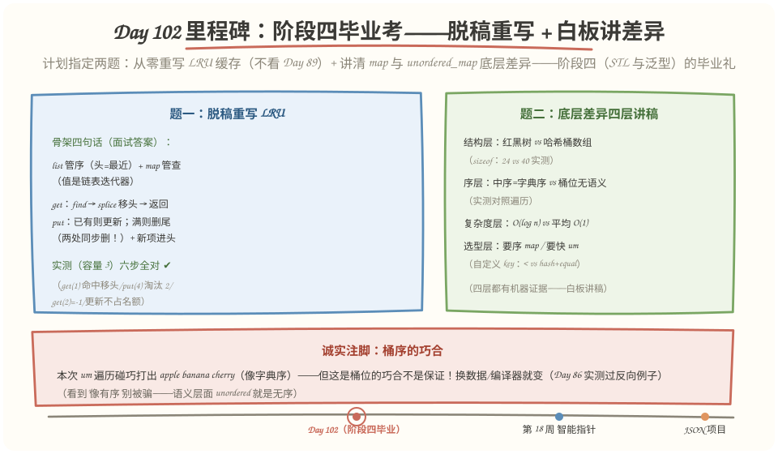
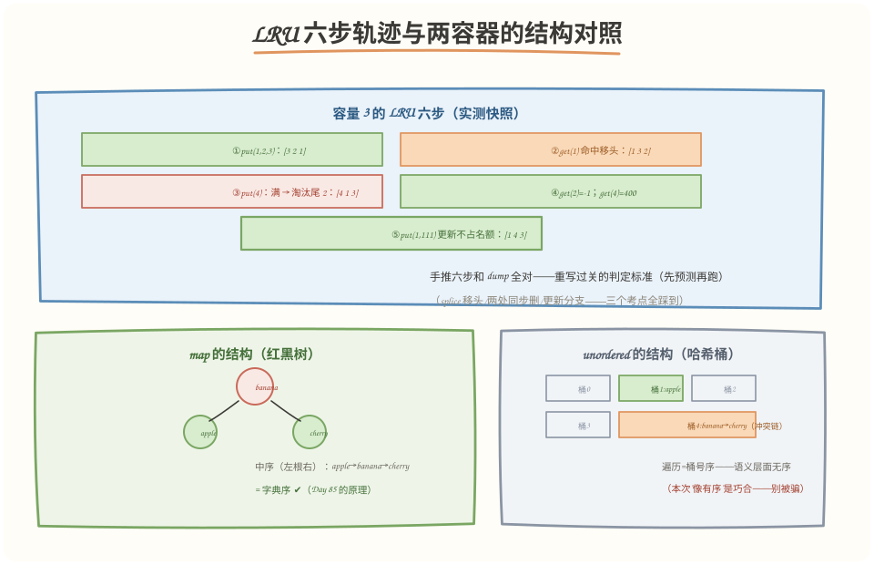
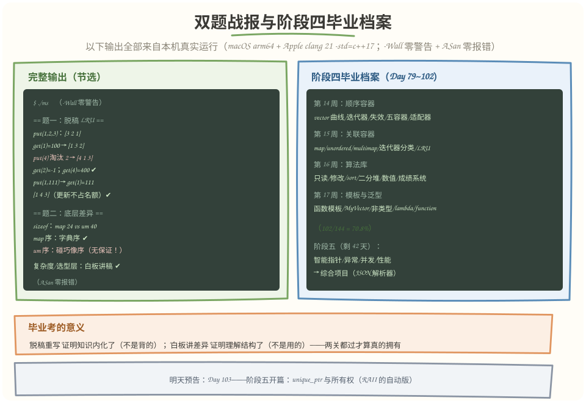

# 第 102 天（里程碑）：阶段自测——脱稿重写 LRU + 讲清底层差异

> **今日目标**：完成本教程后，你能做到：**不看任何参考**从零写出 LRU 缓存（骨架四句话 + 三考点全对 + 六步手推验证）；四层讲清 map 与 unordered_map 的底层差异（结构/序/复杂度/选型——每层配机器证据）；识别"桶序巧合"的陷阱（像有序 ≠ 有保证）。
> **预计时间**：脱稿重写 40 分钟＋讲稿整理 40 分钟
> **前置准备**：完成 Day 79~101（阶段四全部——今天是毕业考）。
> **今日产出**：容量 3 的 LRU 六步全对、四层差异讲稿（sizeof 24 vs 40 等证据）、阶段四毕业档案。

## 1. 今天解决什么问题？

计划指定的**阶段自测**两道题：**从零重写 LRU 缓存**（Day 89 的答案今天必须能默写）+ **讲清 map 与 unordered_map 底层差异**（Day 85/86 的知识要能白板输出）。这是阶段四（STL 与泛型，Day 79~102 共 24 天）的毕业礼——"脱稿重写"证明知识内化（不是背的）、"白板讲差异"证明理解结构（不是只会用）。

自测方法论第三次复用（Day 35/78/102）：**程序化讲稿**——每个论断配机器证据，讲不出的地方就是没吃透的地方。

## 2. 先看全貌：两道题的地图



**图 1**：左卡蓝是题一（LRU 骨架四句话+六步实测）；右卡绿是题二（四层讲稿）；下方红卡是桶序巧合的诚实注脚。

三步概括今天：

1. 题一：list 管序 + map 管查 + 两处同步删 + 更新分支——默写并六步验证；
2. 题二：结构（树 vs 桶）/序（中序 vs 桶位）/复杂度（log n vs 1）/选型（序 vs 快）；
3. 陷阱：桶序碰巧像有序——语义上仍无保证。

## 3. 核心概念：先用直觉，再给准确定义

### 3.1 题一：LRU 的默写三考点

- **一句通俗解释**：写出 LRU 要踩准三个考点——splice 移头（O(1) 纯接线）、淘汰的两处同步（链尾 + map）、更新分支不占名额。
- **一个类比**：默写不是背字——是"骨架长在手上"：四句话（list 管序/map 管查/同步删/更新分支）像公式一样自然流出。
- **对应到技术上是**：实测——容量 3 六步全对：put(1,2,3) 得 `[3 2 1]`；get(1)=100 命中移头 `[1 3 2]`；put(4) 满淘汰 2 `[4 1 3]`；get(2)=**-1**；get(4)=400；put(1,111) 更新不占名额 get(1)=**111**、`[1 4 3]`。**验证法**：每步先手推链表视图再 dump 对照——全对才算重写过关。类比的边界：默写允许卡顿查一次文档——两次以上说明该回 Day 89 补课。
- **常见误解**："重写 = 记住代码"——是记住**骨架**（四句话）和**考点**（三处易错）；代码自己能长出来。

### 3.2 题二：四层差异讲稿

- **一句通俗解释**：讲差异按四层走——结构（是什么）、序（遍历怎样）、复杂度（多快）、选型（什么时候用谁）。
- **一个类比**：介绍两个同事——先说他们部门（结构）、说话风格（序）、干活速度（复杂度）、适合什么项目（选型）——四层齐了才算真了解。
- **对应到技术上是**：实测四层证据——**结构层**：map 是红黑树（节点带三指针）、um 是哈希桶数组（sizeof 24 vs 40）；**序层**：同样按 cherry/apple/banana 插入，map 遍历得 apple banana cherry（**中序=字典序**——Day 85）、um 遍历按桶位；**复杂度层**：map 全操作 O(log n)（树高层层比）、um 平均 O(1)（一次哈希直达桶）最坏 O(n)（全冲突）；**选型层**：要序/范围查询 → map；要快（计数/缓存）→ um；自定义 key：map 只要 `<`、um 要 hash+equal。类比的边界：讲稿是骨架不是逐字稿——自己的话+每层一个例子最好记。
- **常见误解**："背复杂度表就够了"——四层缺一不可（只背 O() 说不清"为什么"——结构层才是根）。

### 3.3 桶序巧合：诚实注脚

- **一句通俗解释**：本次 um 遍历**碰巧**打出字典序（apple banana cherry）——这是桶位的巧合，**不是保证**！
- **一个类比**：抛硬币连出三次正面——不是硬币"会出正面"，是随机撞上了；下次就变。
- **对应到技术上是**：实测——同样的插入序，um 的桶位这次恰好排成字典序（hash 分布的偶然）；对照 Day 86 的实测（cherry banana apple——完全无序）：**同一程序两种"序"**——证明桶序无语义。**为什么强调这个**：看到"像有序"就依赖它是经典 bug（换数据/编译器/加元素就崩给你的逻辑）；语义层面 unordered 就是**无序**——要序必须 map 或显式排序。类比的边界：特定实现的桶数和 hash 是确定的（同一环境跑结果稳定）——但这是实现细节不是语言承诺。
- **常见误解**："实测有序就是有序"——一次实测的巧合不是契约；契约（标准）只说"无特定序"。

## 4. 图解核心机制



**图 2**：上半部分蓝卡是 LRU 容量 3 的六步快照（每步的链表视图）；左下绿卡是 map 的红黑树（中序=字典序）；右下灰卡是 um 的桶地图（含冲突链 + 巧合注脚）。

按图逐步讲：

1. **对着六步走一遍**：每步先遮住结果自己推（头=最近、满删尾、更新不移位）——六步全对即重写过关；
2. **看两棵树的遍历**：map 中序 apple→banana→cherry（左根右的必然）；um 按桶号 0→4 扫（桶 4 的冲突链 banana→cherry）；
3. **读巧合注脚**：本次桶位恰好"看起来有序"——图 1 红卡和 Day 86 的反例共同证明无保证；
4. **连毕业考标准**：两题都能"讲+证"（白板输出 + 机器证据）——阶段四真毕业。

## 5. 动手实践：完成一个最小可运行例子

### 5.1 准备文件

```bash
cd ai-compiler-roadmap/tutorials/day-102/examples
```

主角：`milestone_v4.cpp`（题一重写 + 题二讲稿）。

### 5.2 编写代码

题一的默写骨架（完整代码见本目录——**建议先合上教程自己写一遍再对照**）：

```cpp
class LRUCache {
    int cap_;
    std::list<std::pair<int, int>> items_;                                 // 头=最近
    std::unordered_map<int, std::list<std::pair<int, int>>::iterator> pos_;
public:
    int get(int key) {
        auto it = pos_.find(key);
        if (it == pos_.end()) { return -1; }
        items_.splice(items_.begin(), items_, it->second);                  // 考点①：O(1) 移头
        return it->second->second;
    }
    void put(int key, int value) {
        auto it = pos_.find(key);
        if (it != pos_.end()) { /* 考点③：更新+移头，不占名额 */ }
        if ((int)items_.size() >= cap_) {
            pos_.erase(items_.back().first);                                // 考点②：两处同步删！
            items_.pop_back();
        }
        items_.push_front({key, value});
        pos_[key] = items_.begin();
    }
};
```

### 5.3 运行与观察

```bash
g++ -Wall -std=c++17 milestone_v4.cpp -o ms && ./ms
```

实际执行结果（本机，节选）：

```text
== 讲稿一：脱稿重写 LRU（容量 3） ==
  链表视图：[3 2 1 ]（头=最近）
  get(1) = 100（命中——1 移头）
  链表视图：[1 3 2 ]（头=最近）
  put(4)：淘汰 2
  链表视图：[4 1 3 ]（头=最近）
  get(2) = -1（已淘汰 → -1）
  get(4) = 400（新项在）
  put(1,111)：更新不占名额，get(1) = 111
  链表视图：[1 4 3 ]（头=最近）

== 讲稿二：map 与 unordered_map 的底层差异 ==
结构层：
  map：红黑树（自平衡二叉搜索树）——节点带键值+三指针
  unordered_map：哈希桶数组——键经哈希函数映射到桶
  sizeof(map)=24；sizeof(um)=40
序层：
  同样按 cherry/apple/banana 插入——
  map 遍历：apple banana cherry （字典序=中序遍历）
  um 遍历：apple banana cherry （桶位序——本次碰巧像字典序，但无保证！）
复杂度层：
  map：查找/插入/删除 O(log n)——树高 ~log₂n 层层比
  um：平均 O(1)（一次哈希直达桶）——最坏 O(n)（全冲突）
选型层：
  要有序遍历/范围查询 → map；要快（计数/缓存）→ unordered
  自定义 key：map 只要 operator<；um 还要 hash+equal
```

```bash
g++ -Wall -std=c++17 -fsanitize=address milestone_v4.cpp -o msa && ./msa
```

```text
（ASan 零报错——重写版的正确性盖章）
```



**图 3**：左上完整输出（两题各段）；右侧是**阶段四毕业档案**（四周内容 + 阶段五预告）；下方橙卡是毕业考的意义。

**开发插曲（诚实记录）**：本日代码首版漏了 `#include <map>`（讲稿二的对照容器没编译过）——毕业考也翻车了一次的实录；补上后全绿。这正是"探针先行"的日常。

### 5.4 修改一个输入再观察：换数据破巧合

把讲稿二的插入序换成 `{"zebra",1}, {"mango",2}, {"apple",3}, {"kiwi",4}`（四键）重跑——um 的遍历序**大概率不再是字典序**（桶位重排）；map 依旧稳如字典序。**一破一稳**：桶序巧合的最直接反证——也是"要序靠 map"的最后一次说服。

## 6. 常见错误与排查

**错误 1：重写时忘了淘汰的两处同步**

- 现象：淘汰后偶发崩（悬空迭代器）；
- 原因：只 pop_back 链表、map 里还留着；
- 定位：ASan 的 use-after-free；
- 修复：考点②的两句连写（pos_.erase + pop_back）。

**错误 2：讲差异时只说"一个快一个慢"**

- 现象：追问"为什么快/什么时候不能用快"就卡壳；
- 原因：只背了复杂度层、缺结构/序/选型三层；
- 定位：四层自检（结构？序？复杂度？选型？）；
- 修复：按今天的讲稿结构补全（每层配一个例子）。

**错误 3：看到 um 输出"有序"就依赖它**

- 现象：代码依赖了遍历序、换数据后逻辑崩；
- 原因：把桶位巧合当契约；
- 定位：审计对 um 遍历序的依赖；
- 修复：要序改 map（或收集后排序）；5.4 的换数据实验是警钟。

## 7. 今日练习

### 必做练习（计划指定）

**完整脱稿自测**：合上一切参考，白纸上写 LRU（容量任意）+ 口述四层差异（录音 5 分钟）。写完跑通、讲完回听——卡壳点回对应天补。预期产出：手写代码照片 + 录音自查笔记。

### 选做挑战

"LRU 变体考"：把淘汰策略改成 LFU（最不经常使用——同频回退 LRU）的设计题（不必完整实现）：想清楚"频次存哪、同频怎么破、淘汰怎么找最不频"——这是面试的进阶追问，今天的知识足够推理出方案。

## 8. 今日验收

- [ ] 我脱稿写出了 LRU 且六步手推全对（ASan 零报错）
- [ ] 我能四层讲清 map/unordered 差异（结构/序/复杂度/选型——各有证据）
- [ ] 我识别了桶序巧合的陷阱（本次实测 + 5.4 换数据反证）
- [ ] 我做过完整脱稿自测（手写 + 录音——必做练习）
- [ ] 阶段四的知识清单我能自己列全（四周各主题）

## 9. 一句话总结与下阶段预告

今天的问题是"阶段四的知识是不是真的内化了"；方法上，脱稿重写（骨架+考点）和白板讲差异（四层+证据）是两块试金石，桶序巧合的识别是理解深度的加分项；实践上，六步全对、四层讲稿、换数据反证全部落地；验证标准是任何人问起 LRU 或两容器差异，你能脱稿输出并跑出证据。**阶段四（STL 与泛型）毕业——102/144 天（70.8%），四周 24 天全胜。** 明天进入 **阶段五 · Day 103：unique_ptr 与所有权**——RAII 的自动版：手写了三法则五周的你们，终于等来了"官方代驾"。
