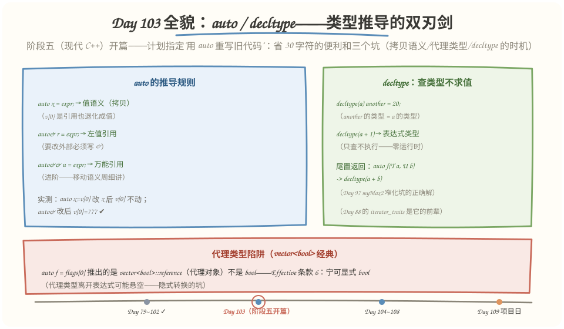
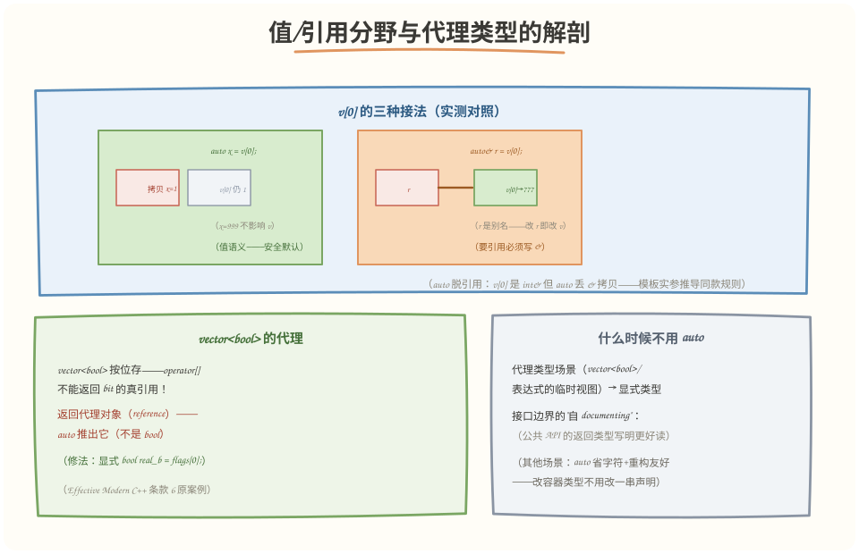
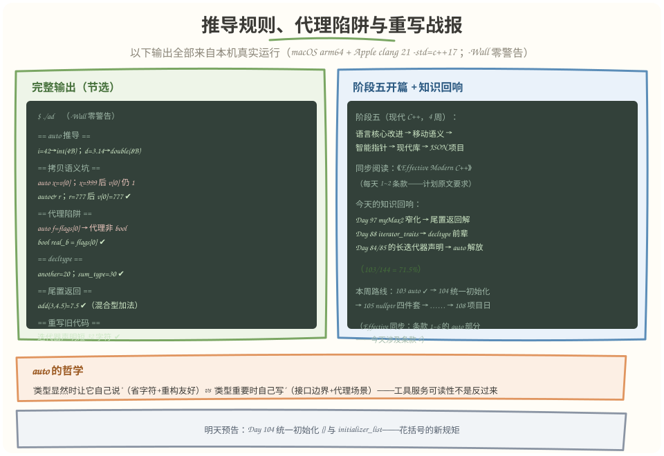

# 第 103 天：auto / decltype——规则与陷阱

> **今日目标**：完成本教程后，你能做到：背出 auto 的三种形态（`auto`=值拷贝 / `auto&`=左值引用 / `auto&&`=万能引用）并实测拷贝语义坑；识别**代理类型陷阱**（vector\<bool\> 的经典案例——Effective 条款 6）；用 decltype 查类型（不求值）和尾置返回（Day 97 窄化坑的正解）；用 auto 重写旧代码（计划指定——迭代器声明的解放）。
> **预计时间**：学习 20 分钟＋实践 40 分钟
> **前置准备**：完成 Day 97~102（模板是推导的语境；阶段四毕业）。
> **今日产出**：推导规则实测、拷贝/代理双坑、decltype 与尾置返回、旧代码重写。

## 1. 今天解决什么问题？

阶段五（现代 C++）开篇。**auto** 从 Day 84 起就零散在用（`auto it = m.begin()`）——今天系统讲：推导规则（值/引用分野）、两个坑（**拷贝语义**——`auto x = v[0]` 是拷贝不是引用；**代理类型**——vector\<bool\> 的经典陷阱，Effective Modern C++ 条款 6 的原案例）、以及**decltype**（查类型不求值）和尾置返回（Day 97 myMax2 窄化坑的正解）。计划指定"**用 auto 重写旧代码**"——把三周来攒的长迭代器声明全部解放。

## 2. 先看全貌：今天的内容位于哪里？



**图 1**：左卡蓝是 auto 的三种形态；右卡绿是 decltype 与尾置返回；下方红卡是代理陷阱。路线图：**103/144 = 71.5%，阶段五开篇**。

三步概括今天：

1. auto = 值拷贝（v[0] 的引用被丢）、auto& 才是别名；
2. 代理陷阱：vector\<bool\> 的 operator[] 返回代理——显式 bool；
3. decltype 查类型 + 尾置返回（auto add(T,U) -> decltype(a+b)）。

## 3. 核心概念：先用直觉，再给准确定义

### 3.1 auto 的值语义：最常见的坑

- **一句通俗解释**：`auto x = expr` 永远是**拷贝**——即使 expr 是引用（引用被剥掉）；要别名必须写 `auto&`。
- **一个类比**：转发邮件——auto 把附件**复制**给你一份（原件不动）；auto& 是把**原邮箱的钥匙**给你（动原件）。
- **对应到技术上是**：实测——`auto x = v[0]; x = 999;` 后 **v[0] 仍 1**（x 是拷贝）；`auto& r = v[0]; r = 777;` 后 **v[0] = 777**（别名）。**规则三条**：`auto`（值——安全默认）、`auto&`（左值引用——要改外部）、`auto&&`（万能引用——转发场景，明天移动语义开讲）。**推导机制**：auto 走模板实参推导同款规则（剥引用剥 const 除非你写回去）——这就是"v[0] 是 int& 但 auto 推出 int"的原因。类比的边界：`const auto&`（只读引用）是遍历大对象的标准姿势（Day 89 起就在用）。
- **常见误解**："auto 会自动选最优类型"——不；auto 只按规则推导（值拷贝）；最优要自己写（& / const&）。

### 3.2 代理类型陷阱：vector\<bool\>

- **一句通俗解释**：vector\<bool\> 按位存——operator[] 没法返回 bit 的真引用，返回的是**代理对象**；auto 推出的是它不是 bool。
- **一个类比**：传话筒——你以为直接拿到了本人（bool），其实拿到的是转述员（代理）——大部分时候话能传到，但转述员下班（表达式结束）后有些事就办不了。
- **对应到技术上是**：实测——`auto f = flags[0]` 推出 `vector<bool>::reference`（代理）；`bool real_b = flags[0]` 显式转换才是真 bool。**为什么危险**：代理对象内部引用着 vector 的内部状态——vector 改动后代理可能悬空（类似 Day 81 的失效问题）。**Effective 条款 6 的建议**：auto 推出代理类型时**宁可显式写类型**（bool）。**其他代理案例**：表达式的临时视图（矩阵的行切片等）——看到"auto 推出的类型有 reference/view 字样"就要警觉。类比的边界：显式类型也不总是安全（代理本身某些操作合法）——理解"我拿到的到底是什么"才是根治。
- **常见误解**："auto f = flags[0] 就是 bool"——是代理；平时打印看不出差别（代理可隐式转 bool），**类型层面已经不同**——`typeid` 能验。

### 3.3 decltype 与尾置返回

- **一句通俗解释**：decltype(expr) 查表达式的**类型**但不执行它（编译期零成本）；配 auto 做**尾置返回**解决"返回类型依赖参数"的题。
- **一个类比**：问路——decltype 问"这条路通向哪（类型）"但不真的走（不求值）。
- **对应到技术上是**：实测——`decltype(a) another = 20;`（another 是 int——a 的类型）；`decltype(a + 1)`（表达式类型 int）。**尾置返回**：`template <typename T, typename U> auto add(T a, U b) -> decltype(a + b)`——**Day 97 myMax2 窄化坑的正解**（返回类型跟随 a+b 的真实类型：add(3, 4.5) 实测 7.5——double 不被截）。**C++14 更简**：`auto add(T a, U b) { return a + b; }`（返回类型自动推导）。**历史回响**：Day 88 的 `iterator_traits` 就是"查类型"的前辈（decltype 是语言级、traits 是库级）。类比的边界：decltype(变量) 和 decltype(表达式) 的规则略异（变量保引用、表达式按值类）——进阶细节，今天会用即可。
- **常见误解**："decltype 会执行表达式"——不执行（`decltype(a++)` 不会自增——纯类型查询）。

## 4. 图解核心机制



**图 2**：上半部分蓝卡是 v[0] 的三种接法对照（auto 拷贝 vs auto& 别名的箭头图）；左下绿卡是 vector\<bool\> 代理的原理（按位存→无真引用→代理对象）；右下灰卡是什么时候不用 auto。

按图逐步讲：

1. **看两种接法的箭头**：auto x 是独立格子（拷贝）、auto& r 是连到 v[0] 的线（别名）——值/引用的几何；
2. **读代理的因果链**：按位存（省内存）→ bit 没地址 → operator[] 返回不了真引用 → 代理对象顶上——每环都合理、合起来是坑；
3. **记不用 auto 的清单**：代理场景（显式 bool）+ 接口边界（自 documenting）——其余场景 auto 更优（省字符+重构友好）；
4. **连 Effective 同步**：计划要求每天读 1~2 条款——今天对应条款 6（auto 与代理）。

## 5. 动手实践：完成一个最小可运行例子

### 5.1 准备文件

```bash
cd ai-compiler-roadmap/tutorials/day-103/examples
```

主角：`auto_decltype.cpp`（规则+双坑+重写）。

### 5.2 编写代码

核心（完整代码见本目录）：

```cpp
std::vector<int> v = {1, 2, 3};
auto x = v[0];                    // 拷贝（v[0] 是 int&，auto 剥引用）
auto& r = v[0];                   // 别名（要改外部必须 &）
const auto& ro = v[1];            // 只读引用（遍历大对象的标准姿势）

std::vector<bool> flags = {true, false, true};
auto f = flags[0];                // 代理类型！（vector<bool>::reference）
bool real_b = flags[0];           // 显式 bool 才是真类型

decltype(a) another = 20;         // 查类型不求值
auto add(T a, U b) -> decltype(a + b);   // 尾置返回（窄化坑正解）

for (auto it = ages.begin(); it != ages.end(); ++it) { … }   // auto 重写（计划指定）
for (auto& [k, v] : ages) { … }                              // 结构化绑定更进一步
```

### 5.3 运行与观察

```bash
g++ -Wall -std=c++17 auto_decltype.cpp -o ad && ./ad
```

实际执行结果（本机，节选）：

```text
== auto 的基本推导 ==
  auto i=42 → int（4 字节）
  auto d=3.14 → double（8 字节）
  auto s="hello" → string（24 字节）

== 最常见的坑：auto 拷贝语义 ==
  auto x = v[0]; x=999 后 v[0] 仍 = 1（x 是拷贝不是引用）
  auto& r = v[0]; r=777 后 v[0] = 777（& 才是引用）
  （规则：auto = 值语义（拷贝）；auto& = 左值引用；auto&& = 万能引用）

== 代理类型陷阱（vector<bool> 经典） ==
  auto f = flags[0]; f = 1（推导出的是代理类型不是 bool！）
  bool real_b = flags[0]; → 真正的 bool
  （Effective Modern C++ 条款 6：auto 推出代理时宁可显式写类型）

== decltype：查类型不求值 ==
  decltype(a) another = 20；decltype(a+1) sum_type = 30
  （decltype 只查类型不执行表达式——零运行时）

== 尾置返回类型（auto + decltype 组合） ==
  add(3, 4.5) = 7.5（3+4.5=7.5——不同类型相加）
  （Day 97 的 myMax2 窄化坑 → 今天 auto 返回的正确解）

== 计划指定：用 auto 重写旧代码 ==
  重写前：std::map<std::string, int>::iterator it = m.begin();
  重写后：auto it = m.begin();（短 30 个字符）
    小明 = 15
    小红 = 14
  结构化绑定（C++17）更进一步：for (auto& [k, v] : m)
    小明 = 15
    小红 = 14
```



**图 3**：左上完整输出（推导/双坑/decltype/重写五段）；右侧是阶段五开篇和知识回响；下方橙卡是 auto 的哲学。

### 5.4 修改一个输入再观察：typeid 验代理

在代理段加 `#include <typeinfo>` 和 `std::cout << typeid(f).name()`——打出 `NSt3__16vectorIbNS_9allocatorIbEEE11referenceE`（libc++ 的代理类型名——带 `reference` 字样）；对照 `typeid(real_b).name()` 是 `b`（bool 的修饰名）。**名字级别的证据**：auto 推出的确实不是 bool——打印值看不出差别但类型早已分叉。这也演示了 typeid 这个"类型透视镜"（排查 auto 推导的日常工具）。

## 6. 常见错误与排查

**错误 1：改了 auto 变量、容器没变（拷贝语义误会）**

- 现象：`auto x = v[0]; x = 999;` 后 v[0] 不动；
- 原因：auto 是值拷贝（引用被剥）；
- 定位：对比修改前后的容器；
- 修复：要改外部写 `auto&`；只读大对象写 `const auto&`。

**错误 2：vector\<bool\> 的 auto 元素行为诡异**

- 现象：存的 auto 变量随 vector 改动"自己变了"或失效；
- 原因：拿到的是代理（引用着 vector 内部）；
- 定位：typeid 看 `reference` 字样；
- 修复：显式 `bool`；或换 vector\<char\>/bitset（真容器）。

**错误 3：decltype(expr) 以为会执行**

- 现象：以为 `decltype(a++)` 会自增；
- 原因：概念误会（decltype 纯类型查询）；
- 定位：打印 a 前后对照（不变）；
- 修复：概念修正——要执行就正常写、要类型才用 decltype。

## 7. 今日练习

### 必做练习（计划指定：用 auto 重写旧代码）

翻出 Day 84（词频）或 Day 90（v2）的代码——把所有显式长类型（`std::map<...>::iterator`、`std::vector<std::pair<...>>::value_type` 等）改 auto；对比重写前后的行数和可读性，记录"哪几处改完更好读、哪几处反而变模糊"到 notes.md。预期产出：重写版 + 两点观察。

### 选做挑战

"代理类型狩猎"：写一个小程序用 typeid 检查三种可疑场景的 auto 推导（vector\<bool\> 的 []、`auto s = std::to_string(42)` 之类正常案例、以及 `auto p = std::make_pair(1, 2.0)` 的 pair 类型）——给每个打出类型名。这是"看清 auto 到底推了什么"的显微镜练习。

## 8. 今日验收

- [ ] 我能背出 auto 三形态（值/左值引用/万能引用）并实测过拷贝坑（999 vs 777）
- [ ] 我能讲出 vector\<bool\> 代理陷阱的因果链（按位存→无真引用→代理）
- [ ] 我会用 decltype 查类型和尾置返回（add(3,4.5)=7.5——窄化正解）
- [ ] 我的旧代码重写完成（迭代器声明解放 + 结构化绑定）
- [ ] 我知道什么时候不用 auto（代理 + 接口边界）

## 9. 一句话总结与明天预告

今天的问题是"auto 便利的背后要防什么"；机制上，auto 是值拷贝语义（引用被剥——要别名写 &）、代理类型是隐形分叉（vector\<bool\> 案例）、decltype 查类型不求值（尾置返回解窄化）；实践上，三形态、双坑、重写、typeid 透视全部落地；验证标准是看到任何 auto 声明能说出"推出来的是什么、是拷贝还是别名"。明天 **Day 104：右值引用与移动语义**——偷资源为什么比抄资源快：Day 79 扩容"搬新家"的进阶版（搬家不用搬家具——连房本一起过户）。
