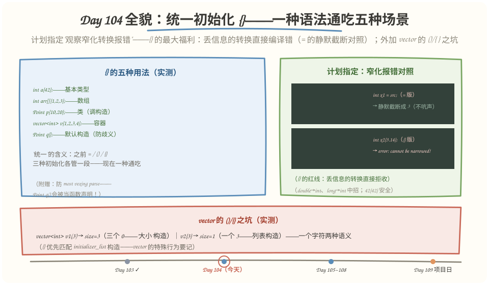
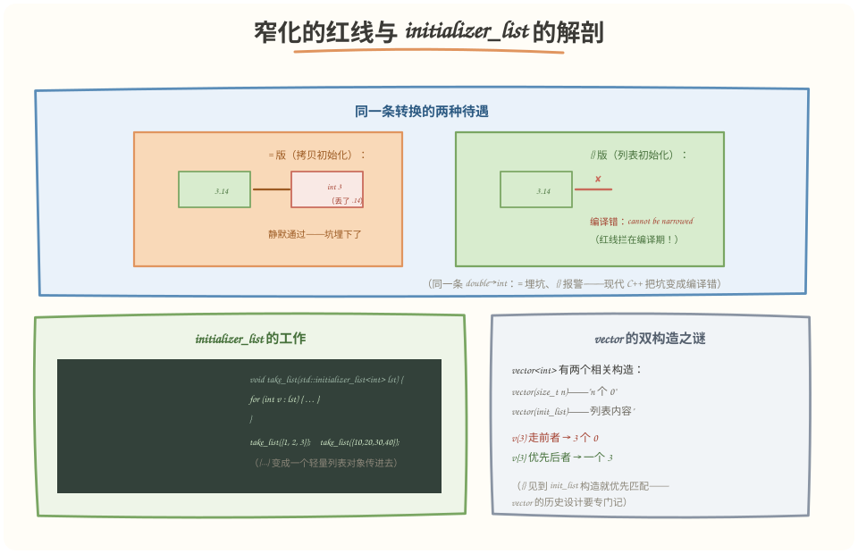
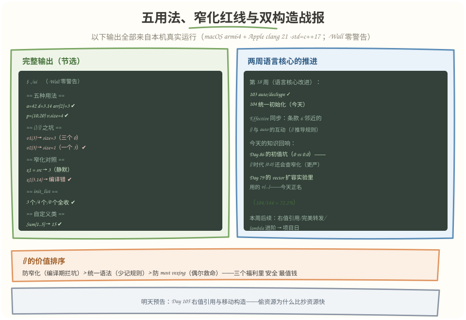

# 第 104 天：统一初始化 {} 与 initializer_list

> **今日目标**：完成本教程后，你能做到：用 `{}` 通吃五种初始化（基本类型/数组/类/容器/默认构造）；观察计划指定的**窄化转换报错**（`int{3.14}` 编译错 vs `int = 3.14` 静默截断的对照）；避开 vector 的 `()`/`{}` 之坑（`v(3)` 三个 0 vs `v{3}` 一个 3）；写收 `initializer_list` 的函数和构造。
> **预计时间**：学习 20 分钟＋实践 40 分钟
> **前置准备**：完成 Day 103（auto——阶段五第一天的语言核心课）。
> **今日产出**：五用法实测、窄化红线执法、双构造坑、init_list 两例。

## 1. 今天解决什么问题？

C++98 的初始化有三种写法（`=`、`()`、聚合的 `{}`）各管一段——C++11 统一成 **`{}`**：一种语法通吃基本类型/数组/类对象/容器/默认构造。更重要的是**安全红利**：`{}` **禁止窄化转换**（`int x{3.14}` 直接编译错——把 Day 86 那种静默截断坑变成编译期拦截）。计划指定的"观察窄化转换报错"正是这个对照。

两个配套坑：vector 的 `()`/`{}` 语义分叉（`v(3)` 是三个 0、`v{3}` 是一个 3）；`Point q()` 的 most vexing parse（被当函数声明——`q{}` 消歧）。

## 2. 先看全貌：今天的内容位于哪里？



**图 1**：左卡蓝是五种用法（一个语法通吃）；右卡绿是计划指定的窄化对照；下方红卡是 vector 双构造坑。

三步概括今天：

1. `{}` 通吃五场景——"统一"的含义；
2. 红线：丢信息的转换直接编译错（= 版静默的对照）；
3. 坑：vector 的 ()/{} 分叉 + most vexing parse。

## 3. 核心概念：先用直觉，再给准确定义

### 3.1 统一初始化：一种语法通吃

- **一句通俗解释**：`{}` 是初始化的万能插座——基本类型、数组、类、容器、默认构造全用它。
- **一个类比**：统一充电口——以前各设备各配线（=、()、{}各一段），现在一根 Type-C 通吃。
- **对应到技术上是**：实测——`int a{42}`、`int arr[]{1,2,3}`、`Point p{10,20}`（调构造）、`vector<int> v{1,2,3,4}`、`Point q{}`（默认构造）——**五种场景一个语法**。**附赠 most vexing parse 的解药**：`Point q();` 被解析成**函数声明**（不是对象——C 的语法遗产）；`Point q{};` 明确是对象（实测 q.x=0 ✔）。类比的边界：`{}` 也有坑（3.2 的 vector 分叉）——统一不等于万能。
- **常见误解**："`{}` 只是另一种写法没新东西"——窄化红线（3.2 的主角）是实打实的安全提升。

### 3.2 窄化红线：编译期拦坑

- **一句通俗解释**：`{}` 拒绝丢信息的转换——`int x{3.14}` 编译错（double→int 丢 .14）；`int x = 3.14` 静默截断成 3（坑埋下）。
- **一个类比**：海关安检——= 版是"睁只眼闭只眼"（货物少了几件也放行）；{} 版是严格申报（缺一件就退回）。
- **对应到技术上是**：实测——`int x1 = src;`（src 是 double 3.14）→ x1 = **3**（静默通过）；`int x2{3.14}` → **error: type 'double' cannot be narrowed to 'int'**（编译错——计划指定的观察对象）。**红线的范围**：double→int、long→int、float→int 这类**丢信息**的都拦；`int ok{42}` 同宽度安全放行。**历史回响**：Day 86 的初值坑（accumulate 初值 0 vs 0.0——int 累加器截断 double）就是窄化的容器版；{} 时代 `{0.0}` 从源头防（类型还是自己要写对）。类比的边界：窄化检查在**列表初始化**语境——普通赋值（x = 3.14）不查（兼容旧代码）；要全程严格靠 -Wconversion 警告。
- **常见误解**："`{}` 让窄化变合法"——恰恰相反：**禁止**；它把静默坑变编译错。

### 3.3 vector 双构造与 initializer_list

- **一句通俗解释**：`vector<int> v(3)` 是"三个 0"、`v{3}` 是"一个 3"——`{}` 见到 initializer_list 构造就优先匹配。
- **一个类比**：同说"3"——(3) 版听成"要 3 间房"（数量）；{3} 版听成"放个 3 进去"（内容）。
- **对应到技术上是**：实测——`v1(3)` → size=**3**（走了 `vector(size_t)` 的"大小"构造）；`v2{3}` → size=**1**（走了 `vector(initializer_list)` 的列表构造——**{} 优先匹配它**）。**initializer_list 的用法**：函数参数 `void take_list(std::initializer_list<int> lst)` 收 `{1,2,3}`（实测 3 个/4 个/0 个全收——for 遍历）；自定义类构造也能收（`Sum s{1,2,3,4,5}` → 15——构造函数里累加）。**为什么 vector 特殊**：它同时有"大小"和"列表"两个构造——{} 的优先规则造成分叉（其他类通常没这烦恼）。类比的边界：要"n 个默认值"就写 `(n)`；要"这些值"就写 `{...}`——**意图选写法**。
- **常见误解**："`{}` 和 `()` 就是风格差异"——vector 上语义不同（size=3 vs size=1 的实测）；团队规范常约定"初始化一律 {}、vector 的定长用 ()"。

## 4. 图解核心机制



**图 2**：上半部分蓝卡是同一条转换的两种待遇（= 版静默通过 vs {} 版编译错——箭头图对照）；左下绿卡是 initializer_list 的工作方式；右下灰卡是 vector 双构造之谜。

按图逐步讲：

1. **看两个箭头的命运**：= 版的 3.14 顺利变成 int 3（丢 .14——静默）；{} 版被 ✘ 拦下（编译错）——**同一条转换的编译期分岔**；
2. **读 init_list 的收货**：`{1,2,3}` 打包成轻量列表对象传入——函数按 size()/遍历消费；
3. **看 vector 的双构造**：`(3)` 匹配"大小"、`{3}` 优先匹配"列表"——一个字符两种语义的历史设计；
4. **连 Day 86 的坑**：初值窄化（int 累加器吃 double）在 {} 时代多一道防线——**编译器替你把关**。

## 5. 动手实践：完成一个最小可运行例子

### 5.1 准备文件

```bash
cd ai-compiler-roadmap/tutorials/day-104/examples
```

主角：`unified_init.cpp`（五用法+窄化+双坑+init_list）。

### 5.2 编写代码

核心（完整代码见本目录）：

```cpp
int a{42};                          // 基本类型
int arr[]{1, 2, 3};                 // 数组
Point p{10, 20};                    // 类（调构造）
std::vector<int> v{1, 2, 3, 4};     // 容器
Point q{};                          // 默认构造（防 most vexing parse）

int x1 = src;                       // = 版：静默截断（3.14 → 3）
// int x2{3.14};                    // {} 版：编译错！cannot be narrowed
int ok{42};                         // 同宽度——安全 ✔

std::vector<int> v1(3);             // 三个 0（"大小"构造）
std::vector<int> v2{3};             // 一个 3（列表构造——{} 优先）

void take_list(std::initializer_list<int> lst) {
    for (int v : lst) { … }         // {1,2,3} 直接传
}
take_list({1, 2, 3});
```

### 5.3 运行与观察

```bash
g++ -Wall -std=c++17 unified_init.cpp -o ui && ./ui
```

实际执行结果（本机，节选）：

```text
== {} 的五种用法（统一初始化） ==
  a=42 d=3.14 arr[2]=3 p=(10,20) v.size=4
  （一个语法 {} 通吃五种场景——"统一"的含义）

== 最想当的解析坑（vector 专属） ==
  vector<int> v1(3) → size = 3（三个 0——"大小"构造）
  vector<int> v2{3} → size = 1（一个 3——列表构造）
  （() 和 {} 语义不同——vector 的历史坑）

== 计划指定：窄化转换报错观察 ==
  int x1 = src;    （允许——隐式截断成 3）
  x1 = 3（赋值初始化不吭声）
  int x2{3.14};    （编译错！{} 禁止窄化）
  （{} 的红线：double→int、long→int 这类丢信息的转换直接拒收）
  int ok{42};      （安全——同宽度不窄化 ✔）

== initializer_list：可变参数的糖 ==
  收到 3 个：1 2 3
  收到 4 个：10 20 30 40
  收到 0 个：
  （{...} 直接传——函数按列表收）

== 自定义类吃 initializer_list ==
  Sum s{1,2,3,4,5} → 15（构造函数收列表——15）

== {} 的保留节目：防 most vexing parse ==
  Point q();   ← 被解析成函数声明！（不是对象）
  Point q{};   ← 确定是对象：q.x = 0, q.y = 0（{} 消歧）
```

**窄化执法**（探针实测）：

```text
/tmp/narrow.cpp:1:20: error: type 'double' cannot be narrowed to 'int' in initializer list
```



**图 3**：左上完整输出（五用法/双构造/窄化/init_list/自定义类各段）；右侧是语言核心周的推进和知识回响；下方橙卡是 {} 的价值排序。

### 5.4 修改一个输入再观察：窄化范围的地毯式测试

写一组探针把六种转换各试一遍 `{}`：`int{3.14}`（double→int ✘）、`int{3L}`（long→int 常量表达式且值装得下——通过；本机 long 实为 64 位、int 32 位，非同宽）、`double{3}`（int→double 放大 ✔ 安全）、`char{'a'}`（同字符 ✔）、`int{char('a')}`（char→int 放大 ✔）、`short{70000}`（int→short 溢出 ✘）。**红线判据**：目标类型**装得下**就放行、装不下（丢信息）就拦——用这组探针感受"编译器怎么判断装不装得下"。

## 6. 常见错误与排查

**错误 1：`error: cannot be narrowed`（{} 初始化混类型）**

- 现象：`int x{3.14}` 或 `short s{70000}` 编译错；
- 原因：{} 禁止丢信息的转换（红线）；
- 定位：报错提 narrowing；
- 修复：确认是否真要截断（要就显式 static_cast 表达意图）；改初值的类型（{3} 或 {3.0} 按需）。

**错误 2：vector 初始化后元素个数和预期不符**

- 现象：想放一个 3 进去结果得到三个 0；
- 原因：写成 `v(3)`（大小构造）而意图是 `v{3}`；
- 定位：打印 size 对照（今天的实测法）；
- 修复：按意图选写法——定长 `(n)`、列举 `{...}`。

**错误 3：`Point q()` 编译过但用不了（most vexing）**

- 现象：q 的"成员调用"报奇怪错误；
- 原因：q 被解析成函数声明不是对象；
- 定位：报错提 cannot call member function 之类；
- 修复：`Point q{}` 或 `Point q`——花括号最稳。

## 7. 今日练习

### 必做练习（计划指定：观察窄化转换报错）

做 5.4 的六探针地毯测试——记录每种转换的放行/拦截和你的预测对照。预期产出：六行对照表（预测 vs 实测）+ 一句"红线判据"的总结。

### 选做挑战

"init_list 聚合器"：写 `class Stats` 收 `initializer_list<double>`——构造时算出 min/max/mean（Day 95 的数值算法 + 今天的 init_list 组合）：`Stats s{85.5, 90.0, 78.5}` 后 s.mean() 等可用。一句话总结 {} 和算法库的组合红利。

## 8. 今日验收

- [ ] 我的五用法全过（基本/数组/类/容器/默认构造——一个语法）
- [ ] 我实测了窄化红线（= 版静默 3 vs {} 版编译错——计划指定）
- [ ] 我实测了 vector 双构造（(3) 三零 vs {3} 一三）
- [ ] 我的 take_list 和 Sum 构造都收 init_list ✔
- [ ] 我知道 most vexing parse 和 {} 的解药

## 9. 一句话总结与明天预告

今天的问题是"初始化怎么统一又安全"；机制上，{} 通吃五种场景（统一）、禁止窄化（编译期拦坑——= 版静默的对照）、优先匹配 init_list 构造（vector 双构造的由来）；实践上，五用法、红线执法、双坑、init_list 全部落地；验证标准是看到任何初始化能说出"{} 行不行、会不会窄化"。明天 **Day 105：nullptr / enum class / using / constexpr——四件套现代化**：NULL/裸 enum/typedef/隐式 const 各换成现代等价物——一次换装四个零件。
